# Action Tree — Regulatory Change Management System

## Mermaid Code

```mermaid
graph TD
    Root["Regulatory Change Management System"]

    Root --> M1["Statutory Regulatory Feeds & Ingestion"]
    Root --> M2["AI Semantic Gap Analysis & Impact Scoring"]
    Root --> M3["Rule-to-Policy Traceability Matrix"]
    Root --> M4["Operational Change Tasking & CAPA Management"]
    Root --> M5["Regulatory Audit Binders & Examination Readiness"]
    Root --> M6["Fine Liability Analytics & Executive Scorecards"]

    M1 --> A11["Subscribe to Global Regulatory Intelligence Feeds (Thomson Reuters API)"]
    M1 --> A12["Ingest Real-Time Statutory Rule Updates, Gazettes & Legal Amendments"]
    M1 --> A13["Filter Regulatory Feeds by Jurisdiction, Business Unit & Industry Sector"]
    M1 --> A14["Classify Statutory Update Severity Levels (Critical, High, Medium, Low)"]

    M2 --> A21["Execute AI NLP Semantic Gap Analysis on Ingested Regulatory Text"]
    M2 --> A22["Compare Statutory Directives against Internal Policy Vector Embeddings"]
    M2 --> A23["Identify Missing Compliance Controls & Un-Mapped Statutory Rules"]
    M2 --> A24["Trigger Automated Policy Revision Workflows in Enterprise Policy System"]

    M3 --> A31["Maintain Bi-Directional Rule-to-Policy Traceability Matrix Links"]
    M3 --> A32["Map Statutory Legal Citations (EU AI Act Art 13) to Policy Paragraphs"]
    M3 --> A33["Map Regulatory Directives to Business Process Hierarchy (SAP Signavio)"]
    M3 --> A34["Audit Traceability Link Integrity & Detect Broken Citation Links"]

    M4 --> A41["Dispatch Operational Change Tasks (CAPA) to Business Unit Process Owners"]
    M4 --> A42["Enforce Implementation Deadlines Scheduled 15 Days Prior to Effective Date"]
    M4 --> A43["Verify Process Owner Implementation Evidence (Release Notes & Screenshots)"]
    M4 --> A44["Escalate Overdue Operational Tasks to Executive Governance Committee"]

    M5 --> A51["Track Regulatory Agency Notice-and-Comment Periods & Public Submissions"]
    M5 --> A52["Compile PDF/A Regulatory Examination Audit Evidence Binders (450 Pages)"]
    M5 --> A53["Attach Verified Operational Control Proofs & Policy Revision Logs"]
    M5 --> A54["Apply Digital Signature Certification & Deliver Binders to Inspectors"]

    M6 --> A61["Calculate Statutory Non-Compliance Fine Liability ($Fine = Turnover * 4%)"]
    M6 --> A62["Benchmark Regulatory Change Implementation Velocity across Business Units"]
    M6 --> A63["Map Enterprise Regulatory Risk Heatmaps & Statutory Exposure Limits"]
    M6 --> A64["Export Executive Regulatory Risk, Readiness & Financial Scorecards"]
```

## Module Description | Mô tả Module

| # | Module | Description | Actions |
|---|--------|-------------|---------|
| 1 | Statutory Regulatory Feeds & Ingestion | Subscribes to global Thomson Reuters feeds, ingests statutory updates and gazettes, filters by jurisdiction, and classifies severity. | Subscribe to Global Regulatory Intelligence Feeds, Ingest Real-Time Statutory Rule Updates, Filter Regulatory Feeds by Jurisdiction & Sector, Classify Statutory Update Severity Levels. |
| 2 | AI Semantic Gap Analysis & Impact Scoring | Runs AI NLP semantic gap analysis comparing legal text against internal policy vector embeddings, flags missing controls, and triggers policy tasks. | Execute AI NLP Semantic Gap Analysis, Compare Statutory Directives against Policy Embeddings, Identify Missing Compliance Controls, Trigger Automated Policy Revision Workflows. |
| 3 | Rule-to-Policy Traceability Matrix | Maintains bi-directional traceability links between legal citations and policy paragraphs, maps to SAP Signavio processes, and audits link integrity. | Maintain Bi-Directional Traceability Matrix Links, Map Legal Citations to Policy Paragraphs, Map Regulatory Directives to Process Hierarchy, Audit Traceability Link Integrity. |
| 4 | Operational Change Tasking & CAPA Management | Dispatches operational change tasks to process owners via CAPA engine, enforces 15-day pre-effective date deadlines, verifies evidence, and escalates overdue tasks. | Dispatch Operational Change Tasks to Process Owners, Enforce Implementation Deadlines 15 Days Pre-Effective Date, Verify Implementation Evidence Logs, Escalate Overdue Tasks to Governance Committee. |
| 5 | Regulatory Audit Binders & Examination Readiness | Tracks agency public comment periods, compiles 450-page PDF/A audit evidence binders, attaches operational proofs, and certifies binders for inspectors. | Track Agency Notice-and-Comment Periods, Compile PDF/A Regulatory Examination Audit Binders, Attach Verified Control Proofs & Revision Logs, Apply Digital Signature Certification. |
| 6 | Fine Liability Analytics & Executive Scorecards | Computes non-compliance fine liabilities (4% turnover), benchmarks implementation velocity across business units, maps risk heatmaps, and exports scorecards. | Calculate Statutory Fine Liability Risks, Benchmark Regulatory Implementation Velocity, Map Enterprise Regulatory Risk Heatmaps, Export Executive Regulatory Scorecards. |
