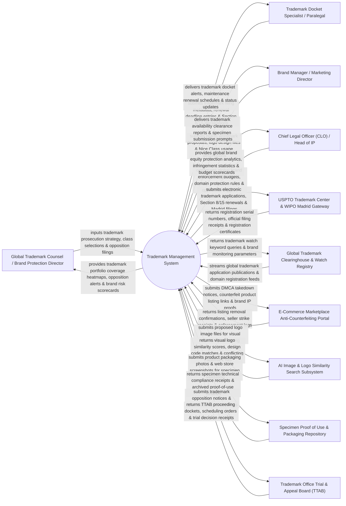

# Context Diagram — Trademark Management System

## Mermaid Code

## Actor & Interaction Table | Bảng Actor & Tương tác

| # | Actor | Actor Type | Data Sent TO System | Data Received FROM System | Notes |
|---|-------|------------|---------------------|---------------------------|-------|
| 1 | Global Trademark Counsel / Brand Protection Director | Primary | Trademark prosecution strategy, Nice Classification goods/services selections, opposition filings, cancellation petitions. | Trademark portfolio coverage heatmaps, opposition watch alerts, brand risk scorecards, registration status notices. | Senior IP counsel managing global trademark prosecution, brand enforcement, and opposition proceedings. |
| 2 | Trademark Docket Specialist / Paralegal | Primary | Trademark filing metadata, renewal deadline entries, Section 8/15 affidavit declarations, fee receipts. | Trademark docket deadline alerts, maintenance renewal schedules (5-6 Yr & 9-10 Yr Rules), filing receipts. | Paralegal managing trademark docketing, statutory renewal deadlines, and specimen submissions. |
| 3 | Brand Manager / Marketing Director | Primary | Proposed brand wordmarks, logo design files (PNG/SVG), Nice Class goods/services descriptions, product launches. | Trademark availability clearance reports, logo similarity search hits, specimen submission prompts. | Marketing lead submitting new brand names and logos for trademark availability screening and filing. |
| 4 | CLO | Primary | Global brand enforcement budgets, domain protection guidelines, opposition escalation thresholds. | Global brand equity protection scorecards, counterfeit infringement statistics, enforcement ROI. | Executive monitoring corporate brand protection, domain portfolio security, and global trademark spend. |
| 5 | USPTO Trademark Center & WIPO Madrid Gateway | Supporting | Trademark registration numbers, official filing receipts, office action notices, registration certificates. | Electronic trademark applications (TEAS), Section 8 & 15 affidavits, WIPO Madrid Protocol international applications. | US and international trademark gateways (USPTO TEAS, WIPO Madrid System) processing trademark applications. |
| 6 | Global Trademark Clearinghouse & Watch Registry | Supporting | Global trademark application publication feeds (USPTO Gazette), domain registration alerts (Whois), watch hits. | Trademark watch keyword queries, brand monitoring parameters, phonetic watch filters. | Watch service monitoring global trademark gazettes and domain registries for confusingly similar marks. |
| 7 | E-Commerce Marketplace Anti-Counterfeiting Portal | Supporting | Counterfeit listing removal confirmations, seller strike receipts, marketplace enforcement logs. | DMCA takedown notices, counterfeit product URL lists, brand IP registration proof certificates. | E-commerce brand protection portals (Amazon Brand Registry, Alibaba IPP) executing counterfeit takedowns. |
| 8 | AI Image & Logo Similarity Search Subsystem | Supporting | Visual logo similarity scores, Vienna/US Design Code matches, conflicting logo search hit reports. | Proposed logo image files (vector/raster), visual feature extraction queries, design class filters. | AI computer vision engine performing visual image search across global trademark logo databases. |
| 9 | Specimen Proof of Use & Packaging Repository | Supporting | Specimen technical compliance receipts, archived proof-of-use image binaries, web store screenshot proofs. | Product packaging photos, point-of-sale labels, digital storefront screenshots, specimen filing logs. | Repository storing evidentiary specimens of use (product packaging, labels) required for trademark registration. |
| 10 | Trademark Office Trial & Appeal Board (TTAB) | Supporting / Regulatory | TTAB proceeding dockets, scheduling orders, trial decision receipts, summary judgment rulings. | Trademark opposition notices, cancellation petitions, TTAB pleading packages, testimony logs. | Administrative law board resolving trademark opposition and cancellation disputes (USPTO TTAB). |

## System Boundary Description | Mô tả Phạm vi Hệ thống

The **Trademark Management System** is an enterprise trademark portfolio, availability clearance, Madrid Protocol international filing, specimen proof of use, global trademark watch, and anti-counterfeiting takedown platform.

**Inside System Scope:**
- Trademark availability clearance searching wordmarks, phonetic similarity, and Nice Classification goods/services classes.
- AI computer vision logo similarity search comparing proposed brand logos against global trademark design registries.
- Integration with USPTO TEAS and WIPO Madrid Protocol APIs for electronic application filings and international extensions.
- Statutory trademark maintenance docketing tracking Section 8 (5-6 Year Use) and Section 9 (10-Year Renewal) filings.
- E-commerce marketplace anti-counterfeiting takedown automation enforcing IP rights on Amazon and Alibaba.

**Outside System Scope:**
- Direct physical seizure of counterfeit goods at customs ports (handled by Customs & Border Protection).
- Direct physical printing of product packaging labels (handled by Packaging Manufacturers).
- Direct physical court representation in federal trademark infringement lawsuits (handled by Litigation Counsel).
