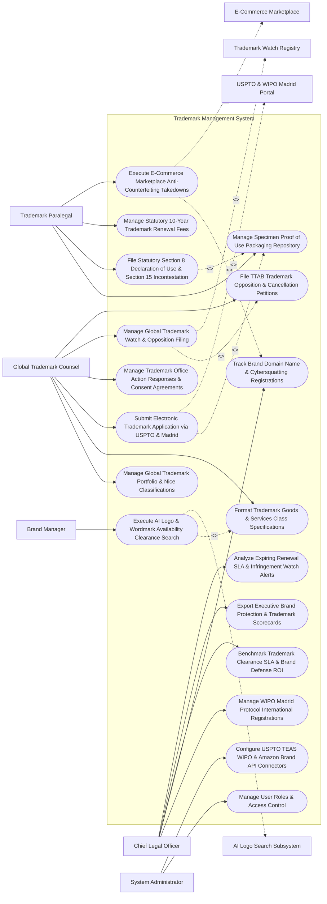

# Use Case Diagram — Trademark Management System

## Mermaid Code

## Actor Table | Bảng Actor

| # | Actor | Actor Type | Role Description | Related Use Cases |
|---|-------|------------|------------------|-------------------|
| 1 | Global Trademark Counsel | Primary | Lead trademark attorney managing portfolio classifications, application filings, office actions, watches, and TTAB oppositions. | UC01, UC04, UC05, UC09, UC10, UC11 |
| 2 | Trademark Paralegal | Primary | Docket paralegal managing proof-of-use specimens, Section 8/15 affidavits, 10-year renewals, and marketplace takedowns. | UC03, UC07, UC08, UC12 |
| 3 | Brand Manager | Primary | Marketing lead submitting proposed brand wordmarks and logos for AI availability clearance screening. | UC02 |
| 4 | Chief Legal Officer | Primary | Executive reviewing Madrid Protocol international strategy, domain protection, brand ROI, and executive scorecards. | UC06, UC13, UC14, UC15, UC18 |
| 5 | System Administrator | Primary | IT admin managing user security roles, USPTO TEAS credentials, and Amazon Brand Registry API keys. | UC16, UC17 |
| 6 | USPTO & WIPO Madrid Portal | System (Secondary) | Government trademark portals processing electronic applications, Section 8 affidavits, and Madrid filings. | UC05 |
| 7 | Trademark Watch Registry | System (Secondary) | Global watch service monitoring trademark gazettes and domain registries for confusingly similar marks. | UC10 |
| 8 | E-Commerce Marketplace | System (Secondary) | Marketplace brand protection portals (Amazon Brand Registry/Alibaba) executing counterfeit listing takedowns. | UC12 |
| 9 | AI Logo Search Subsystem | System (Secondary) | Computer vision engine comparing proposed brand logos against global trademark design registries. | UC02 |

## Use Case Table | Bảng Use Case

| # | UC ID | Use Case Name | Primary Actor | Secondary Actor | Description | Priority |
|---|-------|---------------|---------------|-----------------|-------------|----------|
| 1 | UC01 | Manage Global Trademark Portfolio & Nice Classifications | Counsel | None | Organizes corporate trademarks, wordmarks, logos, and slogans across International Nice Classifications (Classes 1-45). | Critical |
| 2 | UC02 | Execute AI Logo & Wordmark Availability Clearance Search | BrandMgr | AILogo | Performs AI computer vision and phonetic search across global registries to evaluate trademark availability prior to filing. | Critical |
| 3 | UC03 | Manage Specimen Proof of Use Packaging Repository | Paralegal | None | Stores and validates evidentiary specimens of use (product packaging, labels, digital storefront screenshots) for PTO filings. | Critical |
| 4 | UC04 | Format Trademark Goods & Services Class Specifications | Counsel | None | Formats precise descriptions of goods and services according to USPTO and WIPO Acceptable Identification manuals. | High |
| 5 | UC05 | Submit Electronic Trademark Application via USPTO & Madrid | Counsel | USPTOPortal | Assembles electronic trademark application packages (TEAS), transmitting filings to USPTO and WIPO Madrid System. | Critical |
| 6 | UC06 | Manage WIPO Madrid Protocol International Registrations | CLO | None | Manages international trademark registration extensions across target designated contract member countries via WIPO. | Critical |
| 7 | UC07 | File Statutory Section 8 Declaration of Use & Section 15 Incontestation | Paralegal | None | Auto-dockets and files Section 8 Declaration of Use (5-6 Year Rule) and Section 15 Incontestability Status affidavits. | Critical |
| 8 | UC08 | Manage Statutory 10-Year Trademark Renewal Fees | Paralegal | None | Manages 10-year statutory trademark renewal schedules, dispatching renewal instructions and paying maintenance fees. | Critical |
| 9 | UC09 | Manage Trademark Office Action Responses & Consent Agreements | Counsel | None | Parses USPTO trademark office actions (Likelihood of Confusion / Descriptiveness rejections), preparing responses and consent agreements. | Critical |
| 10 | UC10 | Manage Global Trademark Watch & Opposition Filing | Counsel | WatchRegistry | Scrapes global official trademark gazettes, alerting counsel to third-party trademark publications matching corporate brands. | Critical |
| 11 | UC11 | File TTAB Trademark Opposition & Cancellation Petitions | Counsel | None | Manages Trademark Trial and Appeal Board (TTAB) opposition filings and petitions to cancel conflicting third-party marks. | High |
| 12 | UC12 | Execute E-Commerce Marketplace Anti-Counterfeiting Takedowns | Paralegal | Marketplace | Submits automated IP infringement takedown notices to Amazon Brand Registry, eBay, and Alibaba to remove counterfeit listings. | Critical |
| 13 | UC13 | Track Brand Domain Name & Cybersquatting Registrations | CLO | None | Monitors global domain name registries for cybersquatting registrations, initiating UDRP domain recovery complaints. | High |
| 14 | UC14 | Benchmark Trademark Clearance SLA & Brand Defense ROI | CLO | None | Measures average trademark clearance search cycle time, registration success rate %, and anti-counterfeiting ROI. | High |
| 15 | UC15 | Export Executive Brand Protection & Trademark Scorecards | CLO | None | Renders executive scorecards detailing active registered trademarks count, global country coverage %, and takedown volume. | High |
| 16 | UC16 | Manage User Roles & Access Control | Admin | None | Controls user login credentials, RBAC permissions, and confidential brand clearance file authorization limits. | High |
| 17 | UC17 | Configure USPTO TEAS WIPO & Amazon Brand API Connectors | Admin | None | Configures API connection parameters for USPTO TEAS, WIPO e-Madrid, Amazon Brand Registry, and MarkMonitor. | High |
| 18 | UC18 | Analyze Expiring Renewal SLA & Infringement Watch Alerts | CLO | None | Dispatches urgent notifications when a 10-year renewal deadline is within 60 days or a high-risk watch hit is detected. | High |

## Use Case Specification | Đặc tả Use Case

---

### UC02 — Execute AI Logo & Wordmark Availability Clearance Search

| Field | Detail |
|-------|--------|
| **UC ID** | UC02 |
| **Use Case Name** | Execute AI Logo & Wordmark Availability Clearance Search |
| **Actor(s)** | Primary: Brand Manager, Global Trademark Counsel   Secondary: AI Logo Search Subsystem |
| **Description** | Performs AI computer vision logo search and phonetic wordmark search across global trademark databases (USPTO TESS, WIPO Global Brand Database) to evaluate risk of confusion prior to brand launch. |
| **Precondition** | 1. Marketing team proposes a new brand name or logo design.   2. AI computer vision and phonetic search engines are connected. |
| **Main Flow** | 1. Brand Manager opens "Trademark Clearance Search Desk".   2. Brand Manager inputs Proposed Brand Parameters:   &nbsp;&nbsp;&nbsp;&nbsp; a. Proposed Wordmark: `"NEXUS PULSE"`.   &nbsp;&nbsp;&nbsp;&nbsp; b. Proposed Logo Image: `logo_design_v1.svg` (Abstract Wave Design).   &nbsp;&nbsp;&nbsp;&nbsp; c. Target Nice Classification: `Class 9 (Computer Software)` & `Class 42 (Cloud SaaS Services)`.   3. System dispatches search payload to AI Logo Search Subsystem:   &nbsp;&nbsp;&nbsp;&nbsp; a. Phonetic Search Engine: Evaluates sound-alike marks (`"NEXIS"`, `"NEXOS"`, `"PULSZ"`).   &nbsp;&nbsp;&nbsp;&nbsp; b. Visual Computer Vision Engine: Extracts vector feature embeddings, matching design codes (Vienna Code 26.11.12 - Waves).   4. Search Engine returns Conflicting Search Hits:   &nbsp;&nbsp;&nbsp;&nbsp; a. Hit 1 (Exact Word Overlap): `Reg #5,884,120 ("NEXUS CLOUD")` in Class 42 -> `HIGH_CONFUSION_RISK (88%)`.   &nbsp;&nbsp;&nbsp;&nbsp; b. Hit 2 (Visual Logo Match): `Reg #4,120,884 (Wave Logo)` in Class 9 -> `MEDIUM_VISUAL_RISK (65%)`.   5. System computes Trademark Risk Clearance Score: `72 / 100 Risk Score` (`HIGH_RISK_OBSTACLE_DETECTED`).   6. System generates Trademark Clearance Search Report PDF, rendering side-by-side visual comparison matrix.   7. Global Trademark Counsel reviews report, advising marketing to modify brand name to `"NEXUS VECTOR"` to avoid infringement litigation. |
| **Alternative Flow** | **AF1** — Zero Risk Clearance: Search returns zero conflicting marks in Class 9/42; System marks brand as `CLEARED_FOR_FILING`, unlocking UC05 (Submit Electronic Application). |
| **Exception Flow** | **EX1** — Un-Supported Image Format Error: Brand manager uploads 50 MB TIFF image; System prompts user to upload PNG or SVG vector format under 10 MB. |
| **Postcondition** | Phonetic and visual logo searches execute across global databases, conflicting marks and risk scores are identified, and clearance report renders. |
| **Business Rule** | **BR1**: Proposed brand names and logos MUST undergo automated AI availability clearance searches before commercial launch or PTO application filing. |

---

### UC05 — Submit Electronic Trademark Application via USPTO & Madrid

| Field | Detail |
|-------|--------|
| **UC ID** | UC05 |
| **Use Case Name** | Submit Electronic Trademark Application via USPTO & Madrid |
| **Actor(s)** | Primary: Global Trademark Counsel, Trademark Paralegal   Secondary: USPTO & WIPO Madrid Portal (USPTO TEAS / WIPO e-Madrid) |
| **Description** | Assembles electronic trademark application packages, incorporating verified specimens of use, Nice Class descriptions, and fee payments, transmitting filings to the USPTO and WIPO Madrid System. |
| **Precondition** | 1. Trademark availability clearance is approved (UC02).   2. Specimen proof of use (UC03) and Nice Class descriptions (UC04) are finalized.   3. USPTO TEAS / WIPO API credentials are authenticated. |
| **Main Flow** | 1. Counsel opens "Electronic Trademark Application Desk" for Mark `"NEXUS VECTOR"`.   2. System compiles TEAS Standard Application Package:   &nbsp;&nbsp;&nbsp;&nbsp; a. Mark Type: `Standard Character Wordmark ("NEXUS VECTOR")`.   &nbsp;&nbsp;&nbsp;&nbsp; b. Applicant Entity: `Acme Global Inc (Delaware Corporation)`.   &nbsp;&nbsp;&nbsp;&nbsp; c. Class Selection: `Class 9 (Downloadable SaaS Management Software)`.   &nbsp;&nbsp;&nbsp;&nbsp; d. Filing Basis: `Section 1(a) Actual Use` (or `Section 1(b) Intent-to-Use`).   &nbsp;&nbsp;&nbsp;&nbsp; e. Attached Specimen: `Software_Storefront_Screenshot.jpg` (UC03).   3. System dispatches TEAS Pre-Filing Validation Check:   &nbsp;&nbsp;&nbsp;&nbsp; a. Specimen Attachment Check: Verified -> `VALID`.   &nbsp;&nbsp;&nbsp;&nbsp; b. Goods Description Check: Matches USPTO Identification Manual -> `VALID`.   &nbsp;&nbsp;&nbsp;&nbsp; c. Statutory Fee Calculation: `$350.00 per Class` -> `$350.00 Total Fee`.   4. Counsel applies Cryptographic Digital Bar Signature.   5. System dispatches HTTPS REST API payload to USPTO TEAS Gateway API (`POST /api/v1/trademark/submit`).   6. USPTO Gateway accepts filing and returns Official Registration Serial Receipt:   &nbsp;&nbsp;&nbsp;&nbsp; a. USPTO Serial #: `US 98/884,120`.   &nbsp;&nbsp;&nbsp;&nbsp; b. Official Filing Date: `October 30, 2026 at 04:30:00 PM EST`.   7. System initializes WIPO Madrid Protocol Extension Workflow (UC06), prompting counsel to select international target member countries. |
| **Alternative Flow** | **AF1** — Section 1(b) Intent-to-Use Filing: Mark is not yet in commercial use; System files Intent-to-Use application, auto-docketing Statement of Use deadline (6 Months post-Notice of Allowance). |
| **Exception Flow** | **EX1** — Indefinite Goods Description Rejection: USPTO API flags custom goods description `"computer stuff"` as indefinite; System highlights error, requiring counsel to select approved term `"computer software for data analytics"`. |
| **Postcondition** | Trademark application is validated, digitally signed, submitted to USPTO TEAS, official serial number is issued, and Madrid extension initializes. |
| **Business Rule** | **BR1**: Section 1(a) Actual Use trademark applications MUST include verified evidentiary specimens of use demonstrating the mark in commerce. |

---

### UC08 — Manage Statutory 10-Year Trademark Renewal Fees

| Field | Detail |
|-------|--------|
| **UC ID** | UC08 |
| **Use Case Name** | Manage Statutory 10-Year Trademark Renewal Fees |
| **Actor(s)** | Primary: Trademark Paralegal, Global Trademark Counsel   Secondary: USPTO & WIPO Madrid Portal |
| **Description** | Manages 10-year statutory trademark renewal schedules (USPTO Section 9 Renewal, WIPO 10-Year Renewal), tracking statutory renewal windows and dispatching renewal payments to prevent registration expiration. |
| **Precondition** | 1. Granted registered trademarks are cataloged in portfolio (UC01).   2. Statutory registration date and 10-year expiration dates are recorded. |
| **Main Flow** | 1. System runs monthly global trademark renewal evaluation job.   2. System identifies Upcoming 10-Year Renewal Deadlines due in next 12 months:   &nbsp;&nbsp;&nbsp;&nbsp; a. Target Trademark: `Reg #4,884,120 ("ACME GLOBAL")` in Class 9 & Class 42.   &nbsp;&nbsp;&nbsp;&nbsp; b. Original Registration Date: `December 15, 2016`.   &nbsp;&nbsp;&nbsp;&nbsp; c. 10-Year Renewal Window Opens: `December 15, 2025` (1 Year prior to expiration).   &nbsp;&nbsp;&nbsp;&nbsp; d. Statutory Renewal Deadline: `December 15, 2026`.   &nbsp;&nbsp;&nbsp;&nbsp; e. Statutory Grace Period Cap (6 Months with Surcharge): `June 15, 2027`.   3. System dispatches Renewal Notification to Trademark Paralegal: *"RENEWAL REQUIRED: Reg #4,884,120 10-Year Renewal due Dec 15, 2026 (6 Months remaining)."*   4. Paralegal verifies active commercial use, attaches current specimen (UC03), and selects "Execute Combined Section 8 & 9 Renewal Filing".   5. System compiles Combined Section 8 (Declaration of Use) & Section 9 (Application for Renewal) package ($525.00 fee per class).   6. Paralegal signs package and dispatches payload to USPTO TEAS Gateway API.   7. USPTO returns Renewal Confirmation Receipt: `Reg #4,884,120 Renewed through December 15, 2036`.   8. System updates trademark expiration date to 2036 and logs maintenance expenditure ($1,050.00 total). |
| **Alternative Flow** | **AF1** — WIPO Madrid Protocol 10-Year International Renewal: Trademark is registered via WIPO Madrid System; System dispatches e-Renewal payload to WIPO e-Services API, renewing international registration across 15 designated countries. |
| **Exception Flow** | **EX1** — Non-Use Abandonment Notice: Brand manager indicates brand was discontinued 3 years ago; Counsel tags mark as `DO_NOT_RENEW`, allowing registration to expire gracefully and saving renewal fees. |
| **Postcondition** | 10-year renewal deadline is evaluated, combined Section 8 & 9 renewal package is submitted, fee is paid, and registration renews for 10 years. |
| **Business Rule** | **BR1**: Trademark 10-year renewal filings MUST be executed within the 1-year statutory window preceding registration expiration. |

---

### UC10 — Manage Global Trademark Watch & Opposition Filing

| Field | Detail |
|-------|--------|
| **UC ID** | UC10 |
| **Use Case Name** | Manage Global Trademark Watch & Opposition Filing |
| **Actor(s)** | Primary: Global Trademark Counsel, Trademark Paralegal   Secondary: Global Trademark Clearinghouse & Watch Registry |
| **Description** | Scrapes global official trademark gazettes and domain registries, detecting third-party trademark publications matching corporate brands, and managing Trademark Trial and Appeal Board (TTAB) opposition filings. |
| **Precondition** | 1. Active trademark watch rules (keywords, logo designs, Nice classes) are registered (UC01).   2. Global Trademark Watch Registry feed is active. |
| **Main Flow** | 1. System receives weekly trademark publication watch feed from Global Watch Registry.   2. Watch Engine detects Conflicting Published Mark:   &nbsp;&nbsp;&nbsp;&nbsp; a. Published Mark: `"NEXIS VECTOR LOGISTICS"`.   &nbsp;&nbsp;&nbsp;&nbsp; b. Applicant: `Logistics Corp Inc`.   &nbsp;&nbsp;&nbsp;&nbsp; c. Publication Source: `USPTO Official Gazette (Published Oct 20, 2026)`.   &nbsp;&nbsp;&nbsp;&nbsp; d. Target Class: `Class 39 (Transportation & Logistics Services)`.   &nbsp;&nbsp;&nbsp;&nbsp; e. Conflicting Corporate Mark: `Reg #4,884,120 ("NEXUS VECTOR")`.   3. System calculates Statutory 30-Day Opposition Window:   &nbsp;&nbsp;&nbsp;&nbsp; a. Publication Date: `October 20, 2026`.   &nbsp;&nbsp;&nbsp;&nbsp; b. Opposition Period Expiration: `November 19, 2026` (30 Days from publication).   4. System dispatches High-Priority Watch Alert to Global Trademark Counsel.   5. Counsel reviews watch hit, determines high likelihood of confusion, and clicks "Initiate TTAB Opposition Proceeding".   6. System generates Notice of Opposition Draft and Request for Extension of Time to Oppose (Form ESTTA).   7. Counsel signs ESTTA extension request, extending opposition window by 30 days.   8. System logs TTAB Proceeding Docket `#OPP-2026-88412` and initializes UC11 (File TTAB Opposition). |
| **Alternative Flow** | **AF1** — Out-of-Court Settlement & Co-Existence Agreement: Opposing applicant agrees to restrict goods description; Counsel negotiates and executes a Trademark Co-Existence Agreement, withdrawing opposition. |
| **Exception Flow** | **EX1** — Expired Opposition Window Warning: Watch hit is reviewed on Day 32 (Opposition window expired); System alerts counsel that direct TTAB opposition is expired, advising post-grant Petition to Cancel. |
| **Postcondition** | Conflicting published marks are detected in gazette feeds, 30-day opposition deadlines are docketed, and ESTTA extension or TTAB opposition initializes. |
| **Business Rule** | **BR1**: Watch hits matching corporate brands MUST trigger automated notifications within <= 48 hours of official gazette publication. |

---

### UC12 — Execute E-Commerce Marketplace Anti-Counterfeiting Takedowns

| Field | Detail |
|-------|--------|
| **UC ID** | UC12 |
| **Use Case Name** | Execute E-Commerce Marketplace Anti-Counterfeiting Takedowns |
| **Actor(s)** | Primary: Trademark Paralegal, Global Trademark Counsel   Secondary: E-Commerce Marketplace Anti-Counterfeiting Portal (Amazon Brand Registry / Alibaba IPP) |
| **Description** | Submits automated IP infringement takedown notices to e-commerce marketplaces (Amazon, Alibaba, eBay) to remove unauthorized counterfeit product listings violating corporate trademarks. |
| **Precondition** | 1. Corporate registered trademarks are enrolled in Amazon Brand Registry / Alibaba IPP.   2. Counterfeit web scraping crawler identifies infringing product listing URLs. |
| **Main Flow** | 1. System crawler scans Amazon marketplace and detects Infringing Listing:   &nbsp;&nbsp;&nbsp;&nbsp; a. Product Listing Title: `"Cheap Counterfeit Acme Wireless Earbuds"`.   &nbsp;&nbsp;&nbsp;&nbsp; b. Listing ASIN: `B0884120XX`.   &nbsp;&nbsp;&nbsp;&nbsp; c. Seller Name: `Unauthorized Trader Ltd`.   &nbsp;&nbsp;&nbsp;&nbsp; d. Infringement Category: `Unauthorized Trademark Usage & Counterfeit Design`.   2. Paralegal opens "Anti-Counterfeiting Takedown Desk".   3. Paralegal verifies infringement proof, selects Registered Trademark `Reg #4,884,120 ("ACME")`, and clicks "Submit Marketplace Takedown Notice".   4. System dispatches HTTPS REST API payload to Amazon Brand Registry API (`POST /v1/infringement/report`).   5. Amazon API accepts takedown notice, validates trademark registration status, and executes automated listing removal:   &nbsp;&nbsp;&nbsp;&nbsp; a. ASIN `B0884120XX` status -> `REMOVED_FROM_STORE`.   6. Amazon API returns Takedown Confirmation Receipt `#AMZ-TAKE-88412` (Executed in 4.2 Hours).   7. System logs enforcement action in Anti-Counterfeiting Dashboard: `Enforcement Success - 1 Listing Removed | Total YTD: 420 Listings Removed`.   8. System updates Brand Enforcement ROI Scorecard (UC15), calculating estimated prevented revenue loss ($15,000.00). |
| **Alternative Flow** | **AF1** — Counter-Notice Counter-Claim Workflow: Infringing seller files counter-notice claiming legitimate resale; System alerts Counsel, initiating 10-day statutory window to file federal court infringement lawsuit. |
| **Exception Flow** | **EX1** — Marketplace API Rejection: Amazon rejects takedown due to insufficient trademark registration proof; System prompts paralegal to re-attach official USPTO registration certificate PDF. |
| **Postcondition** | IP infringement takedown payload is submitted to e-commerce API, counterfeit product listing is removed within hours, and enforcement logs update. |
| **Business Rule** | **BR1**: Marketplace anti-counterfeiting takedown submissions MUST link to active, verified registered trademark numbers. |
