# Conceptual ERD — Trademark Management System

## Mermaid Code

```mermaid
erDiagram
    USER_ACCOUNT {
        int user_id PK
        string full_name
        string username
        string user_role
        string department_code
        boolean is_active
    }

    TRADEMARK_PORTFOLIO_MASTER {
        int trademark_id PK
        int counsel_user_id FK
        string wordmark_text
        string mark_type_category
        string registration_number
        date filing_date
        date registration_date
        string trademark_status
    }

    AI_CLEARANCE_SEARCH_REPORT {
        int search_id PK
        int trademark_id FK
        string queried_wordmark_text
        int composite_risk_score_1to100
        text conflicting_search_hits_json
        datetime searched_at
    }

    NICE_CLASSIFICATION_SPECIFICATION {
        int spec_id PK
        int trademark_id FK
        int nice_class_number_1to45
        text approved_goods_services_description
    }

    SPECIMEN_PROOF_OF_USE_ITEM {
        int specimen_id PK
        int trademark_id FK
        string specimen_type_category
        string specimen_image_s3_uri
        date first_use_in_commerce_date
        boolean is_pto_accepted
    }

    USPTO_TEAS_APPLICATION_FILING {
        int filing_id PK
        int trademark_id FK
        string uspto_serial_number
        date official_filing_date
        decimal paid_filing_fee_usd
        string filing_basis_type
    }

    SECTION8_DECLARATION_OF_USE {
        int sec8_id PK
        int trademark_id FK
        int paralegal_user_id FK
        date statutory_due_date_5to6year
        boolean is_section15_incontestable
        string sec8_status
    }

    TRADEMARK_RENEWAL_FEE_RECORD {
        int renewal_id PK
        int trademark_id FK
        date statutory_10year_renewal_date
        decimal paid_renewal_fee_usd
        date next_renewal_due_date
        datetime renewed_at
    }

    MADRID_PROTOCOL_INTERNATIONAL_REG {
        int madrid_id PK
        int trademark_id FK
        string wipo_international_reg_number
        text designated_contracting_countries_json
        date international_registration_date
    }

    TRADEMARK_GAZETTE_WATCH_ALERT {
        int alert_id PK
        int trademark_id FK
        string conflicting_published_mark
        string publishing_gazette_source
        date publication_date
        date statutory_30day_opposition_deadline
        string alert_action_status
    }

    MARKETPLACE_TAKEDOWN_NOTICE {
        int takedown_id PK
        int trademark_id FK
        int paralegal_user_id FK
        string marketplace_platform_name
        string infringing_product_asin_url
        string confirmation_receipt_number
        datetime executed_at
    }

    EXECUTIVE_BRAND_PROTECTION_SCORECARD {
        int scorecard_id PK
        int total_registered_trademarks_count
        int active_takedown_enforcements_count
        decimal global_country_coverage_percent
        decimal annual_brand_protection_spend_usd
        date period_quarter
    }

    TRADEMARK_PORTFOLIO_MASTER ||--o| AI_CLEARANCE_SEARCH_REPORT : "cleared in"
    TRADEMARK_PORTFOLIO_MASTER ||--o{ NICE_CLASSIFICATION_SPECIFICATION : "classified in"
    TRADEMARK_PORTFOLIO_MASTER ||--o{ SPECIMEN_PROOF_OF_USE_ITEM : "proven by"
    TRADEMARK_PORTFOLIO_MASTER ||--o| USPTO_TEAS_APPLICATION_FILING : "filed via"
    TRADEMARK_PORTFOLIO_MASTER ||--o| SECTION8_DECLARATION_OF_USE : "declared in"
    TRADEMARK_PORTFOLIO_MASTER ||--o{ TRADEMARK_RENEWAL_FEE_RECORD : "renewed via"
    TRADEMARK_PORTFOLIO_MASTER ||--o| MADRID_PROTOCOL_INTERNATIONAL_REG : "extended via"
    TRADEMARK_PORTFOLIO_MASTER ||--o{ TRADEMARK_GAZETTE_WATCH_ALERT : "monitored in"
    TRADEMARK_PORTFOLIO_MASTER ||--o{ MARKETPLACE_TAKEDOWN_NOTICE : "enforced via"
    USER_ACCOUNT ||--o{ TRADEMARK_PORTFOLIO_MASTER : "manages"
    USER_ACCOUNT ||--o{ SECTION8_DECLARATION_OF_USE : "files"
    USER_ACCOUNT ||--o{ MARKETPLACE_TAKEDOWN_NOTICE : "executes takedowns in"
```

## Entity Description Table | Bảng mô tả Entity

| # | Entity Name | Vietnamese Name | Description | Key Attributes | Main Relationships |
|---|-------------|-----------------|-------------|----------------|-------------------|
| 1 | USER_ACCOUNT | Tài khoản Nguời dùng | System credentials and access roles for global trademark counsel, paralegals, brand managers, and admins. | `user_id`, `username`, `user_role`, `department_code` | Manages `TRADEMARK_PORTFOLIO_MASTER`, files `SECTION8_DECLARATION_OF_USE`, executes takedowns in `MARKETPLACE_TAKEDOWN_NOTICE`. |
| 2 | TRADEMARK_PORTFOLIO_MASTER | Master Asset Trademark Portfolio | Central trademark master record tracking wordmarks, mark types, registration numbers, filing dates, and status. | `trademark_id`, `counsel_user_id`, `wordmark_text`, `mark_type_category`, `registration_number`, `registration_date`, `trademark_status` | Cleared in `AI_CLEARANCE_SEARCH_REPORT`, classified in `NICE_CLASSIFICATION_SPECIFICATION`, proven by `SPECIMEN_PROOF_OF_USE_ITEM`, filed via `USPTO_TEAS_APPLICATION_FILING`, declared in `SECTION8_DECLARATION_OF_USE`, renewed via `TRADEMARK_RENEWAL_FEE_RECORD`, extended via `MADRID_PROTOCOL_INTERNATIONAL_REG`, monitored in `TRADEMARK_GAZETTE_WATCH_ALERT`, enforced via `MARKETPLACE_TAKEDOWN_NOTICE`, managed by `USER_ACCOUNT`. |
| 3 | AI_CLEARANCE_SEARCH_REPORT | Báo cáo AI Clearance Search | Pre-filing AI trademark clearance search log recording queried wordmark text, composite risk scores (1-100), and conflicting search hits JSON. | `search_id`, `trademark_id`, `queried_wordmark_text`, `composite_risk_score_1to100`, `conflicting_search_hits_json`, `searched_at` | Belongs to `TRADEMARK_PORTFOLIO_MASTER`. |
| 4 | NICE_CLASSIFICATION_SPECIFICATION | Specification Phân loại Nice | International Nice Classification specification record tracking class numbers (Classes 1-45) and approved goods/services descriptions. | `spec_id`, `trademark_id`, `nice_class_number_1to45`, `approved_goods_services_description` | Belongs to `TRADEMARK_PORTFOLIO_MASTER`. |
| 5 | SPECIMEN_PROOF_OF_USE_ITEM | Specimen Bằng chứng Sử dụng | Evidentiary specimen proof-of-use record storing specimen type, S3 image URIs, first use dates in commerce, and PTO acceptance status. | `specimen_id`, `trademark_id`, `specimen_type_category`, `specimen_image_s3_uri`, `first_use_in_commerce_date`, `is_pto_accepted` | Belongs to `TRADEMARK_PORTFOLIO_MASTER`. |
| 6 | USPTO_TEAS_APPLICATION_FILING | Package Filing USPTO TEAS | USPTO TEAS electronic filing record tracking serial numbers (`US 98/884,120`), official filing dates, fees paid, and filing basis types. | `filing_id`, `trademark_id`, `uspto_serial_number`, `official_filing_date`, `paid_filing_fee_usd`, `filing_basis_type` | Belongs to `TRADEMARK_PORTFOLIO_MASTER`. |
| 7 | SECTION8_DECLARATION_OF_USE | Tuyên bố Use Section 8 USPTO | Statutory Section 8 Declaration of Use (5-6 Year Rule) and Section 15 Incontestability Status affidavit log. | `sec8_id`, `trademark_id`, `paralegal_user_id`, `statutory_due_date_5to6year`, `is_section15_incontestable`, `sec8_status` | Belongs to `TRADEMARK_PORTFOLIO_MASTER`, filed by `USER_ACCOUNT`. |
| 8 | TRADEMARK_RENEWAL_FEE_RECORD | Bản ghi Phí Renewal Trademark | Statutory 10-year trademark renewal fee log tracking 10-year renewal dates, renewal fees paid USD, next renewal due dates, and renewal timestamps. | `renewal_id`, `trademark_id`, `statutory_10year_renewal_date`, `paid_renewal_fee_usd`, `next_renewal_due_date` | Belongs to `TRADEMARK_PORTFOLIO_MASTER`. |
| 9 | MADRID_PROTOCOL_INTERNATIONAL_REG | Đăng ký Quốc tế Madrid | WIPO Madrid Protocol international registration record tracking international registration numbers, designated contracting countries JSON, and registration dates. | `madrid_id`, `trademark_id`, `wipo_international_reg_number`, `designated_contracting_countries_json`, `international_registration_date` | Belongs to `TRADEMARK_PORTFOLIO_MASTER`. |
| 10 | TRADEMARK_GAZETTE_WATCH_ALERT | Alert Watch Gazette Trademark | Global trademark gazette watch alert log recording conflicting published marks, gazette sources, 30-day opposition deadlines, and action status. | `alert_id`, `trademark_id`, `conflicting_published_mark`, `publishing_gazette_source`, `publication_date`, `statutory_30day_opposition_deadline` | Belongs to `TRADEMARK_PORTFOLIO_MASTER`. |
| 11 | MARKETPLACE_TAKEDOWN_NOTICE | Notification Takedown Marketplace | E-commerce marketplace anti-counterfeiting takedown notice log recording marketplace platforms (Amazon/Alibaba), infringing ASIN URLs, receipt numbers, and execution timestamps. | `takedown_id`, `trademark_id`, `paralegal_user_id`, `marketplace_platform_name`, `infringing_product_asin_url`, `confirmation_receipt_number` | Belongs to `TRADEMARK_PORTFOLIO_MASTER`, executed by `USER_ACCOUNT`. |
| 12 | EXECUTIVE_BRAND_PROTECTION_SCORECARD | Scorecard Executive Brand | Executive brand protection scorecard aggregating total registered trademarks, active takedown enforcements, global country coverage %, and brand protection spend. | `scorecard_id`, `total_registered_trademarks_count`, `active_takedown_enforcements_count`, `global_country_coverage_percent`, `annual_brand_protection_spend_usd` | Standalone executive performance entity. |

## Relationship Description | Mô tả Quan hệ

| # | From Entity | Cardinality | To Entity | Label | Business Explanation |
|---|-------------|-------------|-----------|-------|----------------------|
| 1 | TRADEMARK_PORTFOLIO_MASTER | 1 to 0..1 | AI_CLEARANCE_SEARCH_REPORT | cleared in | A trademark master record is cleared in AI clearance search reports. |
| 2 | TRADEMARK_PORTFOLIO_MASTER | 1 to 1..N | NICE_CLASSIFICATION_SPECIFICATION | classified in | A trademark master record is classified in Nice Classification specifications. |
| 3 | TRADEMARK_PORTFOLIO_MASTER | 1 to 1..N | SPECIMEN_PROOF_OF_USE_ITEM | proven by | A trademark master record is proven by evidentiary specimen proof-of-use items. |
| 4 | TRADEMARK_PORTFOLIO_MASTER | 1 to 0..1 | USPTO_TEAS_APPLICATION_FILING | filed via | A trademark master record is filed via USPTO TEAS application filings. |
| 5 | TRADEMARK_PORTFOLIO_MASTER | 1 to 0..1 | SECTION8_DECLARATION_OF_USE | declared in | A trademark master record is declared in Section 8 Declaration of Use filings. |
| 6 | TRADEMARK_PORTFOLIO_MASTER | 1 to 0..N | TRADEMARK_RENEWAL_FEE_RECORD | renewed via | A trademark master record is renewed via 10-year renewal fee records. |
| 7 | TRADEMARK_PORTFOLIO_MASTER | 1 to 0..1 | MADRID_PROTOCOL_INTERNATIONAL_REG | extended via | A trademark master record is extended via Madrid Protocol international registrations. |
| 8 | TRADEMARK_PORTFOLIO_MASTER | 1 to 0..N | TRADEMARK_GAZETTE_WATCH_ALERT | monitored in | A trademark master record is monitored in gazette watch alerts. |
| 9 | TRADEMARK_PORTFOLIO_MASTER | 1 to 0..N | MARKETPLACE_TAKEDOWN_NOTICE | enforced via | A trademark master record is enforced via marketplace takedown notices. |
| 10 | USER_ACCOUNT | 1 to 0..N | TRADEMARK_PORTFOLIO_MASTER | manages | A global trademark counsel user account manages trademark portfolio master records. |
| 11 | USER_ACCOUNT | 1 to 0..N | SECTION8_DECLARATION_OF_USE | files | A trademark paralegal user account files Section 8 declarations of use. |
| 12 | USER_ACCOUNT | 1 to 0..N | MARKETPLACE_TAKEDOWN_NOTICE | executes takedowns in | A trademark paralegal user account executes marketplace takedown notices. |
