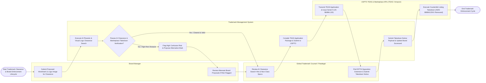

# Swimlane Diagram — Trademark Management System

## Mermaid Code

## Flow Description | Mô tả luồng

| Lane | Actor | Role in Flow |
|------|-------|-------------|
| 1 | Brand Manager | Submits proposed brand wordmarks and vector logo designs for pre-filing clearance screening, reviews risk reports, and selects alternative brand proposals. |
| 2 | Global Trademark Counsel / Paralegal | Evaluates AI phonetic and computer vision logo clearance search hits, formats Nice Class goods descriptions, files ESTTA opposition extensions, and submits marketplace anti-counterfeiting takedown notices. |
| 3 | Trademark Management System | Executes AI computer vision logo searches across global registries, calculates trademark risk scores (0-100), validates evidentiary specimens of use, compiles TEAS application packages, monitors global trademark gazette publications, dispatches takedown API payloads, and computes brand protection scorecards. |
| 4 | USPTO TEAS & Marketplace APIs (TEAS / Amazon) | Ingests electronic TEAS application filings, issues official serial numbers (`US 98/884,120`) and registration certificates, and executes automated counterfeit listing removals on Amazon Brand Registry. |
