# Action Tree — Trademark Management System

## Mermaid Code

```mermaid
graph TD
    Root["Trademark Management System"]

    Root --> M1["AI Clearance Search & Brand Availability"]
    Root --> M2["Nice Classification & Specimen Management"]
    Root --> M3["USPTO TEAS E-Filing & Madrid Protocol"]
    Root --> M4["Statutory Section 8, 15 & 10-Year Renewals"]
    Root --> M5["Global Gazette Watch & TTAB Oppositions"]
    Root --> M6["Marketplace Takedowns & Brand Protection ROI"]

    M1 --> A11["Execute AI Phonetic & Sound-Alike Wordmark Clearance Searches"]
    M1 --> A12["Execute AI Computer Vision Logo Image Searches across Design Registries"]
    M1 --> A13["Calculate Composite Trademark Risk Clearance Scores (Scale 0 to 100)"]
    M1 --> A14["Generate Side-by-Side Visual Logo Comparison Matrix Search Reports"]

    M2 --> A21["Organize Corporate Trademarks across Nice Classifications (Classes 1-45)"]
    M2 --> A22["Format Approved Goods & Services Descriptions using PTO Manuals"]
    M2 --> A23["Store & Validate Evidentiary Specimen Proof of Use Packaging Images"]
    M2 --> A24["Track First-Use-in-Commerce & First-Use-in-Jurisdiction Dates"]

    M3 --> A31["Format Electronic Trademark Application Packages (TEAS Standard)"]
    M3 --> A32["Validate Specimen PDF Images & Goods Description Integrity"]
    M3 --> A33["Transmit Electronic Applications to USPTO TEAS & WIPO e-Madrid APIs"]
    M3 --> A34["Manage International WIPO Madrid Protocol Extension Country Selections"]

    M4 --> A41["Auto-Docket Statutory Section 8 Declaration of Use Deadlines (5-6 Year Rule)"]
    M4 --> A42["File Section 15 Incontestation Affidavits for 5-Year Registered Marks"]
    M4 --> A43["Manage Statutory 10-Year Trademark Renewal Schedules & Maintenance Fees"]
    M4 --> A44["Execute Combined Section 8 & 9 Renewal Filings via USPTO TEAS API"]

    M5 --> A51["Scrape Global Official Trademark Gazettes for Conflicting Publications"]
    M5 --> A52["Calculate Statutory 30-Day Opposition Window Expiration Dates"]
    M5 --> A53["File ESTTA Requests for Extension of Time to Oppose with USPTO TTAB"]
    M5 --> A54["Manage TTAB Opposition Proceedings & Cancellation Petition Filings"]

    M6 --> A61["Submit Automated Anti-Counterfeiting Takedown Notices to Amazon Brand Registry"]
    M6 --> A62["Track Counterfeit Listing Removal Confirmations & Seller Strike Receipts"]
    M6 --> A63["Monitor Brand Domain Name Registrations & Submit UDRP Cybersquatting Complaints"]
    M6 --> A64["Export Executive Brand Protection Scorecards & Anti-Counterfeiting ROI"]
```

## Module Description | Mô tả Module

| # | Module | Description | Actions |
|---|--------|-------------|---------|
| 1 | AI Clearance Search & Brand Availability | Runs AI phonetic wordmark searches, computer vision logo searches across Vienna/US design codes, computes risk scores (0-100), and renders comparison reports. | Execute AI Phonetic Wordmark Searches, Execute AI Computer Vision Logo Searches, Calculate Composite Trademark Risk Scores, Generate Visual Logo Comparison Matrix Reports. |
| 2 | Nice Classification & Specimen Management | Organizes marks across Nice Classes 1-45, formats goods descriptions using PTO manuals, stores specimen proof-of-use photos, and tracks first use dates. | Organize Trademarks across Nice Classifications, Format Approved Goods & Services Descriptions, Store & Validate Specimen Proof of Use Images, Track First-Use-in-Commerce Dates. |
| 3 | USPTO TEAS E-Filing & Madrid Protocol | Builds TEAS Standard packages, validates specimen images/goods descriptions, submits electronic applications to USPTO/WIPO, and manages Madrid country extensions. | Format TEAS Application Packages, Validate Specimen PDF Images & Goods Descriptions, Transmit Applications to USPTO TEAS & WIPO APIs, Manage WIPO Madrid Protocol Country Extensions. |
| 4 | Statutory Section 8, 15 & 10-Year Renewals | Auto-dockets Section 8 (5-6 Year) and Section 15 incontestability affidavits, manages 10-year renewal schedules, and executes combined Section 8 & 9 filings. | Auto-Docket Section 8 Declaration of Use Deadlines, File Section 15 Incontestation Affidavits, Manage 10-Year Trademark Renewal Schedules, Execute Combined Section 8 & 9 Renewal Filings. |
| 5 | Global Gazette Watch & TTAB Oppositions | Scrapes global official trademark gazettes, tracks 30-day opposition deadlines, files ESTTA extension requests, and manages TTAB opposition proceedings. | Scrape Global Official Trademark Gazettes, Calculate 30-Day Opposition Deadlines, File ESTTA Extension Requests with USPTO TTAB, Manage TTAB Opposition & Cancellation Petitions. |
| 6 | Marketplace Takedowns & Brand Protection ROI | Submits automated takedown notices to Amazon Brand Registry/Alibaba, tracks ASIN removals, files UDRP domain complaints, and exports brand protection scorecards. | Submit Takedown Notices to Amazon Brand Registry, Track Counterfeit Listing Removal Confirmations, Monitor Brand Domain Names & Submit UDRP Complaints, Export Executive Brand Protection Scorecards. |
