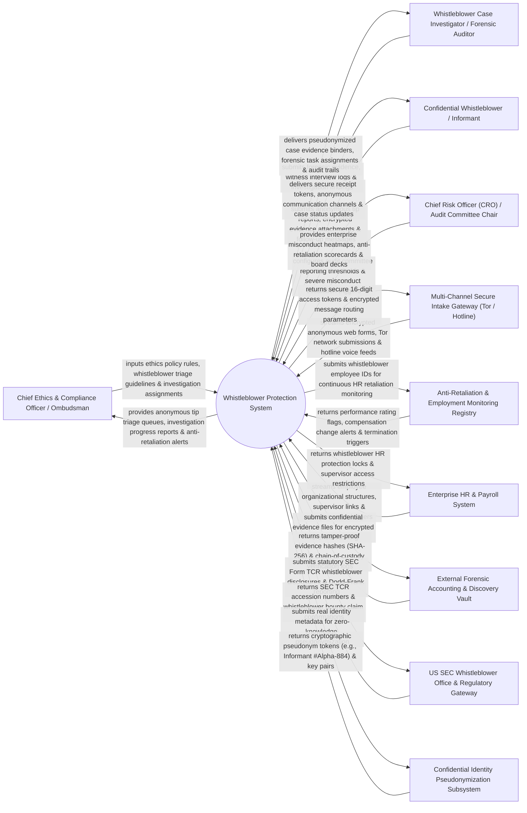

# Context Diagram — Whistleblower Protection System

## Mermaid Code

## Actor & Interaction Table | Bảng Actor & Tương tác

| # | Actor | Actor Type | Data Sent TO System | Data Received FROM System | Notes |
|---|-------|------------|---------------------|---------------------------|-------|
| 1 | Chief Ethics & Compliance Officer / Ombudsman | Primary | Ethics policy rules, whistleblower triage guidelines, investigation assignments, resolution decisions. | Anonymous tip triage queues, investigation progress reports, anti-retaliation alerts, ethics scorecards. | Executive managing corporate ethics hotline, ombudsman governance, and whistleblower protection. |
| 2 | Whistleblower Case Investigator / Forensic Auditor | Primary | Forensic evidence notes, witness interview logs, accounting audit findings, remediation recommendations. | Pseudonymized case evidence binders, forensic task assignments, chain-of-custody audit logs. | Forensic auditor investigating reported misconduct, financial fraud, or harassment allegations. |
| 3 | Confidential Whistleblower / Informant | Primary | Anonymous tip reports, encrypted evidence attachments, follow-up messages, secure 16-digit access tokens. | Secure 16-digit access tokens, anonymous two-way messaging, case status updates, protection notices. | Employee or external party submitting confidential tips regarding financial fraud, safety, or legal breaches. |
| 4 | Chief Risk Officer (CRO) / Audit Committee Chair | Primary | Audit committee reporting thresholds, severe misconduct escalation triggers, board reporting rules. | Misconduct heatmaps, anti-retaliation compliance scorecards, audit committee reporting decks, risk metrics. | Executive evaluating enterprise misconduct trends, audit committee reporting, and retaliation risk. |
| 5 | Multi-Channel Secure Intake Gateway | Supporting | Encrypted web forms, Tor hidden service submissions, 24/7 hotline voice recordings, email tips. | Secure 16-digit access tokens, encrypted message routing parameters, receipt acknowledgments. | Secure intake portal (Tor Network / NAVEX / Convercent API) capturing anonymous tips without IP logging. |
| 6 | Anti-Retaliation & Employment Monitoring Registry | Supporting | Performance appraisal rating changes, compensation adjustment alerts, demotion flags, termination triggers. | Whistleblower employee IDs (encrypted), protection monitoring rules, supervisor isolation parameters. | System monitoring HR records to detect adverse employment actions taken against whistleblowers. |
| 7 | Enterprise HR & Payroll System | Supporting | Employee organizational structures, supervisor hierarchy links, salary ledgers, job performance records. | Whistleblower HR protection locks, supervisor access restrictions, anti-retaliation monitoring flags. | HR system (Workday / SAP SuccessFactors) receiving protection locks to shield whistleblowers from retaliatory firing. |
| 8 | External Forensic Accounting & Document Discovery Vault | Supporting | Tamper-proof evidence hashes (SHA-256), chain-of-custody logs, encrypted evidence file downloads. | Confidential evidence files, forensic interview audio recordings, financial ledger exports. | AES-256 encrypted repository securing digital evidence and maintaining immutable chains of custody. |
| 9 | US SEC Whistleblower Office & Regulatory Compliance Gateway | Supporting / Regulatory | Statutory SEC Form TCR (Tip, Complaint or Referral) filings, Dodd-Frank whistleblower disclosures. | SEC TCR accession numbers, whistleblower bounty claim confirmations, regulatory inquiry letters. | Regulatory body (SEC Office of the Whistleblower / OSHA) receiving statutory whistleblower disclosures. |
| 10 | Confidential Identity Pseudonymization & Encryption Subsystem | Supporting | Cryptographic pseudonym tokens (e.g., `Informant #Alpha-88412`), public key pairs, zero-knowledge proofs. | Real identity metadata (Name, Email, IP Address), encryption keys, identity masking queries. | Subsystem stripping IP addresses and replacing real names with zero-knowledge cryptographic pseudonyms. |

## System Boundary Description | Mô tả Phạm vi Hệ thống

The **Whistleblower Protection System** is an enterprise anonymous reporting, zero-knowledge identity protection, anti-retaliation HR monitoring, forensic investigation, SEC Form TCR filing, and EU Whistleblower Directive compliance platform.

**Inside System Scope:**
- Anonymous multi-channel intake via Tor hidden services, 24/7 hotline, and encrypted web forms with 16-digit access tokens.
- Zero-knowledge identity pseudonymization stripping IP addresses, metadata, and replacing names with cryptographic aliases.
- Anti-retaliation HR monitoring tracking performance reviews, salary changes, and terminations of whistleblowers.
- Immutable chain-of-custody evidence vaulting with SHA-256 cryptographic hashing.
- Compliance with EU Whistleblower Directive 2019/1937 and US Sarbanes-Oxley (SOX) / Dodd-Frank rules.

**Outside System Scope:**
- Direct physical protection of informants from physical threats (handled by Law Enforcement Witness Protection).
- Direct physical forensic search of off-site physical office desks (handled by Physical Security Teams).
- Direct representation in federal court whistleblower retaliation lawsuits (handled by Employment Litigation Counsel).
