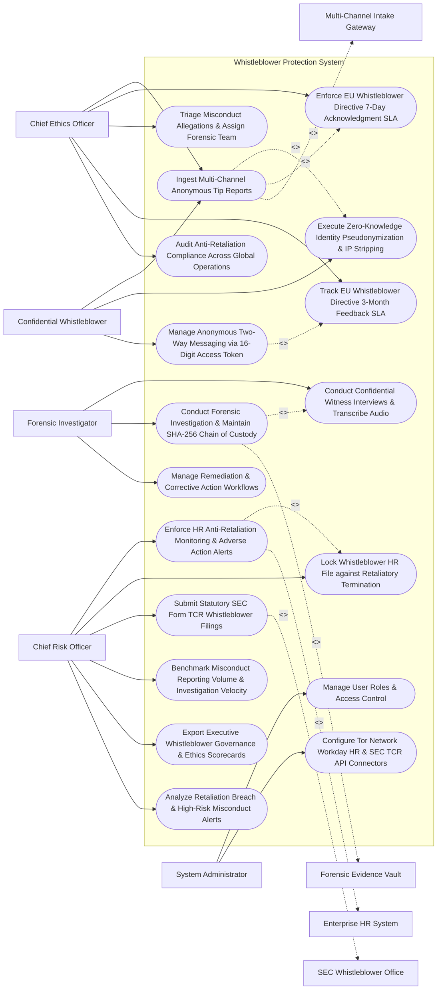

# Use Case Diagram — Whistleblower Protection System

## Mermaid Code

## Actor Table | Bảng Actor

| # | Actor | Actor Type | Role Description | Related Use Cases |
|---|-------|------------|------------------|-------------------|
| 1 | Chief Ethics Officer | Primary | Ombudsman managing anonymous tip ingestion, 7-day acknowledgments, case triage, 3-month feedback SLAs, and anti-retaliation. | UC01, UC03, UC04, UC11, UC13 |
| 2 | Forensic Investigator | Primary | Investigator conducting witness interviews, auditing accounting evidence, maintaining chain of custody, and executing remediation. | UC07, UC08, UC09 |
| 3 | Confidential Whistleblower | Primary | Informant submitting anonymous tips, receiving 16-digit access tokens, and engaging in secure two-way messaging. | UC01, UC02, UC10 |
| 4 | Chief Risk Officer | Primary | Executive monitoring HR anti-retaliation locks, SEC Form TCR filings, investigation velocity, scorecards, and alerts. | UC05, UC06, UC12, UC14, UC15, UC18 |
| 5 | System Administrator | Primary | IT admin managing user security roles, Tor network gateways, Workday HR APIs, and SEC TCR gateways. | UC16, UC17 |
| 6 | Multi-Channel Intake Gateway | System (Secondary) | Intake portal (Tor Network / NAVEX) processing anonymous web tips and 24/7 hotline phone feeds without IP logging. | UC01 |
| 7 | Enterprise HR System | System (Secondary) | Enterprise HR platform (Workday / SAP SuccessFactors) accepting anti-retaliation protection locks and monitoring performance changes. | UC05 |
| 8 | Forensic Evidence Vault | System (Secondary) | Encrypted repository storing evidence files, interview audio, and SHA-256 chain-of-custody hashes. | UC08 |
| 9 | SEC Whistleblower Office | System (Secondary) | Government portal (SEC Office of the Whistleblower) processing Form TCR tips and bounty claims. | UC12 |

## Use Case Table | Bảng Use Case

| # | UC ID | Use Case Name | Primary Actor | Secondary Actor | Description | Priority |
|---|-------|---------------|---------------|-----------------|-------------|----------|
| 1 | UC01 | Ingest Multi-Channel Anonymous Tip Reports | Whistleblower | IntakeGateway | Ingests anonymous misconduct reports via Tor web portal, 24/7 phone hotline, mobile app, or encrypted email. | Critical |
| 2 | UC02 | Execute Zero-Knowledge Identity Pseudonymization & IP Stripping | Whistleblower | None | Strips IP addresses, browser headers, and metadata, assigning cryptographic aliases (e.g., `Informant #Alpha-884`). | Critical |
| 3 | UC03 | Enforce EU Whistleblower Directive 7-Day Acknowledgment SLA | Officer | None | Enforces statutory requirement (EU 2019/1937) to dispatch a formal acknowledgment to the informant within <= 7 days. | Critical |
| 4 | UC04 | Triage Misconduct Allegations & Assign Forensic Team | Officer | None | Triages tips (Financial Fraud, Harassment, Environmental, Safety), assigning independent forensic investigators. | Critical |
| 5 | UC05 | Enforce HR Anti-Retaliation Monitoring & Adverse Action Alerts | CRO | HRSystem | Integrates with Workday HR to continuously monitor whistleblower records, alerting on demotions, pay cuts, or bad reviews. | Critical |
| 6 | UC06 | Lock Whistleblower HR File against Retaliatory Termination | CRO | None | Applies an immutable protection lock on the whistleblower's HR file, requiring Chief Ethics Officer sign-off for any HR changes. | Critical |
| 7 | UC07 | Conduct Confidential Witness Interviews & Transcribe Audio | Investigator | None | Records and transcribes confidential witness interviews, anonymizing voice audio and transcript names. | High |
| 8 | UC08 | Conduct Forensic Investigation & Maintain SHA-256 Chain of Custody | Investigator | ForensicVault | Secures digital evidence in an encrypted vault, calculating SHA-256 hashes to guarantee tamper-proof chains of custody. | Critical |
| 9 | UC09 | Manage Remediation & Corrective Action Workflows | Investigator | None | Tracks corporate remediation tasks (policy updates, executive termination, financial restatement, internal controls). | High |
| 10 | UC10 | Manage Anonymous Two-Way Messaging via 16-Digit Access Token | Whistleblower | None | Enables secure, encrypted two-way messaging between investigator and anonymous informant using a 16-digit access code. | Critical |
| 11 | UC11 | Track EU Whistleblower Directive 3-Month Feedback SLA | Officer | None | Enforces EU Directive 2019/1937 requirement to provide the informant with substantive investigation feedback within <= 3 months. | Critical |
| 12 | UC12 | Submit Statutory SEC Form TCR Whistleblower Filings | CRO | SECOffice | Auto-compiles SEC Form TCR (Tip, Complaint or Referral), submitting electronic filings to the SEC Office of the Whistleblower. | Critical |
| 13 | UC13 | Audit Anti-Retaliation Compliance Across Global Operations | Officer | None | Audits enterprise HR actions to verify zero retaliation occurred against whistleblowers across all global subsidiaries. | High |
| 14 | UC14 | Benchmark Misconduct Reporting Volume & Investigation Velocity | CRO | None | Measures average investigation cycle time (days), tip substantiation rate %, and reporting volume across business units. | High |
| 15 | UC15 | Export Executive Whistleblower Governance & Ethics Scorecards | CRO | None | Renders executive scorecards detailing active tip volume, EU SLA compliance %, anti-retaliation metrics, and SEC filings. | High |
| 16 | UC16 | Manage User Roles & Access Control | Admin | None | Controls user login credentials, strict RBAC permissions, and confidential whistleblower case file access. | High |
| 17 | UC17 | Configure Tor Network Workday HR & SEC TCR API Connectors | Admin | None | Configures API connectors for Tor Hidden Services, Workday HR, NAVEX EthicsPoint, and SEC Form TCR portal. | High |
| 18 | UC18 | Analyze Retaliation Breach & High-Risk Misconduct Alerts | CRO | None | Dispatches urgent alerts when an adverse HR action is taken against a whistleblower or a SOX financial fraud tip is filed. | High |

## Use Case Specification | Đặc tả Use Case

---

### UC02 — Execute Zero-Knowledge Identity Pseudonymization & IP Stripping

| Field | Detail |
|-------|--------|
| **UC ID** | UC02 |
| **Use Case Name** | Execute Zero-Knowledge Identity Pseudonymization & IP Stripping |
| **Actor(s)** | Primary: Confidential Whistleblower   Secondary: Confidential Identity Pseudonymization & Encryption Subsystem |
| **Description** | Automatically strips IP addresses, browser User-Agent strings, and document metadata from incoming tip submissions, assigning zero-knowledge cryptographic aliases (e.g., `Informant #Alpha-88412`) to protect informant identity. |
| **Precondition** | 1. Whistleblower accesses web intake portal or Tor hidden service (UC01).   2. Cryptographic pseudonymization engine and metadata stripper are active. |
| **Main Flow** | 1. Whistleblower accesses intake web portal: `https://ethics.company.com/report`.   2. Whistleblower submits misconduct report alleging accounting fraud and attaches PDF evidence `Financial_Ledger_Export.pdf`.   3. System dispatches file and web payload to Zero-Knowledge Identity Pseudonymization Subsystem.   4. Subsystem executes Identity Protection Pipeline:   &nbsp;&nbsp;&nbsp;&nbsp; a. IP Address Stripping: Overwrites client IP address `198.51.100.42` with `0.0.0.0 (IP_STRIPPED_ANONYMOUS)`.   &nbsp;&nbsp;&nbsp;&nbsp; b. Browser Telemetry Purging: Purges HTTP User-Agent, screen resolution, cookies, and web tracking tokens.   &nbsp;&nbsp;&nbsp;&nbsp; c. Document Metadata Stripping: Removes author name, organization, camera EXIF data, and creation timestamps from attached PDF file.   &nbsp;&nbsp;&nbsp;&nbsp; d. Cryptographic Alias Assignment: Generates unique zero-knowledge alias `Informant #Alpha-88412` using public-key cryptography.   5. System generates Secure 16-Digit Access Token: `8841-2026-9941-0412` (hashed with SHA-256).   6. System presents Access Token to Whistleblower: *"YOUR ANONYMOUS ACCESS CODE IS 8841-2026-9941-0412. Save this code to log in anonymously and communicate with investigators."*   7. System stores pseudonymized tip in encrypted database; System database contains zero traceable PII or IP logs. |
| **Alternative Flow** | **AF1** — Tor Hidden Service Submission: Whistleblower submits tip via Onion network (`.onion` address); System ingests payload via Tor gateway with native Onion routing anonymity. |
| **Exception Flow** | **EX1** — Self-Disclosed Identity Option: Whistleblower voluntarily checks "I want to disclose my identity to Ethics Officer"; System encrypts identity data, restricting access exclusively to Chief Ethics Officer. |
| **Postcondition** | IP addresses and document metadata are stripped, cryptographic alias (`Informant #Alpha-88412`) is assigned, and 16-digit access token renders. |
| **Business Rule** | **BR1**: Anonymous whistleblower tip submissions MUST strip client IP addresses and document EXIF metadata before saving to database. |

---

### UC05 — Enforce HR Anti-Retaliation Monitoring & Adverse Action Alerts

| Field | Detail |
|-------|--------|
| **UC ID** | UC05 |
| **Use Case Name** | Enforce HR Anti-Retaliation Monitoring & Adverse Action Alerts |
| **Actor(s)** | Primary: Chief Risk Officer, Chief Ethics Officer   Secondary: Enterprise HR & Payroll System (Workday / SAP SuccessFactors API) |
| **Description** | Integrates with Workday/SAP HR systems to continuously monitor employment records of identified whistleblowers, firing automated alerts upon detecting demotions, salary cuts, bad reviews, or termination attempts. |
| **Precondition** | 1. Whistleblower's employee ID is registered in Anti-Retaliation Registry (UC06).   2. Workday HR event streaming connector is active. |
| **Main Flow** | 1. Whistleblower John Doe (Employee `#EMP-88412`) files internal compliance tip regarding supervisor financial fraud.   2. System registers Employee `#EMP-88412` in Anti-Retaliation Monitoring Registry.   3. System establishes API Event Stream Listener with Workday HR System (`GET /workday/v1/employee-events/EMP-88412`).   4. Three weeks later, supervisor attempts to execute Adverse HR Action in Workday:   &nbsp;&nbsp;&nbsp;&nbsp; a. HR Action: Performance Rating downgrade from `Exceeds Expectations` to `Unsatisfactory`.   &nbsp;&nbsp;&nbsp;&nbsp; b. Compensation Action: Merit bonus canceled.   &nbsp;&nbsp;&nbsp;&nbsp; c. Termination Action: Termination workflow initiated (`Reason: Performance`).   5. Workday API streams event payload to Anti-Retaliation System.   6. System detects Adverse Action Trigger: `RETALIATION_RISK_DETECTED (Adverse HR Action against Protected Whistleblower EMP-88412)`.   7. System automatically triggers UC06 (Lock Whistleblower HR File), placing an instant API Freeze on Workday termination workflow (`WORKFLOW_FROZEN_BY_COMPLIANCE`).   8. System dispatches High-Priority Retaliation Alert to Chief Risk Officer and Chief Ethics Officer.   9. Chief Ethics Officer conducts retaliation review, reversing performance downgrade and blocking retaliatory firing. |
| **Alternative Flow** | **AF1** — Legitimate Non-Retaliatory HR Action Approval: HR proves demotion was part of pre-existing company-wide layoff planned 6 months prior; Ethics Officer approves exception sign-off. |
| **Exception Flow** | **EX1** — Workday API Sync Disruption: Workday API is offline; System dispatches daily batch file audit, detecting unauthorized HR rating changes within 24 hours. |
| **Postcondition** | Whistleblower HR file is continuously monitored, adverse employment actions trigger immediate alerts, and retaliatory terminations freeze automatically. |
| **Business Rule** | **BR1**: Any adverse HR action (demotion, pay cut, termination) targeting a protected whistleblower MUST automatically freeze pending Chief Ethics Officer review. |

---

### UC08 — Conduct Forensic Investigation & Maintain SHA-256 Chain of Custody

| Field | Detail |
|-------|--------|
| **UC ID** | UC08 |
| **Use Case Name** | Conduct Forensic Investigation & Maintain SHA-256 Chain of Custody |
| **Actor(s)** | Primary: Whistleblower Case Investigator, Forensic Auditor   Secondary: External Forensic Accounting & Document Discovery Vault |
| **Description** | Secures digital accounting evidence, interview transcripts, and bank records in an AES-256 encrypted vault, calculating SHA-256 cryptographic hashes to guarantee tamper-proof chains of custody. |
| **Precondition** | 1. Whistleblower case `#CASE-2026-88412` is assigned to forensic investigator (UC04).   2. Forensic evidence vault and cryptographic hashing engine are active. |
| **Main Flow** | 1. Forensic Investigator opens "Forensic Case Investigation Console" for Case `#CASE-2026-88412`.   2. Investigator uploads Digital Evidence Files:   &nbsp;&nbsp;&nbsp;&nbsp; a. Evidence File 1: `Vendor_Invoice_Ledger_Tampered.xlsx` (Accounting evidence).   &nbsp;&nbsp;&nbsp;&nbsp; b. Evidence File 2: `Witness_Interview_Audio_Anonymized.mp3` (UC07).   &nbsp;&nbsp;&nbsp;&nbsp; c. Evidence File 3: `Email_Export_Supervisor_Instructions.pst`.   3. System dispatches files to External Forensic Vault.   4. Forensic Vault applies AES-256 Encryption & SHA-256 Hashing:   &nbsp;&nbsp;&nbsp;&nbsp; a. Calculates SHA-256 Cryptographic Hash for File 1: `e3b0c44298fc1c149afbf4c8996fb92427ae41e4649b934ca495991b7852b855`.   &nbsp;&nbsp;&nbsp;&nbsp; b. Anchors Hash + Timestamp + Uploading Investigator User ID into Immutable Chain-of-Custody Ledger.   5. System generates Evidence Chain-of-Custody Certificate `#COC-2026-88412`.   6. Whenever an investigator accesses or downloads evidence, System re-calculates SHA-256 hash:   &nbsp;&nbsp;&nbsp;&nbsp; a. Hash Verification: Current Hash matches Original Hash -> `CHAIN_OF_CUSTODY_INTACT`.   7. Investigator compiles Forensic Finding Report, attaching certified evidence binder for Audit Committee review. |
| **Alternative Flow** | **AF1** — Forensic Accounting SAP General Ledger Audit: Investigator queries SAP ERP audit log directly via system; System ingests general ledger transactions, hashing export data. |
| **Exception Flow** | **EX1** — Evidence Hash Mismatch Error: File hash changes due to file corruption or tampering; System flags `EVIDENCE_TAMPERING_ALERT`, locking file and alerting Chief Risk Officer. |
| **Postcondition** | Digital evidence is encrypted, SHA-256 hashes anchor to chain-of-custody ledger, hash integrity verifies upon access, and audit binder generates. |
| **Business Rule** | **BR1**: Digital forensic evidence MUST be hashed with SHA-256 upon ingestion to maintain an immutable chain of custody for regulatory or court proceedings. |

---

### UC10 — Manage Anonymous Two-Way Messaging via 16-Digit Access Token

| Field | Detail |
|-------|--------|
| **UC ID** | UC10 |
| **Use Case Name** | Manage Anonymous Two-Way Messaging via 16-Digit Access Token |
| **Actor(s)** | Primary: Confidential Whistleblower, Whistleblower Case Investigator   Secondary: Multi-Channel Secure Intake Gateway |
| **Description** | Enables end-to-end encrypted, anonymous two-way messaging between the forensic investigator and the informant using a 16-digit access code, allowing clarification questions without compromising identity. |
| **Precondition** | 1. Anonymous tip is submitted and 16-digit access token `8841-2026-9941-0412` is issued (UC02).   2. Investigator requires additional evidence or clarification. |
| **Main Flow** | 1. Investigator opens "Anonymous Communication Console" for Case `#CASE-2026-88412` (`Informant #Alpha-88412`).   2. Investigator posts Clarification Message:   &nbsp;&nbsp;&nbsp;&nbsp; a. Message: *"Thank you for your report. Can you provide the invoice numbers or purchase order details for the fraudulent payments made to Apex Logistics in Q3 2026?"*   3. System encrypts message payload using Informant's Public Key.   4. Whistleblower accesses portal `https://ethics.company.com/status` and enters 16-Digit Access Token `8841-2026-9941-0412`.   5. System authenticates access token (SHA-256 hash match), rendering encrypted message thread.   6. Whistleblower reads message and posts Anonymous Reply:   &nbsp;&nbsp;&nbsp;&nbsp; a. Reply: *"The invoice numbers are INV-99412 and INV-99415 processed on Aug 12. Attached is the wire transfer confirmation PDF."*   &nbsp;&nbsp;&nbsp;&nbsp; b. Attachment: `Wire_Confirmation.pdf` (System auto-strips metadata UC02).   7. System delivers reply to Investigator console and updates EU Directive SLA tracker (UC11). |
| **Alternative Flow** | **AF1** — SMS Anonymous Messaging Gateway: Whistleblower opts for SMS updates via virtual relay number; System routes encrypted SMS text messages without storing informant phone number. |
| **Exception Flow** | **EX1** — Access Token Loss Recovery Failure: Informant loses 16-digit access token; System cannot recover token (zero-knowledge design), requiring informant to submit new tip referencing previous case. |
| **Postcondition** | End-to-end encrypted two-way message exchanges occur between investigator and informant using access tokens, preserving 100% anonymity. |
| **Business Rule** | **BR1**: Communication with anonymous whistleblowers MUST utilize zero-knowledge access tokens, preventing investigators from tracing informant IP addresses or identities. |

---

### UC12 — Submit Statutory SEC Form TCR Whistleblower Filings

| Field | Detail |
|-------|--------|
| **UC ID** | UC12 |
| **Use Case Name** | Submit Statutory SEC Form TCR Whistleblower Filings |
| **Actor(s)** | Primary: Chief Risk Officer, External Privacy Counsel   Secondary: US SEC Whistleblower Office & Regulatory Gateway (SEC Form TCR Portal API) |
| **Description** | Auto-compiles and submits statutory SEC Form TCR (Tip, Complaint or Referral) filings to the US SEC Office of the Whistleblower for SOX financial fraud or securities violations under Dodd-Frank rules. |
| **Precondition** | 1. Investigation confirms material SOX financial fraud, securities manipulation, or FCPA violations (UC08).   2. SEC Form TCR API connector and attorney digital certificates are active. |
| **Main Flow** | 1. Chief Risk Officer and Audit Committee approve voluntary self-disclosure of SOX financial accounting fraud to SEC.   2. CRO opens "SEC Form TCR Regulatory Desk" for Case `#CASE-2026-88412`.   3. System auto-populates SEC Form TCR (Tip, Complaint or Referral):   &nbsp;&nbsp;&nbsp;&nbsp; a. Complainant Information: Pseudonymized or Counsel-Represented Complainant details (Dodd-Frank Rule 21F-9).   &nbsp;&nbsp;&nbsp;&nbsp; b. Entity Subject to Complaint: `Acme Corporation (SEC CIK #0001188412)`.   &nbsp;&nbsp;&nbsp;&nbsp; c. Misconduct Category: `Accounting Fraud / Internal Controls Failure / Revenue Recognition Inflation`.   &nbsp;&nbsp;&nbsp;&nbsp; d. Detailed Misconduct Summary: Auto-populates 5-page executive summary from forensic finding report (UC08).   &nbsp;&nbsp;&nbsp;&nbsp; e. Attached Evidence: `Certified_Forensic_Accounting_Binder.pdf` (SHA-256 Hashed UC08).   4. External Counsel signs Form TCR declaration under penalty of perjury.   5. System transmits HTTPS REST API payload to SEC Whistleblower Office Gateway (`https://www.sec.gov/tcr`).   6. SEC Gateway accepts filing and issues Official Accession Receipt:   &nbsp;&nbsp;&nbsp;&nbsp; a. SEC TCR Accession #: `TCR-2026-88412-001`.   &nbsp;&nbsp;&nbsp;&nbsp; b. Confirmation Timestamp: `October 30, 2026 at 04:30:00 PM EST`.   7. System attaches SEC accession receipt to case file and logs Dodd-Frank whistleblower protection tracking. |
| **Alternative Flow** | **AF1** — Direct SEC Whistleblower Bounty Claim: Informant files Form TCR directly with SEC via counsel; System assists counsel by exporting certified evidence package formatted for SEC submission. |
| **Exception Flow** | **EX1** — SEC Portal Schema Validation Rejection: Attached evidence exceeds SEC 50 MB upload limit; System compresses PDF file and splits exhibits, re-submitting payload to SEC. |
| **Postcondition** | Form TCR is compiled, counsel signs declaration, filing payload transmits to SEC Whistleblower Office, and official TCR accession receipt issues. |
| **Business Rule** | **BR1**: SEC Form TCR filings alleging securities violations MUST incorporate certified forensic evidence binders with SHA-256 chain-of-custody verification. |
