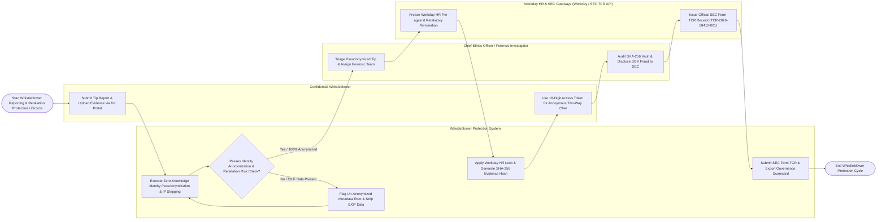

# Swimlane Diagram — Whistleblower Protection System

## Mermaid Code

## Flow Description | Mô tả luồng

| Lane | Actor | Role in Flow |
|------|-------|-------------|
| 1 | Confidential Whistleblower | Submits anonymous tips via Tor hidden services or encrypted web portals, receives 16-digit access tokens, and communicates anonymously with investigators via two-way encrypted chat. |
| 2 | Chief Ethics Officer / Forensic Investigator | Triages pseudonymized tip reports, enforces EU 7-day acknowledgment SLAs, conducts confidential witness interviews, audits SHA-256 forensic evidence chains of custody, and submits SEC Form TCR disclosures. |
| 3 | Whistleblower Protection System | Executes zero-knowledge identity pseudonymization, strips IP addresses and document EXIF metadata, assigns cryptographic aliases (`Informant #Alpha-88412`), applies Workday HR anti-retaliation locks, hashes evidence with SHA-256, tracks EU 3-month feedback SLAs, and exports ethics scorecards. |
| 4 | Workday HR & SEC Gateways (Workday / SEC TCR API) | Freezes Workday HR employee files against retaliatory demotions or terminations, and ingests statutory SEC Form TCR filings, issuing official SEC accession receipts (`TCR-2026-88412-001`). |
