# Action Tree — Whistleblower Protection System

## Mermaid Code

```mermaid
graph TD
    Root["Whistleblower Protection System"]

    Root --> M1["Anonymous Intake & Zero-Knowledge Identity"]
    Root --> M2["Triage & EU Directive Statutory SLA Tracking"]
    Root --> M3["HR Anti-Retaliation Monitoring & HR Lock"]
    Root --> M4["Forensic Investigation & SHA-256 Evidence Vault"]
    Root --> M5["Anonymous Access Token Two-Way Messaging"]
    Root --> M6["SEC Form TCR Filings & Executive Scorecards"]

    M1 --> A11["Ingest Anonymous Misconduct Reports via Tor Portal, Hotline & Encrypted Web"]
    M1 --> A12["Strip Client IP Addresses, Browser User-Agents & Document EXIF Metadata"]
    M1 --> A13["Assign Cryptographic Alias Handles (e.g., Informant #Alpha-88412)"]
    M1 --> A14["Generate Hashed 16-Digit Access Tokens for Anonymous Informant Login"]

    M2 --> A21["Enforce EU Whistleblower Directive 7-Day Acknowledgment SLA (Directive 2019/1937)"]
    M2 --> A22["Triage Misconduct Allegations (Accounting Fraud, Harassment, Safety)"]
    M2 --> A23["Enforce EU Whistleblower Directive 3-Month Substantive Feedback SLA"]
    M2 --> A24["Assign Independent Forensic Accounting Investigators & Legal Leads"]

    M3 --> A31["Integrate with Workday & SAP SuccessFactors HR Event Streams via API"]
    M3 --> A32["Apply Immutable HR File Protection Locks on Registered Whistleblower Profiles"]
    M3 --> A33["Detect Adverse HR Actions (Demotions, Pay Cuts, Bad Reviews, Terminations)"]
    M3 --> A34["Automatically Freeze Workday HR Termination Workflows pending Compliance Sign-Off"]

    M4 --> A41["Vault Digital Accounting Evidence & Transcripts with AES-256 Encryption"]
    M4 --> A42["Calculate Immutable SHA-256 Cryptographic Hashes for Chain-of-Custody Integrity"]
    M4 --> A43["Conduct Confidential Witness Interviews & Transcribe Anonymized Audio"]
    M4 --> A44["Track Corporate Remediation Tasks & Internal Control Correction Workflows"]

    M5 --> A51["Enable End-to-End Encrypted Two-Way Messaging via 16-Digit Access Tokens"]
    M5 --> A52["Encrypt Message Bodies using Informant Public Keys (Zero-Knowledge Design)"]
    M5 --> A53["Allow Anonymous Informants to Upload Supplementary Evidence Attachments"]
    M5 --> A54["Purge Communication Logs upon Case Archive per Statutory Data Retention Limits"]

    M6 --> A61["Auto-Compile SEC Form TCR (Tip, Complaint or Referral) Filings"]
    M6 --> A62["Submit Electronic SEC Form TCR Filings to SEC Office of the Whistleblower API"]
    M6 --> A63["Benchmark Investigation Cycle Time, Substantiation Rates & HR Lock Metrics"]
    M6 --> A64["Export Executive Whistleblower Governance, Anti-Retaliation & Ethics Scorecards"]
```

## Module Description | Mô tả Module

| # | Module | Description | Actions |
|---|--------|-------------|---------|
| 1 | Anonymous Intake & Zero-Knowledge Identity | Ingests tips via Tor/hotline/web, strips IP addresses and document EXIF metadata, assigns cryptographic aliases (`Informant #Alpha-884`), and generates 16-digit access tokens. | Ingest Anonymous Tip Reports, Strip Client IP Addresses & Metadata, Assign Cryptographic Alias Handles, Generate 16-Digit Access Tokens. |
| 2 | Triage & EU Directive Statutory SLA Tracking | Enforces EU Directive 7-day acknowledgment SLAs, triages tips (financial fraud/safety), enforces EU 3-month feedback SLAs, and assigns independent investigators. | Enforce EU Directive 7-Day Acknowledgment SLA, Triage Misconduct Allegations, Enforce EU Directive 3-Month Feedback SLA, Assign Independent Forensic Investigators. |
| 3 | HR Anti-Retaliation Monitoring & HR Lock | Integrates with Workday/SAP HR, applies immutable protection locks on whistleblower profiles, detects adverse actions (demotions/pay cuts), and freezes terminations. | Integrate with Workday/SAP HR Event Streams, Apply Immutable HR File Protection Locks, Detect Adverse HR Actions, Freeze Workday Termination Workflows. |
| 4 | Forensic Investigation & SHA-256 Evidence Vault | Vaults evidence with AES-256 encryption, calculates SHA-256 hashes for chain of custody, transcribes anonymized witness audio, and tracks remediation tasks. | Vault Digital Evidence with AES-256 Encryption, Calculate SHA-256 Hashes for Chain of Custody, Transcribe Anonymized Witness Audio, Track Corporate Remediation Tasks. |
| 5 | Anonymous Access Token Two-Way Messaging | Enables end-to-end encrypted two-way chat via 16-digit access tokens, encrypts message bodies with public keys, allows attachment uploads, and purges logs per retention limits. | Enable Encrypted Two-Way Messaging via Access Tokens, Encrypt Message Bodies with Public Keys, Allow Supplementary Evidence Uploads, Purge Communication Logs upon Archive. |
| 6 | SEC Form TCR Filings & Executive Scorecards | Auto-compiles SEC Form TCR filings, submits disclosures to SEC Whistleblower Office API, benchmarks investigation cycle time, and exports ethics scorecards. | Auto-Compile SEC Form TCR Filings, Submit Electronic Filings to SEC Whistleblower API, Benchmark Investigation Cycle Time & Substantiation Rates, Export Executive Whistleblower Governance Scorecards. |
