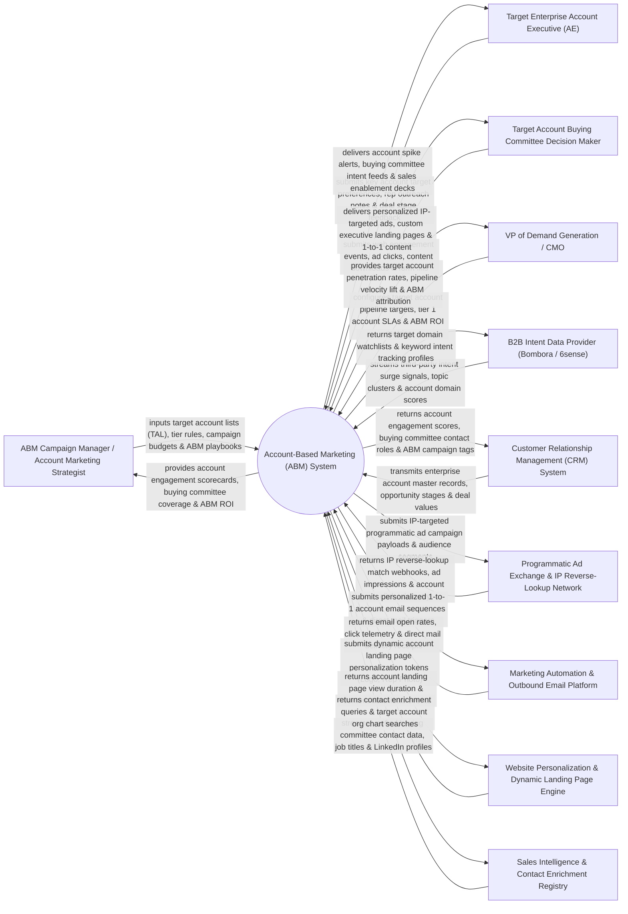

# Context Diagram — Account-Based Marketing (ABM) System

## Mermaid Code

## Actor & Interaction Table | Bảng Actor & Tương tác

| # | Actor | Actor Type | Data Sent TO System | Data Received FROM System | Notes |
|---|-------|------------|---------------------|---------------------------|-------|
| 1 | ABM Campaign Manager / Account Marketing Strategist | Primary | Target Account Lists (TAL), account tiering rules (Tier 1 1-to-1, Tier 2 1-to-Few, Tier 3 1-to-Many), ABM campaign budgets, content playbooks. | Account engagement scorecards, buying committee coverage heatmaps, ABM campaign ROI, account penetration reports. | ABM marketer orchestrating multi-channel campaigns targeting high-value enterprise accounts. |
| 2 | Target Enterprise Account Executive (AE) | Primary | Key account target selections, manual outreach notes, deal stage feedback, rep availability. | Real-time account surge alerts, buying committee intent feeds, sales enablement decks, account engagement scorecards. | Enterprise AE receiving real-time intent alerts when target accounts research product topics. |
| 3 | Target Account Buying Committee Decision Maker | Primary | Corporate IP web browsing events, display ad clicks, executive whitepaper downloads, form submissions. | Personalized IP-targeted display ads, custom 1-to-1 executive landing pages, tailored case studies. | Executive buyer or IT decision maker at target enterprise accounts interacting with ABM touchpoints. |
| 4 | VP of Demand Generation / CMO | Primary | Target account pipeline targets, Tier 1 account SLA limits, ABM revenue attribution rules. | Target account penetration rates, pipeline velocity lift, ABM revenue attribution scorecards, account LTV lift. | Executive evaluating ABM strategy, target account pipeline influence, and enterprise marketing ROI. |
| 5 | B2B Intent Data Provider | Supporting | Third-party intent surge signals (Bombora Company Surge / 6sense), topic clusters, intent score changes. | Target domain watchlists, keyword intent tracking profiles, topic monitoring queries. | Intent data service monitoring off-site B2B research activity across business publications. |
| 6 | Customer Relationship Management (CRM) System | Supporting | Enterprise account master records, opportunity stages, deal values, account owner assignments. | Account engagement scores, buying committee contact roles, ABM campaign membership tags. | Enterprise CRM synchronizing target account profiles and tracking ABM pipeline influence. |
| 7 | Programmatic Ad Exchange & IP Reverse-Lookup Network | Supporting | Reverse IP lookup match webhooks (Demandbase / RollWorks), B2B ad impressions, account click telemetry. | IP-targeted programmatic ad campaign payloads, target company IP range segments, ad creative assets. | B2B ad platform mapping anonymous website visitor IP addresses to target company names and serving ads. |
| 8 | Marketing Automation & Outbound Email Platform | Supporting | Email open rates, link click telemetry, direct mail fulfillment receipts (Sendoso / Alyce). | Personalized 1-to-1 account email sequences, direct mail gift triggers, account campaign membership. | Automation platform executing targeted email sequences and triggering physical direct mail gifts. |
| 9 | Website Personalization & Dynamic Landing Page Engine | Supporting | Account landing page view duration, content download events, interactive ROI calculator queries. | Dynamic account landing page tokens (Target Company Logo, Custom Headline, Dedicated AE Photo). | Personalization engine rendering customized web pages tailored specifically to visiting target companies. |
| 10 | Sales Intelligence & Contact Enrichment Registry | Supporting | Verified buying committee contact profiles (LinkedIn Sales Navigator / ZoomInfo), job titles, phone numbers. | Contact enrichment queries, target account org chart searches, buying committee gap queries. | Data enrichment service identifying key decision makers (CIO, CISO, VP Engineering) at target accounts. |

## System Boundary Description | Mô tả Phạm vi Hệ thống

The **Account-Based Marketing (ABM) System** is an enterprise target account selection, B2B intent monitoring, buying committee mapping, IP-targeted display advertising, and ABM revenue attribution platform designed to acquire enterprise accounts.

**Inside System Scope:**
- Target Account List (TAL) selection and tiering (Tier 1 1-to-1, Tier 2 1-to-Few, Tier 3 1-to-Many).
- Buying Committee Mapping identifying key decision-maker personas (Economic Buyer, Champion, Technical Evaluator).
- Real-time B2B Intent Data aggregation (Bombora / 6sense) detecting off-site research surges.
- IP Reverse-Lookup & Programmatic ABM Display Advertising targeting corporate IP ranges with personalized ad creatives.
- Dynamic 1-to-1 web landing page personalization displaying target company logos, customized headlines, and dedicated AE contact cards.

**Outside System Scope:**
- Direct physical delivery of direct mail gift boxes (handled by FedEx / UPS).
- Direct hosting of corporate B2B ad exchanges (handled by Demandbase / Google AdX).
- Direct legal drafting of enterprise Master Service Agreements (handled by Corporate Legal Counsel).
