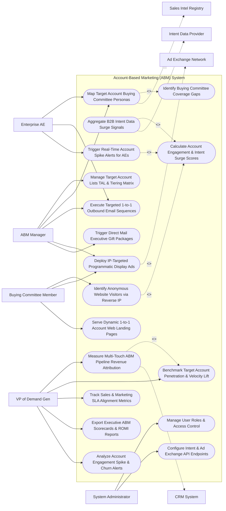

# Use Case Diagram — Account-Based Marketing (ABM) System

## Mermaid Code

## Actor Table | Bảng Actor

| # | Actor | Actor Type | Role Description | Related Use Cases |
|---|-------|------------|------------------|-------------------|
| 1 | ABM Manager | Primary | Account marketing strategist managing target account lists (TAL), mapping buying committees, launching IP ads, and sending direct mail. | UC01, UC05, UC07, UC08, UC09 |
| 2 | Enterprise AE | Primary | Enterprise sales rep viewing buying committee org charts, receiving real-time account spike alerts, and conducting 1-to-1 outreach. | UC05, UC07, UC11 |
| 3 | Buying Committee Member | Primary | Decision maker at target enterprise account viewing IP-targeted ads, personalized landing pages, and downloading whitepapers. | UC03, UC08, UC10 |
| 4 | VP of Demand Gen | Primary | Executive tracking multi-touch revenue attribution, target account penetration, sales/marketing SLA alignment, and ABM ROMI. | UC12, UC13, UC14, UC15, UC18 |
| 5 | System Administrator | Primary | IT admin managing user security roles, intent provider API keys, and B2B ad exchange credentials. | UC16, UC17 |
| 6 | Intent Data Provider | System (Secondary) | Intent data service (Bombora/6sense) streaming third-party topic research surge signals. | UC02 |
| 7 | Ad Exchange Network | System (Secondary) | Programmatic B2B ad platform (Demandbase/RollWorks) serving IP-targeted display ads to corporate offices. | UC08 |
| 8 | Sales Intel Registry | System (Secondary) | Data enrichment service (LinkedIn Sales Navigator/ZoomInfo) identifying decision-maker contact details. | UC05 |
| 9 | CRM System | System (Secondary) | Enterprise CRM synchronizing target account records and tracking multi-touch ABM opportunity attribution. | UC12 |

## Use Case Table | Bảng Use Case

| # | UC ID | Use Case Name | Primary Actor | Secondary Actor | Description | Priority |
|---|-------|---------------|---------------|-----------------|-------------|----------|
| 1 | UC01 | Manage Target Account Lists TAL & Tiering Matrix | ABMManager | None | Defines target account lists (TAL) and classifies accounts into Tier 1 (1-to-1), Tier 2 (1-to-Few), and Tier 3 (1-to-Many). | Critical |
| 2 | UC02 | Aggregate B2B Intent Data Surge Signals | ABMManager | IntentProvider | Ingests third-party intent surge data (Bombora Company Surge / 6sense) to identify target accounts actively researching topics. | Critical |
| 3 | UC03 | Identify Anonymous Website Visitors via Reverse IP | Buyer | None | Performs reverse IP lookup (Demandbase API) on anonymous web traffic to map visitor IP addresses to target company names. | Critical |
| 4 | UC04 | Calculate Account Engagement & Intent Surge Scores | System | None | Combines first-party web engagement, email opens, ad clicks, and third-party intent data into a 0-100 Account Engagement Score. | Critical |
| 5 | UC05 | Map Target Account Buying Committee Personas | ABMManager | SalesIntel | Maps target account decision makers across 4 key personas: Economic Buyer, Champion, Technical Evaluator, and User. | Critical |
| 6 | UC06 | Identify Buying Committee Coverage Gaps | System | None | Analyzes engaged contacts within a target account, highlighting missing personas (e.g., "CISO Contact Missing"). | High |
| 7 | UC07 | Execute Targeted 1-to-1 Outbound Email Sequences | AE | None | Dispatches highly personalized 1-to-1 email sequences tailored specifically to the target account's industry and pain points. | High |
| 8 | UC08 | Deploy IP-Targeted Programmatic Display Ads | ABMManager | AdExchange | Serves display ad campaigns targeted exclusively at the corporate IP ranges and location offices of Tier 1 target accounts. | Critical |
| 9 | UC09 | Trigger Direct Mail Executive Gift Packages | ABMManager | None | Triggers automated physical direct mail gifts (Sendoso/Alyce integration) to target account executives upon reaching intent surges. | High |
| 10 | UC10 | Serve Dynamic 1-to-1 Account Web Landing Pages | Buyer | None | Renders personalized landing pages displaying the target company's logo, custom headline, and assigned AE photo when visited. | Critical |
| 11 | UC11 | Trigger Real-Time Account Spike Alerts for AEs | AE | None | Dispatches real-time Slack/email alerts to assigned AEs when a target account's engagement score spikes $> 50\%$ in 24 hours. | Critical |
| 12 | UC12 | Measure Multi-Touch ABM Pipeline Revenue Attribution | DemandGenVP | CRM System | Applies multi-touch attribution models (First-Touch, Lead Creation, W-Shaped) to quantify ABM revenue influence on deals. | Critical |
| 13 | UC13 | Benchmark Target Account Penetration & Velocity Lift | DemandGenVP | None | Measures target account penetration rates % and compares sales cycle velocity lift for ABM vs non-ABM accounts. | High |
| 14 | UC14 | Track Sales & Marketing SLA Alignment Metrics | DemandGenVP | None | Tracks SLA agreement response times (e.g., AE must contact surging account within 4 hours of intent alert). | High |
| 15 | UC15 | Export Executive ABM Scorecards & ROMI Reports | DemandGenVP | None | Renders executive scorecards detailing TAL pipeline value, account win rate %, average deal size lift, and ABM ROMI. | High |
| 16 | UC16 | Manage User Roles & Access Control | Admin | None | Controls user login credentials, RBAC permissions, and target account list management rights. | High |
| 17 | UC17 | Configure Intent & Ad Exchange API Endpoints | Admin | None | Configures API keys and webhook endpoints for Bombora, 6sense, Demandbase, RollWorks, and ZoomInfo. | High |
| 18 | UC18 | Analyze Account Engagement Spike & Churn Alerts | DemandGenVP | None | Alerts sales management when a Tier 1 account displays an intent surge with a competitor or sudden engagement drop. | High |

## Use Case Specification | Đặc tả Use Case

---

### UC02 — Aggregate B2B Intent Data Surge Signals

| Field | Detail |
|-------|--------|
| **UC ID** | UC02 |
| **Use Case Name** | Aggregate B2B Intent Data Surge Signals |
| **Actor(s)** | Primary: ABM Campaign Manager   Secondary: B2B Intent Data Provider (Bombora Company Surge / 6sense) |
| **Description** | Ingests third-party B2B intent surge data to identify target accounts actively researching product topics across business websites and trade publications before they visit the company site. |
| **Precondition** | 1. Target Account List (TAL) domains and intent keyword topic clusters (e.g., "Cloud Security", "SOC-2 Compliance") are configured.   2. Bombora / 6sense API connection is active. |
| **Main Flow** | 1. System executes weekly intent data sync with Bombora Company Surge API.   2. Intent Data Provider scans 5,000+ B2B publisher websites, measuring reading velocity against historical baselines.   3. Intent Data Provider identifies Intent Surge Events for Target Account `Acme Corporation (acme.com)`:   &nbsp;&nbsp;&nbsp;&nbsp; a. Topic Cluster 1: `"Cloud Security Platform"` -> `Surge Score: 85 / 100` (Baseline: 20).   &nbsp;&nbsp;&nbsp;&nbsp; b. Topic Cluster 2: `"Zero Trust Architecture"` -> `Surge Score: 92 / 100` (Baseline: 15).   &nbsp;&nbsp;&nbsp;&nbsp; c. Topic Cluster 3: `"Competitor X Review"` -> `Surge Score: 78 / 100`.   4. System ingests intent payload and updates Account Profile `Acme Corporation`.   5. System recalculates Account Engagement & Intent Score (UC04): Composite Score jumps from `30` to `82` (`HIGH_INTENT_SURGE`).   6. System triggers UC11 (Trigger Real-Time Account Spike Alerts), sending immediate notification to AE: *"INTENT SURGE: Acme Corp is actively researching Cloud Security & Zero Trust on Bombora (Surge Score: 92/100)"*. |
| **Alternative Flow** | **AF1** — Competitor Intent Research Detection: System detects target account researching direct competitor names; System automatically triggers a "Competitor Displacement ABM Ad Campaign" (UC08). |
| **Exception Flow** | **EX1** — Intent API Sync Timeout Error: Intent provider API fails to respond; System logs sync retry event, maintaining previous week's intent scores until next automated polling cycle. |
| **Postcondition** | Intent surge scores and topic clusters are updated for target accounts, composite scores recalculate, and AE alerts trigger. |
| **Business Rule** | **BR1**: Intent surge scores exceeding a threshold of >= 70/100 MUST trigger real-time notification alerts to assigned Account Executives. |

---

### UC05 — Map Target Account Buying Committee Personas

| Field | Detail |
|-------|--------|
| **UC ID** | UC05 |
| **Use Case Name** | Map Target Account Buying Committee Personas |
| **Actor(s)** | Primary: ABM Campaign Manager, Enterprise Account Executive   Secondary: Sales Intelligence & Contact Enrichment Registry (LinkedIn Sales Navigator / ZoomInfo) |
| **Description** | Maps and enriches individual decision makers within a target account across 4 core buying personas (Economic Buyer, Champion, Technical Evaluator, User), highlighting missing committee roles. |
| **Precondition** | 1. Target account is categorized in TAL (UC01).   2. ZoomInfo / LinkedIn Sales Navigator API integration is active. |
| **Main Flow** | 1. User opens "Target Account Buying Committee Map" for `Acme Corporation`.   2. System queries ZoomInfo API (`POST /v1/contacts/search?domain=acme.com`) for verified contacts.   3. System maps contact profiles to 4 Mandatory Buying Committee Personas:   &nbsp;&nbsp;&nbsp;&nbsp; a. Economic Buyer (Budget Authority): `Jane Doe (CFO) - Engaged (Score: 85)`.   &nbsp;&nbsp;&nbsp;&nbsp; b. Champion (Internal Advocate): `John Smith (VP of IT) - Engaged (Score: 90)`.   &nbsp;&nbsp;&nbsp;&nbsp; c. Technical Evaluator (Security Gatekeeper): `Robert Taylor (CISO) - NOT ENGAGED (Score: 0)`.   &nbsp;&nbsp;&nbsp;&nbsp; d. User Representative (End User): `Sarah Jenkins (Lead Architect) - Engaged (Score: 70)`.   4. System executes UC06 (Identify Buying Committee Coverage Gaps):   &nbsp;&nbsp;&nbsp;&nbsp; a. Evaluates committee coverage: 3 of 4 personas mapped -> `COVERAGE_GAP_DETECTED`.   &nbsp;&nbsp;&nbsp;&nbsp; b. Highlights missing role: `Technical Evaluator / CISO Persona Missing`.   5. System displays prompt: *"Coverage Gap Alert: CISO Robert Taylor has zero engagement. Launch CISO 1-to-1 Email Sequence to complete buying committee coverage."*   6. AE clicks "Add Robert Taylor to CISO Email Campaign"; System attaches contact and initiates targeted outreach. |
| **Alternative Flow** | **AF1** — Automated Contact Enrichment on Job Change: ZoomInfo detects a new CISO hired at Acme Corp; System auto-updates org map, archives former CISO, and alerts AE of executive job change. |
| **Exception Flow** | **EX1** — Un-Mapped Organization Structure: Account is a private subsidiary with zero listed ZoomInfo contacts; System flags account as `MANUAL_RESEARCH_REQUIRED`, tasking AE to map org manually. |
| **Postcondition** | Target account buying committee org chart is mapped, coverage gaps are identified, and targeted outreach is initiated to fill missing roles. |
| **Business Rule** | **BR1**: Target account deals MUST NOT advance to Proposal stage without at least 3 of 4 buying committee personas actively engaged. |

---

### UC08 — Deploy IP-Targeted Programmatic Display Ads

| Field | Detail |
|-------|--------|
| **UC ID** | UC08 |
| **Use Case Name** | Deploy IP-Targeted Programmatic Display Ads |
| **Actor(s)** | Primary: ABM Campaign Manager   Secondary: Programmatic Ad Exchange & IP Reverse-Lookup Network (Demandbase / RollWorks) |
| **Description** | Deploys programmatic display ad campaigns targeted exclusively at the corporate IP addresses and office locations of Tier 1 target accounts, delivering personalized B2B ad creative. |
| **Precondition** | 1. Target Account List (TAL) is uploaded and verified.   2. Corporate IP range database and B2B ad exchange (Demandbase API) credentials are active. |
| **Main Flow** | 1. User opens "ABM Ad Campaign Orchestrator".   2. User selects Target Account Segment: `Tier 1 Financial Services Accounts (20 Companies)`.   3. System resolves Corporate IP Ranges for target accounts:   &nbsp;&nbsp;&nbsp;&nbsp; a. Acme Corp IP Range: `198.51.100.0/24` (Demandbase IP Match Confidence: 98%).   4. User uploads Tailored B2B Ad Creative Suite:   &nbsp;&nbsp;&nbsp;&nbsp; a. Banner Ad 300x250: `"Acme Corp: Accelerate Cloud Security by 3x with Our Enterprise Platform"`.   &nbsp;&nbsp;&nbsp;&nbsp; b. Destination URL: Dynamic Landing Page `https://company.com/abm/acme-corp` (UC10).   5. User sets Campaign Budget & Frequency Cap: `$5,000 Monthly Budget` | `Max 5 Impressions / User / Day`.   6. User clicks "Launch IP-Targeted ABM Ad Campaign".   7. System dispatches ad package via HTTPS API to Demandbase B2B Ad Exchange.   8. Ad Exchange serves display banner ads exclusively to devices connecting from target company IP ranges across premium publisher sites (WSJ, Forbes, TechCrunch).   9. System tracks account ad telemetry: `12,500 Impressions` | `145 Clicks (1.16% CTR)` | `35 Unique Account Visitors`. |
| **Alternative Flow** | **AF1** — Persona-Specific Retargeting: System serves different ad creatives to CISO (focus on compliance) vs CFO (focus on ROI/cost savings) within the same target company IP range. |
| **Exception Flow** | **EX1** — Low IP Match Confidence Warning: Target account uses dynamic remote VPN IPs; Demandbase reports < 50% IP match confidence; System switches campaign strategy to LinkedIn Company Targeted Ads. |
| **Postcondition** | Programmatic B2B ads are served exclusively to target company corporate IP ranges, click telemetry is tracked, and account engagement scores update. |
| **Business Rule** | **BR1**: ABM display ad campaigns MUST target verified corporate IP ranges and limit ad frequency to a maximum of <= 5 impressions per user per day. |

---

### UC10 — Serve Dynamic 1-to-1 Account Web Landing Pages

| Field | Detail |
|-------|--------|
| **UC ID** | UC10 |
| **Use Case Name** | Serve Dynamic 1-to-1 Account Web Landing Pages |
| **Actor(s)** | Primary: Target Account Buying Committee Decision Maker   Secondary: Website Personalization & Dynamic Landing Page Engine |
| **Description** | Dynamically customizes website landing pages in real time when visited by target account employees, displaying the target company logo, tailored industry headline, and dedicated AE contact card. |
| **Precondition** | 1. Reverse IP lookup integration (Demandbase / Clearbit IP API) is active.   2. Account-specific personalization tokens (Logo, Industry, AE Photo) are configured. |
| **Main Flow** | 1. Decision Maker at Acme Corp (`IP: 198.51.100.4`) clicks an ABM ad or email link, requesting page `https://company.com/abm/welcome`.   2. System intercepts HTTP request at edge and performs Reverse IP Lookup.   3. Reverse IP Lookup identifies Visitor Company: `Acme Corporation` (Domain: `acme.com`, Industry: `Financial Services`).   4. System retrieves Account Personalization Assets for `acme.com`:   &nbsp;&nbsp;&nbsp;&nbsp; a. Target Company Logo: `acme_logo_vector.png`.   &nbsp;&nbsp;&nbsp;&nbsp; b. Dedicated AE Profile: `Account Executive John Doe (Photo + Direct Phone + Calendly Link)`.   &nbsp;&nbsp;&nbsp;&nbsp; c. Custom Headline: `"Welcome Acme Corp: Accelerate Your Financial Cloud Security"`.   &nbsp;&nbsp;&nbsp;&nbsp; d. Industry Case Study: `Tier-1 Bank SOC-2 Case Study PDF`.   5. System dynamically injects personalization tokens into page DOM without page layout shift.   6. Decision Maker sees a fully customized landing page featuring their own company logo, tailored financial headline, and dedicated AE contact card.   7. Decision Maker clicks "Download Financial Case Study PDF"; System logs high-value engagement event and updates Account Engagement Score (+15 points). |
| **Alternative Flow** | **AF1** — Anonymous Target Visitor Welcome: Visitor arrives directly without clicking link; Reverse IP detects `Acme Corp` IP; System dynamically replaces generic homepage banner with `"Special Welcome to Acme Corp Team"`. |
| **Exception Flow** | **EX1** — Un-Matched IP Fallback Execution: Visitor IP is a home broadband IP (Un-matched); System serves standard enterprise industry default landing page, suppressing target company logos. |
| **Postcondition** | Landing page DOM is dynamically updated with target company logos and custom copy, engagement is logged, and account score increases. |
| **Business Rule** | **BR1**: 1-to-1 dynamic account landing pages MUST render personalized target company logos and dedicated AE contact cards without introducing page layout shift. |

---

### UC12 — Measure Multi-Touch ABM Pipeline Revenue Attribution

| Field | Detail |
|-------|--------|
| **UC ID** | UC12 |
| **Use Case Name** | Measure Multi-Touch ABM Pipeline Revenue Attribution |
| **Actor(s)** | Primary: VP of Demand Generation, Chief Marketing Officer   Secondary: Customer Relationship Management (CRM) System |
| **Description** | Applies multi-touch attribution models (First-Touch, Lead Creation, W-Shaped, Full-Path) to calculate ABM marketing campaign revenue influence across all pipeline deals and closed-won contracts. |
| **Precondition** | 1. ABM campaign touchpoints (Ad clicks, email opens, landing page views, direct mail) are logged with timestamps.   2. Opportunity deal records exist in CRM. |
| **Main Flow** | 1. User opens "ABM Revenue Attribution & ROMI Analytics Studio".   2. User selects Attribution Model: `W-Shaped Multi-Touch Model` and Period: `Year-To-Date 2026`.   3. System retrieves Closed-Won Opportunity Deal: `Acme Corporation Enterprise Expansion ($500,000.00 Closed-Won Revenue)`.   4. System analyzes historical ABM touchpoints across all buying committee members for Acme Corp:   &nbsp;&nbsp;&nbsp;&nbsp; a. Touchpoint 1 (First Touch - 30% Weight): CISO saw IP Display Ad (Demandbase) -> `$150,000.00 Credit`.   &nbsp;&nbsp;&nbsp;&nbsp; b. Touchpoint 2 (Lead Creation - 30% Weight): VP IT filled form on Dynamic Landing Page -> `$150,000.00 Credit`.   &nbsp;&nbsp;&nbsp;&nbsp; c. Touchpoint 3 (Mid-Funnel Nurture - 10% Weight): Direct Mail Executive Gift delivered -> `$50,000.00 Credit`.   &nbsp;&nbsp;&nbsp;&nbsp; d. Touchpoint 4 (Opportunity Creation - 30% Weight): AE Demo booked via Chatbot -> `$150,000.00 Credit`.   5. System computes Total ABM Influenced Revenue: `$500,000.00 Total Influenced Revenue` (100% ABM Influenced).   6. System calculates ABM Program Return on Marketing Investment (ROMI):   $$\text{ABM Program Spend} = \$50,000.00$$   $$\text{Net ABM Revenue} = \$500,000.00 - \$50,000.00 = \$450,000.00$$   $$\text{ABM ROMI Multiplier} = \frac{\$500,000.00}{\$50,000.00} = 10.0\times \text{ ROMI Multiplier (1,000\% Return)}$$   7. System renders Multi-Touch Attribution Sankey Diagram and exports executive ABM ROMI scorecard PDF. |
| **Alternative Flow** | **AF1** — Comparison of Attribution Models: System displays side-by-side comparison between First-Touch, Last-Touch, and W-Shaped attribution models to validate campaign consistency. |
| **Exception Flow** | **EX1** — Un-Attributed Offline Deal Handling: Sales closes deal with zero logged digital touchpoints; System flags deal as `UNATTRIBUTED_ORGANIC`, excluding it from ABM campaign credit. |
| **Postcondition** | Multi-touch revenue attribution weights are assigned across campaign touchpoints, ABM influenced revenue is quantified, and ROMI scorecards export. |
| **Business Rule** | **BR1**: ABM revenue attribution MUST use multi-touch models (W-Shaped or Full-Path) to distribute deal revenue credit across all engaged buying committee touchpoints. |
