# Conceptual ERD — Account-Based Marketing (ABM) System

## Mermaid Code

```mermaid
erDiagram
    USER_ACCOUNT {
        int user_id PK
        string full_name
        string username
        string user_role
        string department_code
        boolean is_active
    }

    TARGET_ACCOUNT_MASTER {
        int account_id PK
        int assigned_ae_user_id FK
        string company_name
        string domain_name
        string account_tier_level
        string primary_corporate_ip_range
        decimal annual_target_revenue_potential
        datetime added_to_tal_at
    }

    BUYING_COMMITTEE_MEMBER {
        int contact_id PK
        int account_id FK
        string contact_first_name
        string contact_last_name
        string work_email_address
        string job_title
        string mapped_persona_role
        int individual_engagement_score
    }

    INTENT_SURGE_SIGNAL {
        int signal_id PK
        int account_id FK
        string intent_topic_cluster
        int surge_score_1to100
        string intent_data_provider_name
        datetime detected_at
    }

    REVERSE_IP_LOOKUP_LOG {
        int lookup_id PK
        int account_id FK
        string visitor_ip_address
        decimal ip_match_confidence_percent
        string visited_page_url
        datetime visited_at
    }

    ACCOUNT_ENGAGEMENT_SCORECARD {
        int scorecard_id PK
        int account_id FK
        int first_party_web_score
        int third_party_intent_score
        int composite_engagement_score
        boolean is_spiking
        date period_date
    }

    PROGRAMMATIC_ABM_AD_CAMPAIGN {
        int campaign_id PK
        int abm_manager_user_id FK
        string campaign_name
        decimal monthly_budget_amount
        int total_impressions_served
        int total_clicks_count
        boolean is_active
    }

    DYNAMIC_LANDING_PAGE_TOKEN {
        int token_id PK
        int account_id FK
        string customized_headline_text
        string company_logo_url
        int assigned_ae_user_id FK
    }

    DIRECT_MAIL_GIFT_FULFILLMENT {
        int gift_id PK
        int account_id FK
        int recipient_contact_id FK
        string gift_item_name
        string tracking_status
        datetime dispatched_at
    }

    ACCOUNT_SPIKE_ALERT_LOG {
        int alert_id PK
        int account_id FK
        int assigned_ae_user_id FK
        string alert_trigger_reason
        boolean is_acknowledged_by_ae
        datetime alerted_at
    }

    MULTI_TOUCH_ATTRIBUTION_RECORD {
        int attribution_id PK
        int account_id FK
        string attribution_model_name
        decimal influenced_deal_revenue
        decimal abm_romi_multiplier
        date period_quarter
    }

    EXECUTIVE_ABM_SCORECARD {
        int scorecard_id PK
        int total_target_accounts_count
        decimal tal_pipeline_value
        decimal target_account_win_rate_percent
        decimal average_deal_size_lift_percent
        date period_month
    }

    TARGET_ACCOUNT_MASTER ||--o{ BUYING_COMMITTEE_MEMBER : "employs"
    TARGET_ACCOUNT_MASTER ||--o{ INTENT_SURGE_SIGNAL : "monitored for"
    TARGET_ACCOUNT_MASTER ||--o{ REVERSE_IP_LOOKUP_LOG : "matched in"
    TARGET_ACCOUNT_MASTER ||--o| ACCOUNT_ENGAGEMENT_SCORECARD : "evaluated in"
    TARGET_ACCOUNT_MASTER ||--o| DYNAMIC_LANDING_PAGE_TOKEN : "customizes"
    TARGET_ACCOUNT_MASTER ||--o{ DIRECT_MAIL_GIFT_FULFILLMENT : "receives gifts in"
    TARGET_ACCOUNT_MASTER ||--o{ ACCOUNT_SPIKE_ALERT_LOG : "triggers alerts for"
    TARGET_ACCOUNT_MASTER ||--o{ MULTI_TOUCH_ATTRIBUTION_RECORD : "attributed in"
    BUYING_COMMITTEE_MEMBER ||--o{ DIRECT_MAIL_GIFT_FULFILLMENT : "receives"
    USER_ACCOUNT ||--o{ TARGET_ACCOUNT_MASTER : "assigned AE for"
    USER_ACCOUNT ||--o{ PROGRAMMATIC_ABM_AD_CAMPAIGN : "manages"
    USER_ACCOUNT ||--o{ ACCOUNT_SPIKE_ALERT_LOG : "receives alerts in"
```

## Entity Description Table | Bảng mô tả Entity

| # | Entity Name | Vietnamese Name | Description | Key Attributes | Main Relationships |
|---|-------------|-----------------|-------------|----------------|-------------------|
| 1 | USER_ACCOUNT | Tài khoản Nguời dùng | System credentials and access roles for ABM managers, enterprise AEs, demand gen VPs, and admins. | `user_id`, `username`, `user_role`, `department_code` | Assigned AE for `TARGET_ACCOUNT_MASTER`, manages `PROGRAMMATIC_ABM_AD_CAMPAIGN`, receives alerts in `ACCOUNT_SPIKE_ALERT_LOG`. |
| 2 | TARGET_ACCOUNT_MASTER | Target Account Master | Central Target Account List (TAL) record tracking company names, domains, tier levels (Tier 1/2/3), corporate IP ranges, and revenue potential. | `account_id`, `assigned_ae_user_id`, `company_name`, `domain_name`, `account_tier_level`, `primary_corporate_ip_range` | Employs `BUYING_COMMITTEE_MEMBER`, monitored for `INTENT_SURGE_SIGNAL`, matched in `REVERSE_IP_LOOKUP_LOG`, evaluated in `ACCOUNT_ENGAGEMENT_SCORECARD`, customizes `DYNAMIC_LANDING_PAGE_TOKEN`. |
| 3 | BUYING_COMMITTEE_MEMBER | Thành viên Buying Committee | Contact profile at target account storing name, work email, job title, and mapped persona role (Economic Buyer, Champion, CISO). | `contact_id`, `account_id`, `contact_first_name`, `work_email_address`, `job_title`, `mapped_persona_role` | Belongs to `TARGET_ACCOUNT_MASTER`, receives `DIRECT_MAIL_GIFT_FULFILLMENT`. |
| 4 | INTENT_SURGE_SIGNAL | Tín hiệu Intent Surge B2B | Third-party intent surge signal log tracking topic clusters (Bombora/6sense), surge scores (1-100), and provider names. | `signal_id`, `account_id`, `intent_topic_cluster`, `surge_score_1to100`, `intent_data_provider_name` | Belongs to `TARGET_ACCOUNT_MASTER`. |
| 5 | REVERSE_IP_LOOKUP_LOG | Nhật ký Reverse IP Lookup | First-party website visitor reverse IP lookup log tracking IP addresses, match confidence %, visited URLs, and timestamps. | `lookup_id`, `account_id`, `visitor_ip_address`, `ip_match_confidence_percent`, `visited_page_url` | Belongs to `TARGET_ACCOUNT_MASTER`. |
| 6 | ACCOUNT_ENGAGEMENT_SCORECARD | Scorecard Engagement Account | Composite account engagement score record combining first-party web score and third-party intent score into a 0-100 composite score. | `scorecard_id`, `account_id`, `first_party_web_score`, `third_party_intent_score`, `composite_engagement_score`, `is_spiking` | Belongs to `TARGET_ACCOUNT_MASTER`. |
| 7 | PROGRAMMATIC_ABM_AD_CAMPAIGN | Chiến dịch Quảng cáo ABM | Programmatic B2B IP-targeted ad campaign record tracking budgets, impressions served, clicks, and active status. | `campaign_id`, `abm_manager_user_id`, `campaign_name`, `monthly_budget_amount`, `total_impressions_served`, `total_clicks_count` | Managed by `USER_ACCOUNT`. |
| 8 | DYNAMIC_LANDING_PAGE_TOKEN | Token Personalization Web | Dynamic account landing page personalization token record storing customized headlines, logos, and assigned AE photos. | `token_id`, `account_id`, `customized_headline_text`, `company_logo_url`, `assigned_ae_user_id` | Belongs to `TARGET_ACCOUNT_MASTER`. |
| 9 | DIRECT_MAIL_GIFT_FULFILLMENT | Gift Direct Mail Executive | Physical direct mail executive gift tracking log (Sendoso/Alyce) recording gift items, recipient contacts, and tracking status. | `gift_id`, `account_id`, `recipient_contact_id`, `gift_item_name`, `tracking_status` | Belongs to `TARGET_ACCOUNT_MASTER` and `BUYING_COMMITTEE_MEMBER`. |
| 10 | ACCOUNT_SPIKE_ALERT_LOG | Nhật ký Alert Engagement Spike | Real-time AE notification alert log recording trigger reasons (e.g., score jumped > 50%), assigned AE ID, and acknowledgment status. | `alert_id`, `account_id`, `assigned_ae_user_id`, `alert_trigger_reason`, `is_acknowledged_by_ae` | Belongs to `TARGET_ACCOUNT_MASTER`, received by `USER_ACCOUNT`. |
| 11 | MULTI_TOUCH_ATTRIBUTION_RECORD | Bản ghi Attribution Multi-Touch | Multi-touch revenue attribution record quantifying influenced deal revenue, ABM ROMI multipliers, and model names. | `attribution_id`, `account_id`, `attribution_model_name`, `influenced_deal_revenue`, `abm_romi_multiplier` | Belongs to `TARGET_ACCOUNT_MASTER`. |
| 12 | EXECUTIVE_ABM_SCORECARD | Scorecard Executive ABM | Executive ABM scorecard aggregating total target accounts, TAL pipeline value, win rate %, average deal size lift, and ROMI. | `scorecard_id`, `total_target_accounts_count`, `tal_pipeline_value`, `target_account_win_rate_percent`, `average_deal_size_lift_percent` | Standalone executive performance entity. |

## Relationship Description | Mô tả Quan hệ

| # | From Entity | Cardinality | To Entity | Label | Business Explanation |
|---|-------------|-------------|-----------|-------|----------------------|
| 1 | TARGET_ACCOUNT_MASTER | 1 to 1..N | BUYING_COMMITTEE_MEMBER | employs | A target account master employs multiple buying committee decision makers. |
| 2 | TARGET_ACCOUNT_MASTER | 1 to 0..N | INTENT_SURGE_SIGNAL | monitored for | A target account is monitored for third-party B2B intent surge signals. |
| 3 | TARGET_ACCOUNT_MASTER | 1 to 0..N | REVERSE_IP_LOOKUP_LOG | matched in | A target account is matched in reverse IP lookup web browsing logs. |
| 4 | TARGET_ACCOUNT_MASTER | 1 to 0..1 | ACCOUNT_ENGAGEMENT_SCORECARD | evaluated in | A target account is evaluated in composite engagement scorecards. |
| 5 | TARGET_ACCOUNT_MASTER | 1 to 0..1 | DYNAMIC_LANDING_PAGE_TOKEN | customizes | A target account customizes 1-to-1 dynamic landing page tokens. |
| 6 | TARGET_ACCOUNT_MASTER | 1 to 0..N | DIRECT_MAIL_GIFT_FULFILLMENT | receives gifts in | A target account receives physical direct mail executive gifts. |
| 7 | TARGET_ACCOUNT_MASTER | 1 to 0..N | ACCOUNT_SPIKE_ALERT_LOG | triggers alerts for | A target account triggers real-time engagement spike alerts for AEs. |
| 8 | TARGET_ACCOUNT_MASTER | 1 to 0..N | MULTI_TOUCH_ATTRIBUTION_RECORD | attributed in | A target account is attributed in multi-touch revenue models. |
| 9 | BUYING_COMMITTEE_MEMBER | 1 to 0..N | DIRECT_MAIL_GIFT_FULFILLMENT | receives | A buying committee member receives direct mail gift packages. |
| 10 | USER_ACCOUNT | 1 to 0..N | TARGET_ACCOUNT_MASTER | assigned AE for | An enterprise AE user account is assigned target accounts. |
| 11 | USER_ACCOUNT | 1 to 0..N | PROGRAMMATIC_ABM_AD_CAMPAIGN | manages | An ABM manager user account manages programmatic B2B ad campaigns. |
| 12 | USER_ACCOUNT | 1 to 0..N | ACCOUNT_SPIKE_ALERT_LOG | receives alerts in | An AE user account receives real-time account engagement spike alerts. |
