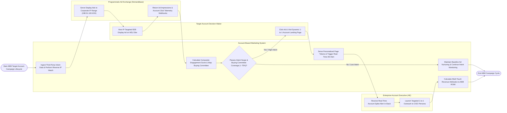

# Swimlane Diagram — Account-Based Marketing (ABM) System

## Mermaid Code

## Flow Description | Mô tả luồng

| Lane | Actor | Role in Flow |
|------|-------|-------------|
| 1 | Target Account Decision Maker | Views IP-targeted B2B display ads on premium publisher sites, clicks ad links, visits personalized 1-to-1 account web landing pages, and downloads case studies. |
| 2 | Enterprise Account Executive (AE) | Receives real-time Slack/email engagement spike alerts, reviews buying committee coverage maps, and executes targeted 1-to-1 outreach to unengaged decision-maker personas. |
| 3 | Account-Based Marketing System | Ingests third-party intent data (Bombora), performs reverse IP lookup (Demandbase), calculates composite account engagement scores (0-100), maps buying committee roles, serves dynamic page personalization tokens, dispatches AE alerts, and computes multi-touch ABM revenue attribution. |
| 4 | Programmatic Ad Exchange (Demandbase) | Serves programmatic display ads targeted exclusively at target company corporate IP ranges, returning ad impression and account click telemetry webhooks. |
