# Action Tree — Account-Based Marketing (ABM) System

## Mermaid Code

```mermaid
graph TD
    Root["Account-Based Marketing (ABM) System"]

    Root --> M1["Target Account List (TAL) & Tiering"]
    Root --> M2["B2B Intent Data & Reverse IP Lookup"]
    Root --> M3["Buying Committee Mapping & Org Intelligence"]
    Root --> M4["Programmatic IP Ads & Direct Mail Gifts"]
    Root --> M5["Dynamic 1-to-1 Web Personalization"]
    Root --> M6["Multi-Touch Revenue Attribution & ABM ROMI"]

    M1 --> A11["Define Target Account Lists (TAL) & Firmographic Filters"]
    M1 --> A12["Classify Accounts into Tier 1 (1-to-1), Tier 2 (1-to-Few), Tier 3 (1-to-Many)"]
    M1 --> A13["Sync Target Account Master Records with Salesforce CRM"]
    M1 --> A14["Assign Enterprise Account Executives (AEs) to Target Accounts"]

    M2 --> A21["Ingest Third-Party Intent Surge Data (Bombora / 6sense)"]
    M2 --> A22["Perform Reverse IP Lookup on Anonymous Web Traffic (Demandbase)"]
    M2 --> A23["Calculate Composite Account Engagement Scores (Scale 0-100)"]
    M2 --> A24["Trigger Real-Time Account Surge Alerts to Assigned AEs via Slack"]

    M3 --> A31["Map Buying Committee Personas (Economic Buyer, Champion, CISO)"]
    M3 --> A32["Enrich Contact Data via LinkedIn Sales Navigator & ZoomInfo"]
    M3 --> A33["Identify Buying Committee Coverage Gaps (Missing Persona Roles)"]
    M3 --> A34["Enforce Rule: Requires 3 of 4 Mapped Personas to Advance Stage"]

    M4 --> A41["Deploy Programmatic B2B Display Ads to Corporate IP Ranges"]
    M4 --> A42["Configure Persona-Specific Ad Creatives & Frequency Caps"]
    M4 --> A43["Trigger Physical Direct Mail Executive Gifts (Sendoso / Alyce)"]
    M4 --> A44["Track Account Ad Impression Reach, Clicks & Click-Through Rates"]

    M5 --> A51["Render Dynamic 1-to-1 Web Landing Pages with Target Company Logos"]
    M5 --> A52["Inject Customized Industry Headlines & Tailored Case Studies"]
    M5 --> A53["Display Dedicated AE Contact Profile Cards & Calendly Widgets"]
    M5 --> A54["Track Account Visitor Landing Page Duration & Download Telemetry"]

    M6 --> A61["Apply W-Shaped & Full-Path Multi-Touch Revenue Attribution"]
    M6 --> A62["Calculate ABM Influenced Pipeline Revenue & Deal Velocity Lift"]
    M6 --> A63["Benchmark Target Account Penetration Rates % vs Non-ABM Accounts"]
    M6 --> A64["Export Executive ABM Scorecards & Net ROMI Multiplier Reports"]
```

## Module Description | Mô tả Module

| # | Module | Description | Actions |
|---|--------|-------------|---------|
| 1 | Target Account List (TAL) & Tiering | Defines target account lists (TAL), classifies account tiers (1-to-1, 1-to-Few, 1-to-Many), syncs with CRM, and assigns AEs. | Define Target Account Lists (TAL), Classify Account Tiers (Tier 1/2/3), Sync Master Records to Salesforce CRM, Assign Enterprise AEs to Accounts. |
| 2 | B2B Intent Data & Reverse IP Lookup | Ingests Bombora/6sense intent surge data, performs Demandbase reverse IP lookup, calculates composite engagement scores, and dispatches AE alerts. | Ingest Third-Party Intent Surge Data, Perform Reverse IP Lookup on Web Traffic, Calculate Composite Engagement Scores, Trigger Real-Time AE Account Surge Alerts. |
| 3 | Buying Committee Mapping & Org Intelligence | Maps decision-maker personas (CFO, CISO, VP IT), enriches contact profiles via ZoomInfo, identifies coverage gaps, and enforces committee rules. | Map Buying Committee Personas, Enrich Contact Data via ZoomInfo, Identify Buying Committee Coverage Gaps, Enforce Mapped Persona Stage Criteria. |
| 4 | Programmatic IP Ads & Direct Mail Gifts | Deploys B2B display ads to corporate IP ranges, configures persona ad creatives, triggers physical direct mail gifts (Sendoso), and tracks CTRs. | Deploy Programmatic Ads to Corporate IPs, Configure Persona-Specific Ad Creatives, Trigger Physical Direct Mail Executive Gifts, Track Account Ad Impression Reach & CTRs. |
| 5 | Dynamic 1-to-1 Web Personalization | Customizes landing pages with target company logos, custom headlines, dedicated AE contact cards, and tracks content download duration. | Render Dynamic 1-to-1 Account Landing Pages, Inject Customized Industry Headlines & Logos, Display Dedicated AE Contact Cards, Track Account Visitor Page Duration. |
| 6 | Multi-Touch Revenue Attribution & ABM ROMI | Applies W-Shaped multi-touch attribution, quantifies ABM influenced pipeline revenue, benchmarks penetration rates, and exports ROMI scorecards. | Apply Multi-Touch Revenue Attribution Models, Calculate ABM Influenced Pipeline Revenue, Benchmark Target Account Penetration Rates, Export Executive ABM ROMI Reports. |
