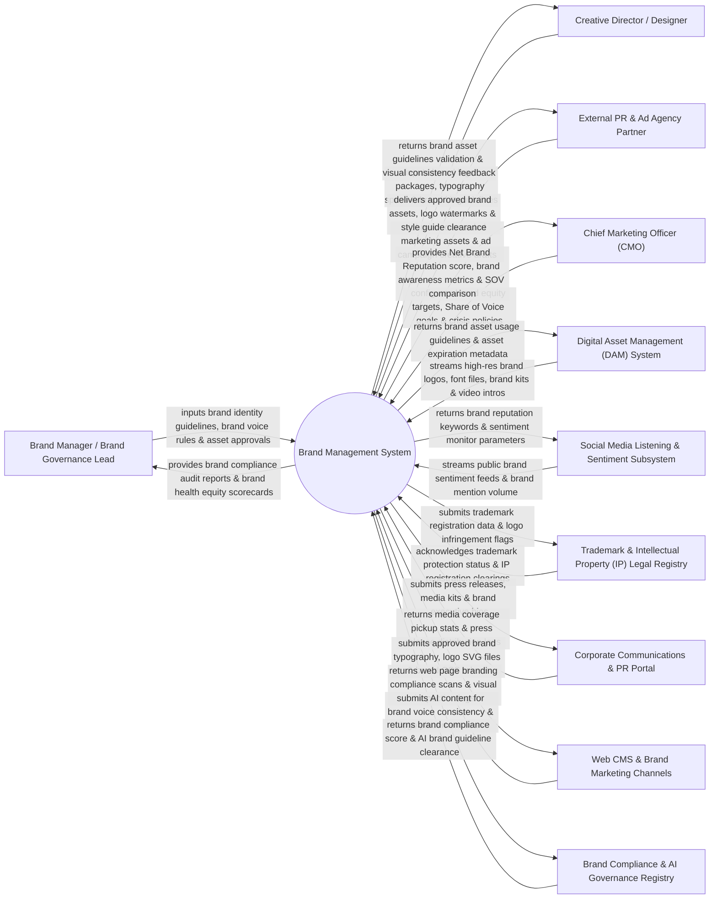

# Context Diagram — Brand Management System

## Mermaid Code

## Actor & Interaction Table | Bảng Actor & Tương tác

| # | Actor | Actor Type | Data Sent TO System | Data Received FROM System | Notes |
|---|-------|------------|---------------------|---------------------------|-------|
| 1 | Brand Manager / Brand Governance Lead | Primary | Brand identity guidelines, brand voice & tone standards, brand approval workflows, brand compliance rules. | Brand compliance audit reports, Brand Health Equity scorecards, logo misuse alerts, brand consistency heatmaps. | Brand professional enforcing corporate brand identity guidelines and managing brand equity. |
| 2 | Creative Director / Designer | Primary | Brand logo packages (SVG/EPS), typography specifications, color palette hex codes, brand style kits. | Brand asset guideline validation, visual alignment feedback, approved brand design templates. | Creative leader defining visual brand identity assets, font hierarchies, and design systems. |
| 3 | External PR & Ad Agency Partner | Primary | Co-branded marketing assets, partner ad creative drafts, sponsored event banner designs. | Approved brand assets, high-res logo watermarks, brand style guide clearance certificates. | External agency partner creating marketing collateral compliant with corporate brand guidelines. |
| 4 | CMO | Primary | Brand equity growth targets, Share of Voice (SOV) goals, brand crisis management protocols. | Net Brand Reputation score, brand awareness metrics, competitive SOV benchmarks, brand value contribution. | Executive evaluating brand equity, corporate reputation, and multi-market brand performance. |
| 5 | Digital Asset Management (DAM) System | Supporting | Master brand logos, font files (.woff2), approved brand kits, video stinger intros, photography. | Brand asset usage guidelines, asset expiration dates, licensed media asset tags. | Repository storing vector logos, brand guidelines PDFs, and visual brand elements. |
| 6 | Social Media Listening & Sentiment Subsystem | Supporting | Public brand mention feeds, brand sentiment scores (Positive/Negative), brand perception keywords. | Brand reputation keywords, brand tracking parameters, sentiment threshold alerts. | Listening engine monitoring public web and social conversations for brand perception data. |
| 7 | Trademark & Intellectual Property (IP) Legal Registry | Supporting | Registered trademark numbers, copyright clearance records, trademark infringement alerts. | Trademark registration data, logo infringement flags, legal IP protection documentation. | Legal registry maintaining global trademarks, service marks, and brand copyright filings. |
| 8 | Corporate Communications & PR Portal | Supporting | Press release distribution logs, media pickup metrics, executive spokesperson quotes. | Approved press release templates, media press kits, executive headshot bios. | Corporate PR portal distributing official press releases and managing media relations. |
| 9 | Web CMS & Brand Marketing Channels | Supporting | Web page branding compliance scans, HTML visual inspection logs, logo rendering checks. | Approved brand typography, vector SVG logos, brand color CSS design tokens. | Web CMS platforms enforcing brand design tokens and typography standards on web pages. |
| 10 | Brand Compliance & AI Governance Registry | Supporting / Regulatory | AI visual brand inspection models, brand voice NLP classifiers, compliance audit standards. | Brand compliance score, AI brand guideline clearance, brand violation flags. | AI governance engine auditing marketing creative for brand voice and logo placement compliance. |

## System Boundary Description | Mô tả Phạm vi Hệ thống

The **Brand Management System** is an enterprise brand identity, brand guidelines management, digital asset governance, brand health analytics, and trademark compliance platform designed to maintain visual and tonal brand consistency across all global touchpoints.

**Inside System Scope:**
- Centralized interactive Brand Style Guide portal containing logo usage rules, typography, color palettes, and tone of voice.
- Automated AI visual and text brand compliance scanner auditing ad creative, emails, and web pages for brand violations.
- Brand Asset Management and DAM integration governing vector logos, design tokens, and co-branded partner kits.
- Brand health equity tracking measuring brand awareness, Net Brand Reputation score, Share of Voice (SOV), and brand perception.
- Trademark and IP legal registry tracking global trademark filings, licensing agreements, and logo infringement.

**Outside System Scope:**
- Direct physical painting of corporate headquarters building signs (handled by Physical Signage Contractors).
- Direct legal litigation in federal court for trademark infringement (handled by IP Litigation Attorneys).
- Direct hosting of external press release wire services (handled by PR Newswire / BusinessWire).
