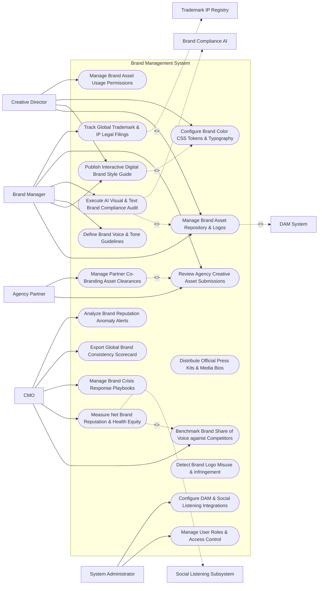

# Use Case Diagram — Brand Management System

## Mermaid Code

## Actor Table | Bảng Actor

| # | Actor | Actor Type | Role Description | Related Use Cases |
|---|-------|------------|------------------|-------------------|
| 1 | Brand Manager | Primary | Governance lead publishing brand guidelines, defining voice rules, executing AI compliance audits, and reviewing agency submissions. | UC01, UC02, UC04, UC05, UC07, UC10 |
| 2 | Creative Director | Primary | Designer building visual brand assets, managing font packages, setting color CSS tokens, and controlling DAM permissions. | UC01, UC02, UC03, UC06 |
| 3 | Agency Partner | Primary | External PR or advertising agency submitting co-branded marketing assets and requesting brand style guide clearances. | UC07, UC08 |
| 4 | CMO | Primary | Executive evaluating brand health equity, Net Brand Reputation, competitor Share of Voice (SOV), and crisis playbooks. | UC11, UC12, UC14, UC15, UC18 |
| 5 | System Administrator | Primary | IT administrative user managing security roles, DAM API integrations, and social listening tokens. | UC16, UC17 |
| 6 | DAM System | System (Secondary) | Central asset repository storing vector logos, brand kits, font files, and video stinger intros. | UC01 |
| 7 | Social Listening Subsystem | System (Secondary) | Listening engine tracking public brand mentions, sentiment scores, and brand perception keywords. | UC12 |
| 8 | Trademark IP Registry | System (Secondary) | Legal registry maintaining trademark registration numbers, class filings, and copyright clearances. | UC10 |
| 9 | Brand Compliance AI | System (Secondary) | Computer vision and NLP AI engine auditing ad creative for visual logo placement and brand voice tone. | UC05 |

## Use Case Table | Bảng Use Case

| # | UC ID | Use Case Name | Primary Actor | Secondary Actor | Description | Priority |
|---|-------|---------------|---------------|-----------------|-------------|----------|
| 1 | UC01 | Manage Brand Asset Repository & Logos | CreativeDirector | DAM System | Centralizes master vector brand logos (SVG/EPS), icon sets, fonts, and photography guidelines. | Critical |
| 2 | UC02 | Publish Interactive Digital Brand Style Guide | BrandManager | None | Publishes an interactive web-based Brand Style Guide featuring logo clearance rules, color palettes, and fonts. | Critical |
| 3 | UC03 | Configure Brand Color CSS Tokens & Typography | CreativeDirector | None | Exports standardized CSS/SASS design tokens (Primary Hex `#0052CC`, Secondary `#FF5630`) for web developers. | High |
| 4 | UC04 | Define Brand Voice & Tone Guidelines | BrandManager | None | Configures brand personality traits, vocabulary dos/don'ts, and tone guidelines for different customer channels. | High |
| 5 | UC05 | Execute AI Visual & Text Brand Compliance Audit | BrandManager | Compliance AI | Uses AI computer vision and NLP to audit ad graphics, emails, and web pages for brand rule violations. | Critical |
| 6 | UC06 | Manage Brand Asset Usage Permissions | CreativeDirector | None | Sets access permissions, watermark requirements, and expiration dates for downloadable brand assets. | High |
| 7 | UC07 | Review Agency Creative Asset Submissions | BrandManager | None | Reviews marketing collateral submitted by external agencies, providing inline brand feedback and approval badges. | High |
| 8 | UC08 | Manage Partner Co-Branding Asset Clearances | AgencyPartner | None | Generates co-branding logo lockups (Partner Logo + Brand Logo) following strict spacing and sizing ratio rules. | High |
| 9 | UC09 | Distribute Official Press Kits & Media Bios | BrandManager | None | Publishes downloadable media press kits containing approved corporate logos, executive bios, and press releases. | Medium |
| 10 | UC10 | Track Global Trademark & IP Legal Filings | BrandManager | Trademark Reg | Tracks global trademark registrations, class categories (Class 9, 35, 42), renewal dates, and legal certificates. | Critical |
| 11 | UC11 | Benchmark Brand Share of Voice against Competitors | CMO | None | Compares brand mention volume, media coverage, and social reach against key industry competitors. | High |
| 12 | UC12 | Measure Net Brand Reputation & Health Equity | CMO | Listening Engine | Computes Net Brand Reputation Score based on sentiment analysis, brand awareness surveys, and customer perception. | Critical |
| 13 | UC13 | Detect Brand Logo Misuse & Infringement | BrandManager | None | Scans web and social channels to detect unauthorized logo distortions, incorrect color usage, or counterfeit sites. | High |
| 14 | UC14 | Manage Brand Crisis Response Playbooks | CMO | None | Manages pre-approved crisis messaging templates, spokesperson escalation protocols, and holding statements. | High |
| 15 | UC15 | Export Global Brand Consistency Scorecard | CMO | None | Renders executive dashboards displaying brand compliance percentage, asset adoption rates, and brand health equity. | High |
| 16 | UC16 | Manage User Roles & Access Control | Admin | None | Controls user login accounts, workspace permissions, and agency partner access boundaries. | High |
| 17 | UC17 | Configure DAM & Social Listening Integrations | Admin | None | Manages API connections to DAM repositories, social listening engines, and web CMS platforms. | High |
| 18 | UC18 | Analyze Brand Reputation Anomaly Alerts | CMO | None | Triggers alert notifications when negative brand sentiment spikes $> 25\%$ or brand compliance drops below 85%. | High |

## Use Case Specification | Đặc tả Use Case

---

### UC02 — Publish Interactive Digital Brand Style Guide

| Field | Detail |
|-------|--------|
| **UC ID** | UC02 |
| **Use Case Name** | Publish Interactive Digital Brand Style Guide |
| **Actor(s)** | Primary: Brand Manager, Creative Director   Secondary: None |
| **Description** | Publishes a web-based, interactive digital Brand Style Guide detailing logo clear space rules, color palettes (HEX, RGB, CMYK, Pantone), typography hierarchies, and brand voice guidelines. |
| **Precondition** | 1. Vector logos, color codes, and font packages are uploaded to the DAM system (UC01). |
| **Main Flow** | 1. User opens "Brand Style Guide Editor".   2. User configures Section 1 (Visual Logo Rules):   &nbsp;&nbsp;&nbsp;&nbsp; a. Master Logo Variations: Primary Full-Color, Monochromatic White, Monochromatic Black.   &nbsp;&nbsp;&nbsp;&nbsp; b. Minimum Size Limits: Web (min 120px width), Print (min 25mm width).   &nbsp;&nbsp;&nbsp;&nbsp; c. Clear Space Rule: Minimum clear space equal to the height of the logo icon ($X$).   &nbsp;&nbsp;&nbsp;&nbsp; d. Logo Misuse Rules: "Do NOT stretch, rotate, alter colors, or add drop shadows".   3. User configures Section 2 (Color Palette & Tokens):   &nbsp;&nbsp;&nbsp;&nbsp; a. Primary Brand Color: `#0052CC` (RGB: 0, 82, 204 | Pantone 2728 C).   &nbsp;&nbsp;&nbsp;&nbsp; b. Secondary Accent Color: `#FF5630` (RGB: 255, 86, 48 | Pantone 1655 C).   4. User configures Section 3 (Typography): Specifies Primary Font (`Inter Bold / Regular`) and Fallback Fonts (`Arial, sans-serif`).   5. User clicks "Publish Digital Style Guide".   6. System generates web-based Style Guide portal (`https://brand.company.com`) and exports downloadable CSS Design Tokens (`brand-tokens.json`). |
| **Alternative Flow** | **AF1** — Multi-Brand Sub-Domain Publishing: User publishes separate style guides for distinct sub-brands (e.g., Enterprise Product vs Consumer Product) under sub-domains (`enterprise.brand.company.com`). |
| **Exception Flow** | **EX1** — Missing Pantone / CMYK Codes Warning: User inputs HEX color code without defining CMYK print equivalents; System displays warning "CMYK Print Values Required for Style Guide Publishing", prompting entry. |
| **Postcondition** | Digital Brand Style Guide is published on the web portal, downloadable brand kits are available, and CSS tokens are generated. |
| **Business Rule** | **BR1**: The digital Brand Style Guide MUST define minimum clear space, minimum size limits, and incorrect usage examples for all master logos. |

---

### UC05 — Execute AI Visual & Text Brand Compliance Audit

| Field | Detail |
|-------|--------|
| **UC ID** | UC05 |
| **Use Case Name** | Execute AI Visual & Text Brand Compliance Audit |
| **Actor(s)** | Primary: Brand Manager / Brand Governance Lead   Secondary: Brand Compliance AI |
| **Description** | Audits uploaded ad creative, email templates, social graphics, and web pages using computer vision AI (logo placement, color contrast) and NLP (brand voice tone) to detect brand rule violations. |
| **Precondition** | 1. Digital Brand Style Guide rules and approved color tokens are published (UC02/UC03).   2. Ad graphic or text copy is uploaded for audit. |
| **Main Flow** | 1. User uploads marketing creative file (e.g., Social Ad Banner `promo_banner.png` or Email Copy `email_draft.html`).   2. User clicks "Run AI Brand Compliance Audit".   3. System sends creative file to Brand Compliance AI service.   4. AI Computer Vision Inspection checks visual brand rules:   &nbsp;&nbsp;&nbsp;&nbsp; a. Logo Detection: Detects logo position and verifies clear space boundary around logo -> `PASS`.   &nbsp;&nbsp;&nbsp;&nbsp; b. Color Compliance: Analyzes image pixel color histogram; Confirms 78% of colors match approved HEX palette (`#0052CC`, `#FF5630`) -> `PASS`.   &nbsp;&nbsp;&nbsp;&nbsp; c. Aspect Ratio Distortion: Detects logo aspect ratio stretch (1.2x horizontal stretch) -> `FAIL (Logo Distorted)`.   5. AI NLP Text Inspection checks brand voice rules:   &nbsp;&nbsp;&nbsp;&nbsp; a. Banned Words Check: Scans copy for blacklisted terms ("cheap", "guaranteed") -> `PASS`.   &nbsp;&nbsp;&nbsp;&nbsp; b. Tone of Voice: Assesses tone as `Professional / Authoritative` -> `PASS`.   6. System computes Overall Brand Compliance Score: `82 / 100` (Grade B - Needs Minor Fix).   7. System highlights exact visual violation on canvas: "Logo aspect ratio is stretched horizontally by 20%".   8. User fixes logo distortion and re-audits; System updates compliance score to `98 / 100` (APPROVED). |
| **Alternative Flow** | **AF1** — Automated Web Page URL Audit: User inputs web URL (`https://company.com/landing-page`); System scrapes web page, checks CSS font families and color tokens against style guide, and logs compliance score. |
| **Exception Flow** | **EX1** — Unapproved Logo Version Detected: Uploaded asset contains a retired 2024 logo version; System blocks audit approval, displaying error "Deprecation Alert: Retired 2024 Logo Detected - Replace with 2026 Master Vector Logo". |
| **Postcondition** | AI visual and text brand audit is executed, compliance score is computed, and brand rule violations are highlighted. |
| **Business Rule** | **BR1**: External agency creative submissions MUST achieve an AI Brand Compliance Score of >= 90/100 to receive automated publishing clearance. |

---

### UC08 — Manage Partner Co-Branding Asset Clearances

| Field | Detail |
|-------|--------|
| **UC ID** | UC08 |
| **Use Case Name** | Manage Partner Co-Branding Asset Clearances |
| **Actor(s)** | Primary: External PR & Ad Agency Partner, Brand Manager   Secondary: None |
| **Description** | Generates compliant partner co-branding logo lockups (Partner Logo + Brand Logo) following strict sizing ratio, divider line, and clear space rules, and issues official clearance certificates. |
| **Precondition** | 1. Master vector brand logos are active (UC01).   2. Partner logo vector file is uploaded by Agency Partner. |
| **Main Flow** | 1. Agency Partner opens "Co-Branding Lockup Generator".   2. Partner uploads vector logo: `PartnerCompany_Logo.svg`.   3. Partner inputs Co-Branding Context: `Sponsored Webinar Banner`.   4. System evaluates Co-Branding Layout Rules:   &nbsp;&nbsp;&nbsp;&nbsp; a. Logo Sizing Ratio: Equal visual height ($1:1$ visual weight ratio between Brand Logo and Partner Logo).   &nbsp;&nbsp;&nbsp;&nbsp; b. Separator Line: Inserts vertical 1px divider line (`#CCCCCC`) centered between logos.   &nbsp;&nbsp;&nbsp;&nbsp; c. Minimum Distance: Enforces clear space distance ($1.5X$) between logos.   5. System generates 3 Co-Branding Lockup Variations (Horizontal, Vertical Stack, Dark Background).   6. Partner submits co-branding layout for formal Brand Manager sign-off.   7. Brand Manager reviews layout on approval dashboard and clicks "Approve Co-Branding Lockup".   8. System generates cryptographic Clearance Certificate (`CLEARANCE_COBRAND_2026_99412`) and unlocks high-res EPS/SVG export files for the partner. |
| **Alternative Flow** | **AF1** — Automated Instant Clearance for Preferred Partners: Partner belongs to "Tier-1 Certified Alliance"; System automatically validates lockup geometry and issues instant clearance certificate without manual manager review. |
| **Exception Flow** | **EX1** — Partner Logo Dominance Violation: Partner logo visual area is 3x larger than brand logo; System flags error "Visual Hierarchy Violation: Partner logo exceeds allowed 1:1 height ratio", auto-scaling partner logo down. |
| **Postcondition** | Co-branding logo lockup is generated, geometric rules are validated, Brand Manager approves, and clearance certificate is issued. |
| **Business Rule** | **BR1**: Partner co-branding lockups MUST maintain equal visual height ratios ($1:1$) and enforce vertical divider line clear space. |

---

### UC10 — Track Global Trademark & IP Legal Filings

| Field | Detail |
|-------|--------|
| **UC ID** | UC10 |
| **Use Case Name** | Track Global Trademark & IP Legal Filings |
| **Actor(s)** | Primary: Brand Manager / Brand Governance Lead   Secondary: Trademark & IP Legal Registry |
| **Description** | Centralizes global corporate trademark registrations, track class categories (NICE Classification 9, 35, 42), jurisdiction countries, registration certificates, and legal renewal alert dates. |
| **Precondition** | 1. Brand Manager holds legal brand administration permissions. |
| **Main Flow** | 1. Brand Manager opens "Global Trademark & IP Governance Console".   2. Manager selects "Add New Trademark Registration".   3. Manager inputs Trademark Details:   &nbsp;&nbsp;&nbsp;&nbsp; a. Trademark Mark Name: `ACME CLOUD™` / `ACME CLOUD®`.   &nbsp;&nbsp;&nbsp;&nbsp; b. Registration Number: `USPTO Reg #6,884,120`.   &nbsp;&nbsp;&nbsp;&nbsp; c. International NICE Classes: Class 9 (Software), Class 42 (Cloud SaaS Services).   &nbsp;&nbsp;&nbsp;&nbsp; d. Jurisdiction Country: `United States` (USPTO) and `European Union` (EUIPO).   &nbsp;&nbsp;&nbsp;&nbsp; e. Registration Date: `Oct 15, 2021` | Renewal Due Date: `Oct 15, 2031`.   4. Manager uploads official Trademark Registration Certificate PDF file.   5. System attaches legal notice rules: "Enforce ® symbol on all primary brand mentions in US/EU; Use ™ symbol in unregistered territories".   6. System saves record, updates Global Trademark Matrix, and sets automated email alert triggers for 180 days prior to renewal due dates. |
| **Alternative Flow** | **AF1** — Trademark Dispute / Infringement Tracking: Manager logs trademark dispute case against a third party using a confusingly similar brand name; System tracks legal cease-and-desist case status and attorney notes. |
| **Exception Flow** | **EX1** — Imminent Renewal Expiration Warning: A trademark in Japan is 60 days from expiration without renewal filing; System flashes red alert "CRITICAL: Japan Trademark #402 Expires in 60 Days", notifying Legal Counsel. |
| **Postcondition** | Global trademark registration data and certificates are archived, legal attribution rules are set, and renewal alert timers are active. |
| **Business Rule** | **BR1**: Registered trademarks (®) MUST enforce legal symbol placement rules specific to each registered jurisdiction country. |

---

### UC12 — Measure Net Brand Reputation & Health Equity

| Field | Detail |
|-------|--------|
| **UC ID** | UC12 |
| **Use Case Name** | Measure Net Brand Reputation & Health Equity |
| **Actor(s)** | Primary: Chief Marketing Officer   Secondary: Social Media Listening & Sentiment Subsystem |
| **Description** | Computes Net Brand Reputation Score and Brand Health Equity index by aggregating public sentiment feeds, brand awareness survey data, Share of Voice (SOV), and customer brand association metrics. |
| **Precondition** | 1. Social listening sentiment data is ingested continuously (UC17).   2. Brand perception survey data is imported. |
| **Main Flow** | 1. CMO opens "Executive Brand Health & Equity Dashboard".   2. CMO selects Evaluation Period (e.g., Q3 2026) and Brand Entity (`Acme Corporate Brand`).   3. System retrieves component brand health datasets:   &nbsp;&nbsp;&nbsp;&nbsp; a. Net Sentiment Score (NSS): 72% Positive, 18% Neutral, 10% Negative -> `NSS = +62`.   &nbsp;&nbsp;&nbsp;&nbsp; b. Brand Awareness Index (Unaided/Aided Survey Data): `68.5% Unaided Brand Recall`.   &nbsp;&nbsp;&nbsp;&nbsp; c. Share of Voice (SOV): `44.0% Market Share of Voice` vs Top 3 Competitors.   &nbsp;&nbsp;&nbsp;&nbsp; d. Brand Quality Perception Rating: `4.6 / 5.0 Stars`.   4. System calculates Composite Brand Health Equity Index ($BHEI$):   $$BHEI = (NSS \times 0.35) + (\text{Awareness} \times 0.25) + (SOV \times 0.20) + (\text{Quality} \times 0.20) = 84.2 / 100$$   5. System compares current $BHEI$ (84.2) vs previous quarter (81.0) -> `+3.2 Point Brand Equity Growth`.   6. System renders Brand Perception Attribute Spider Map highlighting brand associations (Innovative: 88%, Reliable: 82%, Expensive: 45%).   7. CMO exports Brand Health Scorecard PDF for Board of Directors briefing. |
| **Alternative Flow** | **AF1** — Regional Brand Equity Comparison: CMO filters dashboard by geographic region (North America BHEI 88.0 vs Europe BHEI 76.5) to identify regional brand perception gaps. |
| **Exception Flow** | **EX1** — Negative Sentiment Anomaly Trigger: Social listening detects negative brand sentiment spiking to 35%; System triggers UC18 (Analyze Brand Reputation Anomaly Alerts), notifying CMO of brand reputation risk. |
| **Postcondition** | Net Brand Reputation Score and Brand Health Equity index ($BHEI$) are computed, trendlines update, and executive scorecards render. |
| **Business Rule** | **BR1**: Composite Brand Health Equity indexes MUST incorporate both public social sentiment data and structured market research survey inputs. |
