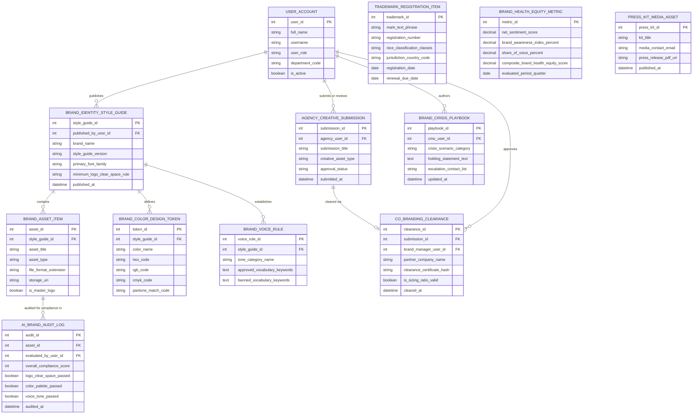

# Conceptual ERD — Brand Management System

## Mermaid Code

## Entity Description Table | Bảng mô tả Entity

| # | Entity Name | Vietnamese Name | Description | Key Attributes | Main Relationships |
|---|-------------|-----------------|-------------|----------------|-------------------|
| 1 | USER_ACCOUNT | Tài khoản Nguời dùng | System credentials and access roles for brand managers, creative directors, agency partners, and CMOs. | `user_id`, `username`, `user_role`, `department_code` | Publishes `BRAND_IDENTITY_STYLE_GUIDE`, reviews `AGENCY_CREATIVE_SUBMISSION`, approves `CO_BRANDING_CLEARANCE`. |
| 2 | BRAND_IDENTITY_STYLE_GUIDE | Cẩm nang Thương hiệu Style Guide | Master Brand Style Guide specification header storing font families, clear space rules, and publication dates. | `style_guide_id`, `published_by_user_id`, `brand_name`, `style_guide_version`, `minimum_logo_clear_space_rule` | Contains `BRAND_ASSET_ITEM`, defines `BRAND_COLOR_DESIGN_TOKEN`, establishes `BRAND_VOICE_RULE`. |
| 3 | BRAND_ASSET_ITEM | Asset Logo & Visual Brand | Vector logos (SVG/EPS), icon packages, typography assets, and master visual brand elements. | `asset_id`, `style_guide_id`, `asset_title`, `asset_type`, `storage_uri`, `is_master_logo` | Belongs to `BRAND_IDENTITY_STYLE_GUIDE`, audited in `AI_BRAND_AUDIT_LOG`. |
| 4 | BRAND_COLOR_DESIGN_TOKEN | Design Token Màu Thương hiệu | Color design token definition entity storing HEX, RGB, CMYK, and Pantone color match codes. | `token_id`, `style_guide_id`, `color_name`, `hex_code`, `rgb_code`, `pantone_match_code` | Belongs to `BRAND_IDENTITY_STYLE_GUIDE`. |
| 5 | BRAND_VOICE_RULE | Quy tắc Giọng văn Brand | Brand personality and voice tone guidelines defining approved vs banned vocabulary lists. | `voice_rule_id`, `style_guide_id`, `tone_category_name`, `approved_vocabulary_keywords`, `banned_vocabulary_keywords` | Belongs to `BRAND_IDENTITY_STYLE_GUIDE`. |
| 6 | AI_BRAND_AUDIT_LOG | Nhật ký Audit Compliance AI | Computer vision and NLP AI audit logs tracking overall compliance scores and visual rule passes/fails. | `audit_id`, `asset_id`, `evaluated_by_user_id`, `overall_compliance_score`, `logo_clear_space_passed`, `color_palette_passed` | Belongs to `BRAND_ASSET_ITEM`. |
| 7 | AGENCY_CREATIVE_SUBMISSION | Submission Creative Agency | Marketing collateral submissions from external agencies sent for brand compliance review. | `submission_id`, `agency_user_id`, `submission_title`, `creative_asset_type`, `approval_status` | Cleared via `CO_BRANDING_CLEARANCE`, submitted by `USER_ACCOUNT`. |
| 8 | CO_BRANDING_CLEARANCE | Chứng nhận Co-Branding | Partner co-branding logo lockup clearance certificate recording geometry checks and Brand Manager approvals. | `clearance_id`, `submission_id`, `brand_manager_user_id`, `partner_company_name`, `clearance_certificate_hash` | Belongs to `AGENCY_CREATIVE_SUBMISSION`, approved by `USER_ACCOUNT`. |
| 9 | TRADEMARK_REGISTRATION_ITEM | Mục Đăng ký Nhãn hiệu | Global legal trademark registration entry tracking mark text,USPTO/EUIPO reg numbers, NICE classes, and renewal dates. | `trademark_id`, `mark_text_phrase`, `registration_number`, `nice_classification_classes`, `renewal_due_date` | Standalone IP legal entity. |
| 10 | BRAND_HEALTH_EQUITY_METRIC | Chỉ số Sức khỏe Thương hiệu | Quarterly composite Brand Health Equity index ($BHEI$) aggregating Net Sentiment Score (NSS), awareness %, and SOV %. | `metric_id`, `net_sentiment_score`, `brand_awareness_index_percent`, `share_of_voice_percent`, `composite_brand_health_equity_score` | Standalone brand equity entity. |
| 11 | BRAND_CRISIS_PLAYBOOK | Playbook Xử lý Khủng hoảng | Pre-approved brand crisis response playbooks, holding statements, and emergency executive contact escalation trees. | `playbook_id`, `cmo_user_id`, `crisis_scenario_category`, `holding_statement_text`, `escalation_contact_list` | Authored by `USER_ACCOUNT`. |
| 12 | PRESS_KIT_MEDIA_ASSET | Press Kit Báo chí | Media press kit package storing corporate logos, executive headshot bios, and press releases. | `press_kit_id`, `kit_title`, `media_contact_email`, `press_release_pdf_uri`, `published_at` | Standalone PR media entity. |

## Relationship Description | Mô tả Quan hệ

| # | From Entity | Cardinality | To Entity | Label | Business Explanation |
|---|-------------|-------------|-----------|-------|----------------------|
| 1 | BRAND_IDENTITY_STYLE_GUIDE | 1 to 1..N | BRAND_ASSET_ITEM | contains | A Brand Style Guide contains multiple visual brand asset items. |
| 2 | BRAND_IDENTITY_STYLE_GUIDE | 1 to 1..N | BRAND_COLOR_DESIGN_TOKEN | defines | A Brand Style Guide defines brand color design tokens (HEX, Pantone). |
| 3 | BRAND_IDENTITY_STYLE_GUIDE | 1 to 1..N | BRAND_VOICE_RULE | establishes | A Brand Style Guide establishes brand voice and tone rules. |
| 4 | BRAND_ASSET_ITEM | 1 to 0..N | AI_BRAND_AUDIT_LOG | audited for compliance in | A brand asset item is audited for compliance in AI brand audit logs. |
| 5 | AGENCY_CREATIVE_SUBMISSION | 1 to 0..1 | CO_BRANDING_CLEARANCE | cleared via | An agency creative submission is cleared via a co-branding clearance certificate. |
| 6 | USER_ACCOUNT | 1 to 0..N | BRAND_IDENTITY_STYLE_GUIDE | publishes | A brand manager user account publishes Brand Style Guides. |
| 7 | USER_ACCOUNT | 1 to 0..N | AGENCY_CREATIVE_SUBMISSION | submits or reviews | An agency partner or brand manager user account submits/reviews agency submissions. |
| 8 | USER_ACCOUNT | 1 to 0..N | CO_BRANDING_CLEARANCE | approves | A brand manager user account approves co-branding clearances. |
| 9 | USER_ACCOUNT | 1 to 0..N | BRAND_CRISIS_PLAYBOOK | authors | A CMO user account authors brand crisis response playbooks. |
