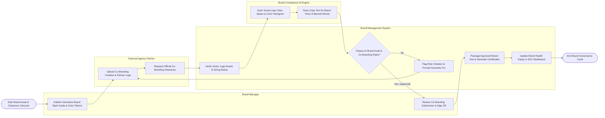

# Swimlane Diagram — Brand Management System

## Mermaid Code

## Flow Description | Mô tả luồng

| Lane | Actor | Role in Flow |
|------|-------|-------------|
| 1 | Brand Manager | Publishes interactive Brand Style Guides and CSS color tokens, sets clear space rules, reviews agency co-branding submissions, and signs off on brand clearance certificates. |
| 2 | External Agency Partner | Uploads co-branding marketing collateral and partner logos, generating logo lockups and submitting clearance requests. |
| 3 | Brand Management System | Verifies vector logo visual assets, validates visual $1:1$ height ratios, packages approved brand kits, generates cryptographic clearance certificates, and updates executive Brand Health Equity dashboards. |
| 4 | Brand Compliance AI Engine | Audits ad creative using computer vision AI (logo clear space boundaries, color pixel histograms) and NLP text analytics (banned words, brand voice tone). |
