# Action Tree — Brand Management System

## Mermaid Code

```mermaid
graph TD
    Root["Brand Management System"]

    Root --> M1["Brand Style Guide & Token Management"]
    Root --> M2["AI Brand Compliance & Content Audit"]
    Root --> M3["Co-Branding & Partner Governance"]
    Root --> M4["Trademark & Intellectual Property (IP) Legal"]
    Root --> M5["Brand Reputation & Sentiment Listening"]
    Root --> M6["Brand Health Equity & Crisis Management"]

    M1 --> A11["Publish Interactive Digital Web Style Guides"]
    M1 --> A12["Export Standardized CSS/SASS Color Design Tokens"]
    M1 --> A13["Define Master Vector Logo Clear Space & Minimum Sizes"]
    M1 --> A14["Configure Brand Voice Personality & Banned Words"]

    M2 --> A21["Execute Computer Vision Visual Logo Placement Audits"]
    M2 --> A22["Analyze Image Pixel Color Palette Histograms"]
    M2 --> A23["Audit Text Copy Tone of Voice with NLP Classifiers"]
    M2 --> A24["Scrape Web Pages to Inspect Front-End CSS Token Adherence"]

    M3 --> A31["Generate Partner Co-Branding Logo Lockups (1:1 Ratio)"]
    M3 --> A32["Review & Approve External Agency Creative Submissions"]
    M3 --> A33["Issue Cryptographic Co-Branding Clearance Certificates"]
    M3 --> A34["Manage Asset Expiration Dates & Watermark Permissions"]

    M4 --> A41["Track Global Trademark Registration Numbers & NICE Classes"]
    M4 --> A42["Monitor Trademark Renewal Due Dates & Alert Timers"]
    M4 --> A43["Detect Unauthorized Logo Misuse & Web Infringement"]
    M4 --> A44["Enforce Jurisdiction-Specific Legal Symbol Rules (® vs ™)"]

    M5 --> A51["Ingest Public Web & Social Media Brand Mention Feeds"]
    M5 --> A52["Classify Brand Sentiment (Positive, Neutral, Negative)"]
    M5 --> A53["Benchmark Brand Share of Voice (SOV) vs Competitors"]
    M5 --> A54["Render Brand Perception Attribute Spider Maps"]

    M6 --> A61["Calculate Composite Brand Health Equity Index (BHEI)"]
    M6 --> A62["Manage Pre-Approved Crisis Response Holding Statements"]
    M6 --> A63["Alert on Brand Reputation Drops & Negative Spikes (> 25%)"]
    M6 --> A64["Export Executive Global Brand Consistency Scorecards"]
```

## Module Description | Mô tả Module

| # | Module | Description | Actions |
|---|--------|-------------|---------|
| 1 | Brand Style Guide & Token Management | Publishes digital Brand Style Guides, exports CSS design tokens, sets master logo rules, and configures brand voice guidelines. | Publish Digital Style Guides, Export CSS Design Tokens, Define Master Logo Rules, Configure Brand Voice Guidelines. |
| 2 | AI Brand Compliance & Content Audit | Audits ad visual graphics using computer vision AI, analyzes color histograms, evaluates copy text tone, and scrapes web CSS tokens. | Execute Computer Vision Audits, Analyze Color Histograms, Audit Text Copy Tone, Scrape Web Pages for CSS Compliance. |
| 3 | Co-Branding & Partner Governance | Generates partner co-branding logo lockups, reviews agency creative submissions, issues clearance certificates, and sets asset watermarks. | Generate Co-Branding Lockups, Review Agency Creative Submissions, Issue Co-Branding Clearance Certificates, Manage Asset Expiration & Watermarks. |
| 4 | Trademark & Intellectual Property (IP) Legal | Tracks global trademark registrations, monitors renewal deadlines, detects unauthorized logo misuse, and enforces legal ®/™ symbol rules. | Track Global Trademark Registrations, Monitor Renewal Dates, Detect Unauthorized Logo Misuse, Enforce Legal Symbol Rules. |
| 5 | Brand Reputation & Sentiment Listening | Ingests brand mention feeds, classifies sentiment, benchmarks competitor Share of Voice, and renders brand attribute spider maps. | Ingest Brand Mention Feeds, Classify Brand Sentiment, Benchmark Competitor SOV, Render Perception Spider Maps. |
| 6 | Brand Health Equity & Crisis Management | Computes composite Brand Health Equity Index (BHEI), manages crisis playbooks, alerts on sentiment drops, and exports brand scorecards. | Calculate Composite BHEI Index, Manage Crisis Playbooks, Alert on Reputation Drops, Export Executive Brand Scorecards. |
