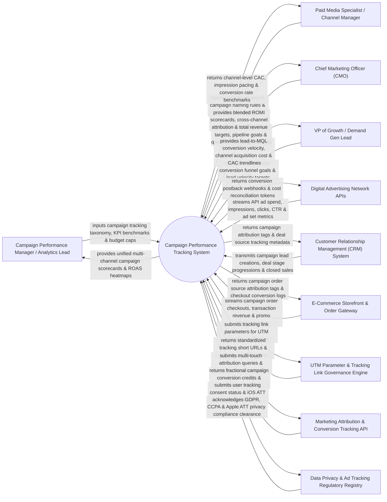

# Context Diagram — Campaign Performance Tracking System

## Mermaid Code

## Actor & Interaction Table | Bảng Actor & Tương tác

| # | Actor | Actor Type | Data Sent TO System | Data Received FROM System | Notes |
|---|-------|------------|---------------------|---------------------------|-------|
| 1 | Campaign Performance Manager / Analytics Lead | Primary | Campaign tracking taxonomy, KPI benchmarks (Target CAC/ROAS), campaign budget limits, channel attribution rules. | Unified multi-channel campaign scorecards, channel ROAS heatmaps, campaign pacing alerts. | Analytics leader monitoring global campaign performance across digital and offline channels. |
| 2 | Paid Media Specialist / Channel Manager | Primary | Channel ad spend entries, campaign naming conventions, UTM parameter links, creative ad set IDs. | Channel-level Customer Acquisition Cost (CAC), impression pacing stats, Click-Through Rate (CTR) benchmarks. | Specialist managing Google, Meta, and LinkedIn paid media ad campaigns and budget allocations. |
| 3 | Chief Marketing Officer (CMO) | Primary | Strategic ROI targets, quarterly marketing budgets, target payback period goals. | Blended Return on Marketing Investment (ROMI), cross-channel attribution reports, total pipeline revenue. | Executive evaluating global campaign contribution to enterprise revenue and brand growth. |
| 4 | VP of Growth / Demand Gen Lead | Primary | Campaign conversion funnel goals, lead velocity targets, channel scaling thresholds. | Lead-to-MQL conversion velocity, channel acquisition cost, CAC trendlines, growth pacing. | Growth executive scaling high-performing campaign channels and tuning acquisition funnels. |
| 5 | Digital Advertising Network APIs | Supporting | API ad spend, impression counts, click telemetry, Click-Through Rates (CTR), cost-per-click (CPC). | Conversion postback webhooks, CAPI server-side event dispatches, cost reconciliation tokens. | Ad network APIs (Google Ads, Meta, TikTok, LinkedIn) streaming real-time ad performance data. |
| 6 | Customer Relationship Management (CRM) System | Supporting | Campaign lead creations, deal pipeline stage progressions, closed-won opportunity sales value. | Campaign revenue attribution tags, deal source tracking metadata, campaign lead source history. | Enterprise CRM providing closed sales pipeline revenue data for campaign ROI mapping. |
| 7 | E-Commerce Storefront & Order Gateway | Supporting | Campaign order checkouts, net transaction revenue, promo code redemptions, customer refund events. | Campaign order source attribution tags, checkout conversion logs, UTM session tracking tags. | Storefront payment gateway providing e-commerce order revenue data mapped to campaign links. |
| 8 | UTM Parameter & Tracking Link Governance Engine | Supporting | Validated UTM parameters (`utm_source`, `utm_medium`, `utm_campaign`), short URL mappings. | Standardized tracking short URLs, UTM taxonomy validation tokens, broken link alerts. | Link governance service enforcing consistent UTM parameter naming conventions across campaigns. |
| 9 | Marketing Attribution & Conversion Tracking API | Supporting | Multi-touch attribution model outputs, fractional conversion credits, customer touchpoint sequences. | Campaign conversion event paths, attribution weight queries, touchpoint timestamps. | Attribution engine calculating multi-touch campaign revenue attribution models. |
| 10 | Data Privacy & Ad Tracking Regulatory Registry | Supporting / Regulatory | Apple App Tracking Transparency (ATT) guidelines, GDPR cookie consent rules, CCPA opt-out rules. | User tracking consent status verification, iOS ATT privacy compliance tokens. | Governance registry enforcing ad privacy laws and server-side Conversion API (CAPI) compliance. |

## System Boundary Description | Mô tả Phạm vi Hệ thống

The **Campaign Performance Tracking System** is an enterprise multi-channel campaign analytics, real-time ROAS tracking, UTM link governance, server-side Conversion API (CAPI) integration, and campaign budget pacing platform designed to measure the end-to-end performance of marketing campaigns.

**Inside System Scope:**
- Multi-channel ad spend aggregation ingesting APIs from Google Ads, Meta Ads, TikTok Ads, LinkedIn Ads, and Bing.
- Real-time Return on Ad Spend ($\text{ROAS} = \frac{\text{Attributed Revenue}}{\text{Ad Spend}}$), CAC, CPC, and CTR performance tracking.
- UTM parameter builder and tracking link governance engine enforcing standardized URL taxonomy.
- Server-side Conversion API (CAPI) dispatching privacy-compliant conversion webhooks to ad networks.
- Real-time campaign budget pacing alerts warning media buyers of over-spending or under-pacing campaigns.

**Outside System Scope:**
- Direct creation of ad copy text or graphic design assets (handled by Content Marketing and Design Systems).
- Direct physical hosting of corporate web servers (handled by Cloud Web Hosting Services).
- Direct processing of bank merchant payment transactions (handled by Payment Gateways).
