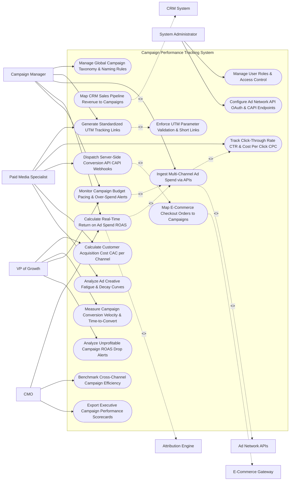

# Use Case Diagram — Campaign Performance Tracking System

## Mermaid Code

## Actor Table | Bảng Actor

| # | Actor | Actor Type | Role Description | Related Use Cases |
|---|-------|------------|------------------|-------------------|
| 1 | Campaign Manager | Primary | Analytics leader managing global campaign taxonomies, UTM links, ad spend ingestion, ROAS calculations, and budget pacing. | UC01, UC02, UC05, UC10, UC12 |
| 2 | Paid Media Specialist | Primary | Specialist building UTM links, monitoring CTR/CPC, dispatching server-side CAPI webhooks, measuring CAC, and tracking ad fatigue. | UC02, UC04, UC08, UC09, UC13 |
| 3 | CMO | Primary | Executive evaluating channel ROAS, cross-channel campaign efficiency, executive scorecards, and overall marketing contribution. | UC10, UC14, UC15 |
| 4 | VP of Growth | Primary | Growth leader monitoring CAC benchmarks, conversion velocity, budget pacing alerts, and unprofitable ROAS drop notifications. | UC09, UC11, UC12, UC18 |
| 5 | System Administrator | Primary | IT admin managing security roles, ad network OAuth credentials, and CAPI endpoint tokens. | UC16, UC17 |
| 6 | Ad Network APIs | System (Secondary) | Digital ad platforms (Google Ads, Meta, TikTok, LinkedIn) streaming API spend, clicks, and impressions. | UC05 |
| 7 | CRM System | System (Secondary) | Enterprise CRM providing closed-won sales opportunity values mapped to campaign source tags. | UC06 |
| 8 | E-Commerce Gateway | System (Secondary) | Storefront checkout engine supplying order revenue and transaction counts mapped to campaign links. | UC07 |
| 9 | Attribution Engine | System (Secondary) | Analytics service applying multi-touch attribution models to assign fractional campaign revenue credit. | UC10 |

## Use Case Table | Bảng Use Case

| # | UC ID | Use Case Name | Primary Actor | Secondary Actor | Description | Priority |
|---|-------|---------------|---------------|-----------------|-------------|----------|
| 1 | UC01 | Manage Global Campaign Taxonomy & Naming Rules | CampaignMgr | None | Defines standardized campaign naming conventions (e.g., `YYYY_Region_Channel_CampaignName`) and taxonomy rules. | High |
| 2 | UC02 | Generate Standardized UTM Tracking Links | MediaSpec | None | Generates standardized tracking URLs with validated `utm_source`, `utm_medium`, `utm_campaign`, and `utm_content` parameters. | Critical |
| 3 | UC03 | Enforce UTM Parameter Validation & Short Links | System | None | Enforces URL lowercasing, strips illegal spaces/characters, and generates shortened tracking links (`brand.co/c402`). | High |
| 4 | UC04 | Track Click-Through Rate CTR & Cost Per Click CPC | MediaSpec | Ad Networks | Tracks ad click telemetry, calculating Click-Through Rate ($\text{CTR} = \frac{\text{Clicks}}{\text{Impressions}} \times 100\%$) and Average CPC. | High |
| 5 | UC05 | Ingest Multi-Channel Ad Spend via APIs | CampaignMgr | Ad Networks | Ingests daily automated ad spend, impression, and click data from Google Ads, Meta Ads, TikTok, and LinkedIn via APIs. | Critical |
| 6 | UC06 | Map CRM Sales Pipeline Revenue to Campaigns | CampaignMgr | CRM System | Maps B2B enterprise closed-won sales deals in CRM to original campaign UTM tracking parameters. | Critical |
| 7 | UC07 | Map E-Commerce Checkout Orders to Campaigns | MediaSpec | E-Commerce | Maps e-commerce checkout transaction totals and promo code redemptions to originating campaign tracking links. | Critical |
| 8 | UC08 | Dispatch Server-Side Conversion API CAPI Webhooks | MediaSpec | E-Commerce | Sends privacy-compliant server-side CAPI conversion webhooks to Meta and Google Ads for iOS 14+ ad optimization. | Critical |
| 9 | UC09 | Calculate Customer Acquisition Cost CAC per Channel | MediaSpec | None | Computes channel-level Customer Acquisition Cost ($\text{CAC} = \frac{\text{Total Channel Spend}}{\text{Acquired Customers}}$) in real time. | Critical |
| 10 | UC10 | Calculate Real-Time Return on Ad Spend ROAS | CampaignMgr | Attribution API | Computes real-time Return on Ad Spend ($\text{ROAS} = \frac{\text{Attributed Revenue}}{\text{Ad Spend}}$) across channels and campaigns. | Critical |
| 11 | UC11 | Measure Campaign Conversion Velocity & Time-to-Convert | GrowthVP | None | Calculates average time (days/hours) elapsed between initial campaign ad click and final order conversion. | High |
| 12 | UC12 | Monitor Campaign Budget Pacing & Over-Spend Alerts | CampaignMgr | None | Compares daily campaign spend against projected monthly budget pacing targets, triggering over-spend warnings. | Critical |
| 13 | UC13 | Analyze Ad Creative Fatigue & Decay Curves | MediaSpec | None | Monitors CTR and conversion rate drop-offs over time to alert media buyers when ad creative suffers fatigue. | High |
| 14 | UC14 | Benchmark Cross-Channel Campaign Efficiency | CMO | None | Renders side-by-side performance benchmarks comparing ROAS, CAC, and conversion rates across search, social, and display. | High |
| 15 | UC15 | Export Executive Campaign Performance Scorecards | CMO | None | Renders executive scorecards detailing total campaign spend, total attributed revenue, blended ROAS, and top campaigns. | High |
| 16 | UC16 | Manage User Roles & Access Control | Admin | None | Controls user login credentials, RBAC permissions, and channel budget edit rights. | High |
| 17 | UC17 | Configure Ad Network API OAuth & CAPI Endpoints | Admin | None | Manages API OAuth 2.0 tokens, developer access keys, and server-side CAPI endpoint configurations. | High |
| 18 | UC18 | Analyze Unprofitable Campaign ROAS Drop Alerts | GrowthVP | None | Triggers alert notifications when a campaign's ROAS drops below $1.0\times$ or fails corporate hurdle targets. | High |

## Use Case Specification | Đặc tả Use Case

---

### UC02 — Generate Standardized UTM Tracking Links

| Field | Detail |
|-------|--------|
| **UC ID** | UC02 |
| **Use Case Name** | Generate Standardized UTM Tracking Links |
| **Actor(s)** | Primary: Paid Media Specialist, Campaign Manager   Secondary: None |
| **Description** | Generates standardized, error-free UTM tracking URLs enforcing lowercasing, space stripping, taxonomy rules, custom parameter tagging, and shortened URL creation. |
| **Precondition** | 1. Global campaign taxonomy and naming conventions are configured (UC01). |
| **Main Flow** | 1. User opens "UTM Tracking Link Builder Studio".   2. User selects Campaign Taxonomy: `2026_US_META_BlackFridaySale`.   3. User inputs Destination Base URL: `https://company.com/products/cloud-software`.   4. User inputs required UTM Parameters:   &nbsp;&nbsp;&nbsp;&nbsp; a. `utm_source`: `facebook` (Selected from dropdown).   &nbsp;&nbsp;&nbsp;&nbsp; b. `utm_medium`: `cpc` (Selected from dropdown).   &nbsp;&nbsp;&nbsp;&nbsp; c. `utm_campaign`: `2026_us_meta_blackfridaysale`.   &nbsp;&nbsp;&nbsp;&nbsp; d. `utm_content`: `video_ad_variant_a`.   &nbsp;&nbsp;&nbsp;&nbsp; e. `utm_term`: `cloud_security_software`.   5. User clicks "Generate & Validate Tracking Link".   6. System executes UC03 (Enforce UTM Parameter Validation & Short Links):   &nbsp;&nbsp;&nbsp;&nbsp; a. Validation: Converts all uppercase letters to lowercase -> `PASS`.   &nbsp;&nbsp;&nbsp;&nbsp; b. Space Stripping: Replaces spaces with underscores -> `PASS`.   &nbsp;&nbsp;&nbsp;&nbsp; c. Base URL Check: Validates HTTPS base URL returns HTTP 200 OK -> `PASS`.   7. System constructs Full Tracking URL: `https://company.com/products/cloud-software?utm_source=facebook&utm_medium=cpc&utm_campaign=2026_us_meta_blackfridaysale&utm_content=video_ad_variant_a&utm_term=cloud_security_software`.   8. System generates Shortened Tracking URL: `https://brand.co/c/bf2026a`.   9. System registers link in Campaign Tracking Registry and copies short link to user clipboard. |
| **Alternative Flow** | **AF1** — Bulk UTM Link Generation: User uploads CSV containing 50 ad creative variants; System bulk-generates 50 standardized UTM tracking links and exports them as a downloadable CSV. |
| **Exception Flow** | **EX1** — Non-Compliant Taxonomy Error: User inputs unauthorized `utm_medium` value (`"paid-social-ad"`); System flags error "Taxonomy Violation: Value not in approved utm_medium list - Select 'cpc' or 'social'", blocking link creation. |
| **Postcondition** | Standardized UTM tracking URL and short link are generated, validated against taxonomy rules, and logged in the link registry. |
| **Business Rule** | **BR1**: All generated UTM tracking URLs MUST enforce lowercase formatting, strip spaces, and validate parameters against approved taxonomy lists. |

---

### UC05 — Ingest Multi-Channel Ad Spend via APIs

| Field | Detail |
|-------|--------|
| **UC ID** | UC05 |
| **Use Case Name** | Ingest Multi-Channel Ad Spend via APIs |
| **Actor(s)** | Primary: Campaign Performance Manager   Secondary: Digital Advertising Network APIs |
| **Description** | Executes automated daily API ingestion pipelines fetching ad spend, impression counts, click telemetry, CPC, and CTR data from Google Ads, Meta Ads, TikTok Ads, and LinkedIn Ads. |
| **Precondition** | 1. OAuth 2.0 API connection tokens for Google, Meta, TikTok, and LinkedIn are active (UC17). |
| **Main Flow** | 1. System scheduler triggers Daily Ad Spend API Ingestion Job at 01:00 AM.   2. System dispatches API requests to connected ad networks:   &nbsp;&nbsp;&nbsp;&nbsp; a. Google Ads API (`GET /v14/customers/searchStream`): Fetches daily spend, impressions, clicks, CPC per campaign ID.   &nbsp;&nbsp;&nbsp;&nbsp; b. Meta Marketing API (`GET /v17.0/act_88412/insights`): Fetches ad set spend, reach, impressions, link clicks per campaign ID.   &nbsp;&nbsp;&nbsp;&nbsp; c. LinkedIn Marketing API (`GET /v2/adAnalyticsV2`): Fetches B2B ad campaign spend and click telemetry.   3. Ad Network APIs return daily spend payloads:   &nbsp;&nbsp;&nbsp;&nbsp; a. Google Ads Spend: `$12,500.00` (125,000 Impressions | 2,500 Clicks | CPC $5.00).   &nbsp;&nbsp;&nbsp;&nbsp; b. Meta Ads Spend: `$8,200.00` (164,000 Impressions | 3,280 Clicks | CPC $2.50).   &nbsp;&nbsp;&nbsp;&nbsp; c. LinkedIn Ads Spend: `$4,300.00` (21,500 Impressions | 430 Clicks | CPC $10.00).   &nbsp;&nbsp;&nbsp;&nbsp; d. Total Ingested Ad Spend: `$25,000.00`.   4. System maps external campaign IDs to internal Campaign Master Records using UTM tracking taxonomy.   5. System resolves multi-currency exchange rates (converts EUR/GBP ad spend to USD reporting currency).   6. System updates Campaign Spend Database and triggers ROAS calculations (UC10). |
| **Alternative Flow** | **AF1** — Manual Offline Media Cost Import: Analyst imports CSV file containing offline print/billboard ad spend ($15,000); System reconciles offline spend into total campaign expenditure. |
| **Exception Flow** | **EX1** — API OAuth Token Expiration (401): Meta API returns 401 Unauthorized; System catches error, flags connection as `TOKEN_EXPIRED`, dispatches alert to Admin, and logs failed sync. |
| **Postcondition** | Multi-channel ad spend, impression, and click telemetry are ingested via APIs, mapped to internal campaigns, and updated in database. |
| **Business Rule** | **BR1**: Daily ad spend data MUST be ingested via automated APIs and converted into a unified reporting currency (USD) before ROAS calculation. |

---

### UC08 — Dispatch Server-Side Conversion API (CAPI) Webhooks

| Field | Detail |
|-------|--------|
| **UC ID** | UC08 |
| **Use Case Name** | Dispatch Server-Side Conversion API (CAPI) Webhooks |
| **Actor(s)** | Primary: Paid Media Specialist   Secondary: E-Commerce Storefront & Order Gateway |
| **Description** | Dispatches privacy-compliant server-side Conversion API (CAPI) webhooks (Meta CAPI, Google Conversions API) upon e-commerce checkout completion to bypass client-side ad blocker loss and iOS 14+ ATT restrictions. |
| **Precondition** | 1. E-Commerce checkout order completed event occurs (UC07).   2. Meta CAPI Access Token and Pixel ID are configured.   3. Customer tracking consent checks are cleared. |
| **Main Flow** | 1. System receives real-time order completion webhook from E-Commerce Gateway:   &nbsp;&nbsp;&nbsp;&nbsp; a. Order ID: `ORD-99412`.   &nbsp;&nbsp;&nbsp;&nbsp; b. Order Value: `$150.00`.   &nbsp;&nbsp;&nbsp;&nbsp; c. Customer Identifiers: Email `john@acme.com`, Phone `+15550192`, IP `198.51.100.4`, User Agent.   &nbsp;&nbsp;&nbsp;&nbsp; d. Click Identifiers: Meta Click ID (`fbclid: iw_88412`), Google Click ID (`gclid: Cj_992`).   2. System applies SHA-256 Hashing to Customer Identifiers:   &nbsp;&nbsp;&nbsp;&nbsp; a. `em`: SHA-256 hash of `john@acme.com`.   &nbsp;&nbsp;&nbsp;&nbsp; b. `ph`: SHA-256 hash of `+15550192`.   3. System constructs Meta Server-Side CAPI JSON Payload:   &nbsp;&nbsp;&nbsp;&nbsp; a. `event_name`: `"Purchase"`.   &nbsp;&nbsp;&nbsp;&nbsp; b. `event_time`: Epoch timestamp.   &nbsp;&nbsp;&nbsp;&nbsp; c. `action_source`: `"website"`.   &nbsp;&nbsp;&nbsp;&nbsp; d. `user_data`: Hashed email, phone, IP, User Agent, `fbclid`.   &nbsp;&nbsp;&nbsp;&nbsp; e. `custom_data`: `currency: "USD"`, `value: 150.00`, `order_id: "ORD-99412"`.   4. System transmits HTTPS POST request to Meta Conversions API (`https://graph.facebook.com/v17.0/{pixel_id}/events`).   5. Meta CAPI Endpoint receives payload, matches conversion event to Meta ad account, and returns `HTTP 200 OK (events_received: 1)`.   6. System logs CAPI dispatch success and records event deduplication token (`ORD-99412`). |
| **Alternative Flow** | **AF1** — Google Ads Server-Side Conversion Upload: System simultaneously formats and transmits Google Ads Conversion API payload using `gclid` click token. |
| **Exception Flow** | **EX1** — Opted-Out User Suppression: Customer set `AD_TRACKING_CONSENT = FALSE`; System suppresses CAPI dispatch, logging compliance record `CAPI_DISPATCH_SUPPRESSED`. |
| **Postcondition** | Server-side conversion API payload is encrypted, dispatched to Meta/Google CAPI endpoints, matched to ad accounts, and logged. |
| **Business Rule** | **BR1**: Server-Side Conversion API (CAPI) webhooks MUST hash all customer PII (email, phone) using SHA-256 before transmitting over HTTPS. |

---

### UC10 — Calculate Real-Time Return on Ad Spend (ROAS)

| Field | Detail |
|-------|--------|
| **UC ID** | UC10 |
| **Use Case Name** | Calculate Real-Time Return on Ad Spend (ROAS) |
| **Actor(s)** | Primary: Campaign Performance Manager, Chief Marketing Officer   Secondary: Marketing Attribution & Conversion Tracking API |
| **Description** | Computes real-time Return on Ad Spend ($\text{ROAS} = \frac{\text{Attributed Gross Revenue}}{\text{Total Ad Spend}}$) for individual campaigns, ad sets, and overall channels, evaluating performance against corporate hurdle rates. |
| **Precondition** | 1. Ingested ad spend data is updated (UC05).   2. Attributed revenue from CRM or E-Commerce is mapped (UC06/UC07). |
| **Main Flow** | 1. User opens "Real-Time ROAS & Campaign Performance Console".   2. User selects Campaign: `2026_US_META_BlackFridaySale` and Date Range: `Last 30 Days`.   3. System retrieves Campaign Financial Telemetry:   &nbsp;&nbsp;&nbsp;&nbsp; a. Total Ingested Ad Spend ($S$): `$50,000.00`.   &nbsp;&nbsp;&nbsp;&nbsp; b. Total Attributed Gross Revenue ($R$): `$225,000.00` (From 1,500 converted orders).   4. System calculates Campaign ROAS Ratio:   $$\text{ROAS} = \frac{\text{Attributed Revenue}}{\text{Ad Spend}} = \frac{\$225,000.00}{\$50,000.00} = 4.50\times \text{ ROAS}$$   5. System calculates ROAS Percentage: $4.50 \times 100\% = 450.0\% \text{ ROAS}$.   6. System evaluates ROAS Hurdle Benchmark: Hurdle Target = $3.00\times$ -> Result ($4.50\times$) >= Target ($3.00\times$) -> `HIGH_PERFORMING_CAMPAIGN` (Green Badge).   7. System calculates Net Margin ROAS: Deducts COGS (60%) -> Net Revenue ($90,000) / Spend ($50,000) = $1.80\times \text{ Net ROAS}$.   8. System renders ROAS Heatmap comparing Meta ($4.50\times$), Google Search ($3.80\times$), and LinkedIn ($1.20\times$). |
| **Alternative Flow** | **AF1** — Multi-Touch Attributed ROAS View: System calculates ROAS across 5 attribution models (First-Touch $5.2\times$, Last-Touch $4.5\times$, Data-Driven $4.1\times$) to analyze model variance. |
| **Exception Flow** | **EX1** — Unprofitable ROAS Trigger: Campaign ROAS drops below $1.00\times$ ($0.75\times$ ROAS); System triggers UC18 (Analyze Unprofitable Campaign ROAS Drop Alerts), alerting media buyer to pause ad set. |
| **Postcondition** | Campaign ROAS multiplier and percentage are calculated, benchmarked against hurdle rates, and rendered on performance dashboards. |
| **Business Rule** | **BR1**: Campaign performance dashboards MUST display both Gross ROAS ($\frac{\text{Gross Revenue}}{\text{Spend}}$) and Net ROAS ($\frac{\text{Net Margin Revenue}}{\text{Spend}}$). |

---

### UC12 — Monitor Campaign Budget Pacing & Over-Spend Alerts

| Field | Detail |
|-------|--------|
| **UC ID** | UC12 |
| **Use Case Name** | Monitor Campaign Budget Pacing & Over-Spend Alerts |
| **Actor(s)** | Primary: Campaign Performance Manager, VP of Growth   Secondary: None |
| **Description** | Compares real-time daily campaign ad spend against projected monthly budget pacing trajectories, dispatching urgent over-spend warnings or under-pacing alerts to media buyers. |
| **Precondition** | 1. Monthly campaign budget cap (e.g., $100,000/month) is configured.   2. Daily API ad spend is ingested continuously (UC05). |
| **Main Flow** | 1. System executes Campaign Budget Pacing Monitor on Day 15 of 30-day month.   2. System retrieves Campaign Budget Parameters:   &nbsp;&nbsp;&nbsp;&nbsp; a. Total Monthly Campaign Budget Cap ($B$): `$100,000.00`.   &nbsp;&nbsp;&nbsp;&nbsp; b. Days Elapsed in Month ($d$): `15 Days` (50.0% of month elapsed).   &nbsp;&nbsp;&nbsp;&nbsp; c. Expected Ideal Budget Spent to Date: $\$100,000 \times 50.0\% = \$50,000.00$.   3. System retrieves Actual Cumulative Ad Spend to Date ($A$): `$72,500.00`.   4. System calculates Budget Pacing Percentage:   $$\text{Pacing Percentage} = \frac{\text{Actual Spend}}{\text{Expected Spend}} \times 100\% = \frac{\$72,500}{\$50,000} \times 100\% = 145.0\% \text{ Pacing}$$   5. System projects Month-End Total Spend ($P$): $\$72,500 \times \frac{30}{15} = \$145,000.00$ (Projected Over-Spend: +$45,000 / +45%).   6. System evaluates Pacing Threshold Rules: Pacing (145.0%) > Maximum Threshold (110.0%) -> `CRITICAL_OVER_SPEND_RISK`.   7. System dispatches Urgent Alert Notifications to Media Specialist and VP of Growth:   &nbsp;&nbsp;&nbsp;&nbsp; a. Alert Title: `"CRITICAL: Campaign Over-Spending by 45%"`.   &nbsp;&nbsp;&nbsp;&nbsp; b. Recommended Action: `"Reduce daily ad set budget cap from $4,833/day to $1,833/day to remain within $100K cap"`.   8. Media buyer adjusts daily budget cap in Meta Ads Manager; System updates pacing trajectory to `100.0% RE-ALIGNED`. |
| **Alternative Flow** | **AF1** — Under-Pacing Budget Alert: Actual Spend is $20,000 on Day 15 (40.0% Pacing); System dispatches alert "Under-Pacing Warning: Campaign has spent only 20% of monthly budget - Increase daily bid limits". |
| **Exception Flow** | **EX1** — Hard Budget Cap Auto-Pause: Campaign reaches 100% of monthly budget ($100,000) on Day 22; System dispatches emergency automated API command to pause active ad sets. |
| **Postcondition** | Budget pacing percentage and month-end spend projections are calculated, over-spend alerts are dispatched, and budget re-alignments log. |
| **Business Rule** | **BR1**: Campaigns over-spending by >= 15% of projected daily pacing targets MUST trigger automated over-spend alert notifications. |
