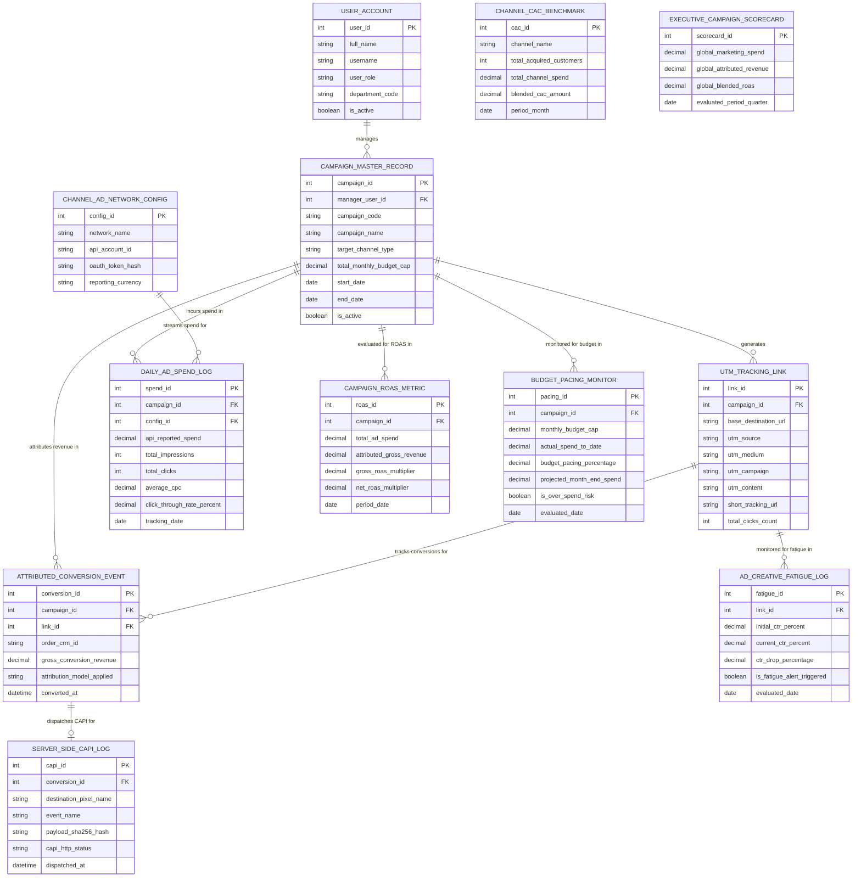

# Conceptual ERD — Campaign Performance Tracking System

## Mermaid Code

## Entity Description Table | Bảng mô tả Entity

| # | Entity Name | Vietnamese Name | Description | Key Attributes | Main Relationships |
|---|-------------|-----------------|-------------|----------------|-------------------|
| 1 | USER_ACCOUNT | Tài khoản Nguời dùng | System credentials and access roles for campaign managers, media specialists, CMOs, and admins. | `user_id`, `username`, `user_role`, `department_code` | Manages `CAMPAIGN_MASTER_RECORD`. |
| 2 | CAMPAIGN_MASTER_RECORD | Bản ghi Chiến dịch Master | Master campaign entity storing campaign code, name, target channel, monthly budget cap, and active dates. | `campaign_id`, `manager_user_id`, `campaign_code`, `campaign_name`, `total_monthly_budget_cap`, `start_date` | Generates `UTM_TRACKING_LINK`, incurs `DAILY_AD_SPEND_LOG`, attributes revenue in `ATTRIBUTED_CONVERSION_EVENT`, evaluated in `CAMPAIGN_ROAS_METRIC`. |
| 3 | CHANNEL_AD_NETWORK_CONFIG | Cấu hình Mạng Quảng cáo | Digital ad network API connection configuration storing network name, API account ID, and OAuth tokens. | `config_id`, `network_name`, `api_account_id`, `reporting_currency` | Streams spend for `DAILY_AD_SPEND_LOG`. |
| 4 | UTM_TRACKING_LINK | Link Tracking UTM | Standardized UTM tracking link specifying base URL, `utm_source`, `utm_medium`, `utm_campaign`, and short URLs. | `link_id`, `campaign_id`, `base_destination_url`, `utm_source`, `utm_medium`, `utm_campaign`, `short_tracking_url` | Belongs to `CAMPAIGN_MASTER_RECORD`, tracks `ATTRIBUTED_CONVERSION_EVENT`, monitored in `AD_CREATIVE_FATIGUE_LOG`. |
| 5 | DAILY_AD_SPEND_LOG | Nhật ký Daily Spend Quảng cáo | Ingested daily ad spend log tracking API reported spend, impressions, clicks, CPC, and CTR per campaign. | `spend_id`, `campaign_id`, `config_id`, `api_reported_spend`, `total_impressions`, `total_clicks`, `average_cpc`, `tracking_date` | Belongs to `CAMPAIGN_MASTER_RECORD` and `CHANNEL_AD_NETWORK_CONFIG`. |
| 6 | ATTRIBUTED_CONVERSION_EVENT | Sự kiện Chuyển đổi Attribution | Attributed sales conversion record linking e-commerce orders or CRM deals to specific campaign tracking links. | `conversion_id`, `campaign_id`, `link_id`, `order_crm_id`, `gross_conversion_revenue`, `attribution_model_applied` | Belongs to `CAMPAIGN_MASTER_RECORD` and `UTM_TRACKING_LINK`, dispatches `SERVER_SIDE_CAPI_LOG`. |
| 7 | SERVER_SIDE_CAPI_LOG | Nhật ký Dispatch Server CAPI | Privacy-compliant server-side Conversion API log recording SHA-256 encrypted CAPI dispatches to Meta/Google. | `capi_id`, `conversion_id`, `destination_pixel_name`, `event_name`, `payload_sha256_hash`, `capi_http_status` | Belongs to `ATTRIBUTED_CONVERSION_EVENT`. |
| 8 | CAMPAIGN_ROAS_METRIC | Chỉ số ROAS Chiến dịch | Monthly campaign ROAS evaluation log recording total spend, attributed revenue, gross ROAS, and net ROAS. | `roas_id`, `campaign_id`, `total_ad_spend`, `attributed_gross_revenue`, `gross_roas_multiplier`, `net_roas_multiplier` | Belongs to `CAMPAIGN_MASTER_RECORD`. |
| 9 | CHANNEL_CAC_BENCHMARK | Benchmark CAC Kênh | Channel-level Customer Acquisition Cost benchmark tracking acquired customers, channel spend, and blended CAC. | `cac_id`, `channel_name`, `total_acquired_customers`, `total_channel_spend`, `blended_cac_amount` | Standalone channel performance entity. |
| 10 | BUDGET_PACING_MONITOR | Monitor Pacing Ngân sách | Real-time budget pacing tracking log recording monthly budget caps, actual spend to date, pacing %, and over-spend risk flags. | `pacing_id`, `campaign_id`, `monthly_budget_cap`, `actual_spend_to_date`, `budget_pacing_percentage`, `is_over_spend_risk` | Belongs to `CAMPAIGN_MASTER_RECORD`. |
| 11 | AD_CREATIVE_FATIGUE_LOG | Nhật ký Fatigue Creative | Ad creative fatigue monitoring log tracking initial CTR %, current CTR %, CTR drop %, and fatigue alert flags. | `fatigue_id`, `link_id`, `initial_ctr_percent`, `current_ctr_percent`, `ctr_drop_percentage`, `is_fatigue_alert_triggered` | Belongs to `UTM_TRACKING_LINK`. |
| 12 | EXECUTIVE_CAMPAIGN_SCORECARD | Scorecard Executive Campaign | Executive campaign scorecard aggregating global marketing spend, global attributed revenue, and blended ROAS multipliers. | `scorecard_id`, `global_marketing_spend`, `global_attributed_revenue`, `global_blended_roas` | Standalone executive performance entity. |

## Relationship Description | Mô tả Quan hệ

| # | From Entity | Cardinality | To Entity | Label | Business Explanation |
|---|-------------|-------------|-----------|-------|----------------------|
| 1 | CAMPAIGN_MASTER_RECORD | 1 to 1..N | UTM_TRACKING_LINK | generates | A master campaign record generates standardized UTM tracking links. |
| 2 | CAMPAIGN_MASTER_RECORD | 1 to 0..N | DAILY_AD_SPEND_LOG | incurs spend in | A master campaign record incurs daily ad spend ingested via APIs. |
| 3 | CAMPAIGN_MASTER_RECORD | 1 to 0..N | ATTRIBUTED_CONVERSION_EVENT | attributes revenue in | A master campaign record attributes sales revenue from conversion events. |
| 4 | CAMPAIGN_MASTER_RECORD | 1 to 0..N | CAMPAIGN_ROAS_METRIC | evaluated for ROAS in | A master campaign record is evaluated for ROAS multipliers in monthly logs. |
| 5 | CAMPAIGN_MASTER_RECORD | 1 to 0..N | BUDGET_PACING_MONITOR | monitored for budget in | A master campaign record is monitored for budget pacing and over-spend. |
| 6 | CHANNEL_AD_NETWORK_CONFIG | 1 to 0..N | DAILY_AD_SPEND_LOG | streams spend for | An ad network config streams API ad spend into daily ad spend logs. |
| 7 | UTM_TRACKING_LINK | 1 to 0..N | ATTRIBUTED_CONVERSION_EVENT | tracks conversions for | A UTM tracking link tracks attributed conversion events. |
| 8 | UTM_TRACKING_LINK | 1 to 0..N | AD_CREATIVE_FATIGUE_LOG | monitored for fatigue in | A UTM tracking link is monitored for ad creative CTR fatigue over time. |
| 9 | ATTRIBUTED_CONVERSION_EVENT | 1 to 0..1 | SERVER_SIDE_CAPI_LOG | dispatches CAPI for | An attributed conversion event dispatches server-side CAPI webhooks. |
| 10 | USER_ACCOUNT | 1 to 0..N | CAMPAIGN_MASTER_RECORD | manages | A campaign manager user account manages master campaign records. |
