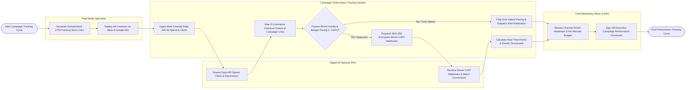

# Swimlane Diagram — Campaign Performance Tracking System

## Mermaid Code

## Flow Description | Mô tả luồng

| Lane | Actor | Role in Flow |
|------|-------|-------------|
| 1 | Paid Media Specialist | Builds standardized UTM tracking short links, deploys ad creatives across Google/Meta/LinkedIn, and configures campaign parameter tags. |
| 2 | Campaign Performance Tracking System | Ingests daily ad spend APIs, maps e-commerce checkout orders to campaign links, evaluates ROAS multipliers, monitors budget pacing ($< 110\%$), dispatches SHA-256 encrypted server-side CAPI webhooks, and renders campaign scorecards. |
| 3 | Digital Ad Network APIs | Streams daily ad spend, impression, and click telemetry via APIs, ingesting server-side CAPI conversion webhooks to optimize ad targeting. |
| 4 | Chief Marketing Officer (CMO) | Reviews channel ROAS heatmaps, re-allocates quarterly marketing budgets to high-performing channels, and signs off on executive campaign scorecards. |
