# Action Tree — Campaign Performance Tracking System

## Mermaid Code

```mermaid
graph TD
    Root["Campaign Performance Tracking System"]

    Root --> M1["UTM Link Governance & Taxonomy"]
    Root --> M2["Multi-Channel Ad Spend API Ingestion"]
    Root --> M3["Server-Side CAPI & Conversion Tracking"]
    Root --> M4["Real-Time ROAS & Attribution Engine"]
    Root --> M5["Budget Pacing & Over-Spend Alerting"]
    Root --> M6["Ad Creative Fatigue & Executive Scorecards"]

    M1 --> A11["Define Global Campaign Naming Conventions & Taxonomy"]
    M1 --> A12["Generate Standardized UTM Tracking Short Links (brand.co/c402)"]
    M1 --> A13["Validate UTM Parameters & Strip Illegal Whitespace"]
    M1 --> A14["Export Bulk UTM Links as Downloadable CSV Packages"]

    M2 --> A21["Ingest Daily API Ad Spend (Google, Meta, TikTok, LinkedIn)"]
    M2 --> A22["Track Click-Through Rate CTR & Cost Per Click CPC Telemetry"]
    M2 --> A23["Map External Ad Network Campaign IDs to Master Records"]
    M2 --> A24["Reconcile Multi-Currency Exchange Rates into Reporting Currency (USD)"]

    M3 --> A31["Map E-Commerce Checkout Orders & CRM Sales Deals to Campaigns"]
    M3 --> A32["Apply SHA-256 Hashing to Customer Email & Phone Identifiers"]
    M3 --> A33["Dispatch Server-Side CAPI Webhooks to Meta & Google Ads APIs"]
    M3 --> A34["Enforce Privacy Consent Filters & Suppress Opted-Out Events"]

    M4 --> A41["Calculate Real-Time Return on Ad Spend (ROAS = Revenue / Spend)"]
    M4 --> A42["Measure Channel-Level Customer Acquisition Cost (Blended CAC)"]
    M4 --> A43["Evaluate Gross ROAS vs Net Margin ROAS Multipliers"]
    M4 --> A44["Calculate Campaign Conversion Velocity & Time-to-Convert"]

    M5 --> A51["Monitor Real-Time Daily Campaign Budget Pacing Trajectories"]
    M5 --> A52["Project Month-End Campaign Total Expenditure"]
    M5 --> A53["Dispatch Urgent Over-Spend Alerts (Pacing > 115%)"]
    M5 --> A54["Auto-Pause Ad Sets when Monthly Budget Cap is Reached"]

    M6 --> A61["Monitor Ad Creative Click-Through Rate CTR Decay & Fatigue Curves"]
    M6 --> A62["Benchmark Cross-Channel Performance Efficiency (Search vs Social)"]
    M6 --> A63["Alert on Unprofitable Campaign ROAS Drops (< 1.0x ROAS)"]
    M6 --> A64["Export Executive Global Campaign Performance Scorecard PDFs"]
```

## Module Description | Mô tả Module

| # | Module | Description | Actions |
|---|--------|-------------|---------|
| 1 | UTM Link Governance & Taxonomy | Defines global campaign naming rules, generates standardized UTM tracking short links, validates parameters, and exports bulk CSVs. | Define Global Naming Rules, Generate UTM Tracking Links, Validate UTM Parameters, Export Bulk UTM CSVs. |
| 2 | Multi-Channel Ad Spend API Ingestion | Ingests daily ad spend via APIs, tracks CTR/CPC telemetry, maps external campaign IDs, and reconciles multi-currency rates. | Ingest Daily API Ad Spend, Track CTR & CPC Telemetry, Map External Campaign IDs, Reconcile Multi-Currency Rates. |
| 3 | Server-Side CAPI & Conversion Tracking | Maps orders and CRM deals to campaigns, hashes customer PII using SHA-256, dispatches server-side CAPI webhooks, and enforces privacy consent filters. | Map Orders & CRM Deals to Campaigns, Apply SHA-256 PII Hashing, Dispatch Server-Side CAPI Webhooks, Enforce Privacy Consent Filters. |
| 4 | Real-Time ROAS & Attribution Engine | Calculates real-time ROAS multipliers, measures blended CAC per channel, evaluates Gross vs Net ROAS, and tracks conversion velocity. | Calculate Real-Time ROAS Multipliers, Measure Channel Blended CAC, Evaluate Gross vs Net ROAS, Track Conversion Velocity. |
| 5 | Budget Pacing & Over-Spend Alerting | Monitors daily budget pacing trajectories, projects month-end spend, dispatches over-spend alerts, and auto-pauses ad sets when caps are hit. | Monitor Daily Budget Pacing, Project Month-End Spend, Dispatch Over-Spend Alerts, Auto-Pause Ad Sets at Cap. |
| 6 | Ad Creative Fatigue & Executive Scorecards | Monitors ad CTR decay curves, benchmarks cross-channel efficiency, alerts on unprofitable ROAS drops, and exports executive scorecards. | Monitor Ad Creative CTR Decay, Benchmark Cross-Channel Efficiency, Alert on Unprofitable ROAS Drops, Export Executive Campaign Scorecards. |
