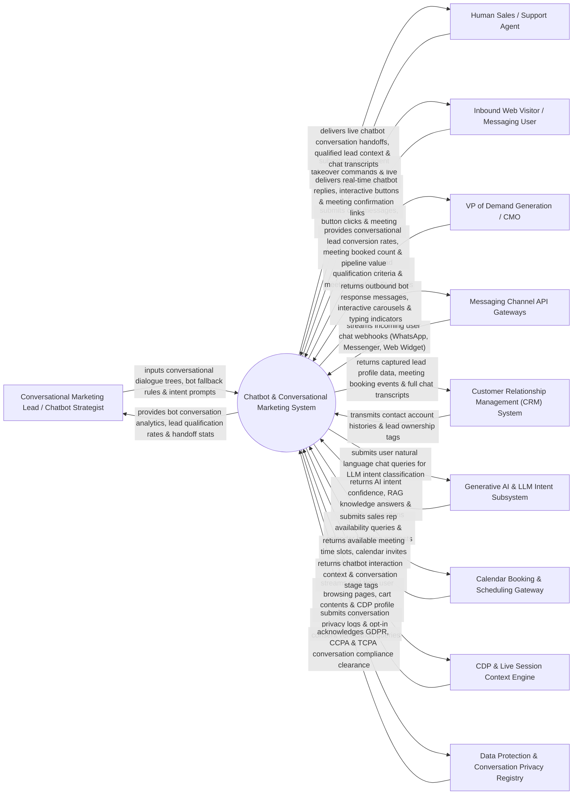

# Context Diagram — Chatbot & Conversational Marketing System

## Mermaid Code

## Actor & Interaction Table | Bảng Actor & Tương tác

| # | Actor | Actor Type | Data Sent TO System | Data Received FROM System | Notes |
|---|-------|------------|---------------------|---------------------------|-------|
| 1 | Conversational Marketing Lead / Chatbot Strategist | Primary | Dialogue decision trees, bot fallback rules, LLM prompt templates, lead qualification script branches. | Bot conversation analytics, lead qualification conversion rates, human handoff stats, chat sentiment heatmaps. | Strategist designing automated chatbot playbooks, tuning LLM prompts, and optimizing conversational lead capture. |
| 2 | Human Sales / Support Agent | Primary | Human agent takeover commands, live chat response messages, agent availability status (`Online/Offline`). | Live chatbot conversation handoff alerts, enriched lead context, complete chat transcripts, meeting notes. | Sales rep or support agent taking over live chat conversations when a bot qualifies a high-value lead. |
| 3 | Inbound Web Visitor / Messaging User | Primary | Natural language chat messages, interactive button selections, email/phone contact details, meeting time picks. | Instant sub-second bot replies, interactive quick-reply buttons, product carousels, calendar booking links. | Prospective buyer or customer interacting with the chatbot on web widgets, WhatsApp, or Facebook Messenger. |
| 4 | VP of Demand Generation / CMO | Primary | Conversational lead qualification criteria, meeting booking targets, bot response SLA limits. | Conversational lead conversion rates, total meetings booked count, pipeline revenue generated, bot ROI. | Executive monitoring conversational marketing performance, lead generation volume, and sales pipeline lift. |
| 5 | Messaging Channel API Gateways | Supporting | Incoming chat message webhooks (WhatsApp Business API, Facebook Messenger API, Web Chat Widget API). | Outbound bot response payloads, interactive button carousels, media attachments, typing indicators. | Communication gateways streaming user messages across WhatsApp, Messenger, and website chat widgets. |
| 6 | Customer Relationship Management (CRM) System | Supporting | Contact account profiles, lead owner assignments, past interaction histories. | Captured lead profile payloads, meeting booking calendar events, full chat transcript attachments. | Enterprise CRM storing qualified leads captured by chatbots and attaching conversation transcripts. |
| 7 | Generative AI & LLM Intent Recognition Subsystem | Supporting | Natural language user queries, context embeddings, RAG knowledge base documents. | AI intent classification, RAG knowledge retrieval answers, extracted entity key-values (Name, Email, Size). | LLM service (OpenAI GPT-4 / Anthropic Claude) performing intent parsing and retrieval-augmented generation. |
| 8 | Calendar Booking & Meeting Scheduling Gateway | Supporting | Sales rep calendar availability slots (Calendly API / Google Calendar / Outlook Calendar). | Confirmed meeting time slots, automated calendar invites (`.ics`), booking receipt tokens. | Scheduling integration booking sales demo meetings directly inside the chatbot conversation stream. |
| 9 | CDP & Live Session Context Engine | Supporting | Real-time user browsing page URLs, current cart items, past purchase traits, geographic location. | Chatbot interaction context tags, conversation stage updates, live visitor intent tags. | Central CDP supplying real-time visitor browsing context to personalize chatbot greeting messages. |
| 10 | Data Protection & Conversation Privacy Regulatory Registry | Supporting / Regulatory | GDPR chat logging consent policies, TCPA WhatsApp messaging rules, CCPA privacy disclosures. | Conversation privacy clearance receipts, opt-out suppression verification tokens. | Regulatory framework ensuring chatbot message processing complies with data privacy laws. |

## System Boundary Description | Mô tả Phạm vi Hệ thống

The **Chatbot & Conversational Marketing System** is an enterprise AI chatbot, natural language understanding (NLU), Generative AI (LLM), automated lead qualification, live agent handoff, and calendar booking platform designed to engage website visitors 24/7.

**Inside System Scope:**
- Visual drag-and-drop conversational playbook builder supporting rule-based dialogue trees and LLM generative fallback nodes.
- Multi-channel support ingesting chat streams from Web Widgets, WhatsApp Business, Facebook Messenger, and SMS.
- Real-time Generative AI (LLM) intent classification, entity extraction (Name, Email, Company Size), and RAG knowledge base retrieval.
- Automated meeting scheduling integrating Calendly/Google Calendar APIs directly within the chat interface.
- Seamless human sales rep live takeover with real-time browser desktop push alerts and CRM transcript attachments.

**Outside System Scope:**
- Direct physical repair of customer hardware products (handled by Physical Field Service Technicians).
- Direct manual composition of legal contracts (handled by Corporate Legal Counsel).
- Direct hosting of physical cellular tower infrastructure (handled by Mobile Telecom Carriers).
