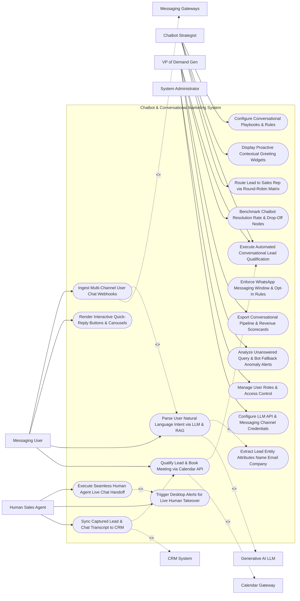

# Use Case Diagram — Chatbot & Conversational Marketing System

## Mermaid Code

## Actor Table | Bảng Actor

| # | Actor | Actor Type | Role Description | Related Use Cases |
|---|-------|------------|------------------|-------------------|
| 1 | Chatbot Strategist | Primary | Conversational marketer designing playbook flows, proactive greetings, qualification rules, and round-robin routing logic. | UC01, UC03, UC07, UC09 |
| 2 | Human Sales Agent | Primary | Sales representative accepting live chatbot handoffs, conducting live chat sessions, and logging CRM notes. | UC10, UC11, UC12 |
| 3 | Messaging User | Primary | Inbound visitor chatting on web widgets, WhatsApp, or Messenger, receiving bot replies and booking meetings. | UC02, UC04, UC05, UC08 |
| 4 | VP of Demand Gen | Primary | Executive monitoring chatbot lead qualification rates, resolution rates, pipeline revenue, and bot alerts. | UC07, UC14, UC15, UC18 |
| 5 | System Administrator | Primary | IT admin managing user security roles, LLM API keys, and messaging channel API webhooks. | UC16, UC17 |
| 6 | Messaging Gateways | System (Secondary) | API gateways (WhatsApp, Messenger, Web Chat) streaming chat webhooks and delivering bot messages. | UC02 |
| 7 | Generative AI LLM | System (Secondary) | LLM service (OpenAI/Anthropic) performing natural language intent parsing, entity extraction, and RAG search. | UC05 |
| 8 | Calendar Gateway | System (Secondary) | Calendar scheduling service (Calendly/Google Calendar) booking sales demo meetings directly in chat. | UC08 |
| 9 | CRM System | System (Secondary) | Enterprise CRM receiving captured lead profiles, booked meeting events, and full chat transcripts. | UC12 |

## Use Case Table | Bảng Use Case

| # | UC ID | Use Case Name | Primary Actor | Secondary Actor | Description | Priority |
|---|-------|---------------|---------------|-----------------|-------------|----------|
| 1 | UC01 | Configure Conversational Playbooks & Rules | Strategist | None | Designs visual chatbot playbooks featuring decision trees, quick-reply buttons, conditional branches, and fallbacks. | Critical |
| 2 | UC02 | Ingest Multi-Channel User Chat Webhooks | Visitor | Gateways | Ingests real-time chat message webhooks from Web Widgets, WhatsApp Business API, and Facebook Messenger API. | Critical |
| 3 | UC03 | Display Proactive Contextual Greeting Widgets | Strategist | None | Displays proactive chat popups based on visitor browsing context (e.g., "Need help choosing an enterprise plan?"). | High |
| 4 | UC04 | Render Interactive Quick-Reply Buttons & Carousels | Visitor | None | Renders interactive quick-reply buttons, product carousels, and multi-choice option cards in the chat window. | High |
| 5 | UC05 | Parse User Natural Language Intent via LLM & RAG | Visitor | Generative LLM | Uses LLM NLU models and Retrieval-Augmented Generation (RAG) to understand complex user questions and generate answers. | Critical |
| 6 | UC06 | Extract Lead Entity Attributes Name Email Company | System | Generative LLM | Automatically extracts key lead entity attributes (First Name, Work Email, Company Name, Employee Count) from chat text. | Critical |
| 7 | UC07 | Execute Automated Conversational Lead Qualification | DemandGenVP | None | Evaluates captured lead entity attributes against MQL qualification criteria (e.g., Company Size > 100) inside chat. | Critical |
| 8 | UC08 | Qualify Lead & Book Meeting via Calendar API | Visitor | Calendar GW | Displays real-time sales rep calendar availability slots and schedules a sales demo meeting directly inside the chat. | Critical |
| 9 | UC09 | Route Lead to Sales Rep via Round-Robin Matrix | Strategist | None | Assigns booked demo meetings and live handoffs to sales reps based on territory, account tier, and round-robin matrices. | High |
| 10 | UC10 | Execute Seamless Human Agent Live Chat Handoff | HumanAgent | None | Transfers active chat conversation from AI bot to a live human sales rep without losing conversation context. | Critical |
| 11 | UC11 | Trigger Desktop Alerts for Live Human Takeover | HumanAgent | None | Dispatches real-time browser desktop push alerts and Slack notifications when a high-value lead requests a human rep. | High |
| 12 | UC12 | Sync Captured Lead & Chat Transcript to CRM | HumanAgent | CRM System | Automatically creates or updates lead contact records in CRM, attaching the complete HTML/text conversation transcript. | Critical |
| 13 | UC13 | Enforce WhatsApp Messaging Window & Opt-In Rules | System | None | Enforces WhatsApp 24-hour customer service window rules and verifies opt-in consent before sending outbound templates. | High |
| 14 | UC14 | Benchmark Chatbot Resolution Rate & Drop-Off Nodes | DemandGenVP | None | Measures chatbot self-service resolution percentage, drop-off nodes, and un-answered query frequency. | High |
| 15 | UC15 | Export Conversational Pipeline & Revenue Scorecards | DemandGenVP | None | Renders executive scorecards detailing total chat conversations, leads qualified, meetings booked, and pipeline value. | High |
| 16 | UC16 | Manage User Roles & Access Control | Admin | None | Controls user login credentials, RBAC permissions, and human agent live chat assignment authorization. | High |
| 17 | UC17 | Configure LLM API & Messaging Channel Credentials | Admin | None | Configures API keys for OpenAI, Anthropic, WhatsApp Business, Facebook Messenger, and Calendly. | High |
| 18 | UC18 | Analyze Unanswered Query & Bot Fallback Anomaly Alerts | DemandGenVP | None | Dispatches alert notifications when bot fallback rate spikes $> 15\%$ or LLM intent confidence drops below 60%. | High |

## Use Case Specification | Đặc tả Use Case

---

### UC02 — Ingest Multi-Channel User Chat Webhooks

| Field | Detail |
|-------|--------|
| **UC ID** | UC02 |
| **Use Case Name** | Ingest Multi-Channel User Chat Webhooks |
| **Actor(s)** | Primary: Inbound Web Visitor / Messaging User   Secondary: Messaging Channel API Gateways |
| **Description** | Ingests real-time inbound user chat message webhooks across Web Chat Widgets, WhatsApp Business API, and Facebook Messenger API, parsing user text and button selections in sub-seconds. |
| **Precondition** | 1. Messaging channel API webhook listeners (WhatsApp/Messenger/Web Widget) are connected and authorized. |
| **Main Flow** | 1. Inbound Visitor submits message on website chat widget OR dispatches WhatsApp message to brand number.   2. Source messaging gateway dispatches HTTPS REST webhook payload to system API endpoint:   &nbsp;&nbsp;&nbsp;&nbsp; a. Channel: `WhatsApp Business API`.   &nbsp;&nbsp;&nbsp;&nbsp; b. Sender Phone: `+1-555-0192` (Sender ID: `wa_user_88412`).   &nbsp;&nbsp;&nbsp;&nbsp; c. Message Type: `text`.   &nbsp;&nbsp;&nbsp;&nbsp; d. Message Body: `"Hi, I'm interested in an enterprise demo for 200 employees"`.   &nbsp;&nbsp;&nbsp;&nbsp; e. Timestamp: `2026-10-30T10:15:00.120Z`.   3. System validates webhook signature (`X-Hub-Signature-256`) -> `SIGNATURE_VALID`.   4. System retrieves live session context for `wa_user_88412` from CDP.   5. System acknowledges webhook receipt (`HTTP 200 OK`) within 10 milliseconds.   6. System passes message body to UC05 (Parse User Natural Language Intent via LLM & RAG) for NLU processing. |
| **Alternative Flow** | **AF1** — Ingestion of Interactive Button Click: Visitor clicks quick-reply button `"Request Pricing"`; System receives button payload `PAYLOAD_REQUEST_PRICING` and triggers immediate pricing playbook branch. |
| **Exception Flow** | **EX1** — Unauthorized Webhook Token Signature: Inbound webhook fails signature verification; System rejects payload (`HTTP 403 Forbidden`) and logs security alert. |
| **Postcondition** | User chat message is ingested, webhook signature is verified, session context is attached, and payload is routed for LLM intent parsing. |
| **Business Rule** | **BR1**: Multi-channel chat webhooks MUST be ingested and acknowledged with an HTTP 200 OK response within <= 50 milliseconds of receipt. |

---

### UC05 — Parse User Natural Language Intent via LLM & RAG

| Field | Detail |
|-------|--------|
| **UC ID** | UC05 |
| **Use Case Name** | Parse User Natural Language Intent via LLM & RAG |
| **Actor(s)** | Primary: Messaging User   Secondary: Generative AI & LLM Intent Subsystem |
| **Description** | Uses Generative AI (LLM) NLU models and Retrieval-Augmented Generation (RAG) knowledge base search to understand complex user intent, extract lead entities, and formulate natural answers. |
| **Precondition** | 1. Inbound chat message is ingested (UC02).   2. RAG knowledge base vectors and corporate product documentation are indexed. |
| **Main Flow** | 1. System receives user message: `"Hi, I'm Alex from Acme Corp. We have 250 employees and need SOC-2 compliant cloud security. How much does it cost?"`.   2. System constructs LLM NLU Prompt Payload:   &nbsp;&nbsp;&nbsp;&nbsp; a. System Prompt: `"You are an enterprise sales chatbot. Parse intent, extract lead entities, and retrieve RAG answer"`.   &nbsp;&nbsp;&nbsp;&nbsp; b. User Message + Conversation History.   3. System executes RAG Vector Search against indexed product docs, retrieving top 2 relevant knowledge chunks (`SOC-2 Compliance Pricing Tier: $20/user/mo`).   4. System invokes LLM (OpenAI GPT-4 API).   5. LLM returns NLU Response JSON:   &nbsp;&nbsp;&nbsp;&nbsp; a. Primary Intent: `INQUIRE_PRICING_AND_COMPLIANCE` (Confidence: 96%).   &nbsp;&nbsp;&nbsp;&nbsp; b. Extracted Entities (UC06): `First Name: Alex`, `Company: Acme Corp`, `Employee Count: 250`, `Requirement: SOC-2`.   &nbsp;&nbsp;&nbsp;&nbsp; c. Generated Natural Response: `"Hi Alex! Our Enterprise Plan with native SOC-2 Type II compliance starts at $20/user/month for 250 seats. Would you like to book a quick 15-minute demo with our security team?"`.   6. System saves extracted lead entities to active chat profile and renders response message + interactive button `[Book a Demo]`. |
| **Alternative Flow** | **AF1** — Low-Confidence Fallback Route: LLM intent confidence is < 60% (unclear query); System triggers fallback response: *"I didn't quite get that. Would you like to speak to a live representative or choose from these topics?"*. |
| **Exception Flow** | **EX1** — LLM API Timeout Handling: OpenAI API fails to respond within 2.5 seconds; System falls back to rule-based keyword matcher, serving pre-configured default response. |
| **Postcondition** | User intent is parsed, lead entities (Name, Company, Size) are extracted, RAG knowledge answer is generated, and response renders in chat. |
| **Business Rule** | **BR1**: RAG knowledge base answers MUST be grounded strictly in verified corporate product documentation to prevent AI hallucinations. |

---

### UC08 — Qualify Lead & Book Meeting via Calendar API

| Field | Detail |
|-------|--------|
| **UC ID** | UC08 |
| **Use Case Name** | Qualify Lead & Book Meeting via Calendar API |
| **Actor(s)** | Primary: Messaging User, VP of Demand Generation   Secondary: Calendar Booking & Scheduling Gateway (Calendly API) |
| **Description** | Evaluates captured lead entities against MQL qualification criteria, displays live sales rep calendar availability slots, and schedules a demo meeting directly inside the chat window. |
| **Precondition** | 1. Lead entities (Email, Company Size) are extracted (UC06).   2. Lead meets MQL qualification criteria (UC07).   3. Calendly / Google Calendar API connection is active. |
| **Main Flow** | 1. User clicks `[Book a Demo]` button in chat window.   2. System evaluates Lead Qualification Criteria:   &nbsp;&nbsp;&nbsp;&nbsp; a. Company Size: `250 Employees` >= Target Threshold (`100 Employees`) -> `MQL_QUALIFIED`.   3. System queries UC09 (Route Lead to Sales Rep via Round-Robin Matrix), selecting `Account Executive John Doe`.   4. System queries Calendly API for John Doe's live availability (`GET /v2/event_types/john-doe/available_times`).   5. System renders Interactive Calendar Time Slot Picker inside chat window:   &nbsp;&nbsp;&nbsp;&nbsp; a. `Tomorrow, 2:00 PM EST`.   &nbsp;&nbsp;&nbsp;&nbsp; b. `Tomorrow, 4:00 PM EST`.   &nbsp;&nbsp;&nbsp;&nbsp; c. `Thursday, 10:00 AM EST`.   6. User clicks `Tomorrow, 2:00 PM EST`.   7. System transmits meeting booking request payload to Calendly API:   &nbsp;&nbsp;&nbsp;&nbsp; a. Invitee Name: `Alex Smith`.   &nbsp;&nbsp;&nbsp;&nbsp; b. Invitee Email: `alex.smith@acme.com`.   &nbsp;&nbsp;&nbsp;&nbsp; c. Scheduled Time: `Tomorrow 2:00 PM EST`.   8. Calendly API books meeting, sends calendar invite (`.ics`) to both parties, and returns booking confirmation payload.   9. System renders confirmation message in chat: *"You're booked with John Doe for Tomorrow at 2:00 PM EST! Check your inbox for the calendar invite."*   10. System triggers UC12 (Sync Captured Lead & Chat Transcript to CRM). |
| **Alternative Flow** | **AF1** — Unqualified Lead Self-Service Routing: Lead company size is 5 employees (Unqualified for sales demo); System routes lead to self-service free trial signup link instead of booking a sales meeting. |
| **Exception Flow** | **EX1** — Calendar Time Slot Taken Conflict: User selects 2:00 PM slot, but slot was taken 5 seconds prior; Calendly returns 409 Conflict; System refreshes time slots, displaying message "That slot was just booked! Please choose another time." |
| **Postcondition** | MQL lead is qualified, live calendar slots render in chat, meeting is booked, calendar invite is sent, and CRM sync triggers. |
| **Business Rule** | **BR1**: Meeting booking widgets MUST query live sales rep calendar availability APIs to prevent double-booking conflicts. |

---

### UC10 — Execute Seamless Human Agent Live Chat Handoff

| Field | Detail |
|-------|--------|
| **UC ID** | UC10 |
| **Use Case Name** | Execute Seamless Human Agent Live Chat Handoff |
| **Actor(s)** | Primary: Human Sales / Support Agent, Messaging User   Secondary: None |
| **Description** | Transfers an active chat conversation from the automated AI bot to an active live human agent without losing chat history, providing full context to the agent before takeover. |
| **Precondition** | 1. User requests human agent OR bot detects high-value lead requiring immediate human assistance.   2. On-duty human sales reps are logged in (`Online`). |
| **Main Flow** | 1. User types chat message: `"I want to talk to a real person right now"`.   2. System detects Human Handoff Intent (`HANDOFF_REQUESTED`).   3. System identifies assigned sales rep `John Doe` (or applies round-robin online agent selection).   4. System triggers UC11 (Trigger Desktop Alerts for Live Human Takeover):   &nbsp;&nbsp;&nbsp;&nbsp; a. Dispatches browser desktop push alert to John Doe: *"LIVE CHAT HANDOFF: Alex (Acme Corp - 250 seats) requests live agent"*.   &nbsp;&nbsp;&nbsp;&nbsp; b. Dispatches Slack alert to `#sales-live-chat`.   5. System sends transitional bot message to user: *"Transferring you to John Doe from our enterprise sales team. One moment please..."*.   6. Agent John Doe clicks "Accept Handoff" on agent desktop console.   7. System transfers chat session control to John Doe:   &nbsp;&nbsp;&nbsp;&nbsp; a. Renders full chat history, extracted lead entities, and CDP profile traits on John Doe's side panel.   &nbsp;&nbsp;&nbsp;&nbsp; b. Displays indicator in user chat: `"John Doe has joined the chat"`.   8. Agent John Doe types live response: *"Hi Alex, John here! I see you need SOC-2 compliance for 250 seats. How can I help?"*.   9. Conversation continues as a live 1-to-1 human chat session. |
| **Alternative Flow** | **AF1** — No Human Agent Online (After-Hours): User requests human agent at 11:00 PM; System replies: *"Our sales team is offline for the night. Let's get a meeting scheduled on their calendar for tomorrow!"*, routing to UC08. |
| **Exception Flow** | **EX1** — Agent Handoff Timeout (No Acceptance in 60s): Agent fails to accept handoff within 60 seconds; System re-routes handoff to backup agent and alerts Sales Manager. |
| **Postcondition** | Chat session control is transferred from bot to human agent, full chat history and lead context are displayed to agent, and live chat proceeds. |
| **Business Rule** | **BR1**: Live human chat handoffs MUST display complete conversation history and extracted lead entities to the human agent before takeover. |

---

### UC12 — Sync Captured Lead & Chat Transcript to CRM

| Field | Detail |
|-------|--------|
| **UC ID** | UC12 |
| **Use Case Name** | Sync Captured Lead & Chat Transcript to CRM |
| **Actor(s)** | Primary: Human Sales Agent   Secondary: Customer Relationship Management (CRM) System |
| **Description** | Automatically creates or updates lead contact records in the CRM (Salesforce / HubSpot) upon conversation completion, attaching captured lead entities, meeting details, and complete chat transcripts. |
| **Precondition** | 1. Chatbot conversation finishes OR meeting is booked (UC08) OR live handoff completes (UC10).   2. CRM API connection is active. |
| **Main Flow** | 1. System detects conversation completion event (User closes chat, meeting booked, or agent closes chat session).   2. System compiles CRM Data Payload:   &nbsp;&nbsp;&nbsp;&nbsp; a. Contact Profile: `First Name: Alex`, `Last Name: Smith`, `Email: alex.smith@acme.com`, `Phone: +1-555-0192`, `Company: Acme Corp`, `Title: VP of IT`.   &nbsp;&nbsp;&nbsp;&nbsp; b. Qualification Attributes: `Employee Count: 250`, `Lead Status: MQL_QUALIFIED`, `Lead Source: Website Chatbot`.   &nbsp;&nbsp;&nbsp;&nbsp; c. Meeting Event: `Sales Demo - Tomorrow 2:00 PM EST with John Doe`.   &nbsp;&nbsp;&nbsp;&nbsp; d. Full Chat Transcript: HTML and text log of all messages, timestamps, and bot/agent replies.   3. System checks CRM Deduplication API (`GET /v1/contacts?email=alex.smith@acme.com`):   &nbsp;&nbsp;&nbsp;&nbsp; a. Deduplication Check: Contact does not exist -> `CREATE_NEW_CONTACT`.   4. System dispatches REST API payload to CRM System (Salesforce API).   5. Salesforce API creates Contact Record `00388412`, creates Opportunity Deal `Acme Corp - Chatbot Demo ($60k)`, and attaches HTML transcript to task activity timeline.   6. System receives CRM confirmation response (`HTTP 201 Created - Contact ID #00388412`).   7. System logs CRM sync success and updates chatbot conversion dashboard. |
| **Alternative Flow** | **AF1** — Update Existing CRM Contact: Contact `alex.smith@acme.com` already exists in Salesforce; System appends new chat transcript activity and updates lead score without duplicating contact. |
| **Exception Flow** | **EX1** — CRM API Network Error (503): Salesforce API returns 503 Service Unavailable; System stores payload in sync retry queue, executing automated retries every 15 minutes. |
| **Postcondition** | Lead profile and deal opportunity are created/updated in CRM, chat transcript is attached to timeline, and sync status logs. |
| **Business Rule** | **BR1**: Every completed chatbot conversation that captures contact details MUST be automatically synchronized to the CRM with a full chat transcript. |
