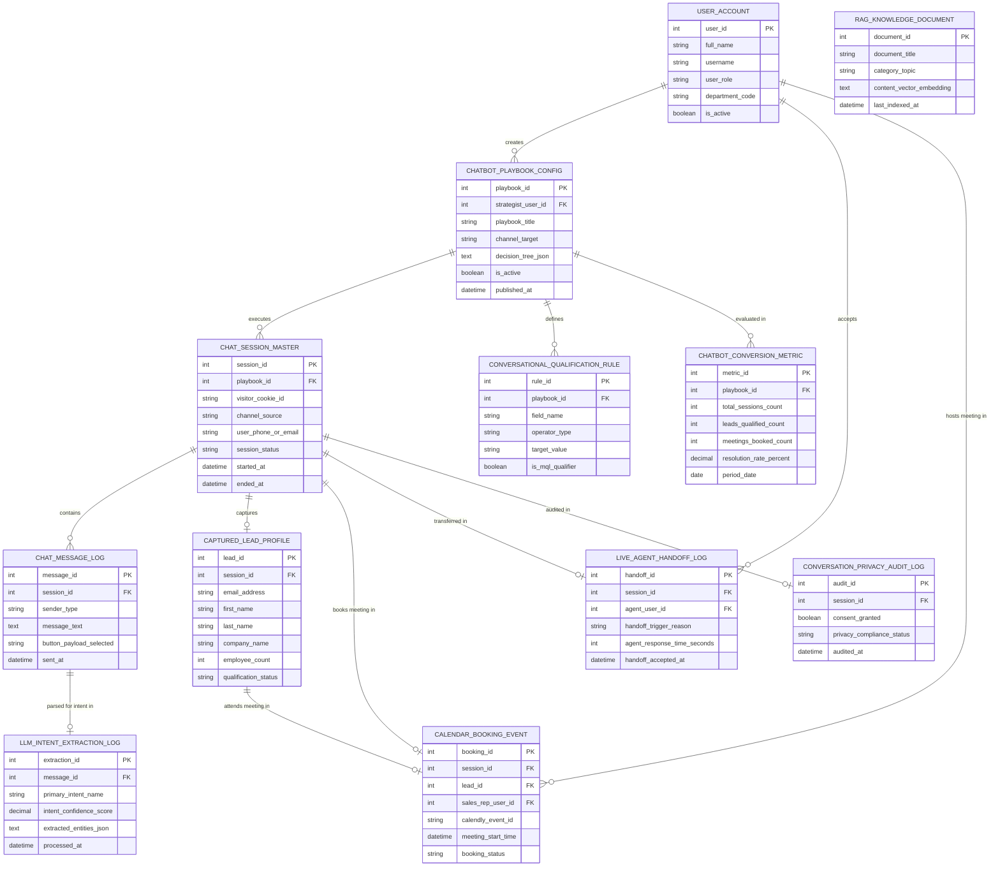

# Conceptual ERD — Chatbot & Conversational Marketing System

## Mermaid Code

## Entity Description Table | Bảng mô tả Entity

| # | Entity Name | Vietnamese Name | Description | Key Attributes | Main Relationships |
|---|-------------|-----------------|-------------|----------------|-------------------|
| 1 | USER_ACCOUNT | Tài khoản Nguời dùng | System credentials and access roles for chatbot strategists, human agents, sales VPs, and admins. | `user_id`, `username`, `user_role`, `department_code` | Creates `CHATBOT_PLAYBOOK_CONFIG`, accepts `LIVE_AGENT_HANDOFF_LOG`, hosts `CALENDAR_BOOKING_EVENT`. |
| 2 | CHATBOT_PLAYBOOK_CONFIG | Cấu hình Playbook Chatbot | Visual chatbot playbook configuration storing playbook titles, target channels, decision trees, and published status. | `playbook_id`, `strategist_user_id`, `playbook_title`, `channel_target`, `decision_tree_json`, `is_active` | Executes `CHAT_SESSION_MASTER`, defines `CONVERSATIONAL_QUALIFICATION_RULE`, evaluated in `CHATBOT_CONVERSION_METRIC`, created by `USER_ACCOUNT`. |
| 3 | CHAT_SESSION_MASTER | Session Chatbot Master | Active chatbot conversation session entity tracking visitor cookie ID, channel source (WhatsApp/Web), phone/email, and status. | `session_id`, `playbook_id`, `visitor_cookie_id`, `channel_source`, `session_status`, `started_at` | Belongs to `CHATBOT_PLAYBOOK_CONFIG`, contains `CHAT_MESSAGE_LOG`, captures `CAPTURED_LEAD_PROFILE`, books `CALENDAR_BOOKING_EVENT`, transferred in `LIVE_AGENT_HANDOFF_LOG`. |
| 4 | CHAT_MESSAGE_LOG | Nhật ký Tin nhắn Chat | Individual chat message log storing sender type (User/Bot/Agent), message text, button payloads selected, and timestamps. | `message_id`, `session_id`, `sender_type`, `message_text`, `button_payload_selected`, `sent_at` | Belongs to `CHAT_SESSION_MASTER`, parsed in `LLM_INTENT_EXTRACTION_LOG`. |
| 5 | LLM_INTENT_EXTRACTION_LOG | Nhật ký Intent & Entity LLM | Generative AI NLU extraction log recording primary intent names, confidence %, and extracted lead entities JSON. | `extraction_id`, `message_id`, `primary_intent_name`, `intent_confidence_score`, `extracted_entities_json` | Belongs to `CHAT_MESSAGE_LOG`. |
| 6 | CAPTURED_LEAD_PROFILE | Profile Lead Đã Capture | Captured lead profile entity storing work email, name, company name, employee count, and qualification status. | `lead_id`, `session_id`, `email_address`, `first_name`, `last_name`, `company_name`, `qualification_status` | Belongs to `CHAT_SESSION_MASTER`, attends `CALENDAR_BOOKING_EVENT`. |
| 7 | CALENDAR_BOOKING_EVENT | Sự kiện Lịch Booking | Confirmed calendar meeting event record storing Calendly event ID, sales rep ID, meeting start time, and status. | `booking_id`, `session_id`, `lead_id`, `sales_rep_user_id`, `calendly_event_id`, `meeting_start_time` | Belongs to `CHAT_SESSION_MASTER` and `CAPTURED_LEAD_PROFILE`, hosted by `USER_ACCOUNT`. |
| 8 | LIVE_AGENT_HANDOFF_LOG | Nhật ký Handoff Live Agent | Human agent takeover log recording handoff trigger reasons, agent response time seconds, and acceptance timestamps. | `handoff_id`, `session_id`, `agent_user_id`, `handoff_trigger_reason`, `agent_response_time_seconds` | Belongs to `CHAT_SESSION_MASTER`, accepted by `USER_ACCOUNT`. |
| 9 | CONVERSATIONAL_QUALIFICATION_RULE | Quy tắc Qualification Chat | Conversational lead qualification rule node specifying field name (e.g., employee_count), operator, and target values. | `rule_id`, `playbook_id`, `field_name`, `operator_type`, `target_value`, `is_mql_qualifier` | Belongs to `CHATBOT_PLAYBOOK_CONFIG`. |
| 10 | RAG_KNOWLEDGE_DOCUMENT | Document Kiến thức RAG | Indexed RAG knowledge base document storing document titles, category topics, and content vector embeddings. | `document_id`, `document_title`, `category_topic`, `content_vector_embedding`, `last_indexed_at` | Standalone AI knowledge vector entity. |
| 11 | CHATBOT_CONVERSION_METRIC | Chỉ số Chuyển đổi Chatbot | Daily chatbot performance telemetry tracking total sessions, leads qualified, meetings booked, and resolution rates %. | `metric_id`, `playbook_id`, `total_sessions_count`, `leads_qualified_count`, `meetings_booked_count`, `resolution_rate_percent` | Belongs to `CHATBOT_PLAYBOOK_CONFIG`. |
| 12 | CONVERSATION_PRIVACY_AUDIT_LOG | Nhật ký Audit Privacy Chat | Conversation privacy compliance audit record tracking visitor consent decisions and GDPR audit statuses. | `audit_id`, `session_id`, `consent_granted`, `privacy_compliance_status`, `audited_at` | Belongs to `CHAT_SESSION_MASTER`. |

## Relationship Description | Mô tả Quan hệ

| # | From Entity | Cardinality | To Entity | Label | Business Explanation |
|---|-------------|-------------|-----------|-------|----------------------|
| 1 | CHATBOT_PLAYBOOK_CONFIG | 1 to 0..N | CHAT_SESSION_MASTER | executes | A chatbot playbook config executes active chat sessions. |
| 2 | CHATBOT_PLAYBOOK_CONFIG | 1 to 1..N | CONVERSATIONAL_QUALIFICATION_RULE | defines | A chatbot playbook defines lead qualification rules. |
| 3 | CHATBOT_PLAYBOOK_CONFIG | 1 to 0..N | CHATBOT_CONVERSION_METRIC | evaluated in | A playbook config is evaluated in daily chatbot conversion metrics. |
| 4 | CHAT_SESSION_MASTER | 1 to 1..N | CHAT_MESSAGE_LOG | contains | A chat session contains multiple chat message logs. |
| 5 | CHAT_SESSION_MASTER | 1 to 0..1 | CAPTURED_LEAD_PROFILE | captures | A chat session captures a lead profile when entities are provided. |
| 6 | CHAT_SESSION_MASTER | 1 to 0..1 | CALENDAR_BOOKING_EVENT | books meeting in | A chat session books a meeting in calendar booking events. |
| 7 | CHAT_SESSION_MASTER | 1 to 0..1 | LIVE_AGENT_HANDOFF_LOG | transferred in | A chat session is transferred to a human agent in a handoff log. |
| 8 | CHAT_SESSION_MASTER | 1 to 0..1 | CONVERSATION_PRIVACY_AUDIT_LOG | audited in | A chat session is audited for conversation privacy compliance. |
| 9 | CHAT_MESSAGE_LOG | 1 to 0..1 | LLM_INTENT_EXTRACTION_LOG | parsed for intent in | A chat message log is parsed for NLU intent in LLM extraction logs. |
| 10 | CAPTURED_LEAD_PROFILE | 1 to 0..1 | CALENDAR_BOOKING_EVENT | attends meeting in | A captured lead profile attends a confirmed calendar booking event. |
| 11 | USER_ACCOUNT | 1 to 0..N | CHATBOT_PLAYBOOK_CONFIG | creates | A chatbot strategist user account creates playbook configs. |
| 12 | USER_ACCOUNT | 1 to 0..N | LIVE_AGENT_HANDOFF_LOG | accepts | A human sales agent user account accepts live chat handoffs. |
| 13 | USER_ACCOUNT | 1 to 0..N | CALENDAR_BOOKING_EVENT | hosts meeting in | A sales rep user account hosts booked demo meetings. |
