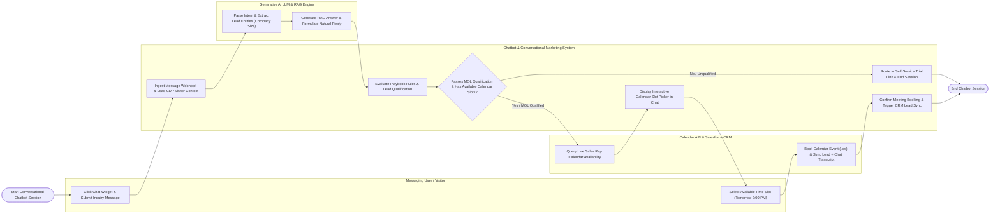

# Swimlane Diagram — Chatbot & Conversational Marketing System

## Mermaid Code

## Flow Description | Mô tả luồng

| Lane | Actor | Role in Flow |
|------|-------|-------------|
| 1 | Messaging User / Visitor | Clicks web chat widget or sends WhatsApp message, submits natural language queries, selects interactive buttons, and picks calendar demo slots. |
| 2 | Chatbot & Conversational Marketing System | Ingests multi-channel webhooks, loads CDP session context, evaluates playbook decision trees, checks MQL lead qualification rules, renders interactive calendar pickers, confirms meeting bookings, and triggers CRM sync. |
| 3 | Generative AI LLM & RAG Engine | Parses natural language intent, extracts key lead entities (Name, Email, Company Size), searches RAG vector knowledge bases, and formulates natural answers. |
| 4 | Calendar API & Salesforce CRM | Queries live sales rep calendar availability slots (Calendly API), books meeting events, sends `.ics` invites, creates lead contacts in CRM, and attaches complete chat transcripts. |
