# Action Tree — Chatbot & Conversational Marketing System

## Mermaid Code

```mermaid
graph TD
    Root["Chatbot & Conversational Marketing System"]

    Root --> M1["Playbook Builder & Multi-Channel Ingestion"]
    Root --> M2["Generative AI LLM Intent & RAG Knowledge"]
    Root --> M3["Conversational Lead Qualification & Routing"]
    Root --> M4["Calendar Meeting Booking Integration"]
    Root --> M5["Human Agent Live Chat Handoff"]
    Root --> M6["CRM Sync & Conversational Analytics"]

    M1 --> A11["Design Visual Chatbot Playbooks & Decision Trees"]
    M1 --> A12["Ingest Multi-Channel Webhooks (WhatsApp, Messenger, Web Chat)"]
    M1 --> A13["Render Interactive Quick-Reply Buttons & Product Carousels"]
    M1 --> A14["Display Proactive Contextual Greeting Widgets based on Page URL"]

    M2 --> A21["Parse User Natural Language Intent via LLM (GPT-4 / Claude)"]
    M2 --> A22["Execute RAG Search against Vectorized Corporate Product Docs"]
    M2 --> A23["Extract Lead Entity Attributes (Name, Email, Company, Size)"]
    M2 --> A24["Trigger Graceful Bot Fallback Prompts on Low Confidence (< 60%)"]

    M3 --> A31["Evaluate Captured Lead Entities against MQL Criteria"]
    M3 --> A32["Route Qualified Leads via Territory Round-Robin Matrix"]
    M3 --> A33["Direct Unqualified Leads to Self-Service Trial Links"]
    M3 --> A34["Enforce WhatsApp 24-Hour Customer Service Messaging Windows"]

    M4 --> A41["Query Live Sales Rep Calendar Availability via Calendly API"]
    M4 --> A42["Render Interactive Time Slot Selection Pickers in Chat Window"]
    M4 --> A43["Book Calendar Events & Dispatch Calendar Invites (.ics)"]
    M4 --> A44["Handle Calendar Time Slot Booking Conflicts & Refreshes"]

    M5 --> A51["Detect Human Agent Handoff Requests & High-Value Triggers"]
    M5 --> A52["Trigger Desktop Push & Slack Alerts for Live Agent Takeover"]
    M5 --> A53["Transfer Active Session Control to Human Agent Console"]
    M5 --> A54["Render Full Chat History & Extracted Lead Context to Agent"]

    M6 --> A61["Sync Captured Lead Profiles & Deal Opportunities to CRM"]
    M6 --> A62["Attach Complete HTML & Text Chat Transcripts to CRM Timeline"]
    M6 --> A63["Benchmark Chatbot Self-Service Resolution Rates & Drop-Offs"]
    M6 --> A64["Export Executive Conversational Pipeline & Revenue Scorecards"]
```

## Module Description | Mô tả Module

| # | Module | Description | Actions |
|---|--------|-------------|---------|
| 1 | Playbook Builder & Multi-Channel Ingestion | Designs visual chat playbooks, ingests multi-channel webhooks (WhatsApp/Web), renders interactive buttons, and displays proactive greetings. | Design Visual Chatbot Playbooks, Ingest Multi-Channel Webhooks, Render Interactive Quick-Reply Buttons, Display Proactive Contextual Greetings. |
| 2 | Generative AI LLM Intent & RAG Knowledge | Parses user intent via LLMs, performs RAG vector searches, extracts lead entities, and triggers fallback prompts on low confidence. | Parse Intent via LLM NLU Models, Execute RAG Search on Product Docs, Extract Lead Entity Attributes, Trigger Graceful Bot Fallback Prompts. |
| 3 | Conversational Lead Qualification & Routing | Evaluates leads against MQL criteria, routes qualified leads via round-robin matrices, directs unqualified leads, and enforces WhatsApp rules. | Evaluate Leads against MQL Criteria, Route Qualified Leads via Round-Robin, Direct Unqualified Leads to Trial Links, Enforce WhatsApp Messaging Windows. |
| 4 | Calendar Meeting Booking Integration | Queries live sales rep availability via Calendly API, renders interactive time slot pickers, books calendar events, and handles slot conflicts. | Query Live Sales Rep Availability via API, Render Interactive Time Slot Pickers, Book Calendar Events & Dispatch Invites, Handle Booking Conflicts & Refreshes. |
| 5 | Human Agent Live Chat Handoff | Detects human handoff requests, dispatches desktop/Slack alerts, transfers session control to agent console, and renders lead context. | Detect Human Agent Handoff Requests, Trigger Desktop & Slack Handoff Alerts, Transfer Session Control to Agent Console, Render Full Chat History to Agent. |
| 6 | CRM Sync & Conversational Analytics | Syncs captured lead profiles to CRM, attaches complete chat transcripts, benchmarks self-service resolution rates, and exports scorecards. | Sync Captured Lead Profiles to CRM, Attach Complete Chat Transcripts to CRM, Benchmark Chatbot Self-Service Resolution Rates, Export Executive Revenue Scorecards. |
