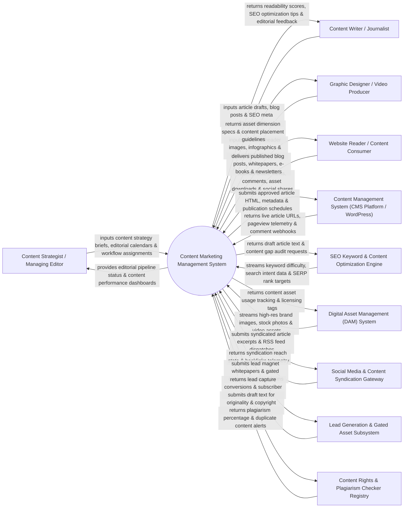

# Context Diagram — Content Marketing Management System

## Mermaid Code

## Actor & Interaction Table | Bảng Actor & Tương tác

| # | Actor | Actor Type | Data Sent TO System | Data Received FROM System | Notes |
|---|-------|------------|---------------------|---------------------------|-------|
| 1 | Content Strategist / Managing Editor | Primary | Content briefs, target buyer persona tags, editorial calendar schedules, writer assignments, content audit guidelines. | Editorial pipeline Kanban status, content publication calendar, team workload distribution, content performance dashboards. | Editorial manager planning content strategy, managing editorial workflows, and reviewing content ROI. |
| 2 | Content Writer / Journalist | Primary | Article drafts, blog post copy, e-book chapters, SEO meta titles/descriptions, target keyword tags. | Flesch-Kincaid readability scores, real-time SEO keyword density recommendations, editorial review comments. | Writer creating articles, whitepapers, and written content assets. |
| 3 | Graphic Designer / Video Producer | Primary | Featured blog header images, custom infographics, embedded video URLs, downloadable PDF whitepaper layouts. | Asset placement guidelines, image dimension specs, creative brief requirements. | Visual creator producing supporting graphics, videos, and PDF layouts for content pieces. |
| 4 | Website Reader / Content Consumer | Primary | Article pageviews, reading time duration, content ratings, comments, whitepaper download form submissions. | Published blog articles, interactive whitepapers, downloadable e-books, recommended related articles. | Audience member reading, sharing, and consuming published brand content. |
| 5 | Content Management System (CMS Platform / WordPress) | Supporting | Live article URLs, web pageview telemetry, bounce rates, user comment webhooks. | Approved article HTML payloads, published metadata, scheduled publication dispatches, canonical URL tags. | Web CMS (WordPress, Webflow, Hubspot CMS) publishing content to public websites. |
| 6 | SEO Keyword & Content Optimization Engine | Supporting | Keyword search volume data, keyword difficulty scores, search intent tags, top SERP competitor benchmarks. | Draft article text, target keyword queries, content gap analysis requests. | SEO tool integration (Clearscope, SurferSEO, Semrush) providing real-time content optimization recommendations. |
| 7 | Digital Asset Management (DAM) System | Supporting | Licensed stock photos, brand graphics, vector illustrations, video files, asset license expiration dates. | Content asset usage logs, article linkage tags, asset attribution credits. | Central DAM repository storing approved visual media assets for content marketing. |
| 8 | Social Media & Content Syndication Gateway | Supporting | Syndicated article impressions, canonical backlink tracking, medium/LinkedIn republishing stats. | Auto-formatted article snippets, RSS feed dispatches, social share triggers. | Content distribution channels (Medium, LinkedIn Articles, RSS feeds) syndicating published content. |
| 9 | Lead Generation & Gated Asset Subsystem | Supporting | Form conversion payloads, lead download events, subscriber opt-ins. | Gated PDF whitepapers, e-book download links, smart lead capture form embeds. | Marketing subsystem gating high-value content assets to capture lead contacts. |
| 10 | Content Rights & Plagiarism Checker Registry | Supporting / Regulatory | Plagiarism checking algorithms, duplicate web content databases, copyright registries. | Originality percentage scores, duplicate text match alerts, copyright attribution verification. | Third-party plagiarism detection service (Copyscape, Grammarly) verifying content originality. |

## System Boundary Description | Mô tả Phạm vi Hệ thống

The **Content Marketing Management System** is an enterprise editorial planning, content creation, workflow approval, content optimization, and performance analytics platform designed to streamline the end-to-end lifecycle of brand marketing content.

**Inside System Scope:**
- Interactive editorial content calendar with persona tagging, content strategy briefs, and multi-stage workflow pipelines.
- Real-time WYSIWYG content editor integrated with SEO optimization engines (Clearscope/SurferSEO) and readability scoring.
- Integration with Plagiarism Detection and Copyright Verification tools prior to editor sign-off.
- Multi-channel content publishing and syndication to CMS platforms (WordPress/Webflow), RSS feeds, and Medium.
- Gated content lead magnet management, asset download tracking, and multi-touch content attribution analytics.

**Outside System Scope:**
- Direct printing and physical binding of hardcover books or magazines (handled by Commercial Printers).
- Direct hosting of core web server infrastructure (handled by Web Hosting Providers).
- Direct accounting payment of freelance writer invoice payroll (handled by Accounts Payable ERP Systems).
