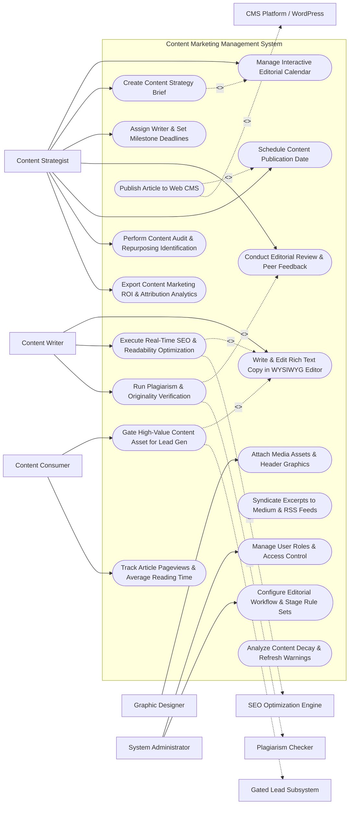

# Use Case Diagram — Content Marketing Management System

## Mermaid Code

## Actor Table | Bảng Actor

| # | Actor | Actor Type | Role Description | Related Use Cases |
|---|-------|------------|------------------|-------------------|
| 1 | Content Strategist | Primary | Editorial lead creating briefs, assigning writers, managing calendars, reviewing articles, and auditing content ROI. | UC01, UC02, UC03, UC07, UC09, UC14, UC15 |
| 2 | Content Writer | Primary | Author drafting articles in WYSIWYG editor, optimizing copy for SEO, and running plagiarism checks. | UC04, UC05, UC08 |
| 3 | Graphic Designer | Primary | Visual creator uploading featured headers, infographics, and inline media assets to content pieces. | UC06 |
| 4 | Content Consumer | Primary | Website reader consuming published blog posts, downloading gated e-books, and submitting lead forms. | UC12, UC13 |
| 5 | System Administrator | Primary | IT administrative user managing security clearance roles, editorial stage rule sets, and API integrations. | UC16, UC17 |
| 6 | CMS Platform / WordPress | System (Secondary) | External web CMS receiving published HTML articles, metadata, and publication schedules. | UC10 |
| 7 | SEO Optimization Engine | System (Secondary) | Optimization service (Clearscope/SurferSEO) streaming target keyword recommendations and content scores. | UC05 |
| 8 | Plagiarism Checker | System (Secondary) | Originality verification service (Copyscape) scanning web databases for duplicate text. | UC08 |
| 9 | Gated Lead Subsystem | System (Secondary) | Lead generation tool capturing contact submissions for gated e-books and whitepapers. | UC12 |

## Use Case Table | Bảng Use Case

| # | UC ID | Use Case Name | Primary Actor | Secondary Actor | Description | Priority |
|---|-------|---------------|---------------|-----------------|-------------|----------|
| 1 | UC01 | Manage Interactive Editorial Calendar | Strategist | None | Visual calendar for planning content topics, target buyer personas, content types, and publication dates. | High |
| 2 | UC02 | Create Content Strategy Brief | Strategist | None | Generates structured content briefs specifying primary keywords, target audience, intent, and word count. | High |
| 3 | UC03 | Assign Writer & Set Milestone Deadlines | Strategist | None | Assigns content briefs to internal writers or freelancers and establishes draft/review milestone deadlines. | High |
| 4 | UC04 | Write & Edit Rich Text Copy in WYSIWYG Editor | Writer | None | Drafts article copy in a collaborative WYSIWYG editor supporting rich text, headers, callouts, and links. | Critical |
| 5 | UC05 | Execute Real-Time SEO & Readability Optimization | Writer | SEO Engine | Evaluates draft copy against target keywords, competitor SERP benchmarks, and Flesch-Kincaid readability scores. | Critical |
| 6 | UC06 | Attach Media Assets & Header Graphics | Designer | None | Attaches high-res header images, infographics, embedded videos, and alt text for SEO accessibility. | High |
| 7 | UC07 | Conduct Editorial Review & Peer Feedback | Strategist | None | Facilitates multi-stage editorial review, inline commenting, version history comparisons, and revision requests. | High |
| 8 | UC08 | Run Plagiarism & Originality Verification | Writer | Plagiarism | Scans draft copy against web databases to verify text originality percentage and detect copyright infringement. | High |
| 9 | UC09 | Schedule Content Publication Date | Strategist | None | Sets scheduled publication timestamps for automated CMS publishing and social syndication dispatches. | High |
| 10 | UC10 | Publish Article to Web CMS | Strategist | CMS Platform | Transmits approved HTML article, meta titles, tags, and canonical URLs to connected WordPress/Webflow CMS. | Critical |
| 11 | UC11 | Syndicate Excerpts to Medium & RSS Feeds | Strategist | None | Formats and dispatches article excerpts to Medium, LinkedIn Articles, and corporate RSS feeds with canonical links. | Medium |
| 12 | UC12 | Gate High-Value Content Asset for Lead Gen | Consumer | Lead Subsys | Converts e-books or whitepapers into gated lead magnets requiring form submission to access PDF download. | Critical |
| 13 | UC13 | Track Article Pageviews & Average Reading Time | Consumer | None | Monitors reader engagement telemetry including total pageviews, average time on page, and scroll depth %. | High |
| 14 | UC14 | Perform Content Audit & Repurposing Identification | Strategist | None | Scans existing content repository to identify outdated articles for refresh or top performers for video repurposing. | High |
| 15 | UC15 | Export Content Marketing ROI & Attribution Analytics | Strategist | None | Renders reports linking content consumption to lead generation, pipeline contribution, and organic traffic growth. | High |
| 16 | UC16 | Manage User Roles & Access Control | Admin | None | Controls user login accounts, writer/editor role permissions, and freelancer access bounds. | High |
| 17 | UC17 | Configure Editorial Workflow & Stage Rule Sets | Admin | Strategist | Configures editorial workflow stages (Draft -> Review -> Legal Approval -> Scheduled -> Published). | High |
| 18 | UC18 | Analyze Content Decay & Refresh Warnings | Strategist | None | Detects articles suffering organic traffic decay (> 30% drop over 90 days) and triggers content refresh alerts. | Medium |

## Use Case Specification | Đặc tả Use Case

---

### UC02 — Create Content Strategy Brief

| Field | Detail |
|-------|--------|
| **UC ID** | UC02 |
| **Use Case Name** | Create Content Strategy Brief |
| **Actor(s)** | Primary: Content Strategist / Managing Editor   Secondary: None |
| **Description** | Generates a comprehensive, structured content brief detailing primary/secondary target keywords, target buyer persona, search intent, target word count, and outline structure. |
| **Precondition** | 1. Content topic idea is added to the Editorial Calendar (UC01). |
| **Main Flow** | 1. Strategist opens "Content Brief Builder" for a planned topic (e.g., *"Ultimate Guide to Enterprise Cloud Migration"*).   2. Strategist selects Target Buyer Persona: `IT Director / CTO`.   3. Strategist inputs Primary Keyword: `enterprise cloud migration strategy` and Secondary Keywords: `cloud migration checklist, AWS vs Azure migration, cloud security compliance`.   4. Strategist sets Search Intent: `Informational / Comparison`.   5. Strategist specifies Target Parameters: Word Count `2,500 - 3,000 words`, Flesch-Kincaid Readability Target `Grade 8-10`.   6. Strategist inputs H2/H3 Section Outline:   &nbsp;&nbsp;&nbsp;&nbsp; a. H2: Why Migrate to the Cloud in 2026?   &nbsp;&nbsp;&nbsp;&nbsp; b. H2: 5 Steps to Build a Secure Cloud Strategy.   &nbsp;&nbsp;&nbsp;&nbsp; c. H2: Common Cloud Migration Pitfalls & Solutions.   7. Strategist attaches Call-to-Action (CTA) requirement: `Promote Gated Whitepaper PDF`.   8. Strategist saves brief; System attaches brief to the topic card on the Editorial Calendar. |
| **Alternative Flow** | **AF1** — AI-Assisted Brief Generation: Strategist inputs primary keyword; System AI engine automatically scrapes top 10 Google SERP competitors, generates section outlines, and suggests secondary keywords. |
| **Exception Flow** | **EX1** — Missing Target Keyword Error: Strategist attempts to save brief without a primary keyword; System blocks save, displaying error "Primary Target Keyword Required for Content Brief Creation". |
| **Postcondition** | Structured content brief is generated, linked to the editorial calendar topic, and ready for writer assignment (UC03). |
| **Business Rule** | **BR1**: Content strategy briefs MUST specify at least 1 primary keyword and 3 secondary keywords aligned with search intent. |

---

### UC05 — Execute Real-Time SEO & Readability Optimization

| Field | Detail |
|-------|--------|
| **UC ID** | UC05 |
| **Use Case Name** | Execute Real-Time SEO & Readability Optimization |
| **Actor(s)** | Primary: Content Writer / Journalist   Secondary: SEO Optimization Engine |
| **Description** | Evaluates draft article copy in real time against target keywords, competitor SERP benchmarks, heading structures, and Flesch-Kincaid readability scores as the writer types. |
| **Precondition** | 1. Content strategy brief with target keywords is attached to the draft (UC02).   2. Writer is drafting copy in the WYSIWYG editor (UC04). |
| **Main Flow** | 1. Writer opens WYSIWYG editor and begins typing article text.   2. System editor streams draft text continuously to connected SEO Optimization Engine API.   3. System calculates Content Optimization Metrics in real time sidebar:   &nbsp;&nbsp;&nbsp;&nbsp; a. Content Score: `74 / 100` (Target Target: >= 80).   &nbsp;&nbsp;&nbsp;&nbsp; b. Keyword Usage Matrix: Displays frequency of primary and secondary keywords (e.g., `cloud migration strategy` used 4x / recommended 6-8x).   &nbsp;&nbsp;&nbsp;&nbsp; c. Readability Score: Flesch Reading Ease `62.4` (Grade 8 Level - OPTIMAL).   &nbsp;&nbsp;&nbsp;&nbsp; d. Heading & Paragraph Structure: 5 H2s, 8 H3s, Average paragraph length 42 words.   4. Writer adds missing secondary keywords (`AWS vs Azure migration`) into an H2 section.   5. System dynamically updates Content Score to `85 / 100` (Green - EXCELLENT).   6. Writer saves draft; System records SEO optimization metrics in draft metadata. |
| **Alternative Flow** | **AF1** — Keyword Stuffing Warning: Writer uses primary keyword 25 times in 500 words (Density 5%); System highlights text in red warning "Keyword Stuffing Detected (5% Density) - Reduce Keyword Usage to Prevent Search Penalty". |
| **Exception Flow** | **EX1** — SEO Engine API Offline: Optimization engine API is unreachable; System displays notification "SEO Real-Time Feedback Offline - Local Word Count & Readability Active", allowing writing to continue. |
| **Postcondition** | Real-time SEO content score and readability metrics are calculated, and article copy is optimized for search rankings. |
| **Business Rule** | **BR1**: Articles submitted for editorial review MUST achieve a minimum Content Optimization Score of >= 80/100. |

---

### UC08 — Run Plagiarism & Originality Verification

| Field | Detail |
|-------|--------|
| **UC ID** | UC08 |
| **Use Case Name** | Run Plagiarism & Originality Verification |
| **Actor(s)** | Primary: Content Writer, Content Strategist   Secondary: Plagiarism Checker |
| **Description** | Scans completed draft article text against global web databases and internal content repositories to calculate text originality percentage and detect potential copyright infringement before publication. |
| **Precondition** | 1. Draft article copy is complete and ready for editorial review (UC04). |
| **Main Flow** | 1. Writer or Editor clicks "Run Plagiarism & Originality Check".   2. System extracts full text body of the draft article (excluding quotes and references).   3. System transmits text payload via HTTPS API to Plagiarism Checker service (e.g., Copyscape API).   4. Plagiarism service scans text against billions of web pages and published articles.   5. System ingests scan results:   &nbsp;&nbsp;&nbsp;&nbsp; a. Overall Originality Score: `96% Original`.   &nbsp;&nbsp;&nbsp;&nbsp; b. Matched Text Fragments: 4% duplicate text found on `externaltechblog.com/cloud-article`.   6. System highlights duplicate text fragments in yellow on editor canvas and displays source web link.   7. Writer rewrites or adds proper blockquote citations to matched fragments.   8. Writer re-runs scan; System verifies `99% Original` score and saves Originality Certificate into draft file. |
| **Alternative Flow** | **AF1** — Internal Duplicate Content Check: System checks draft against internal corporate blog repository to prevent self-cannibalization of identical article text across sub-domains. |
| **Exception Flow** | **EX1** — Unacceptable Plagiarism Score ($< 85\%$ Original): Scan reveals 30% un-cited duplicate text from a competitor site; System blocks editorial sign-off, displaying error "High Plagiarism Detected (30% Match) - Rewrite Required". |
| **Postcondition** | Originality score is calculated, duplicate text is resolved, and originality certificate is attached to the article. |
| **Business Rule** | **BR1**: Published articles MUST achieve a verified Originality Score of >= 90% before receiving editorial publication approval. |

---

### UC10 — Publish Article to Web CMS

| Field | Detail |
|-------|--------|
| **UC ID** | UC10 |
| **Use Case Name** | Publish Article to Web CMS |
| **Actor(s)** | Primary: Content Strategist / Managing Editor   Secondary: CMS Platform / WordPress |
| **Description** | Transmits approved HTML article body, meta titles, featured image assets, tags, and canonical URL settings to connected web CMS platforms (WordPress/Webflow) for instant or scheduled publication. |
| **Precondition** | 1. Article status is `APPROVED_FOR_PUBLICATION` (UC07).   2. Web CMS API connection parameters (WordPress REST API / Webflow API) are configured. |
| **Main Flow** | 1. Strategist opens approved article in publishing queue.   2. Strategist verifies final publication metadata: Target CMS Site (`Corporate Blog - US`), Category (`Cloud Architecture`), Meta Title, Meta Description, Author Byline, Featured Image.   3. Strategist selects Publication Action: `Publish Now`.   4. System packages publication payload into standardized CMS API format:   &nbsp;&nbsp;&nbsp;&nbsp; a. Article HTML body content.   &nbsp;&nbsp;&nbsp;&nbsp; b. Featured image media asset link and ALT text.   &nbsp;&nbsp;&nbsp;&nbsp; c. Meta Title & Description tags.   &nbsp;&nbsp;&nbsp;&nbsp; d. Canonical URL tag (`https://company.com/blog/cloud-migration-guide`).   5. System transmits payload via REST API to WordPress CMS.   6. WordPress CMS ingests post, creates live blog page, and returns live URL (`PUBLISH_SUCCESS_200`).   7. System updates article status to `LIVE_PUBLISHED` and logs publication timestamp in editorial calendar (UC01). |
| **Alternative Flow** | **AF1** — Scheduled CMS Publication: Strategist selects "Schedule Publication for Nov 1 at 08:00 AM"; System pushes post to CMS in `SCHEDULED` status, and CMS automatically publishes post at designated time. |
| **Exception Flow** | **EX1** — CMS API Authentication Error: WordPress REST API returns 401 Unauthorized due to expired API key; System flags "CMS Publish Failed", dispatches alert to Admin, and retains article in publishing queue. |
| **Postcondition** | Article is published live on the web CMS, live URL is logged, and status updates to published. |
| **Business Rule** | **BR1**: Articles published across multiple domains MUST enforce canonical URL tags to prevent search engine duplicate content penalties. |

---

### UC12 — Gate High-Value Content Asset for Lead Gen

| Field | Detail |
|-------|--------|
| **UC ID** | UC12 |
| **Use Case Name** | Gate High-Value Content Asset for Lead Gen |
| **Actor(s)** | Primary: Website Reader / Content Consumer   Secondary: Gated Lead Subsystem |
| **Description** | Gates high-value premium content assets (e-books, whitepapers, industry benchmark reports), requiring website readers to submit a lead contact form before downloading the PDF asset. |
| **Precondition** | 1. Premium PDF content asset (e.g., *"2026 State of Cloud Security Report.pdf"*) is uploaded and marked as `GATED_LEAD_MAGNET`.   2. Gated landing page form is published. |
| **Main Flow** | 1. Reader visits landing page for premium report (*"Download 2026 Cloud Security Report"*).   2. System displays report summary, table of contents preview, and embedded Lead Capture Form.   3. Reader completes form fields: First Name, Last Name, Work Email (`cto@enterprise.com`), Company Name, Job Title.   4. Reader clicks "Download Free PDF Report".   5. System validates form fields and transmits lead submission payload to Gated Lead Subsystem.   6. System generates a secure, time-limited PDF download URL (`https://company.com/assets/download?token=88412`).   7. System displays instant PDF download button on thank-you page AND dispatches automated email containing the PDF download link.   8. System records Lead Conversion Event in content analytics, attributing the new lead to the whitepaper asset. |
| **Alternative Flow** | **AF1** — Social Sign-On One-Click Unlock: Reader selects "Sign in with LinkedIn" on form; System retrieves LinkedIn profile attributes, auto-fills form fields, and immediately unlocks PDF download. |
| **Exception Flow** | **EX1** — Competitor Domain Form Submission: Form email domain belongs to a competitor; System provides PDF download but flags lead record as `COMPETITOR_LEAD` and suppresses CRM sales rep assignment. |
| **Postcondition** | Lead contact form is submitted, PDF download link is delivered, and lead generation conversion is recorded in content ROI analytics. |
| **Business Rule** | **BR1**: Gated content asset downloads MUST validate work email domains and record lead attribution against the specific asset ID. |
