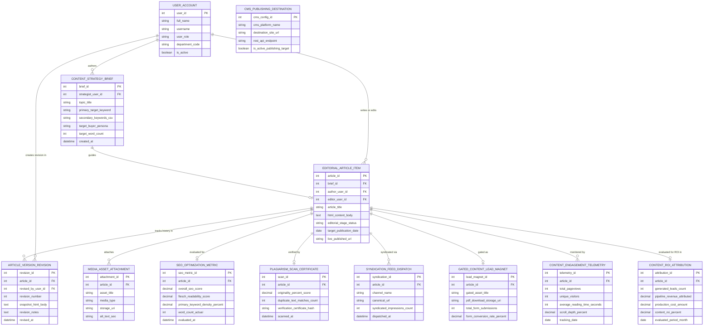

# Conceptual ERD — Content Marketing Management System

## Mermaid Code

## Entity Description Table | Bảng mô tả Entity

| # | Entity Name | Vietnamese Name | Description | Key Attributes | Main Relationships |
|---|-------------|-----------------|-------------|----------------|-------------------|
| 1 | USER_ACCOUNT | Tài khoản Nguời dùng | System user credentials and access roles for content strategists, writers, designers, and editors. | `user_id`, `username`, `user_role`, `department_code` | Authors `CONTENT_STRATEGY_BRIEF`, writes `EDITORIAL_ARTICLE_ITEM`, creates `ARTICLE_VERSION_REVISION`. |
| 2 | CONTENT_STRATEGY_BRIEF | Brief Chiến lược Nội dung | Structured strategy brief defining target keywords, buyer persona, word count targets, and outline. | `brief_id`, `strategist_user_id`, `topic_title`, `primary_target_keyword`, `target_buyer_persona`, `target_word_count` | Guides `EDITORIAL_ARTICLE_ITEM`, authored by `USER_ACCOUNT`. |
| 3 | EDITORIAL_ARTICLE_ITEM | Bài viết Biên tập | Master article entity storing draft HTML copy, editorial stage status, publication date, and live URL. | `article_id`, `brief_id`, `author_user_id`, `article_title`, `html_content_body`, `editorial_stage_status`, `live_published_url` | Guided by `CONTENT_STRATEGY_BRIEF`, verified by `PLAGIARISM_SCAN_CERTIFICATE`, gated as `GATED_CONTENT_LEAD_MAGNET`. |
| 4 | ARTICLE_VERSION_REVISION | Lịch sử Phiên bản Bài viết | Version control revision history capturing HTML snapshots, revision notes, and author timestamps. | `revision_id`, `article_id`, `revised_by_user_id`, `revision_number`, `snapshot_html_body`, `revised_at` | Belongs to `EDITORIAL_ARTICLE_ITEM`, created by `USER_ACCOUNT`. |
| 5 | MEDIA_ASSET_ATTACHMENT | Asset Media Đính kèm | Featured header images, infographics, embedded videos, and alt text tags attached to an article. | `attachment_id`, `article_id`, `asset_title`, `media_type`, `storage_uri`, `alt_text_seo` | Belongs to `EDITORIAL_ARTICLE_ITEM`. |
| 6 | SEO_OPTIMIZATION_METRIC | Chỉ số Tối ưu hóa SEO | Calculated SEO optimization score, Flesch readability rating, keyword density %, and word counts. | `seo_metric_id`, `article_id`, `overall_seo_score`, `flesch_readability_score`, `primary_keyword_density_percent` | Belongs to `EDITORIAL_ARTICLE_ITEM`. |
| 7 | PLAGIARISM_SCAN_CERTIFICATE | Chứng nhận Kiểm tra Đạo văn | Plagiarism scan verification certificate storing originality score %, duplicate match counts, and hashes. | `scan_id`, `article_id`, `originality_percent_score`, `duplicate_text_matches_count`, `verification_certificate_hash` | Belongs to `EDITORIAL_ARTICLE_ITEM`. |
| 8 | CMS_PUBLISHING_DESTINATION | Cấu hình Đích Xuất bản CMS | Publishing destination configuration tracking WordPress/Webflow REST API endpoints and credentials. | `cms_config_id`, `cms_platform_name`, `destination_site_url`, `rest_api_endpoint`, `is_active_publishing_target` | Standalone CMS integration entity. |
| 9 | SYNDICATION_FEED_DISPATCH | Dispatch Syndication Nội dung | Content syndication log recording article excerpt dispatches to Medium, RSS feeds, and LinkedIn. | `syndication_id`, `article_id`, `channel_name`, `canonical_url`, `syndicated_impressions_count` | Belongs to `EDITORIAL_ARTICLE_ITEM`. |
| 10 | GATED_CONTENT_LEAD_MAGNET | Tài sản Gated Capture Lead | Gated lead magnet configuration linking whitepaper PDF downloads to lead capture form submissions. | `lead_magnet_id`, `article_id`, `gated_asset_title`, `pdf_download_storage_uri`, `total_form_submissions` | Belongs to `EDITORIAL_ARTICLE_ITEM`. |
| 11 | CONTENT_ENGAGEMENT_TELEMETRY | Telemetry Tương tác Nội dung | Web tracking telemetry recording total pageviews, unique visitors, reading time, and scroll depth %. | `telemetry_id`, `article_id`, `total_pageviews`, `unique_visitors`, `average_reading_time_seconds`, `scroll_depth_percent` | Belongs to `EDITORIAL_ARTICLE_ITEM`. |
| 12 | CONTENT_ROI_ATTRIBUTION | Đo lường ROI Nội dung | Financial ROI attribution model linking article consumption to generated leads, pipeline revenue, and costs. | `attribution_id`, `article_id`, `generated_leads_count`, `pipeline_revenue_attributed`, `content_roi_percent` | Belongs to `EDITORIAL_ARTICLE_ITEM`. |

## Relationship Description | Mô tả Quan hệ

| # | From Entity | Cardinality | To Entity | Label | Business Explanation |
|---|-------------|-------------|-----------|-------|----------------------|
| 1 | CONTENT_STRATEGY_BRIEF | 1 to 0..1 | EDITORIAL_ARTICLE_ITEM | guides | A content strategy brief guides the creation of an editorial article item. |
| 2 | EDITORIAL_ARTICLE_ITEM | 1 to 0..N | ARTICLE_VERSION_REVISION | tracks history in | An editorial article item tracks its history in article version revisions. |
| 3 | EDITORIAL_ARTICLE_ITEM | 1 to 0..N | MEDIA_ASSET_ATTACHMENT | attaches | An editorial article item attaches featured headers, graphics, and video media. |
| 4 | EDITORIAL_ARTICLE_ITEM | 1 to 0..1 | SEO_OPTIMIZATION_METRIC | evaluated for | An editorial article item is evaluated for real-time SEO and readability metrics. |
| 5 | EDITORIAL_ARTICLE_ITEM | 1 to 0..1 | PLAGIARISM_SCAN_CERTIFICATE | verified by | An editorial article item is verified by a plagiarism scan certificate. |
| 6 | EDITORIAL_ARTICLE_ITEM | 1 to 0..N | SYNDICATION_FEED_DISPATCH | syndicated via | An article item is syndicated via Medium, RSS, and LinkedIn feed dispatches. |
| 7 | EDITORIAL_ARTICLE_ITEM | 1 to 0..1 | GATED_CONTENT_LEAD_MAGNET | gated as | An article or whitepaper item is gated as a lead magnet for lead generation. |
| 8 | EDITORIAL_ARTICLE_ITEM | 1 to 0..N | CONTENT_ENGAGEMENT_TELEMETRY | monitored by | An article item is monitored by reader pageview and reading time telemetry. |
| 9 | EDITORIAL_ARTICLE_ITEM | 1 to 0..1 | CONTENT_ROI_ATTRIBUTION | evaluated for ROI in | An article item is evaluated for ROI in financial attribution models. |
| 10 | USER_ACCOUNT | 1 to 0..N | CONTENT_STRATEGY_BRIEF | authors | A content strategist user account authors strategy briefs. |
| 11 | USER_ACCOUNT | 1 to 0..N | EDITORIAL_ARTICLE_ITEM | writes or edits | A content writer user account writes or edits editorial article items. |
| 12 | USER_ACCOUNT | 1 to 0..N | ARTICLE_VERSION_REVISION | creates revision in | A user account creates version revisions during editing. |
