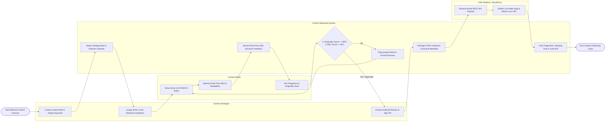

# Swimlane Diagram — Content Marketing Management System

## Mermaid Code

## Flow Description | Mô tả luồng

| Lane | Actor | Role in Flow |
|------|-------|-------------|
| 1 | Content Strategist | Creates structured content briefs with target keywords, assigns writers with milestone deadlines, conducts editorial reviews, and authorizes publication sign-offs. |
| 2 | Content Writer | Drafts article copy in the WYSIWYG editor, optimizes text against real-time SEO keyword recommendations and Flesch readability scores, and executes plagiarism verification. |
| 3 | Content Marketing System | Attaches briefs to editorial calendars, streams real-time SEO scoring feedback, enforces originality and quality thresholds, packages approved HTML payloads with canonical metadata, and tracks pageviews, reading time, and lead ROI. |
| 4 | CMS Platform / WordPress | Ingests published article REST API payloads, generates live public web pages, assigns canonical URLs, and streams reader pageview telemetry back to the system. |
