# Action Tree — Content Marketing Management System

## Mermaid Code

```mermaid
graph TD
    Root["Content Marketing Management System"]

    Root --> M1["Editorial Planning & Brief Management"]
    Root --> M2["WYSIWYG Editing & SEO Optimization"]
    Root --> M3["Editorial Review & Originality QA"]
    Root --> M4["Multi-CMS Publishing & Syndication"]
    Root --> M5["Gated Lead Magnet Management"]
    Root --> M6["Content Telemetry & ROI Analytics"]

    M1 --> A11["Manage Visual Drag-and-Drop Editorial Calendars"]
    M1 --> A12["Create Structured Content Strategy Briefs"]
    M1 --> A13["Assign Writers & Set Milestone Deadlines"]
    M1 --> A14["Tag Target Buyer Personas & Search Intent"]

    M2 --> A21["Write & Edit Rich Text Copy in Collaborative WYSIWYG Editor"]
    M2 --> A22["Calculate Real-Time Flesch-Kincaid Readability Scores"]
    M2 --> A23["Optimize Keyword Density & Heading Structures"]
    M2 --> A24["Attach Featured Header Graphics & Infographics"]

    M3 --> A31["Facilitate Multi-Stage Editorial Review Workflows"]
    M3 --> A32["Run Plagiarism & Web Originality Scans (Copyscape)"]
    M3 --> A33["Track Version Control History & Diff Comparisons"]
    M3 --> A34["Enforce Quality Gates (Originality >= 90%, SEO >= 80)"]

    M4 --> A41["Publish Approved HTML Articles to WordPress/Webflow CMS"]
    M4 --> A42["Configure Canonical URLs & Meta Titles/Descriptions"]
    M4 --> A43["Syndicate Excerpts to Medium & Corporate RSS Feeds"]
    M4 --> A44["Schedule Automated CMS Publication Timestamps"]

    M5 --> A51["Gate High-Value E-Books & Whitepaper PDF Assets"]
    M5 --> A52["Embed Smart Lead Capture Forms on Landing Pages"]
    M5 --> A53["Generate Secure Time-Limited PDF Download Tokens"]
    M5 --> A54["Attribute New Contacts to Gated Asset Downloads"]

    M6 --> A61["Track Reader Pageviews, Time on Page & Scroll Depth"]
    M6 --> A62["Calculate Content Marketing Financial ROI & Pipeline"]
    M6 --> A63["Perform Content Audits & Repurposing Candidates"]
    M6 --> A64["Alert on Organic Search Traffic Decay (> 30% Drop)"]
```

## Module Description | Mô tả Module

| # | Module | Description | Actions |
|---|--------|-------------|---------|
| 1 | Editorial Planning & Brief Management | Manages visual content calendars, creates structured strategy briefs, assigns writers, and tags buyer personas. | Manage Editorial Calendars, Create Content Briefs, Assign Writers & Deadlines, Tag Buyer Personas. |
| 2 | WYSIWYG Editing & SEO Optimization | Facilitates collaborative rich text editing, calculates real-time readability scores, optimizes keyword density, and attaches media. | Edit Copy in WYSIWYG Editor, Calculate Readability Scores, Optimize Keyword Density, Attach Header Graphics. |
| 3 | Editorial Review & Originality QA | Manages multi-stage editorial reviews, runs plagiarism scans, tracks version revision histories, and enforces quality gates. | Facilitate Editorial Reviews, Run Plagiarism Scans, Track Version Histories, Enforce Quality Gates. |
| 4 | Multi-CMS Publishing & Syndication | Publishes HTML articles to WordPress/Webflow CMS, sets canonical URLs, syndicates excerpts to Medium/RSS, and schedules posts. | Publish Articles to Web CMS, Configure Canonical URLs, Syndicate Excerpts to Medium, Schedule CMS Publications. |
| 5 | Gated Lead Magnet Management | Gates premium e-books/whitepapers, embeds lead capture forms, generates secure PDF download tokens, and attributes new leads. | Gate Premium Whitepaper Assets, Embed Smart Lead Forms, Generate PDF Download Tokens, Attribute New Leads. |
| 6 | Content Telemetry & ROI Analytics | Monitors reader pageviews and time on page, calculates content marketing ROI, performs content audits, and alerts on traffic decay. | Track Pageviews & Reading Time, Calculate Content Marketing ROI, Perform Content Audits, Alert on Traffic Decay. |
