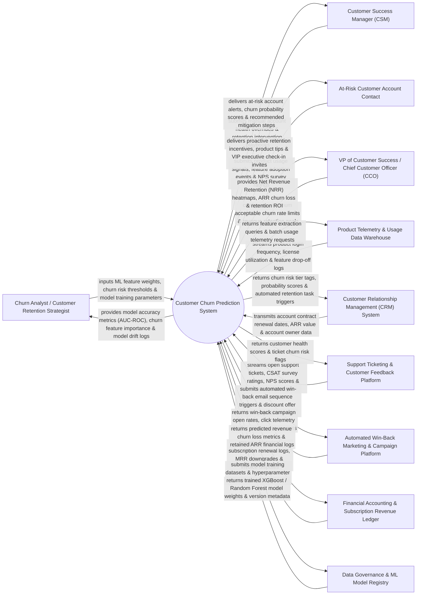

# Context Diagram — Customer Churn Prediction System

## Mermaid Code

## Actor & Interaction Table | Bảng Actor & Tương tác

| # | Actor | Actor Type | Data Sent TO System | Data Received FROM System | Notes |
|---|-------|------------|---------------------|---------------------------|-------|
| 1 | Churn Analyst / Customer Retention Strategist | Primary | ML feature weight configurations, churn risk threshold cutoffs (High > 70%, Medium 40-70%), model training hyper-parameters, retention offer budgets. | ML model accuracy metrics (AUC-ROC, Precision/Recall), SHAP feature importance charts, model drift logs, retention campaign performance. | Data analyst building predictive churn models and evaluating machine learning accuracy. |
| 2 | Customer Success Manager (CSM) | Primary | Manual account health overrides, CSM intervention notes, retention playbook status (`In Progress / Retained / Churned`). | At-risk account alerts, churn probability scores ($P(\text{Churn})$), root cause drivers, recommended retention actions. | Front-line CSM managing customer relationships and executing retention playbooks for at-risk accounts. |
| 3 | At-Risk Customer Account Contact | Primary | Product login telemetry, feature usage events, license seat utilization, CSAT/NPS survey ratings. | Proactive retention incentive offers, tailored product tips, executive sponsor check-in invitations. | B2B customer contact whose product usage behaviors trigger predictive churn risk warnings. |
| 4 | VP of Customer Success / Chief Customer Officer (CCO) | Primary | Maximum acceptable churn rate limits, Net Revenue Retention (NRR %) goals, retention budget caps. | Gross ARR churn loss reports, Net Revenue Retention heatmaps, churn risk segment breakdowns, CCO scorecards. | Executive monitoring customer retention metrics, ARR churn loss, and overall customer success health. |
| 5 | Product Telemetry & Usage Analytics Data Warehouse | Supporting | Product login frequency logs, license seat active utilization %, key feature drop-off events, API call volumes. | Data extraction queries, batch feature engineering jobs, user activity aggregation requests. | Data warehouse (Snowflake / Databricks) storing daily product telemetry and user interaction logs. |
| 6 | Customer Relationship Management (CRM) System | Supporting | Account contract renewal dates, Annual Recurring Revenue (ARR), contract terms, account owner data. | Churn risk tier tags (`CHURN_RISK_HIGH`), probability scores, automated CSM retention task triggers. | Enterprise CRM synchronizing account profiles and creating retention tasks for assigned CSMs. |
| 7 | Support Ticketing & Customer Feedback Platform | Supporting | Open support ticket counts, unresolved ticket age, CSAT survey ratings, NPS scores, escalation tags. | Customer health score tags, support ticket churn risk warning flags, priority escalation triggers. | Customer support system (Zendesk / Gainsight) tracking customer support tickets and satisfaction ratings. |
| 8 | Automated Win-Back Marketing & Campaign Platform | Supporting | Win-back campaign email open rates, click telemetry, promotional discount offer acceptance webhooks. | Automated win-back email sequence triggers, promotional discount offer payloads, dynamic copy. | Marketing automation platform executing automated retention and win-back email nurture campaigns. |
| 9 | Financial Accounting & Subscription Revenue Ledger | Supporting | Historical subscription renewal logs, MRR downgrade transactions, invoice payment disputes, billing failures. | Predicted revenue churn loss metrics, retained ARR financial audit logs, MRR impact forecasts. | Financial ledger recording subscription revenue, MRR downgrades, and billing dispute histories. |
| 10 | Data Governance & Machine Learning Model Registry | Supporting / Regulatory | Trained model binary weights (XGBoost / Random Forest), version metadata, feature scaling parameters. | Model training dataset payloads, hyperparameter optimization logs, model version deployment requests. | ML model registry managing model versioning, automated re-training pipelines, and model drift. |

## System Boundary Description | Mô tả Phạm vi Hệ thống

The **Customer Churn Prediction System** is an enterprise AI machine learning churn forecasting, early warning risk detection, SHAP root-cause analysis, automated CSM alert, and retention playbook management platform designed to protect Annual Recurring Revenue (ARR).

**Inside System Scope:**
- Multi-source data ingestion combining product usage telemetry, CRM contracts, support tickets, and billing payment history.
- AI Machine Learning model training (XGBoost, Random Forest, Logistic Regression) predicting individual customer churn probability ($P(\text{Churn}) \in [0.0, 1.0]$).
- SHAP (SHapley Additive exPlanations) root-cause attribution identifying top churn drivers (e.g., "60% drop in login frequency", "3 unresolved P1 support tickets").
- Automated CSM retention task dispatching in Salesforce CRM when churn probability crosses critical risk thresholds.
- Net Revenue Retention (NRR %) analytics measuring gross ARR churn loss and retention intervention ROI.

**Outside System Scope:**
- Direct physical hosting of cloud data warehouses (handled by Snowflake / Databricks Providers).
- Direct manual composition of legal contract renewal amendments (handled by Enterprise Legal Counsel).
- Direct processing of credit card refund disbursements (handled by Payment Processors).
