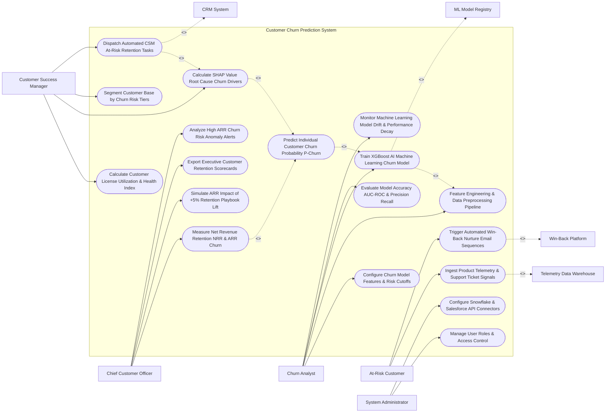

# Use Case Diagram — Customer Churn Prediction System

## Mermaid Code

## Actor Table | Bảng Actor

| # | Actor | Actor Type | Role Description | Related Use Cases |
|---|-------|------------|------------------|-------------------|
| 1 | Churn Analyst | Primary | Data analyst defining ML feature sets, risk cutoffs, training XGBoost churn models, and monitoring model drift. | UC01, UC04, UC05, UC06, UC14 |
| 2 | Customer Success Manager | Primary | CSM monitoring customer health scores, reviewing SHAP root causes, and executing retention playbooks for at-risk accounts. | UC03, UC08, UC09, UC10 |
| 3 | At-Risk Customer | Primary | B2B customer generating usage signals, receiving proactive retention offers, and entering win-back nurture sequences. | UC02, UC11 |
| 4 | Chief Customer Officer | Primary | Executive tracking Net Revenue Retention (NRR %), gross ARR churn loss, retention lift simulations, and CCO scorecards. | UC12, UC13, UC15, UC18 |
| 5 | System Administrator | Primary | IT admin managing user security roles, Snowflake data warehouse credentials, and CRM API tokens. | UC16, UC17 |
| 6 | Telemetry Data Warehouse | System (Secondary) | Cloud data warehouse (Snowflake/Databricks) streaming daily product usage telemetry and feature logs. | UC02 |
| 7 | ML Model Registry | System (Secondary) | Machine learning model registry storing trained model binary weights, feature scalers, and version history. | UC05 |
| 8 | CRM System | System (Secondary) | Enterprise CRM receiving churn risk tags, probability scores, and automated CSM retention tasks. | UC10 |
| 9 | Win-Back Platform | System (Secondary) | Marketing automation system executing automated email sequences and promotional discount offers. | UC11 |

## Use Case Table | Bảng Use Case

| # | UC ID | Use Case Name | Primary Actor | Secondary Actor | Description | Priority |
|---|-------|---------------|---------------|-----------------|-------------|----------|
| 1 | UC01 | Configure Churn Model Features & Risk Cutoffs | Analyst | None | Configures model input features (login frequency, ticket count, NRR, contract length) and risk threshold tiers. | Critical |
| 2 | UC02 | Ingest Product Telemetry & Support Ticket Signals | Customer | Warehouse | Ingests daily product usage telemetry, license seat utilization %, support ticket counts, and CSAT scores. | Critical |
| 3 | UC03 | Calculate Customer License Utilization & Health Index | CSM | None | Aggregates usage signals into a 0-100 Customer Health Index, highlighting accounts with seat utilization $< 40\%$. | High |
| 4 | UC04 | Feature Engineering & Data Preprocessing Pipeline | Analyst | None | Transforms raw telemetry into ML feature vectors (e.g., 30-day login trend %, ticket escalation ratio, days to renewal). | Critical |
| 5 | UC05 | Train XGBoost AI Machine Learning Churn Model | Analyst | MLRegistry | Trains XGBoost, Random Forest, and Logistic Regression ML models on historical customer renewal/churn datasets. | Critical |
| 6 | UC06 | Evaluate Model Accuracy AUC-ROC & Precision Recall | Analyst | None | Evaluates trained ML models using Area Under Curve (AUC-ROC), Precision, Recall, and F1-Score metrics. | High |
| 7 | UC07 | Predict Individual Customer Churn Probability P-Churn | System | None | Generates individual churn probability scores ($P(\text{Churn}) \in [0.0, 1.0]$) for every active customer account. | Critical |
| 8 | UC08 | Calculate SHAP Value Root Cause Churn Drivers | CSM | None | Computes SHAP (SHapley Additive exPlanations) values to identify the top 3 specific drivers of churn risk for an account. | Critical |
| 9 | UC09 | Segment Customer Base by Churn Risk Tiers | CSM | None | Categorizes accounts into risk tiers: Low ($P < 0.30$), Medium ($0.30 \le P < 0.70$), High ($P \ge 0.70$). | High |
| 10 | UC10 | Dispatch Automated CSM At-Risk Retention Tasks | CSM | CRM System | Automatically creates high-priority retention tasks in Salesforce CRM when an account crosses the High Risk threshold. | Critical |
| 11 | UC11 | Trigger Automated Win-Back Nurture Email Sequences | Customer | WinBack | Triggers automated email nurture sequences offering product training webinars or executive check-ins to medium-risk accounts. | High |
| 12 | UC12 | Measure Net Revenue Retention NRR & ARR Churn | CCO | None | Measures Net Revenue Retention Rate (NRR %), Gross Revenue Retention (GRR %), and Gross ARR Churn Loss. | Critical |
| 13 | UC13 | Simulate ARR Impact of +5% Retention Playbook Lift | CCO | None | Simulates financial revenue impact of reducing churn rate by 5%, calculating net ARR saved and retention ROI. | High |
| 14 | UC14 | Monitor Machine Learning Model Drift & Performance Decay | Analyst | None | Tracks model prediction drift over time, alerting data analysts when AUC-ROC drops below 0.75, triggering retraining. | High |
| 15 | UC15 | Export Executive Customer Retention Scorecards | CCO | None | Renders executive scorecards detailing gross ARR churn, NRR %, high-risk account ARR value, and CSM playbook win rates. | High |
| 16 | UC16 | Manage User Roles & Access Control | Admin | None | Controls user login credentials, RBAC permissions, and churn model deployment authorization. | High |
| 17 | UC17 | Configure Snowflake & Salesforce API Connectors | Admin | None | Configures API connection parameters for Snowflake, Databricks, Salesforce, Gainsight, and Zendesk. | High |
| 18 | UC18 | Analyze High ARR Churn Risk Anomaly Alerts | CCO | None | Dispatches urgent alert notifications to CCO when an account with ARR $> \$100,000$ enters the High Risk tier. | High |

## Use Case Specification | Đặc tả Use Case

---

### UC05 — Train XGBoost AI Machine Learning Churn Model

| Field | Detail |
|-------|--------|
| **UC ID** | UC05 |
| **Use Case Name** | Train XGBoost AI Machine Learning Churn Model |
| **Actor(s)** | Primary: Churn Analyst / Customer Retention Strategist   Secondary: Data Governance & Machine Learning Model Registry |
| **Description** | Trains gradient-boosted decision tree (XGBoost) machine learning models on multi-year historical customer renewal and churn datasets to learn complex non-linear churn patterns. |
| **Precondition** | 1. Historical customer dataset (10,000+ renewal/churn accounts over 3 years) is preprocessed (UC04).   2. Feature matrix (50+ feature columns) is stored in Snowflake data warehouse. |
| **Main Flow** | 1. Analyst opens "Machine Learning Model Training Console".   2. Analyst selects Training Algorithm: `XGBoost Classifier (Gradient Boosting)` and Data Split: `80% Training / 20% Validation`.   3. System loads engineered Feature Matrix:   &nbsp;&nbsp;&nbsp;&nbsp; a. Usage Telemetry Features: 30-day login trend %, seat utilization %, key feature usage drop-off.   &nbsp;&nbsp;&nbsp;&nbsp; b. Customer Support Features: Open P1 support tickets count, average CSAT score, NPS rating.   &nbsp;&nbsp;&nbsp;&nbsp; c. Contract & Billing Features: Days to contract renewal, MRR value, billing payment delay days.   4. System executes Model Training Pipeline (100 Decision Trees, Max Depth = 6, Learning Rate = 0.05).   5. System computes Model Cross-Validation Evaluation (UC06):   &nbsp;&nbsp;&nbsp;&nbsp; a. Area Under Curve (AUC-ROC): `0.885` (Excellent Predictive Discrimination).   &nbsp;&nbsp;&nbsp;&nbsp; b. Precision: `82.4%` | Recall: `79.1%` | F1-Score: `0.807`.   6. System saves trained model binary weights (`xgboost_churn_v2.4.bin`) to ML Model Registry.   7. Analyst promotes `v2.4` model to Active Production Status; System begins generating daily predictions (UC07). |
| **Alternative Flow** | **AF1** — Automated Hyperparameter Optimization: System runs Grid Search / Bayesian Optimization over 50 iterations to automatically find optimal learning rates and tree depth parameters. |
| **Exception Flow** | **EX1** — Class Imbalance Training Deficit: Historical dataset has < 2% churn instances (severe class imbalance); System applies SMOTE (Synthetic Minority Over-sampling Technique) to rebalance dataset before training. |
| **Postcondition** | XGBoost churn model is trained, validation accuracy metrics (AUC-ROC >= 0.85) are confirmed, and model is registered in ML Model Registry. |
| **Business Rule** | **BR1**: Churn prediction models MUST achieve a minimum validation AUC-ROC score of >= 0.80 before deployment to production. |

---

### UC08 — Calculate SHAP Value Root Cause Churn Drivers

| Field | Detail |
|-------|--------|
| **UC ID** | UC08 |
| **Use Case Name** | Calculate SHAP Value Root Cause Churn Drivers |
| **Actor(s)** | Primary: Customer Success Manager (CSM), Churn Analyst   Secondary: None |
| **Description** | Computes SHAP (SHapley Additive exPlanations) values to break down individual account predictions, identifying the top 3 specific behavioral root-cause drivers of churn risk. |
| **Precondition** | 1. Customer account has a generated churn probability score (UC07).   2. Active XGBoost churn prediction model is registered. |
| **Main Flow** | 1. CSM opens "Account Risk Details" page for At-Risk Account `Global Logistics Inc (ARR: $120,000)`.   2. System retrieves Account Churn Probability: $P(\text{Churn}) = 0.84$ (`HIGH_RISK_TIER`).   3. System executes SHAP Explainer Algorithm against trained XGBoost model for this specific account feature vector.   4. SHAP Engine calculates feature marginal contributions (SHAP values):   &nbsp;&nbsp;&nbsp;&nbsp; a. Driver 1 (Primary Root Cause): `Active Seat Utilization Dropped to 22% (SHAP Impact: +0.38 to P-Churn)`.   &nbsp;&nbsp;&nbsp;&nbsp; b. Driver 2 (Secondary Root Cause): `2 Unresolved P1 Support Tickets > 14 Days (SHAP Impact: +0.24 to P-Churn)`.   &nbsp;&nbsp;&nbsp;&nbsp; c. Driver 3 (Tertiary Root Cause): `Executive Sponsor Left Company (SHAP Impact: +0.12 to P-Churn)`.   5. System renders SHAP Waterfall Breakdown Chart, visually illustrating how each feature pushed the risk score from baseline (0.15) to 0.84.   6. System generates Recommended Retention Action Plan:   &nbsp;&nbsp;&nbsp;&nbsp; a. Action 1: *"Escalate P1 Support Tickets to VP of Engineering"*.   &nbsp;&nbsp;&nbsp;&nbsp; b. Action 2: *"Schedule Executive Alignment Meeting to identify new Executive Sponsor"*.   7. CSM reviews SHAP root causes and executes recommended retention actions. |
| **Alternative Flow** | **AF1** — Positive Health Driver Identification: System identifies positive SHAP drivers (e.g., "High Mobile App Adoption -0.20 to P-Churn"), highlighting strengths to reinforce. |
| **Exception Flow** | **EX1** — Missing Telemetry Feature Handling: Account is missing login telemetry data; SHAP explainer attributes risk contribution to "Data Incompleteness Proxy Feature", notifying CSM of telemetry gap. |
| **Postcondition** | SHAP root cause drivers (+0.38 seat drop, +0.24 unresolved tickets) are calculated, waterfall charts render, and retention actions update. |
| **Business Rule** | **BR1**: Churn risk alerts MUST provide explainable SHAP root-cause drivers for every flagged high-risk account to guide CSM intervention. |

---

### UC10 — Dispatch Automated CSM At-Risk Retention Tasks

| Field | Detail |
|-------|--------|
| **UC ID** | UC10 |
| **Use Case Name** | Dispatch Automated CSM At-Risk Retention Tasks |
| **Actor(s)** | Primary: Customer Success Manager (CSM)   Secondary: Customer Relationship Management (CRM) System (Salesforce / Gainsight) |
| **Description** | Automatically generates high-priority retention tasks and alert notifications in the CRM when a customer account crosses critical churn probability thresholds, enforcing SLA response limits. |
| **Precondition** | 1. Account churn probability $P(\text{Churn})$ is calculated (UC07).   2. Churn risk threshold cutoffs (High Risk $P \ge 0.70$) are active.   3. Salesforce CRM API integration is active. |
| **Main Flow** | 1. System runs daily churn risk scoring pipeline.   2. Account `Global Logistics Inc (ARR: $120,000)` score increases from 0.45 to `0.84` ($P \ge 0.70$ -> `HIGH_RISK_THRESHOLD_CROSSED`).   3. System identifies assigned Customer Success Manager: `CSM Sarah Jenkins`.   4. System assembles CRM Task Payload:   &nbsp;&nbsp;&nbsp;&nbsp; a. Task Priority: `HIGH_PRIORITY_URGENT`.   &nbsp;&nbsp;&nbsp;&nbsp; b. Task Subject: `"HIGH CHURN RISK ALERT: Global Logistics Inc (ARR: $120K) - P(Churn): 84%"`.   &nbsp;&nbsp;&nbsp;&nbsp; c. Response SLA Limit: `24 Hours to Contact Customer`.   &nbsp;&nbsp;&nbsp;&nbsp; d. Attached SHAP Root Causes: `Seat Utilization 22%`, `2 Unresolved P1 Support Tickets`.   &nbsp;&nbsp;&nbsp;&nbsp; e. Recommended Playbook: `Enterprise Executive Alignment Playbook`.   5. System dispatches REST API payload to Salesforce CRM.   6. Salesforce API creates Task Record `TASK-88412`, updates Account record tag to `CHURN_RISK_HIGH`, and dispatches desktop push alert and Slack notification to CSM Sarah Jenkins.   7. CSM receives alert, opens task in Salesforce, and clicks "Initiate Executive Alignment Playbook". |
| **Alternative Flow** | **AF1** — High-ARR Escalation to CCO: Account ARR exceeds $100,000; System simultaneously triggers UC18 (Analyze High ARR Churn Risk Anomaly Alerts), sending SMS alert directly to Chief Customer Officer. |
| **Exception Flow** | **EX1** — Unassigned Account Task Routing: Account has no assigned CSM; System automatically routes task to Customer Success Director queue, preventing unassigned risk gaps. |
| **Postcondition** | High-priority retention task is created in CRM, account tag updates to High Risk, 24-hour response SLA timer starts, and CSM is notified. |
| **Business Rule** | **BR1**: High-risk churn alerts ($P \ge 0.70$) MUST create an urgent task in CRM enforcing a maximum CSM response SLA of <= 24 hours. |

---

### UC12 — Measure Net Revenue Retention (NRR %) & ARR Churn

| Field | Detail |
|-------|--------|
| **UC ID** | UC12 |
| **Use Case Name** | Measure Net Revenue Retention (NRR %) & ARR Churn |
| **Actor(s)** | Primary: Chief Customer Officer, VP of Customer Success   Secondary: Financial Accounting & Subscription Revenue Ledger |
| **Description** | Calculates Net Revenue Retention Rate ($\text{NRR \%} = \frac{\text{Starting MRR} + \text{Expansion} - \text{Downgrades} - \text{Churn}}{\text{Starting MRR}} \times 100\%$) and Gross ARR Churn Loss to track subscription financial health. |
| **Precondition** | 1. Subscription starting MRR, expansion MRR, downgrade MRR, and churn MRR values are logged in revenue ledger. |
| **Main Flow** | 1. User opens "Net Revenue Retention & ARR Churn Console".   2. User selects Financial Period: `Q3 2026 Close` and Segment: `Enterprise SaaS Accounts`.   3. System retrieves Subscription Revenue Totals from Financial Ledger:   &nbsp;&nbsp;&nbsp;&nbsp; a. Starting MRR ($MRR_{\text{start}}$): `$1,000,000.00` ($12,000,000 ARR baseline).   &nbsp;&nbsp;&nbsp;&nbsp; b. Expansion MRR ($MRR_{\text{expansion}}$): `$120,000.00` (Upsells and seat expansions).   &nbsp;&nbsp;&nbsp;&nbsp; c. Downgrade MRR ($MRR_{\text{downgrade}}$): `$30,000.00` (Seat contractions).   &nbsp;&nbsp;&nbsp;&nbsp; d. Churn MRR ($MRR_{\text{churn}}$): `$40,000.00` (Cancellations).   4. System calculates Net Revenue Retention Rate (NRR %):   $$\text{NRR \%} = \frac{\$1,000,000 + \$120,000 - \$30,000 - \$40,000}{\$1,000,000} \times 100\% = \frac{\$1,050,000}{\$1,000,000} \times 100\% = 105.0\% \text{ NRR}$$   5. System calculates Gross Revenue Retention Rate (GRR %):   $$\text{GRR \%} = \frac{\$1,000,000 - \$30,000 - \$40,000}{\$1,000,000} \times 100\% = \frac{\$930,000}{\$1,000,000} \times 100\% = 93.0\% \text{ GRR}$$   6. System calculates Gross Annualized Churn ARR Loss: $(\$30,000 + \$40,000) \times 12 = \$840,000.00 \text{ ARR Churn Loss}$.   7. System renders NRR vs Target Benchmark (Target: 110% NRR) and displays $5.0\%$ retention gap warning.   8. User exports financial retention scorecard PDF for Board of Directors meeting. |
| **Alternative Flow** | **AF1** — Cohort-Based NRR Heatmap Analysis: System breaks down NRR performance across customer acquisition cohorts (e.g., 2024 Cohort vs 2025 Cohort) over 24 months. |
| **Exception Flow** | **EX1** — Un-Reconciled Billing Variance Warning: Billing ledger contains $10,000 in disputed invoices; System flags variance, calculating NRR with and without disputed revenue. |
| **Postcondition** | Net Revenue Retention (NRR = 105%), Gross Revenue Retention (GRR = 93%), and ARR churn loss ($840k) are calculated and exported. |
| **Business Rule** | **BR1**: Net Revenue Retention (NRR %) MUST account for starting MRR, expansion MRR, downgrade MRR, and churn MRR under GAAP subscription accounting guidelines. |
