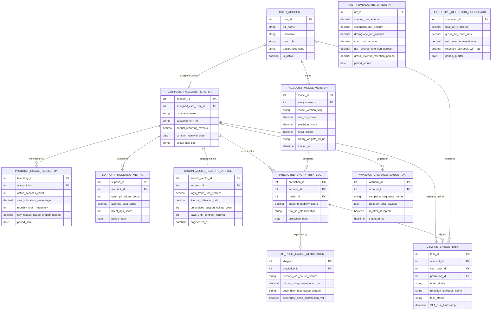

# Conceptual ERD — Customer Churn Prediction System

## Mermaid Code

## Entity Description Table | Bảng mô tả Entity

| # | Entity Name | Vietnamese Name | Description | Key Attributes | Main Relationships |
|---|-------------|-----------------|-------------|----------------|-------------------|
| 1 | USER_ACCOUNT | Tài khoản Nguời dùng | System credentials and access roles for churn analysts, CSMs, CCOs, and admins. | `user_id`, `username`, `user_role`, `department_code` | Assigned CSM for `CUSTOMER_ACCOUNT_MASTER`, trains `XGBOOST_MODEL_VERSION`, executes `CSM_RETENTION_TASK`. |
| 2 | CUSTOMER_ACCOUNT_MASTER | Customer Account Master | Central customer account record tracking company names, CRM ID, Annual Recurring Revenue (ARR), renewal dates, and risk tiers. | `account_id`, `assigned_csm_user_id`, `company_name`, `annual_recurring_revenue`, `contract_renewal_date`, `active_risk_tier` | Monitored via `PRODUCT_USAGE_TELEMETRY`, tracked via `SUPPORT_TICKETING_METRIC`, engineered into `CHURN_MODEL_FEATURE_VECTOR`, predicted for `PREDICTED_CHURN_RISK_LOG`, assigned task in `CSM_RETENTION_TASK`. |
| 3 | PRODUCT_USAGE_TELEMETRY | Telemetry Sử dụng Sản phẩm | Daily product usage telemetry record tracking active licenses, seat utilization %, login frequency, and feature drop-offs. | `telemetry_id`, `account_id`, `active_licenses_count`, `seat_utilization_percentage`, `monthly_login_frequency`, `key_feature_usage_dropoff_percent` | Belongs to `CUSTOMER_ACCOUNT_MASTER`. |
| 4 | SUPPORT_TICKETING_METRIC | Chỉ số Support Ticket & CSAT | Support ticketing and feedback record tracking open P1 tickets, average CSAT ratings, and latest NPS scores. | `support_id`, `account_id`, `open_p1_tickets_count`, `average_csat_rating`, `latest_nps_score` | Belongs to `CUSTOMER_ACCOUNT_MASTER`. |
| 5 | CHURN_MODEL_FEATURE_VECTOR | Feature Vector Mô hình Churn | Engineed ML feature vector aggregating 30-day login trends, license utilization ratios, ticket counts, and days to renewal. | `feature_vector_id`, `account_id`, `login_trend_30d_percent`, `license_utilization_ratio`, `unresolved_support_tickets_count`, `days_until_contract_renewal` | Belongs to `CUSTOMER_ACCOUNT_MASTER`. |
| 6 | XGBOOST_MODEL_VERSION | Version Mô hình XGBoost ML | Machine learning model version entity storing version slugs, AUC-ROC accuracy scores, precision/recall, and binary weights S3 URIs. | `model_id`, `analyst_user_id`, `model_version_slug`, `auc_roc_score`, `precision_score`, `recall_score`, `binary_weights_s3_uri` | Generates `PREDICTED_CHURN_RISK_LOG`, trained by `USER_ACCOUNT`. |
| 7 | PREDICTED_CHURN_RISK_LOG | Bản ghi Predicted Churn Risk | Daily churn prediction log recording churn probability scores ($P \in [0.0, 1.0]$) and risk tier classifications (Low/Medium/High). | `prediction_id`, `account_id`, `model_id`, `churn_probability_score`, `risk_tier_classification`, `prediction_date` | Belongs to `CUSTOMER_ACCOUNT_MASTER` and `XGBOOST_MODEL_VERSION`, explained by `SHAP_ROOT_CAUSE_ATTRIBUTION`, triggers `CSM_RETENTION_TASK`. |
| 8 | SHAP_ROOT_CAUSE_ATTRIBUTION | Phân tích Nguyên nhân Root Cause SHAP | SHAP value root-cause explanation record identifying top 3 feature drivers and their marginal contributions to churn probability. | `shap_id`, `prediction_id`, `primary_root_cause_feature`, `primary_shap_contribution_val`, `secondary_root_cause_feature` | Belongs to `PREDICTED_CHURN_RISK_LOG`. |
| 9 | CSM_RETENTION_TASK | Task Retention CSM At-Risk | High-priority CRM task entity tracking task priority, assigned CSM, retention playbook names, status, and SLA due timestamps. | `task_id`, `account_id`, `csm_user_id`, `prediction_id`, `task_priority`, `retention_playbook_name`, `task_status`, `SLA_due_timestamp` | Belongs to `CUSTOMER_ACCOUNT_MASTER` and `PREDICTED_CHURN_RISK_LOG`, executed by `USER_ACCOUNT`. |
| 10 | WINBACK_CAMPAIGN_EXECUTION | Thực thi Campaign Win-Back | Automated win-back marketing execution log recording sequence names, promotional discount offers, and offer acceptance status. | `winback_id`, `account_id`, `campaign_sequence_name`, `discount_offer_payload`, `is_offer_accepted` | Belongs to `CUSTOMER_ACCOUNT_MASTER`. |
| 11 | NET_REVENUE_RETENTION_NRR | Chỉ số NRR Net Revenue Retention | Monthly financial retention log tracking starting MRR, expansion MRR, downgrade MRR, churn MRR, and NRR / GRR %. | `nrr_id`, `starting_mrr_amount`, `expansion_mrr_amount`, `downgrade_mrr_amount`, `churn_mrr_amount`, `net_revenue_retention_percent` | Standalone subscription financial entity. |
| 12 | EXECUTIVE_RETENTION_SCORECARD | Scorecard Executive Retention | Executive customer success scorecard aggregating total ARR protected, gross ARR churn loss, NRR %, and playbook win rates. | `scorecard_id`, `total_arr_protected`, `gross_arr_churn_loss`, `net_revenue_retention_nrr`, `retention_playbook_win_rate` | Standalone executive performance entity. |

## Relationship Description | Mô tả Quan hệ

| # | From Entity | Cardinality | To Entity | Label | Business Explanation |
|---|-------------|-------------|-----------|-------|----------------------|
| 1 | CUSTOMER_ACCOUNT_MASTER | 1 to 0..N | PRODUCT_USAGE_TELEMETRY | monitored via | A customer account is monitored via daily product usage telemetry. |
| 2 | CUSTOMER_ACCOUNT_MASTER | 1 to 0..N | SUPPORT_TICKETING_METRIC | tracked via | A customer account is tracked via support ticket and CSAT metrics. |
| 3 | CUSTOMER_ACCOUNT_MASTER | 1 to 0..1 | CHURN_MODEL_FEATURE_VECTOR | engineered into | A customer account is engineered into a ML feature vector. |
| 4 | CUSTOMER_ACCOUNT_MASTER | 1 to 0..N | PREDICTED_CHURN_RISK_LOG | predicted for | A customer account is predicted for churn probability risk scores. |
| 5 | CUSTOMER_ACCOUNT_MASTER | 1 to 0..N | CSM_RETENTION_TASK | assigned task in | A high-risk customer account is assigned tasks in CSM retention tasks. |
| 6 | CUSTOMER_ACCOUNT_MASTER | 1 to 0..N | WINBACK_CAMPAIGN_EXECUTION | targeted in | An at-risk customer account is targeted in win-back campaigns. |
| 7 | XGBOOST_MODEL_VERSION | 1 to 0..N | PREDICTED_CHURN_RISK_LOG | generates | An XGBoost model version generates daily churn risk logs. |
| 8 | PREDICTED_CHURN_RISK_LOG | 1 to 0..1 | SHAP_ROOT_CAUSE_ATTRIBUTION | explained by | A churn prediction log is explained by SHAP root-cause feature drivers. |
| 9 | PREDICTED_CHURN_RISK_LOG | 1 to 0..1 | CSM_RETENTION_TASK | triggers | A high-risk churn prediction log triggers a CSM retention task. |
| 10 | USER_ACCOUNT | 1 to 0..N | CUSTOMER_ACCOUNT_MASTER | assigned CSM for | A CSM user account is assigned customer account master records. |
| 11 | USER_ACCOUNT | 1 to 0..N | XGBOOST_MODEL_VERSION | trains | A churn analyst user account trains XGBoost model versions. |
| 12 | USER_ACCOUNT | 1 to 0..N | CSM_RETENTION_TASK | executes | A CSM user account executes at-risk retention tasks. |
