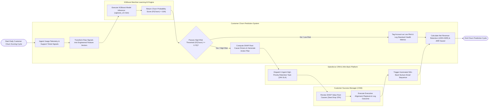

# Swimlane Diagram — Customer Churn Prediction System

## Mermaid Code

## Flow Description | Mô tả luồng

| Lane | Actor | Role in Flow |
|------|-------|-------------|
| 1 | Customer Success Manager (CSM) | Reviews SHAP root-cause feature drivers (+0.38 seat drop, +0.24 unresolved tickets), executes recommended retention playbooks, conducts executive alignment meetings, and logs intervention outcomes. |
| 2 | Customer Churn Prediction System | Ingests daily usage telemetry and support tickets, transforms signals into engineered feature vectors, evaluates high-risk churn thresholds ($P \ge 0.70$), computes SHAP root causes, and measures Net Revenue Retention (NRR %). |
| 3 | XGBoost Machine Learning AI Engine | Executes model inference using trained XGBoost binary weights (`xgboost_v2.4.bin`), returning individual account churn probability scores ($P(\text{Churn}) \in [0.0, 1.0]$). |
| 4 | Salesforce CRM & Win-Back Platform | Receives automated task dispatches, creates urgent 24-hour SLA retention tasks in Salesforce, updates account tags to High Risk, and triggers automated win-back email sequences. |
