# Action Tree — Customer Churn Prediction System

## Mermaid Code

```mermaid
graph TD
    Root["Customer Churn Prediction System"]

    Root --> M1["Data Ingestion & Feature Engineering"]
    Root --> M2["XGBoost Machine Learning Model Training"]
    Root --> M3["Churn Scoring & SHAP Root Cause Analysis"]
    Root --> M4["CSM Retention Tasks & Playbook Governance"]
    Root --> M5["Automated Win-Back Marketing Sequences"]
    Root --> M6["Net Revenue Retention NRR & ARR Analytics"]

    M1 --> A11["Ingest Product Usage Telemetry from Snowflake Data Warehouse"]
    M1 --> A12["Ingest Support Ticket Counts, CSAT & NPS Feedback (Zendesk)"]
    M1 --> A13["Ingest Subscription Contract Renewals & MRR Data (Salesforce)"]
    M1 --> A14["Engineer 30-Day Usage Trend & Seat Utilization Feature Vectors"]

    M2 --> A21["Train XGBoost & Random Forest ML Models on Historical Datasets"]
    M2 --> A22["Apply SMOTE Synthetic Sampling for Severe Churn Class Imbalance"]
    M2 --> A23["Evaluate Model Accuracy AUC-ROC (> 0.85), Precision & Recall"]
    M2 --> A24["Register Model Binary Weights (xgboost_v2.4.bin) in ML Registry"]

    M3 --> A31["Generate Daily Customer Churn Probabilities (P-Churn 0.0 to 1.0)"]
    M3 --> A32["Compute SHAP Value Feature Marginal Contributions for Accounts"]
    M3 --> A33["Identify Top 3 Behavioral Root-Cause Drivers (Seat Drop, P1 Tickets)"]
    M3 --> A34["Segment Accounts into Low (< 0.30), Medium (0.30-0.70), High (>= 0.70) Tiers"]

    M4 --> A41["Dispatch High-Priority Retention Tasks to Salesforce CRM"]
    M4 --> A42["Enforce 24-Hour CSM Response SLA Limits for High-Risk Accounts"]
    M4 --> A43["Provide SHAP Waterfall Charts & Recommended Retention Playbooks"]
    M4 --> A44["Track CSM Playbook Intervention Outcomes (Retained vs Churned)"]

    M5 --> A51["Trigger Automated Win-Back Nurture Email Sequences for Medium Risk"]
    M5 --> A52["Offer Promotional Discount Incentives & Training Webinars in Email"]
    M5 --> A53["Track Win-Back Campaign Open Rates & Offer Acceptance Receipts"]
    M5 --> A54["Auto-Escalate Un-Responded Medium Risk Accounts to High Risk"]

    M6 --> A61["Calculate Net Revenue Retention Rate (NRR %) under GAAP Standards"]
    M6 --> A62["Measure Gross Revenue Retention Rate (GRR %) & Gross ARR Churn Loss"]
    M6 --> A63["Simulate Financial ARR Impact of +5% Retention Playbook Lift"]
    M6 --> A64["Export Executive Customer Retention & ARR Protection Scorecards"]
```

## Module Description | Mô tả Module

| # | Module | Description | Actions |
|---|--------|-------------|---------|
| 1 | Data Ingestion & Feature Engineering | Ingests product telemetry, support tickets, CSAT/NPS, contract renewal data, and engineers 30-day usage trend feature vectors. | Ingest Product Usage Telemetry, Ingest Support Ticket & CSAT Signals, Ingest Contract Renewal & MRR Data, Engineer Usage Trend Feature Vectors. |
| 2 | XGBoost Machine Learning Model Training | Trains XGBoost ML models, applies SMOTE for class imbalance, evaluates AUC-ROC accuracy (> 0.85), and registers model binary weights. | Train XGBoost & Random Forest Models, Apply SMOTE Synthetic Rebalancing, Evaluate Model Accuracy AUC-ROC, Register Binary Weights in ML Registry. |
| 3 | Churn Scoring & SHAP Root Cause Analysis | Generates daily churn probability scores ($P \in [0.0, 1.0]$), computes SHAP values, identifies top 3 root-cause drivers, and segments risk tiers. | Generate Daily Churn Probabilities, Compute SHAP Value Marginal Contributions, Identify Top 3 Root-Cause Drivers, Segment Customer Base into Risk Tiers. |
| 4 | CSM Retention Tasks & Playbook Governance | Dispatches CRM tasks, enforces 24-hour CSM response SLAs, provides SHAP waterfall charts, and tracks playbook win rates. | Dispatch High-Priority Retention Tasks to CRM, Enforce 24-Hour CSM Response SLAs, Provide SHAP Waterfall Charts, Track Playbook Intervention Outcomes. |
| 5 | Automated Win-Back Marketing Sequences | Triggers win-back email sequences for medium-risk accounts, offers promotional discount incentives, and tracks offer acceptance rates. | Trigger Automated Win-Back Email Sequences, Offer Promotional Discount Incentives, Track Win-Back Offer Acceptance Rates, Auto-Escalate Un-Responded Accounts. |
| 6 | Net Revenue Retention NRR & ARR Analytics | Calculates NRR % and GRR % under GAAP guidelines, measures gross ARR churn loss, simulates retention lift, and exports executive scorecards. | Calculate Net Revenue Retention Rate NRR %, Measure Gross ARR Churn Loss, Simulate Impact of +5% Retention Lift, Export Executive Retention Scorecards. |
