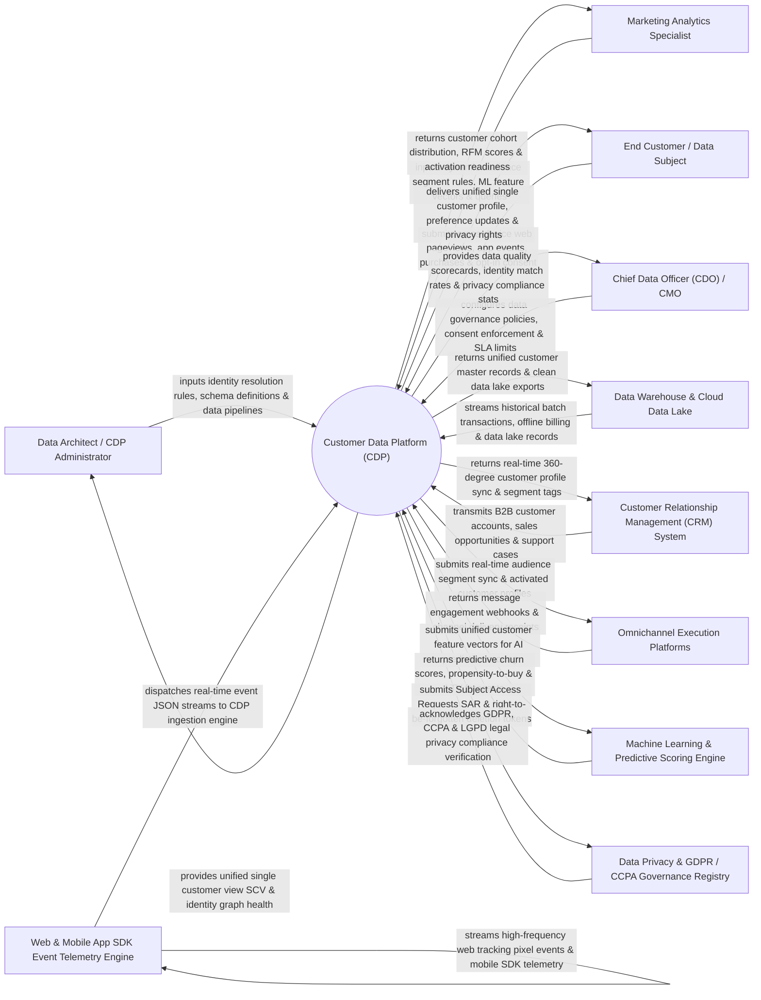

# Context Diagram — Customer Data Platform (CDP)

## Mermaid Code

## Actor & Interaction Table | Bảng Actor & Tương tác

| # | Actor | Actor Type | Data Sent TO System | Data Received FROM System | Notes |
|---|-------|------------|---------------------|---------------------------|-------|
| 1 | Data Architect / CDP Administrator | Primary | Identity resolution rules (Deterministic/Probabilistic), data schema definitions, ETL pipeline configs. | Unified Single Customer View (SCV) audit reports, identity graph match rate stats, data pipeline health. | Technical architect managing customer data schemas, identity resolution, and data integration pipelines. |
| 2 | Marketing Analytics Specialist | Primary | Dynamic audience segment rules, RFM scoring criteria, feature vector definitions, custom SQL queries. | Customer cohort distributions, real-time segment membership, activation readiness metrics. | Analytics specialist building unified audience segments and querying single customer view profiles. |
| 3 | End Customer / Data Subject | Primary | Cross-device web pageviews, mobile app events, e-commerce purchases, communication preferences, consent choices. | Unified single customer profile synchronization, self-service privacy rights, preference updates. | Consumer interacting with brand across channels, generating behavioral data and managing consent. |
| 4 | Chief Data Officer (CDO) / CMO | Primary | Data governance policies, privacy consent enforcement rules, data quality SLA targets. | Data quality scorecards, identity match rate analytics, GDPR/CCPA compliance verification reports. | Executive overseeing enterprise data strategy, identity resolution quality, and privacy compliance. |
| 5 | Data Warehouse & Cloud Data Lake | Supporting | Historical batch transaction tables, offline billing ledgers, legacy mainframe customer dumps. | Unified customer master records, clean deduplicated data lake exports (Snowflake, BigQuery). | Central data warehouse (Snowflake, Google BigQuery, Databricks) exchanging batch customer datasets. |
| 6 | Customer Relationship Management (CRM) System | Supporting | B2B account hierarchies, sales opportunity progressions, customer support ticket histories. | Real-time 360-degree customer profile synchronization, updated segment membership tags. | Enterprise CRM exchanging customer relationship data with the CDP's unified profile engine. |
| 7 | Omnichannel Execution Platforms | Supporting | Campaign delivery receipts, email opens, link clicks, mobile push impressions, ad conversions. | Real-time audience segment exports, activated customer profiles, dynamic personalization tags. | Marketing execution channels (Email, SMS, Mobile Push, Meta Ads, Google Ads) receiving audience activations. |
| 8 | Web & Mobile App SDK Event Telemetry Engine | Supporting | High-frequency web tracking pixel events, iOS/Android mobile SDK telemetry, clickstream JSON feeds. | Client-side tracking configuration scripts, anonymous visitor cookie ID assignments. | SDK telemetry engine collecting real-time client-side user behavior across web browsers and mobile apps. |
| 9 | Machine Learning & Predictive Scoring Engine | Supporting | Predictive churn scores, propensity-to-buy ratings, predicted Customer Lifetime Value (pLTV). | Unified customer feature vectors, historical behavioral event sequences, transaction aggregates. | AI engine analyzing customer feature vectors to output predictive scores back into CDP profiles. |
| 10 | Data Privacy & GDPR / CCPA Governance Registry | Supporting / Regulatory | Mandated privacy rules (GDPR, CCPA, LGPD), Subject Access Request (SAR) protocols, opt-out registries. | Subject Access Request (SAR) exports, right-to-be-forgotten deletion confirmation tokens. | Regulatory compliance framework enforcing legal data privacy, consent, and consumer data rights. |

## System Boundary Description | Mô tả Phạm vi Hệ thống

The **Customer Data Platform (CDP)** is an enterprise customer data unification, identity resolution, single customer view (SCV), real-time segmentation, and data activation platform designed to centralize customer data from all touchpoints.

**Inside System Scope:**
- Ingesting real-time streaming web/mobile SDK telemetry and batch data from Data Warehouses (Snowflake/BigQuery) and CRMs.
- Deterministic and Probabilistic Identity Resolution stitching anonymous cookies, device IDs, emails, and phone numbers into a single 360-degree customer profile.
- Maintaining a centralized Single Customer View (SCV) updating customer traits, behavioral events, and predictive ML scores.
- Real-time dynamic segmentation engine calculating segment membership changes instantaneously upon event receipt.
- Bi-directional reverse ETL data activation exporting audience segments to execution channels (Email, Push, Meta/Google Ads).
- Strict data privacy governance supporting GDPR/CCPA Subject Access Requests (SAR) and right-to-be-forgotten erasures.

**Outside System Scope:**
- Direct physical hosting of cloud data lake storage hardware (handled by Cloud Providers like AWS, Azure, GCP).
- Direct delivery of mass email dispatches (handled by Email Marketing Management Systems).
- Direct manual entry of phone call notes by human support reps (handled by CRM Systems).
