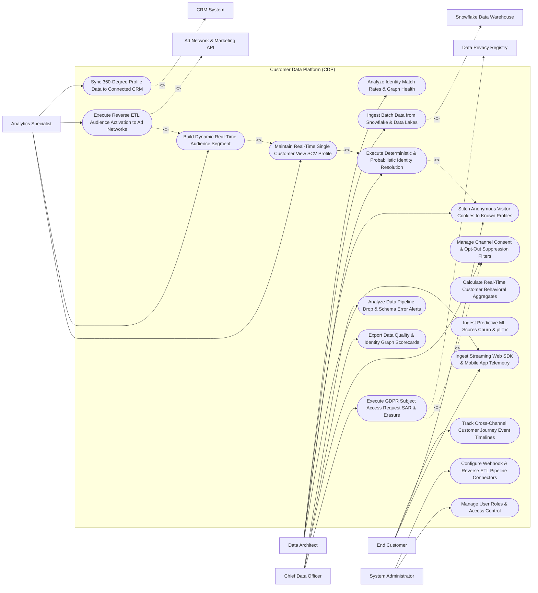

# Use Case Diagram — Customer Data Platform (CDP)

## Mermaid Code

## Actor Table | Bảng Actor

| # | Actor | Actor Type | Role Description | Related Use Cases |
|---|-------|------------|------------------|-------------------|
| 1 | Data Architect | Primary | Technical architect defining identity resolution rules, stitching cookies, configuring data lake pipelines, and monitoring graph health. | UC01, UC02, UC03, UC04, UC09 |
| 2 | Analytics Specialist | Primary | Marketer building real-time dynamic segments, executing reverse ETL activations, and synchronizing 360-degree customer profiles. | UC05, UC08, UC10, UC11 |
| 3 | End Customer | Primary | Consumer generating SDK telemetry events, stitching device cookies, and viewing cross-channel journey timelines. | UC01, UC03, UC14 |
| 4 | Chief Data Officer | Primary | Executive evaluating data quality scorecards, consent governance, GDPR Subject Access Requests (SAR), and schema alerts. | UC12, UC13, UC15, UC18 |
| 5 | System Administrator | Primary | IT admin managing user security roles, reverse ETL pipeline connectors, and API connection keys. | UC16, UC17 |
| 6 | Snowflake Data Warehouse | System (Secondary) | Cloud data warehouse supplying historical batch transaction data and receiving clean customer master tables. | UC04 |
| 7 | CRM System | System (Secondary) | Enterprise CRM receiving real-time 360-degree customer profile synchronization and segment tags. | UC11 |
| 8 | Ad Network & Marketing API | System (Secondary) | Destination ad networks (Meta, Google, LinkedIn) receiving real-time reverse ETL audience segment activations. | UC10 |
| 9 | Data Privacy Registry | System (Secondary) | Compliance registry enforcing GDPR, CCPA, and LGPD Subject Access Requests and right-to-be-forgotten erasures. | UC12 |

## Use Case Table | Bảng Use Case

| # | UC ID | Use Case Name | Primary Actor | Secondary Actor | Description | Priority |
|---|-------|---------------|---------------|-----------------|-------------|----------|
| 1 | UC01 | Ingest Streaming Web SDK & Mobile App Telemetry | DataArchitect | None | Ingests high-frequency real-time clickstream event JSON logs from JavaScript web pixels and iOS/Android SDKs. | Critical |
| 2 | UC02 | Execute Deterministic & Probabilistic Identity Resolution | DataArchitect | None | Merges customer touchpoint identifiers (email, phone, device ID, cookie ID) into a single unified Identity Graph. | Critical |
| 3 | UC03 | Stitch Anonymous Visitor Cookies to Known Profiles | DataArchitect | None | Retroactively stitches anonymous browsing cookie histories to a customer profile when they log in or submit a form. | Critical |
| 4 | UC04 | Ingest Batch Data from Snowflake & Data Lakes | DataArchitect | Snowflake | Executes scheduled batch ETL pipelines importing historical transaction ledgers and offline data from Snowflake/BigQuery. | High |
| 5 | UC05 | Maintain Real-Time Single Customer View SCV Profile | AnalyticsSpec | None | Centralizes all customer attributes, behavioral aggregates, purchase histories, and consent flags in a 360-degree profile. | Critical |
| 6 | UC06 | Calculate Real-Time Customer Behavioral Aggregates | System | None | Dynamically updates real-time behavioral counters (e.g., Total Spend, 30-Day Order Count, Last Session Timestamp). | High |
| 7 | UC07 | Ingest Predictive ML Scores Churn & pLTV | System | None | Ingests external machine learning score outputs (Predicted Churn %, Propensity to Buy, Predicted LTV) into CDP profiles. | High |
| 8 | UC08 | Build Dynamic Real-Time Audience Segment | AnalyticsSpec | None | Configures self-updating audience segments that re-evaluate member inclusion instantaneously upon event ingestion. | Critical |
| 9 | UC09 | Analyze Identity Match Rates & Graph Health | DataArchitect | None | Renders data quality dashboards measuring deterministic vs probabilistic identity match rates and graph cluster health. | High |
| 10 | UC10 | Execute Reverse ETL Audience Activation to Ad Networks | AnalyticsSpec | Execution GW | Pushes privacy-cleared, SHA-256 hashed audience segments to Meta Ads, Google Ads, and TikTok via reverse ETL. | Critical |
| 11 | UC11 | Sync 360-Degree Profile Data to Connected CRM | AnalyticsSpec | CRM System | Transmits enriched customer master profiles, lifetime spend, and segment tags to Salesforce/HubSpot in real time. | High |
| 12 | UC12 | Execute GDPR Subject Access Request SAR & Erasure | CDO | Privacy Reg | Compiles complete customer data exports for SARs or permanently purges PII for Right-to-be-Forgotten requests. | Critical |
| 13 | UC13 | Manage Channel Consent & Opt-Out Suppression Filters | CDO | None | Enforces global and channel-specific opt-out flags (Email, SMS, Ad Retargeting) across all audience exports. | Critical |
| 14 | UC14 | Track Cross-Channel Customer Journey Event Timelines | Customer | None | Renders unified chronological activity timelines showing every web pageview, app event, email click, and purchase. | High |
| 15 | UC15 | Export Data Quality & Identity Graph Scorecards | CDO | None | Displays executive scorecards detailing total unified profiles, data completeness %, match rates, and privacy compliance. | High |
| 16 | UC16 | Manage User Roles & Access Control | Admin | None | Controls user login credentials, RBAC permissions, and PII data masking settings for analytics users. | High |
| 17 | UC17 | Configure Webhook & Reverse ETL Pipeline Connectors | Admin | None | Configures REST API keys, OAuth tokens, and destination webhook pipeline connectors for activation targets. | High |
| 18 | UC18 | Analyze Data Pipeline Drop & Schema Error Alerts | CDO | None | Sends urgent alerts to data engineering teams if ingestion telemetry drops $> 30\%$ or schema parsing errors spike. | High |

## Use Case Specification | Đặc tả Use Case

---

### UC02 — Execute Deterministic & Probabilistic Identity Resolution

| Field | Detail |
|-------|--------|
| **UC ID** | UC02 |
| **Use Case Name** | Execute Deterministic & Probabilistic Identity Resolution |
| **Actor(s)** | Primary: Data Architect / CDP Administrator   Secondary: None |
| **Description** | Merges disparate customer touchpoint identifiers (email, mobile phone, device ID, web cookie, CRM ID) using deterministic exact matches and probabilistic statistical rules into a unified Identity Graph. |
| **Precondition** | 1. Raw customer identifiers are ingested from web SDKs, CRM, or data warehouse (UC01/UC04).   2. Identity resolution rules and matching confidence thresholds are configured. |
| **Main Flow** | 1. System receives raw event containing multiple identity tokens: `Email: john.doe@acme.com`, `Cookie ID: ck_88412`, `IP Address: 192.0.2.45`, `Device ID: dev_ios_992`.   2. System executes Deterministic Identity Matching Engine:   &nbsp;&nbsp;&nbsp;&nbsp; a. Exact Email Match: Searches Identity Graph for `john.doe@acme.com` -> Found existing Master Customer Profile `CID_99412`.   &nbsp;&nbsp;&nbsp;&nbsp; b. Links `Cookie ID: ck_88412` and `Device ID: dev_ios_992` to Master Profile `CID_99412` with Match Confidence `100% (Deterministic)`.   3. System evaluates Probabilistic Identity Matching Engine for secondary tokens:   &nbsp;&nbsp;&nbsp;&nbsp; a. Scans unlinked anonymous cookies sharing same IP Address `192.0.2.45` and device fingerprint within a 1-hour window.   &nbsp;&nbsp;&nbsp;&nbsp; b. Calculates Statistical Match Confidence Score: `88% Match`.   &nbsp;&nbsp;&nbsp;&nbsp; c. Compares score vs Minimum Probabilistic Threshold (85%) -> Threshold Met.   4. System links the anonymous cookie `ck_anon_331` to Master Profile `CID_99412` with Match Confidence `88% (Probabilistic)`.   5. System updates Master Identity Graph cluster, merging all historical activity logs into Customer `CID_99412`.   6. System recalculates real-time profile traits and updates single customer view. |
| **Alternative Flow** | **AF1** — Identity Un-Merging Execution: System detects an over-merged cluster (e.g., shared family computer); System executes un-merge rule, splitting profiles when different user login IDs are submitted. |
| **Exception Flow** | **EX1** — Conflicting Deterministic Identifiers: Event contains Email A and Phone B which belong to two different active Master Profiles; System creates an Identity Conflict Flag and keeps profiles separate until verified. |
| **Postcondition** | Disparate customer identifiers are resolved into a unified Identity Graph, and single customer view profiles are updated. |
| **Business Rule** | **BR1**: Identity resolution MUST prioritize deterministic exact matches (100% confidence) over probabilistic statistical matches. |

---

### UC05 — Maintain Real-Time Single Customer View (SCV) Profile

| Field | Detail |
|-------|--------|
| **UC ID** | UC05 |
| **Use Case Name** | Maintain Real-Time Single Customer View (SCV) Profile |
| **Actor(s)** | Primary: Marketing Analytics Specialist   Secondary: None |
| **Description** | Centralizes all customer attributes, transaction histories, digital body language timelines, predictive ML scores, and consent preferences into a single 360-degree Customer Master Profile. |
| **Precondition** | 1. Identity resolution has linked customer identifiers to a Master Customer ID (`CID_99412`) (UC02). |
| **Main Flow** | 1. User opens "Single Customer View (SCV) Profile Search" and enters Master ID `CID_99412` or Email `john.doe@acme.com`.   2. System retrieves 360-degree Customer Profile:   &nbsp;&nbsp;&nbsp;&nbsp; a. Core Identity Attributes: Name, Email, Phone, Primary Shipping Address, Account Tier (`Gold VIP`).   &nbsp;&nbsp;&nbsp;&nbsp; b. Identity Graph Cluster: Linked Cookies (3), Device IDs (2), CRM Contact ID, Mobile Push Token.   &nbsp;&nbsp;&nbsp;&nbsp; c. Financial & Purchase Summary: Total Lifetime Spend (`$12,450.00`), Order Count (`18 Orders`), Average Order Value (`$691.66`), Last Purchase Date (`3 Days Ago`).   &nbsp;&nbsp;&nbsp;&nbsp; d. Predictive ML Scores: Churn Risk (`12% - LOW`), Propensity to Buy (`88% - HIGH`), Predicted LTV (`$24,000.00`).   &nbsp;&nbsp;&nbsp;&nbsp; e. Active Audience Segments: `[VIP Repeat Buyers, High Propensity Cloud, Email Opt-In]`.   &nbsp;&nbsp;&nbsp;&nbsp; f. Omnichannel Preference & Consent: Email Opt-In (`TRUE`), SMS Opt-In (`TRUE`), Ad Retargeting (`TRUE`).   3. System renders Interactive Chronological Event Timeline showing every web pageview, email click, support ticket, and order.   4. User views real-time profile updates; As new events stream in, the SCV updates dynamically without page refresh. |
| **Alternative Flow** | **AF1** — Raw Event Payload Inspection: User clicks an individual event on the timeline to inspect the raw JSON telemetry payload ingested from the web SDK. |
| **Exception Flow** | **EX1** — Profile Access Security Block: User attempts to view PII of a restricted customer profile without proper security clearance; System masks sensitive PII fields (Email: `j***@acme.com`, Phone: `***-***-0192`). |
| **Postcondition** | 360-degree Single Customer View profile is rendered, displaying unified identities, purchase metrics, ML scores, and consent flags. |
| **Business Rule** | **BR1**: Single Customer View profiles MUST update dynamically in real time (latency <= 5 seconds) as new behavioral events are ingested. |

---

### UC08 — Build Dynamic Real-Time Audience Segment

| Field | Detail |
|-------|--------|
| **UC ID** | UC08 |
| **Use Case Name** | Build Dynamic Real-Time Audience Segment |
| **Actor(s)** | Primary: Marketing Analytics Specialist   Secondary: None |
| **Description** | Configures dynamic self-updating audience segments defined by multi-condition logical rules (demographic, behavioral, predictive ML scores) that re-evaluate membership in real time upon event ingestion. |
| **Precondition** | 1. Customer profiles and behavioral event telemetry are active in CDP (UC05). |
| **Main Flow** | 1. User opens "Dynamic Real-Time Segment Builder".   2. User inputs Segment Name: `High-Value Churn Risk - Cloud Software`.   3. User configures Multi-Condition Rule Logic using AND/OR operators:   &nbsp;&nbsp;&nbsp;&nbsp; a. Condition 1 (Profile Trait): `Total Lifetime Spend >= $5,000`.   &nbsp;&nbsp;&nbsp;&nbsp; b. AND Condition 2 (Predictive Score): `Predicted Churn Risk Score >= 65%`.   &nbsp;&nbsp;&nbsp;&nbsp; c. AND Condition 3 (Real-Time Behavior): `Visited Cancel Subscription Page in Last 7 Days`.   &nbsp;&nbsp;&nbsp;&nbsp; d. AND Condition 4 (Privacy Consent): `Email Marketing Consent EQUALS TRUE`.   4. User clicks "Run Real-Time Segment Preview".   5. System queries customer profile database and calculates matching profile count: `1,240 Matching Customers`.   6. System displays sample matching profiles, demographic breakdown, and estimated audience reach across destination channels.   7. User clicks "Save & Activate Dynamic Segment".   8. System activates real-time segment processing; As events stream into CDP, customers enter or exit the segment instantaneously. |
| **Alternative Flow** | **AF1** — Segment Membership Event Trigger: Customer `CID_99412` visits cancel page, meeting rule criteria; System adds customer to segment and dispatches real-time `SEGMENT_ENTERED` event to activation channels (UC10). |
| **Exception Flow** | **EX1** — Contradictory Rule Logic Warning: User configures `Total Spend > $1,000` AND `Total Spend < $500`; System highlights logic contradiction, preventing segment activation until corrected. |
| **Postcondition** | Dynamic real-time segment is created, initial membership is calculated, and real-time event-driven membership re-evaluation is activated. |
| **Business Rule** | **BR1**: Dynamic audience segments MUST re-evaluate customer membership in real time upon receipt of high-priority behavioral events. |

---

### UC10 — Execute Reverse ETL Audience Activation to Ad Networks

| Field | Detail |
|-------|--------|
| **UC ID** | UC10 |
| **Use Case Name** | Execute Reverse ETL Audience Activation to Ad Networks |
| **Actor(s)** | Primary: Marketing Analytics Specialist   Secondary: Destination Ad Network & Marketing APIs |
| **Description** | Pushes privacy-cleared, SHA-256 encrypted audience segments directly from the CDP to destination marketing platforms (Meta Ads, Google Ads, TikTok Ads, Braze, Salesforce) via reverse ETL pipelines. |
| **Precondition** | 1. Dynamic audience segment is active (UC08).   2. Channel consent and opt-out suppression filters are applied (UC13).   3. Destination API credentials (Meta Marketing API OAuth) are connected. |
| **Main Flow** | 1. User opens "Reverse ETL Activation Console".   2. User selects Source Segment: `High-Value Churn Risk - Cloud Software` (1,240 Profiles).   3. System enforces UC13 (Manage Channel Consent Filters), suppressing 40 opted-out profiles -> `1,200 Privacy-Cleared Profiles`.   4. User selects Destination Target: `Meta Ads - Custom Audience ID #88412` and Sync Schedule: `Real-Time Event Stream Sync`.   5. System retrieves contact identifiers (Email, Mobile Phone) for the 1,200 profiles and applies `SHA-256` cryptographic hashing.   6. System constructs JSON activation payload:   &nbsp;&nbsp;&nbsp;&nbsp; a. `schema`: `["EMAIL_SHA256", "PHONE_SHA256"]`.   &nbsp;&nbsp;&nbsp;&nbsp; b. `data`: Array of 1,200 hashed string pairs.   7. System transmits payload via Reverse ETL REST API pipeline over secure HTTPS to Meta Ads API.   8. Meta Ads API ingests payload, updates custom audience profiles, and returns success response (`200 OK - 980 MATCHED PROFILES`).   9. System logs reverse ETL execution, displaying match rate (81.6%) and sync timestamp. |
| **Alternative Flow** | **AF1** — Automated Segment Delta Sync: Reverse ETL pipeline runs incremental sync, transmitting only newly joined or exited profiles (`ADD` or `REMOVE` tokens) to optimize API bandwidth. |
| **Exception Flow** | **EX1** — Destination API Authentication Expired: Meta OAuth token has expired; Reverse ETL pipeline catches 401 error, pauses sync, and alerts Admin to re-authorize destination token. |
| **Postcondition** | Hashed customer audience segment is pushed to destination ad networks via Reverse ETL, custom ad audiences update, and activation logs record sync metrics. |
| **Business Rule** | **BR1**: Reverse ETL activation pipelines MUST apply SHA-256 encryption to all customer PII (email, phone) before transmitting payloads to external ad network APIs. |

---

### UC12 — Execute GDPR Subject Access Request (SAR) & Erasure

| Field | Detail |
|-------|--------|
| **UC ID** | UC12 |
| **Use Case Name** | Execute GDPR Subject Access Request (SAR) & Erasure |
| **Actor(s)** | Primary: Chief Data Officer / Privacy Officer   Secondary: Data Privacy & GDPR Governance Registry |
| **Description** | Compiles complete customer data exports for Subject Access Requests (SAR) or permanently anonymizes/purges PII across all CDP storage tables for Right-to-be-Forgotten erasure mandates. |
| **Precondition** | 1. Formal SAR or erasure request is logged and verified by Privacy Registry.   2. User holds Data Protection Officer (DPO) security clearance. |
| **Main Flow** | 1. Officer opens "GDPR & Privacy Rights Execution Console".   2. Officer inputs Target Customer Email (`john.doe@acme.com`) or Master ID (`CID_99412`).   3. Officer selects Request Type: `RIGHT_TO_BE_FORGOTTEN_ERASURE`.   4. System scans database and identifies all associated customer data records:   &nbsp;&nbsp;&nbsp;&nbsp; a. Master Profile & Identity Graph records.   &nbsp;&nbsp;&nbsp;&nbsp; b. Web & Mobile SDK clickstream event logs (14,200 events).   &nbsp;&nbsp;&nbsp;&nbsp; c. Segment membership histories.   &nbsp;&nbsp;&nbsp;&nbsp; d. Downstream activation sync logs.   5. System checks Legal Retention Exceptions: Checks if customer has active open financial invoices in ERP -> Retain billing transaction records for 7-year legal compliance; Flag PII for anonymization.   6. System executes Data Erasure & Anonymization Engine:   &nbsp;&nbsp;&nbsp;&nbsp; a. Replaces PII fields (Name, Email, Phone, Address) with `ANONYMIZED_CDP_USER_99412`.   &nbsp;&nbsp;&nbsp;&nbsp; b. Hard-deletes device push tokens, IP address logs, and raw cookie IDs.   &nbsp;&nbsp;&nbsp;&nbsp; c. Dispatches automated erasure notification webhooks to connected CRM and marketing activation systems to purge PII downstream.   7. System generates cryptographic Deletion Certificate (`HASH_GDPR_DEL_2026_99412`).   8. System transmits compliance clearance certificate to Data Privacy Registry and archives audit trail. |
| **Alternative Flow** | **AF1** — Subject Access Request (SAR) Data Export: Request Type is `SAR_DATA_EXPORT`; System compiles machine-readable JSON/CSV export zip file containing all personal data held on the customer and emails download link. |
| **Exception Flow** | **EX1** — Ongoing Litigation Hold Lock: Customer profile is subject to an active legal hold; System blocks erasure execution, displaying alert "Data Erasure Locked: Customer Subject to Legal Hold #LH-884". |
| **Postcondition** | Customer PII is permanently anonymized or purged across CDP tables, downstream erasure webhooks are sent, and a GDPR deletion certificate is generated. |
| **Business Rule** | **BR1**: Verified GDPR Right-to-be-Forgotten erasure requests MUST be fully executed across CDP tables and downstream activation targets within <= 30 calendar days. |
