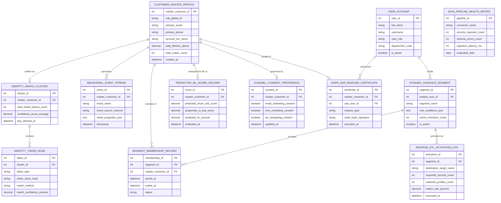

# Conceptual ERD — Customer Data Platform (CDP)

## Mermaid Code

## Entity Description Table | Bảng mô tả Entity

| # | Entity Name | Vietnamese Name | Description | Key Attributes | Main Relationships |
|---|-------------|-----------------|-------------|----------------|-------------------|
| 1 | USER_ACCOUNT | Tài khoản Nguời dùng | System credentials and access roles for data architects, analytics specialists, CDOs, and admins. | `user_id`, `username`, `user_role`, `department_code` | Builds `DYNAMIC_AUDIENCE_SEGMENT`, authorizes `GDPR_SAR_ERASURE_CERTIFICATE`. |
| 2 | CUSTOMER_MASTER_PROFILE | Profile Khách hàng Master | Central 360-degree customer profile entity storing CDP global ID, primary email, phone, spend, and order totals. | `master_customer_id`, `cdp_global_id`, `primary_email`, `total_lifetime_spend`, `total_orders_count` | Unified via `IDENTITY_GRAPH_CLUSTER`, generates `BEHAVIORAL_EVENT_STREAM`, member of `SEGMENT_MEMBERSHIP_RECORD`, governed by `CHANNEL_CONSENT_PREFERENCE`. |
| 3 | IDENTITY_GRAPH_CLUSTER | Cluster Graph Định danh | Identity graph cluster linking all devices, cookies, and tokens associated with a single customer. | `cluster_id`, `master_customer_id`, `total_linked_tokens_count`, `confidence_score_average`, `last_stitched_at` | Belongs to `CUSTOMER_MASTER_PROFILE`, contains `IDENTITY_TOKEN_NODE`. |
| 4 | IDENTITY_TOKEN_NODE | Nút Token Định danh | Individual identity token (Email hash, Phone hash, Cookie ID, Device ID, CRM Contact ID) with match confidence %. | `token_id`, `cluster_id`, `token_type`, `token_value_hash`, `match_method`, `match_confidence_percent` | Belongs to `IDENTITY_GRAPH_CLUSTER`. |
| 5 | BEHAVIORAL_EVENT_STREAM | Stream Sự kiện Hành vi | Real-time clickstream event log recording web pageviews, app events, email clicks, and e-commerce transactions. | `event_id`, `master_customer_id`, `event_name`, `event_source_channel`, `event_properties_json`, `timestamp` | Belongs to `CUSTOMER_MASTER_PROFILE`. |
| 6 | DYNAMIC_AUDIENCE_SEGMENT | Phân đoạn Audience Động | Self-updating audience segment definition storing multi-condition rule JSON and active member counts. | `segment_id`, `analyst_user_id`, `segment_name`, `rule_conditions_json`, `active_members_count`, `is_active` | Includes `SEGMENT_MEMBERSHIP_RECORD`, activates via `REVERSE_ETL_ACTIVATION_LOG`, built by `USER_ACCOUNT`. |
| 7 | SEGMENT_MEMBERSHIP_RECORD | Nhật ký Thành viên Segment | Real-time tracking log recording customer entry, exit, and active membership status within dynamic segments. | `membership_id`, `segment_id`, `master_customer_id`, `joined_at`, `exited_at`, `status` | Relates `DYNAMIC_AUDIENCE_SEGMENT` and `CUSTOMER_MASTER_PROFILE`. |
| 8 | REVERSE_ETL_ACTIVATION_LOG | Nhật ký Activation Reverse ETL | Reverse ETL activation log recording hashed audience list exports to Meta Ads, Google Ads, and Salesforce. | `activation_id`, `segment_id`, `destination_target_name`, `exported_records_count`, `matched_profiles_count`, `match_rate_percent` | Belongs to `DYNAMIC_AUDIENCE_SEGMENT`. |
| 9 | PREDICTIVE_ML_SCORE_RECORD | Nhật ký Điểm Predictive ML | Predictive machine learning scores storing predicted churn risk %, propensity to buy %, and predicted LTV. | `score_id`, `master_customer_id`, `predicted_churn_risk_score`, `propensity_to_buy_score`, `predicted_ltv_amount` | Belongs to `CUSTOMER_MASTER_PROFILE`. |
| 10 | CHANNEL_CONSENT_PREFERENCE | Tùy chọn Consent Kênh | Customer opt-in/opt-out preferences governing Email, SMS, and Ad Retargeting permissions. | `consent_id`, `master_customer_id`, `email_marketing_consent`, `sms_marketing_consent`, `ad_retargeting_consent` | Belongs to `CUSTOMER_MASTER_PROFILE`. |
| 11 | GDPR_SAR_ERASURE_CERTIFICATE | Chứng nhận GDPR SAR & Erasure | GDPR compliance verification certificate recording Subject Access Requests and Right-to-be-Forgotten erasures. | `certificate_id`, `master_customer_id`, `cdo_user_id`, `request_type`, `audit_hash_signature`, `executed_at` | Belongs to `CUSTOMER_MASTER_PROFILE`, authorized by `USER_ACCOUNT`. |
| 12 | DATA_PIPELINE_HEALTH_METRIC | Chỉ số Sức khỏe Pipeline Data | Ingestion pipeline telemetry tracking records ingested, schema errors, and ingestion latency per connector. | `pipeline_id`, `connector_name`, `records_ingested_count`, `schema_errors_count`, `ingestion_latency_ms` | Standalone data pipeline telemetry entity. |

## Relationship Description | Mô tả Quan hệ

| # | From Entity | Cardinality | To Entity | Label | Business Explanation |
|---|-------------|-------------|-----------|-------|----------------------|
| 1 | CUSTOMER_MASTER_PROFILE | 1 to 0..1 | IDENTITY_GRAPH_CLUSTER | unified via | A customer master profile is unified via an identity graph cluster. |
| 2 | CUSTOMER_MASTER_PROFILE | 1 to 0..N | BEHAVIORAL_EVENT_STREAM | generates | A customer master profile generates real-time behavioral event streams. |
| 3 | CUSTOMER_MASTER_PROFILE | 1 to 0..N | SEGMENT_MEMBERSHIP_RECORD | member of | A customer master profile is a member of multiple dynamic segments. |
| 4 | CUSTOMER_MASTER_PROFILE | 1 to 0..1 | PREDICTIVE_ML_SCORE_RECORD | evaluated for ML in | A customer profile is evaluated for predictive ML scores (churn, pLTV). |
| 5 | CUSTOMER_MASTER_PROFILE | 1 to 0..1 | CHANNEL_CONSENT_PREFERENCE | governed by | A customer profile is governed by channel consent preferences. |
| 6 | CUSTOMER_MASTER_PROFILE | 1 to 0..1 | GDPR_SAR_ERASURE_CERTIFICATE | purged in | A customer profile is anonymized or purged in a GDPR erasure certificate. |
| 7 | IDENTITY_GRAPH_CLUSTER | 1 to 1..N | IDENTITY_TOKEN_NODE | contains | An identity graph cluster contains multiple identity token nodes. |
| 8 | DYNAMIC_AUDIENCE_SEGMENT | 1 to 0..N | SEGMENT_MEMBERSHIP_RECORD | includes | A dynamic audience segment includes customer membership records. |
| 9 | DYNAMIC_AUDIENCE_SEGMENT | 1 to 0..N | REVERSE_ETL_ACTIVATION_LOG | activates via | A dynamic audience segment activates via reverse ETL activation logs. |
| 10 | USER_ACCOUNT | 1 to 0..N | DYNAMIC_AUDIENCE_SEGMENT | builds | An analytics specialist user account builds dynamic audience segments. |
| 11 | USER_ACCOUNT | 1 to 0..N | GDPR_SAR_ERASURE_CERTIFICATE | authorizes | A Chief Data Officer user account authorizes GDPR erasure certificates. |
