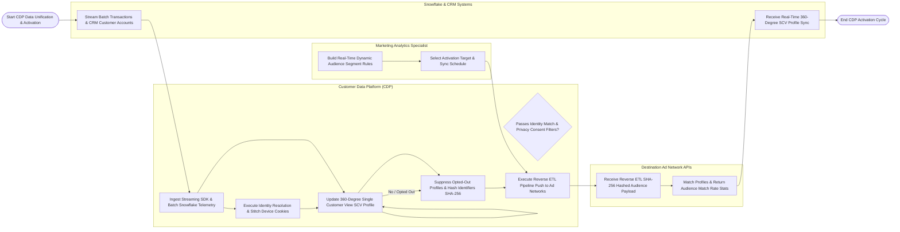

# Swimlane Diagram — Customer Data Platform (CDP)

## Mermaid Code

## Flow Description | Mô tả luồng

| Lane | Actor | Role in Flow |
|------|-------|-------------|
| 1 | Marketing Analytics Specialist | Configures real-time dynamic audience segment rules, inspects 360-degree Single Customer View (SCV) profiles, selects destination activation targets, and schedules reverse ETL pipelines. |
| 2 | Customer Data Platform (CDP) | Ingests real-time streaming SDK clickstream events and batch Snowflake data, executes deterministic/probabilistic identity resolution, stitches cookies, maintains single customer view profiles, re-evaluates segment rules, enforces privacy consent filters, applies SHA-256 hashing, and executes reverse ETL dispatches. |
| 3 | Snowflake & CRM Systems | Supplies historical batch transaction tables and CRM sales account records to the CDP, receiving real-time 360-degree profile synchronization payloads. |
| 4 | Destination Ad Network APIs | Ingests reverse ETL SHA-256 hashed audience lists from the CDP (Meta Ads, Google Ads), matches profiles against network users, and returns match rate telemetry. |
