# Action Tree — Customer Data Platform (CDP)

## Mermaid Code

```mermaid
graph TD
    Root["Customer Data Platform CDP"]

    Root --> M1["Data Ingestion & SDK Telemetry Engine"]
    Root --> M2["Identity Resolution & Cookie Stitching"]
    Root --> M3["Single Customer View SCV & ML Profiling"]
    Root --> M4["Real-Time Dynamic Audience Segmentation"]
    Root --> M5["Reverse ETL Activation & Destination Sync"]
    Root --> M6["Data Privacy, SAR & Compliance Governance"]

    M1 --> A11["Ingest Real-Time Web JavaScript Pixel Telemetry Streams"]
    M1 --> A12["Ingest iOS & Android Mobile App SDK Event Logs"]
    M1 --> A13["Execute Scheduled Batch Ingestion from Snowflake & BigQuery"]
    M1 --> A14["Capture Schema Parsing Errors in Dead-Letter Queue (DLQ)"]

    M2 --> A21["Execute Deterministic Exact Email & Phone Identity Matching"]
    M2 --> A22["Execute Probabilistic Statistical Identity Resolution Rules"]
    M2 --> A23["Retroactively Stitch Anonymous Cookies to Known Profiles"]
    M2 --> A24["Render Identity Graph Match Rate & Cluster Health Scorecards"]

    M3 --> A31["Maintain Centralized 360-Degree Single Customer View Profiles"]
    M3 --> A32["Calculate Real-Time Customer Behavioral Aggregates (Spend/Orders)"]
    M3 --> A33["Ingest Predictive ML Scores (Churn %, Propensity, pLTV)"]
    M3 --> A34["Render Interactive Chronological Event Journey Timelines"]

    M4 --> A41["Build Multi-Condition Dynamic Real-Time Audience Segments"]
    M4 --> A42["Re-Evaluate Segment Membership Instantaneously upon Event Receipt"]
    M4 --> A43["Calculate Real-Time Segment Match Previews & Overlap Venns"]
    M4 --> A44["Trigger Segment Entry & Exit Events for Automation Systems"]

    M5 --> A51["Apply SHA-256 Cryptographic Hashing to Customer Email/Phone"]
    M5 --> A52["Push Audiences to Meta Ads, Google Ads & TikTok via Reverse ETL"]
    M5 --> A53["Sync 360-Degree Profiles & Segment Tags to Salesforce CRM"]
    M5 --> A54["Execute Incremental Delta Syncs to Destination APIs"]

    M6 --> A61["Enforce Channel Opt-Out & Suppression Consent Filters"]
    M6 --> A62["Compile Subject Access Request (SAR) Machine-Readable Exports"]
    M6 --> A63["Execute Right-to-be-Forgotten PII Erasure & Anonymization"]
    M6 --> A64["Generate Cryptographic GDPR/CCPA Compliance Audit Certificates"]
```

## Module Description | Mô tả Module

| # | Module | Description | Actions |
|---|--------|-------------|---------|
| 1 | Data Ingestion & SDK Telemetry Engine | Ingests real-time web pixel telemetry, mobile SDK logs, scheduled batch data from Snowflake/BigQuery, and captures DLQ errors. | Ingest Real-Time Web Telemetry, Ingest Mobile App SDK Logs, Execute Batch Ingestion from Snowflake, Capture Schema Errors in DLQ. |
| 2 | Identity Resolution & Cookie Stitching | Executes deterministic and probabilistic identity resolution, retroactively stitches anonymous cookies, and monitors identity graph health. | Execute Deterministic Matching, Execute Probabilistic Identity Resolution, Stitch Anonymous Cookies, Render Identity Graph Scorecards. |
| 3 | Single Customer View SCV & ML Profiling | Maintains 360-degree SCV profiles, calculates real-time behavioral aggregates, ingests predictive ML scores, and renders journey timelines. | Maintain 360-Degree SCV Profiles, Calculate Real-Time Behavioral Aggregates, Ingest Predictive ML Scores, Render Chronological Event Timelines. |
| 4 | Real-Time Dynamic Audience Segmentation | Builds dynamic real-time audience segments, re-evaluates membership instantaneously, previews segment overlap, and triggers entry/exit events. | Build Dynamic Real-Time Segments, Re-Evaluate Membership Instantaneously, Calculate Segment Overlap Previews, Trigger Segment Entry/Exit Events. |
| 5 | Reverse ETL Activation & Destination Sync | Applies SHA-256 email hashing, pushes audiences via reverse ETL to ad networks (Meta/Google), syncs CRM profile data, and executes delta syncs. | Apply SHA-256 Hashing, Push Audiences via Reverse ETL, Sync Profiles to Salesforce CRM, Execute Incremental Delta Syncs. |
| 6 | Data Privacy, SAR & Compliance Governance | Enforces channel consent filters, compiles Subject Access Request (SAR) exports, executes Right-to-be-Forgotten erasures, and logs certificates. | Enforce Channel Consent Filters, Compile SAR Data Exports, Execute Right-to-be-Forgotten Erasures, Generate GDPR Compliance Certificates. |
