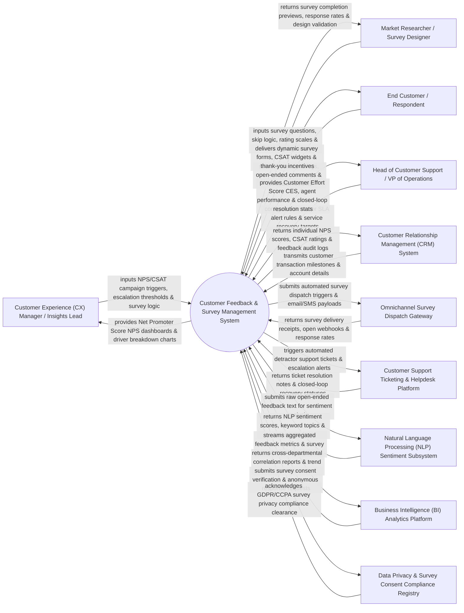

# Context Diagram — Customer Feedback & Survey Management System

## Mermaid Code

## Actor & Interaction Table | Bảng Actor & Tương tác

| # | Actor | Actor Type | Data Sent TO System | Data Received FROM System | Notes |
|---|-------|------------|---------------------|---------------------------|-------|
| 1 | Customer Experience (CX) Manager / Insights Lead | Primary | NPS/CSAT/CES survey triggers, detractor escalation thresholds, survey distribution schedules. | Net Promoter Score (NPS) dashboards, Customer Satisfaction (CSAT) trends, key driver analysis charts. | CX professional managing feedback strategy, analyzing NPS/CSAT metrics, and driving closed-loop resolution. |
| 2 | Market Researcher / Survey Designer | Primary | Survey question sets, Likert rating scales, skip-logic branching rules, multi-language survey copy. | Survey completion preview links, response rate statistics, questionnaire validation checks. | Researcher designing multi-channel surveys, feedback forms, and market research studies. |
| 3 | End Customer / Respondent | Primary | Survey rating inputs (0-10 scale), open-ended verbatim comments, feedback submission timestamps. | Dynamic web/in-app/email survey forms, thank-you confirmation screens, incentive promo codes. | Customer completing feedback surveys post-purchase, post-support interaction, or annually. |
| 4 | Head of Customer Support / VP of Operations | Primary | Detractor Service Level Agreement (SLA) response rules, support team manager routing policies. | Customer Effort Score (CES) reports, support agent CSAT scorecards, closed-loop detractor recovery stats. | Operations executive monitoring service quality, support agent CSAT scores, and customer retention. |
| 5 | Customer Relationship Management (CRM) System | Supporting | Customer account profiles, transaction completion events, support case closure triggers. | Individual customer NPS scores, CSAT ratings, feedback history audit logs. | Central CRM synchronizing customer profiles and storing individual survey feedback records. |
| 6 | Omnichannel Survey Dispatch Gateway | Supporting | Survey email delivery receipts, SMS dispatch confirmations, web widget impression counts. | Automated survey dispatch queues, email/SMS message payloads, web widget embed scripts. | Multi-channel dispatch engine sending surveys via Email, SMS, Web Popup Widgets, and Mobile In-App. |
| 7 | Customer Support Ticketing & Helpdesk Platform | Supporting | Support ticket resolution notes, agent recovery action logs, closed-loop case statuses. | Automated detractor ticket creation payloads, low-CSAT alert notifications. | Support platform (Zendesk, Freshdesk, Salesforce Service Cloud) handling detractor recovery tickets. |
| 8 | Natural Language Processing (NLP) Sentiment Subsystem | Supporting | Analyzed sentiment scores (Positive/Neutral/Negative), extracted topic categories, root-cause tags. | Raw unstructured text feedback, open-ended verbatim comment streams. | AI text analytics engine analyzing open-ended feedback text for key themes and sentiment. |
| 9 | Business Intelligence (BI) Analytics Platform | Supporting | Cross-departmental correlation reports, custom SQL queries, executive dashboard queries. | Aggregated survey metrics, longitudinal NPS datasets, raw response CSV exports. | BI platform (Tableau, Power BI) visualizing feedback metrics alongside sales and retention data. |
| 10 | Data Privacy & Survey Consent Compliance Registry | Supporting / Regulatory | GDPR, CCPA, and ePrivacy survey rules, anonymity mandates, opt-out registries. | Survey consent clearance receipts, anonymized response verification tokens. | Governance framework ensuring respondent anonymity, data privacy, and legal compliance. |

## System Boundary Description | Mô tả Phạm vi Hệ thống

The **Customer Feedback & Survey Management System** is an enterprise customer experience (CX), survey orchestration, text analytics, and closed-loop feedback management platform designed to measure Net Promoter Score (NPS), Customer Satisfaction (CSAT), and Customer Effort Score (CES).

**Inside System Scope:**
- Multi-channel survey builder featuring skip-logic, piping, multi-language support, and customizable rating scales.
- Automated event-triggered survey dispatches via Email, SMS, Web In-App Popups, and QR Codes post-purchase or post-support.
- Closed-loop feedback automation triggering instant detractor escalation tickets (NPS 0-6) to support managers.
- Natural Language Processing (NLP) text analytics classifying unstructured open-ended comments into sentiment scores and topic categories.
- Real-time executive dashboards rendering NPS trends, CSAT scorecards, key driver regression models, and CRM synchronization.

**Outside System Scope:**
- Direct physical mailing of paper survey questionnaires (handled by Postal Print Services).
- Direct phone call interviewing by live human call center operators (handled by Call Center Systems).
- Direct financial payout of cash research incentives (handled by Payment Gateways).
