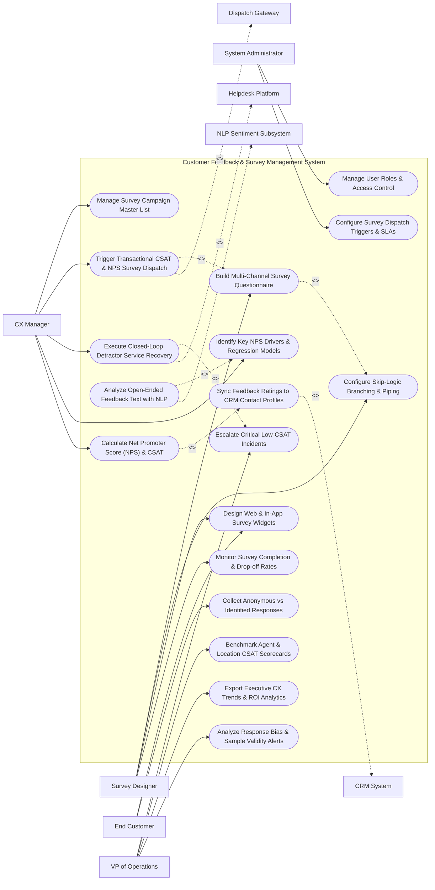

# Use Case Diagram — Customer Feedback & Survey Management System

## Mermaid Code

## Actor Table | Bảng Actor

| # | Actor | Actor Type | Role Description | Related Use Cases |
|---|-------|------------|------------------|-------------------|
| 1 | CX Manager | Primary | Customer experience manager overseeing NPS/CSAT campaigns, closed-loop detractor recovery, and key driver analysis. | UC01, UC05, UC08, UC11, UC12 |
| 2 | Survey Designer | Primary | Researcher creating multi-channel survey questionnaires, building skip-logic branching, and designing web widgets. | UC02, UC03, UC04, UC07 |
| 3 | End Customer | Primary | Target respondent answering CSAT/NPS survey forms, submitting ratings, and writing verbatim comments. | UC04, UC06 |
| 4 | VP of Operations | Primary | Operations executive reviewing agent CSAT scorecards, low-CSAT incident escalations, and executive CX trends. | UC09, UC14, UC15, UC18 |
| 5 | System Administrator | Primary | IT administrative user managing user security clearance roles, dispatch SLA triggers, and API credentials. | UC16, UC17 |
| 6 | Dispatch Gateway | System (Secondary) | Multi-channel dispatch infrastructure sending survey emails, SMS messages, and hosting web widgets. | UC05 |
| 7 | Helpdesk Platform | System (Secondary) | Ticketing system (Zendesk/Salesforce) receiving automated detractor tickets for service recovery actions. | UC08 |
| 8 | NLP Sentiment Subsystem | System (Secondary) | Natural Language Processing engine categorizing verbatim comments into sentiment scores and topic tags. | UC10 |
| 9 | CRM System | System (Secondary) | Enterprise CRM storing customer survey scores, CSAT ratings, and feedback history audit logs. | UC13 |

## Use Case Table | Bảng Use Case

| # | UC ID | Use Case Name | Primary Actor | Secondary Actor | Description | Priority |
|---|-------|---------------|---------------|-----------------|-------------|----------|
| 1 | UC01 | Manage Survey Campaign Master List | CXManager | None | Centralizes all active survey projects (NPS Relationship, Post-Purchase CSAT, Post-Support CES). | High |
| 2 | UC02 | Build Multi-Channel Survey Questionnaire | Researcher | None | Designs customized survey forms with Likert rating scales, NPS 0-10 scales, and open-ended text fields. | Critical |
| 3 | UC03 | Configure Skip-Logic Branching & Piping | Researcher | None | Sets up dynamic question branching rules (e.g., If Rating <= 6 -> Route to "Why were you unsatisfied?"). | High |
| 4 | UC04 | Design Web & In-App Survey Widgets | Researcher | Respondent | Designs responsive web popups, slide-out widgets, and mobile in-app micro-surveys. | High |
| 5 | UC05 | Trigger Transactional CSAT & NPS Survey Dispatch | CXManager | Dispatch Gateway | Automatically dispatches surveys via Email/SMS post-transaction (e.g., 2 hours after support ticket closure). | Critical |
| 6 | UC06 | Collect Anonymous vs Identified Responses | Respondent | None | Supports both identified customer feedback collection and strictly anonymous employee/market research options. | High |
| 7 | UC07 | Monitor Survey Completion & Drop-off Rates | Researcher | None | Tracks survey funnel completion metrics, highlighting questions with high respondent drop-off rates. | High |
| 8 | UC08 | Execute Closed-Loop Detractor Service Recovery | CXManager | Helpdesk Platform | Automatically generates support tickets for Detractors (NPS 0-6 or CSAT <= 2) to trigger 24-hour service recovery. | Critical |
| 9 | UC09 | Escalate Critical Low-CSAT Incidents | OpsVP | Helpdesk Platform | Sends immediate SMS/email alerts to operational directors when a high-value VIP customer submits a 0-rating. | High |
| 10 | UC10 | Analyze Open-Ended Feedback Text with NLP | CXManager | NLP Subsystem | Uses AI NLP algorithms to extract sentiment (Positive/Negative) and classify text into categories (Price, Delivery, Staff). | Critical |
| 11 | UC11 | Identify Key NPS Drivers & Regression Models | CXManager | None | Calculates statistical regression models to identify which operational drivers (e.g., Speed) impact overall NPS. | High |
| 12 | UC12 | Calculate Net Promoter Score (NPS) & CSAT | CXManager | CRM System | Computes Net Promoter Score ($\% \text{Promoters} - \% \text{Detractors}$) and CSAT average percentage scores. | Critical |
| 13 | UC13 | Sync Feedback Ratings to CRM Contact Profiles | CXManager | CRM System | Transmits individual NPS scores and CSAT ratings to customer contact records in the connected CRM. | High |
| 14 | UC14 | Benchmark Agent & Location CSAT Scorecards | OpsVP | None | Compares CSAT performance across individual support agents, retail store locations, or product lines. | High |
| 15 | UC15 | Export Executive CX Trends & ROI Analytics | OpsVP | None | Renders executive CX dashboards linking NPS improvements to customer churn reduction and lifetime value. | High |
| 16 | UC16 | Manage User Roles & Access Control | Admin | None | Controls user login accounts, RBAC permissions, and team survey folder access clearance. | High |
| 17 | UC17 | Configure Survey Dispatch Triggers & SLAs | Admin | None | Sets up event trigger rules (e.g., Delay 24 Hours) and detractor response SLA target windows. | High |
| 18 | UC18 | Analyze Response Bias & Sample Validity Alerts | OpsVP | None | Monitors statistical sample size validity and flags potential survey fatigue or non-response bias. | Medium |

## Use Case Specification | Đặc tả Use Case

---

### UC02 — Build Multi-Channel Survey Questionnaire

| Field | Detail |
|-------|--------|
| **UC ID** | UC02 |
| **Use Case Name** | Build Multi-Channel Survey Questionnaire |
| **Actor(s)** | Primary: Market Researcher / Survey Designer   Secondary: None |
| **Description** | Composes multi-channel survey questionnaires featuring standard rating scales (NPS 0-10, CSAT 1-5, CES 1-7), single/multiple choice questions, open-ended text fields, and multi-language support. |
| **Precondition** | 1. Researcher holds survey builder access permissions. |
| **Main Flow** | 1. Researcher opens "Visual Survey Questionnaire Builder".   2. Researcher selects Survey Type: `Post-Support Interaction CSAT`.   3. Researcher adds Question 1 (CSAT Scale): *"How satisfied were you with the support provided by our agent today?"* (Rating Scale: 1 = Very Unsatisfied to 5 = Very Satisfied).   4. Researcher adds Question 2 (CES Scale): *"How easy was it to get your issue resolved?"* (7-point Likert scale: 1 = Extremely Difficult to 7 = Extremely Easy).   5. Researcher adds Question 3 (Open-Ended Verbatim): *"Please share any additional comments about your experience."*   6. Researcher configures Multi-Language Translations (English, Vietnamese, Spanish).   7. Researcher customizes survey branding: Uploads company logo, sets primary color hex code (`#0052CC`), and customizes thank-you screen.   8. Researcher clicks "Save & Preview Survey"; System generates responsive mobile and desktop preview links. |
| **Alternative Flow** | **AF1** — Standard NPS Question Injection: Researcher inserts standardized Net Promoter Score question: *"How likely are you to recommend [Company Name] to a friend or colleague?"* (0-10 scale). |
| **Exception Flow** | **EX1** — Missing Required Scale Labels Error: Researcher creates a 5-point rating scale without labeling endpoints; System blocks survey saving, displaying error "Rating Scale Endpoint Labels Required (e.g., 1=Poor, 5=Excellent)". |
| **Postcondition** | Survey questionnaire is composed, multi-language translations are configured, and survey is saved for dispatch configuration (UC05). |
| **Business Rule** | **BR1**: Survey questionnaires MUST be optimized for mobile responsiveness and contain no more than 5 core questions to prevent respondent drop-off. |

---

### UC05 — Trigger Transactional CSAT & NPS Survey Dispatch

| Field | Detail |
|-------|--------|
| **UC ID** | UC05 |
| **Use Case Name** | Trigger Transactional CSAT & NPS Survey Dispatch |
| **Actor(s)** | Primary: CX Manager   Secondary: Omnichannel Survey Dispatch Gateway |
| **Description** | Automatically dispatches surveys via Email, SMS, or In-App Popups immediately following specific customer interaction events (e.g., support ticket closure, online order delivery). |
| **Precondition** | 1. Survey questionnaire is published (UC02).   2. Event trigger rules and dispatch delays are configured (UC17). |
| **Main Flow** | 1. System receives real-time customer event payload from CRM/Helpdesk (e.g., `Event: Support Ticket #88412 Status = RESOLVED`, Customer Email: `john.doe@enterprise.com`, Agent ID: `Agent_Smith`).   2. System checks Survey Fatigue Suppression Rules:   &nbsp;&nbsp;&nbsp;&nbsp; a. Rule: "Do not send more than 1 survey per customer every 30 days".   &nbsp;&nbsp;&nbsp;&nbsp; b. Customer John Doe last received a survey 45 days ago -> PASS.   3. System checks Event Delay Timer: `Delay Dispatch by 2 Hours` (Allows customer time to verify issue resolution).   4. After 2 hours, System generates personalized survey payload:   &nbsp;&nbsp;&nbsp;&nbsp; a. Recipient: `john.doe@enterprise.com`.   &nbsp;&nbsp;&nbsp;&nbsp; b. Embedded Email Rating Buttons: 1-5 Stars (One-click response from email client).   &nbsp;&nbsp;&nbsp;&nbsp; c. Dynamic Merge Tags: Agent Name (`Agent Smith`), Ticket Subject (`Order Delivery Delay`).   5. System dispatches survey email via Dispatch Gateway API.   6. Gateway returns dispatch confirmation (`DISPATCH_SUCCESS_200`).   7. System logs survey dispatch record against customer profile in database. |
| **Alternative Flow** | **AF1** — SMS Survey Trigger: Transaction type is Post-Delivery; System dispatches concise 2-question SMS survey with short URL link.   **AF2** — Web In-App Popup Trigger: Customer completes checkout on e-commerce storefront; System displays instant 1-question slide-out web widget (UC04). |
| **Exception Flow** | **EX1** — Survey Fatigue Block: Customer received a survey 5 days ago; System blocks survey dispatch, logging status `SUPPRESSED_SURVEY_FATIGUE` to prevent customer annoyance. |
| **Postcondition** | Survey dispatch is evaluated against fatigue rules, personalized survey is sent via target channel, and dispatch log is recorded. |
| **Business Rule** | **BR1**: Automated transactional survey dispatches MUST enforce survey fatigue suppression rules (maximum 1 survey per customer every 30 days). |

---

### UC08 — Execute Closed-Loop Detractor Service Recovery

| Field | Detail |
|-------|--------|
| **UC ID** | UC08 |
| **Use Case Name** | Execute Closed-Loop Detractor Service Recovery |
| **Actor(s)** | Primary: CX Manager   Secondary: Customer Support Ticketing & Helpdesk Platform |
| **Description** | Automatically detects low survey ratings (NPS Detractors 0-6 or CSAT <= 2), generates high-priority support tickets, and assigns them to support managers to execute service recovery within 24 hours. |
| **Precondition** | 1. Customer submits a survey response (UC06).   2. Helpdesk ticketing platform API integration is active. |
| **Main Flow** | 1. System ingests newly submitted survey response (e.g., Customer `Acme Corp`, NPS Score: `3 / 10 - DETRACTOR`, Verbatim: *"Support agent was unhelpful and issue remains unresolved!"*).   2. System identifies Detractor status (NPS Score <= 6).   3. System automatically generates a high-priority Service Recovery Ticket payload:   &nbsp;&nbsp;&nbsp;&nbsp; a. Ticket Title: `[DETRACTOR RECOVERY] Acme Corp - NPS Score 3`.   &nbsp;&nbsp;&nbsp;&nbsp; b. Priority: `HIGH`.   &nbsp;&nbsp;&nbsp;&nbsp; c. SLA Target: `24-Hour Closed-Loop Recovery`.   &nbsp;&nbsp;&nbsp;&nbsp; d. Context Details: Customer Name, Account Tier, Original Support Ticket #, Verbatim Feedback.   4. System dispatches ticket payload via REST API to Helpdesk Platform (Zendesk/Salesforce).   5. Helpdesk Platform creates ticket and assigns it to CX Service Recovery Manager.   6. Manager contacts customer via phone/email, resolves underlying complaint, offers service credit, and logs resolution notes in helpdesk ticket.   7. Helpdesk Platform transmits ticket closure webhook to System (`STATUS_CLOSED_RECOVERED`).   8. System records closed-loop recovery status in detractor audit log. |
| **Alternative Flow** | **AF1** — Promoter Automated Advocacy Trigger: Customer submits NPS Score `10 - PROMOTER`; System displays thank-you message with a prompt: *"Thank you! Would you mind sharing your review on Capterra/Trustpilot for a $10 gift card?"*. |
| **Exception Flow** | **EX1** — VIP Detractor Critical Escalation: Customer is a Tier-1 Enterprise VIP Account; System executes UC09 (Escalate Critical Low-CSAT Incidents), sending instant SMS alert to VP of Operations. |
| **Postcondition** | Detractor service recovery ticket is created, assigned to a manager, 24-hour SLA is initiated, and closed-loop resolution is tracked. |
| **Business Rule** | **BR1**: NPS Detractor scores (0-6) MUST automatically generate a service recovery ticket with a mandatory 24-hour SLA target. |

---

### UC10 — Analyze Open-Ended Feedback Text with NLP

| Field | Detail |
|-------|--------|
| **UC ID** | UC10 |
| **Use Case Name** | Analyze Open-Ended Feedback Text with NLP |
| **Actor(s)** | Primary: CX Manager   Secondary: Natural Language Processing (NLP) Sentiment Subsystem |
| **Description** | Uses Natural Language Processing (NLP) text analytics to analyze unstructured verbatim feedback comments, classifying sentiment (Positive/Neutral/Negative) and tagging root-cause topic categories. |
| **Precondition** | 1. Survey responses containing open-ended verbatim text are submitted. |
| **Main Flow** | 1. System ingests raw unstructured verbatim text comment (e.g., *"The software interface is very intuitive, but the monthly subscription pricing is way too expensive!"*).   2. System transmits text string to NLP Sentiment Subsystem API.   3. NLP Subsystem executes multi-dimensional text analytics:   &nbsp;&nbsp;&nbsp;&nbsp; a. Overall Sentiment Classification: `MIXED / NEUTRAL` (Compound Score: `+0.05`).   &nbsp;&nbsp;&nbsp;&nbsp; b. Sentence-Level Aspect Extraction:   &nbsp;&nbsp;&nbsp;&nbsp;&nbsp;&nbsp;&nbsp;&nbsp; i. Aspect 1: `[UI / Usability]` -> Sentiment: `POSITIVE (+0.85)` ("intuitive software interface").   &nbsp;&nbsp;&nbsp;&nbsp;&nbsp;&nbsp;&nbsp;&nbsp; ii. Aspect 2: `[Pricing / Billing]` -> Sentiment: `NEGATIVE (-0.90)` ("pricing is way too expensive").   &nbsp;&nbsp;&nbsp;&nbsp; c. Entity & Keyword Extraction: Keywords: `software interface`, `subscription pricing`.   4. NLP Subsystem returns structured JSON sentiment and topic payload.   5. System attaches sentiment scores and aspect topic tags (`Category: Usability -> Positive`; `Category: Pricing -> Negative`) to the response record.   6. System updates CX Sentiment Word Cloud and Topic Breakdown dashboards. |
| **Alternative Flow** | **AF1** — Multi-Language Sentiment Analysis: Text comment is in Vietnamese (*"Dịch vụ hỗ trợ rất tuyệt vời nhưng giao hàng hơi chậm"*); NLP engine detects language code `vi` and applies Vietnamese sentiment dictionary. |
| **Exception Flow** | **EX1** — Unintelligible / Gibberish Text: Verbatim text contains random keyboard spam ("asdfghjkl"); NLP engine flags `UNCLASSIFIED_GIBBERISH`, excluding comment from sentiment topic clouds. |
| **Postcondition** | Verbatim text is analyzed, aspect-based sentiment scores and topic tags are assigned, and CX topic breakdown charts update. |
| **Business Rule** | **BR1**: NLP text analytics MUST perform aspect-based sentiment analysis to separate positive and negative sentiment drivers within a single verbatim comment. |

---

### UC12 — Calculate Net Promoter Score (NPS) & CSAT

| Field | Detail |
|-------|--------|
| **UC ID** | UC12 |
| **Use Case Name** | Calculate Net Promoter Score (NPS) & CSAT |
| **Actor(s)** | Primary: CX Manager   Secondary: CRM System |
| **Description** | Calculates aggregate Net Promoter Score (NPS = % Promoters - % Detractors) and Customer Satisfaction (CSAT) percentage averages across date ranges, customer tiers, and operational units. |
| **Precondition** | 1. Survey responses with valid 0-10 or 1-5 ratings are logged in database. |
| **Main Flow** | 1. CX Manager opens "NPS & CSAT Executive Dashboard".   2. Manager selects Date Range (e.g., Q3 2026) and Survey Filter (`Enterprise Relationship NPS Survey`).   3. System retrieves all valid survey responses in period (e.g., Total Responses = 1,000).   4. System categorizes 0-10 NPS rating breakdown:   &nbsp;&nbsp;&nbsp;&nbsp; a. Promoters (Rating 9-10): 600 respondents (60.0%).   &nbsp;&nbsp;&nbsp;&nbsp; b. Passives (Rating 7-8): 250 respondents (25.0%).   &nbsp;&nbsp;&nbsp;&nbsp; c. Detractors (Rating 0-6): 150 respondents (15.0%).   5. System calculates Net Promoter Score: `NPS = % Promoters (60%) - % Detractors (15%) = +45`.   6. System retrieves CSAT 1-5 star ratings and calculates CSAT Percentage: `CSAT % = (Satisfied Responses 4-5 / Total Responses) * 100 = 84.5%`.   7. System calculates margin of error and statistical confidence interval (95% CI).   8. System renders NPS gauge meter, historical trendline comparison, and pushes calculated scores to CRM system (UC13). |
| **Alternative Flow** | **AF1** — Customer Effort Score (CES) Calculation: Manager selects CES Survey; System computes average CES rating on a 1-7 scale (e.g., Average CES = 5.8 / 7.0). |
| **Exception Flow** | **EX1** — Insufficient Sample Size Warning: Response count is < 30 responses for a store location; System displays warning "Low Sample Size (12 Responses) - Scores Lack Statistical Significance", displaying asterisk. |
| **Postcondition** | Net Promoter Score (NPS) and CSAT percentages are calculated, statistical confidence is verified, and executive dashboards update. |
| **Business Rule** | **BR1**: Net Promoter Score MUST be calculated strictly using the standard formula: $\% \text{Promoters (9-10)} - \% \text{Detractors (0-6)}$. |
