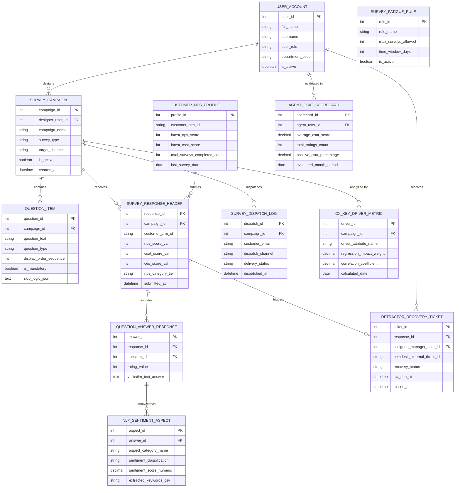

# Conceptual ERD — Customer Feedback & Survey Management System

## Mermaid Code

## Entity Description Table | Bảng mô tả Entity

| # | Entity Name | Vietnamese Name | Description | Key Attributes | Main Relationships |
|---|-------------|-----------------|-------------|----------------|-------------------|
| 1 | USER_ACCOUNT | Tài khoản Nguời dùng | System user credentials and access roles for CX managers, researchers, support agents, and admins. | `user_id`, `username`, `user_role`, `department_code` | Designs `SURVEY_CAMPAIGN`, resolves `DETRACTOR_RECOVERY_TICKET`, evaluated in `AGENT_CSAT_SCORECARD`. |
| 2 | SURVEY_CAMPAIGN | Chiến dịch Khảo sát | Master survey campaign header entity storing survey type (NPS/CSAT/CES), channel, and status. | `campaign_id`, `designer_user_id`, `campaign_name`, `survey_type`, `target_channel`, `is_active` | Contains `QUESTION_ITEM`, receives `SURVEY_RESPONSE_HEADER`, dispatches `SURVEY_DISPATCH_LOG`, analyzed for `CX_KEY_DRIVER_METRIC`. |
| 3 | QUESTION_ITEM | Câu hỏi Khảo sát | Individual survey question item storing text, question type (Likert/NPS/Text), order, and skip-logic JSON. | `question_id`, `campaign_id`, `question_text`, `question_type`, `display_order_sequence`, `skip_logic_json` | Belongs to `SURVEY_CAMPAIGN`. |
| 4 | SURVEY_RESPONSE_HEADER | Header Phản hồi Khảo sát | Respondent submission header storing customer CRM ID, NPS score, CSAT rating, CES rating, and category. | `response_id`, `campaign_id`, `customer_crm_id`, `nps_score_val`, `csat_score_val`, `nps_category_tier` | Belongs to `SURVEY_CAMPAIGN`, includes `QUESTION_ANSWER_RESPONSE`, triggers `DETRACTOR_RECOVERY_TICKET`. |
| 5 | QUESTION_ANSWER_RESPONSE | Câu trả lời Chi tiết | Individual question answer record storing numerical rating values or verbatim text answers. | `answer_id`, `response_id`, `question_id`, `rating_value`, `verbatim_text_answer` | Belongs to `SURVEY_RESPONSE_HEADER`, analyzed via `NLP_SENTIMENT_ASPECT`. |
| 6 | NLP_SENTIMENT_ASPECT | Phân tích Sentiment Aspect NLP | Aspect-based NLP text analytics record capturing aspect category names, sentiment classifications, and keywords. | `aspect_id`, `answer_id`, `aspect_category_name`, `sentiment_classification`, `sentiment_score_numeric` | Belongs to `QUESTION_ANSWER_RESPONSE`. |
| 7 | DETRACTOR_RECOVERY_TICKET | Ticket Phục hồi Detractor | Closed-loop detractor recovery ticket tracking Zendesk/Salesforce external IDs, assigned manager, and SLAs. | `ticket_id`, `response_id`, `assigned_manager_user_id`, `helpdesk_external_ticket_id`, `recovery_status`, `sla_due_at` | Belongs to `SURVEY_RESPONSE_HEADER`, resolved by `USER_ACCOUNT`. |
| 8 | SURVEY_DISPATCH_LOG | Nhật ký Dispatch Khảo sát | Survey dispatch log recording recipient email/phone, dispatch channel, delivery status, and timestamps. | `dispatch_id`, `campaign_id`, `customer_email`, `dispatch_channel`, `delivery_status`, `dispatched_at` | Belongs to `SURVEY_CAMPAIGN`. |
| 9 | CUSTOMER_NPS_PROFILE | Profile NPS Khách hàng | Aggregate customer profile entity storing latest NPS score, CSAT rating, and total completed surveys count. | `profile_id`, `customer_crm_id`, `latest_nps_score`, `latest_csat_score`, `total_surveys_completed_count` | Submits `SURVEY_RESPONSE_HEADER`. |
| 10 | AGENT_CSAT_SCORECARD | Scorecard CSAT Agent | Monthly support agent performance scorecard evaluating average CSAT ratings and positive response percentages. | `scorecard_id`, `agent_user_id`, `average_csat_score`, `total_ratings_count`, `positive_csat_percentage` | Belongs to `USER_ACCOUNT`. |
| 11 | SURVEY_FATIGUE_RULE | Quy tắc Chặn Mệt mỏi Khảo sát | Survey fatigue suppression rules governing maximum allowed surveys per customer over a time window. | `rule_id`, `rule_name`, `max_surveys_allowed`, `time_window_days`, `is_active` | Standalone suppression engine entity. |
| 12 | CX_KEY_DRIVER_METRIC | Chỉ số Driver Thúc đẩy NPS | Statistical regression model metrics linking operational drivers (Speed, Quality, Price) to NPS score impacts. | `driver_id`, `campaign_id`, `driver_attribute_name`, `regression_impact_weight`, `correlation_coefficient` | Belongs to `SURVEY_CAMPAIGN`. |

## Relationship Description | Mô tả Quan hệ

| # | From Entity | Cardinality | To Entity | Label | Business Explanation |
|---|-------------|-------------|-----------|-------|----------------------|
| 1 | SURVEY_CAMPAIGN | 1 to 1..N | QUESTION_ITEM | contains | A survey campaign contains multiple question items. |
| 2 | SURVEY_CAMPAIGN | 1 to 0..N | SURVEY_RESPONSE_HEADER | receives | A survey campaign receives survey response headers from customers. |
| 3 | SURVEY_CAMPAIGN | 1 to 0..N | SURVEY_DISPATCH_LOG | dispatches | A survey campaign dispatches multi-channel survey invitations. |
| 4 | SURVEY_CAMPAIGN | 1 to 0..N | CX_KEY_DRIVER_METRIC | analyzed for | A survey campaign is analyzed for key NPS operational driver weights. |
| 5 | SURVEY_RESPONSE_HEADER | 1 to 1..N | QUESTION_ANSWER_RESPONSE | includes | A survey response header includes question answer responses. |
| 6 | SURVEY_RESPONSE_HEADER | 1 to 0..1 | DETRACTOR_RECOVERY_TICKET | triggers | A detractor survey response triggers a closed-loop recovery ticket. |
| 7 | QUESTION_ANSWER_RESPONSE | 1 to 0..N | NLP_SENTIMENT_ASPECT | analyzed via | A verbatim text answer response is analyzed via NLP sentiment aspect records. |
| 8 | USER_ACCOUNT | 1 to 0..N | SURVEY_CAMPAIGN | designs | A researcher user account designs survey campaigns. |
| 9 | USER_ACCOUNT | 1 to 0..N | DETRACTOR_RECOVERY_TICKET | resolves | A support manager user account resolves detractor recovery tickets. |
| 10 | USER_ACCOUNT | 1 to 0..N | AGENT_CSAT_SCORECARD | evaluated in | A support agent user account is evaluated in monthly CSAT scorecards. |
| 11 | CUSTOMER_NPS_PROFILE | 1 to 0..N | SURVEY_RESPONSE_HEADER | submits | A customer profile submits survey response headers over time. |
