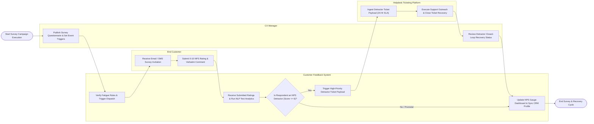

# Swimlane Diagram — Customer Feedback & Survey Management System

## Mermaid Code

## Flow Description | Mô tả luồng

| Lane | Actor | Role in Flow |
|------|-------|-------------|
| 1 | CX Manager | Publishes survey questionnaires, configures event trigger delays, monitors detractor recovery SLA compliance, and reviews NPS/CSAT executive trend dashboards. |
| 2 | Customer Feedback System | Evaluates survey fatigue rules, dispatches invitations, ingests customer ratings, executes NLP sentiment analytics, evaluates Detractor status (NPS 0-6), dispatches Helpdesk recovery payloads, and updates CRM contact profiles. |
| 3 | End Customer | Receives survey invitations via Email, SMS, or In-App widgets, submits 0-10 NPS or 1-5 CSAT ratings, and writes open-ended verbatim feedback comments. |
| 4 | Helpdesk Ticketing Platform | Receives automated high-priority detractor ticket payloads, assigns 24-hour closed-loop recovery SLAs to support managers, tracks agent outreach, and streams ticket closure webhooks back to the system. |
