# Action Tree — Customer Feedback & Survey Management System

## Mermaid Code

```mermaid
graph TD
    Root["Customer Feedback & Survey Management System"]

    Root --> M1["Survey Questionnaire & Widget Design"]
    Root --> M2["Omnichannel Dispatch & Fatigue Control"]
    Root --> M3["Closed-Loop Detractor Service Recovery"]
    Root --> M4["NLP Sentiment & Text Analytics"]
    Root --> M5["NPS & CSAT Metric Calculation"]
    Root --> M6["CRM Synchronization & Executive Reporting"]

    M1 --> A11["Build Multi-Channel Questionnaires (NPS, CSAT, CES)"]
    M1 --> A12["Configure Skip-Logic Branching & Question Piping"]
    M1 --> A13["Design Responsive Web & Mobile In-App Slide-Out Widgets"]
    M1 --> A14["Configure Multi-Language Survey Translations"]

    M2 --> A21["Trigger Automated Transactional Dispatches (Post-Support)"]
    M2 --> A22["Enforce Survey Fatigue Rules (Max 1 per 30 Days)"]
    M2 --> A23["Embed One-Click Rating Buttons in Email Dispatches"]
    M2 --> A24["Track Survey Open, Click & Completion Funnel Rates"]

    M3 --> A31["Identify NPS Detractors (0-6) & Low CSAT (<= 2)"]
    M3 --> A32["Auto-Generate High-Priority Detractor Helpdesk Tickets"]
    M3 --> A33["Escalate VIP Detractor 0-Ratings to Operations VP via SMS"]
    M3 --> A34["Monitor 24-Hour Closed-Loop Recovery Ticket SLA Compliance"]

    M4 --> A41["Execute Aspect-Based NLP Text Analytics on Verbatims"]
    M4 --> A42["Classify Sentiment Scores (Positive, Neutral, Negative)"]
    M4 --> A43["Tag Topic Categories (Usability, Pricing, Support, Delivery)"]
    M4 --> A44["Render Visual CX Sentiment Word Clouds & Topic Maps"]

    M5 --> A51["Calculate Net Promoter Score (% Promoters - % Detractors)"]
    M5 --> A52["Calculate Customer Satisfaction (CSAT) Average %"]
    M5 --> A53["Compute Customer Effort Score (CES) Rating Means"]
    M5 --> A54["Calculate Statistical Confidence Intervals & Margin of Error"]

    M6 --> A61["Sync Individual NPS/CSAT Ratings to CRM Profiles"]
    M6 --> A62["Benchmark Support Agent & Retail Location CSAT Scorecards"]
    M6 --> A63["Calculate Key NPS Operational Drivers & Regression Models"]
    M6 --> A64["Export Executive CX Trends & Churn Reduction Reports"]
```

## Module Description | Mô tả Module

| # | Module | Description | Actions |
|---|--------|-------------|---------|
| 1 | Survey Questionnaire & Widget Design | Designs NPS/CSAT/CES questionnaires, sets skip-logic branching, builds web widgets, and configures translations. | Build Multi-Channel Questionnaires, Configure Skip-Logic Branching, Design Web/In-App Widgets, Configure Multi-Language Translations. |
| 2 | Omnichannel Dispatch & Fatigue Control | Dispatches transactional surveys, enforces survey fatigue limits, embeds one-click email buttons, and tracks completion rates. | Trigger Transactional Dispatches, Enforce Survey Fatigue Rules, Embed One-Click Rating Buttons, Track Completion Rates. |
| 3 | Closed-Loop Detractor Service Recovery | Identifies NPS Detractors, generates helpdesk recovery tickets, escalates VIP 0-ratings, and tracks 24-hour SLA compliance. | Identify NPS Detractors, Auto-Generate Helpdesk Tickets, Escalate VIP Detractor Ratings, Monitor 24-Hour Recovery SLAs. |
| 4 | NLP Sentiment & Text Analytics | Performs aspect-based NLP text analytics on verbatim comments, classifies sentiment, tags topic categories, and renders word clouds. | Execute Aspect NLP Text Analytics, Classify Sentiment Scores, Tag Topic Categories, Render Sentiment Word Clouds. |
| 5 | NPS & CSAT Metric Calculation | Computes Net Promoter Score (NPS), Customer Satisfaction (CSAT %), Customer Effort Score (CES), and confidence intervals. | Calculate Net Promoter Score, Calculate CSAT Percentage, Compute Customer Effort Score, Calculate Confidence Intervals. |
| 6 | CRM Synchronization & Executive Reporting | Syncs ratings to CRM profiles, benchmarks support agent scorecards, calculates key NPS drivers, and exports executive CX reports. | Sync Ratings to CRM Profiles, Benchmark Agent CSAT Scorecards, Calculate Key NPS Drivers, Export Executive CX Reports. |
